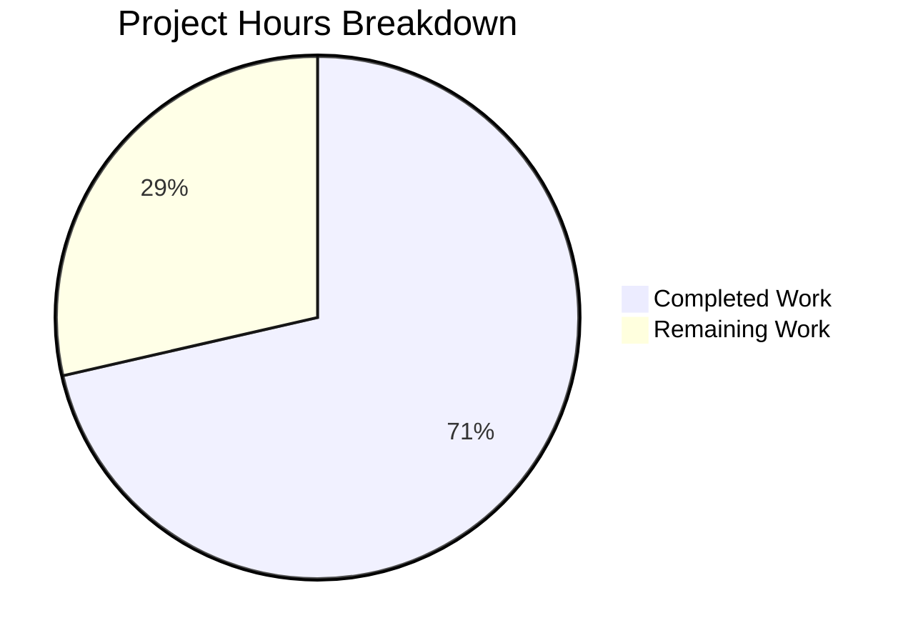

# 1. Executive Summary

## 1.1 Project Overview

`hello_world` is a single-file Node.js HTTP service. It used to answer every request with one fixed line; the objective was to add a second fixed response, `GET /good-evening`, without disturbing the existing one, and to make Express the project's first and only declared dependency and the dispatcher of both routes. Its users are internal: whoever needs a deterministic endpoint to prove that a deployment or integration path works. The value lies in the contract — status, header value and body length must be reproducible — and in a service that fails loudly rather than claiming a start it did not achieve.

## 1.2 Completion Status

**71% complete** — 5.0 of 7.0 hours delivered.



| Metric | Hours |
|---|---|
| Total Hours | 7.0 |
| Completed Hours (Baseline: Human with agentic-assist) | 5.0 |
| Remaining Hours | 2.0 |

5.0 ÷ 7.0 = 71%. Every hour counted traces to a requirement in the AAP or to a path-to-production need for the delivered service.

## 1.3 Key Accomplishments

- Two routes dispatched by path, each answering only its own (`server.js:8`, `server.js:14`).
- Exact response contract: `200`, `Content-Type: text/plain` with no charset, 14- and 13-byte bodies.
- Express 5.3.0 declared in the manifest and serving both routes.
- The original response preserved byte-for-byte.
- Bind and start-up output unchanged: `127.0.0.1:3000`, one 41-byte log line.
- A lost port fails loudly: exit 1, a stderr diagnostic, no false success line.
- Two files changed; lockfile and `README.md` byte-identical; no artefact added.

## 1.4 Critical Unresolved Issues

Three items are open against the 21 requirements and constraints this work was scoped to: two path-to-production decisions and one authorisation gap. None of the five product requirements is unmet.

| Issue | Impact | Owner | ETA |
|---|---|---|---|
| The start-up callback carries an error parameter and a re-throw outside the plan's quoted diff, so `server.js` is 23 lines where the plan states 22 | Needs owner sign-off or a plan amendment; the behaviour is correct and matches the pre-existing failure behaviour | Repository owner | 0.5h |
| The service binds `127.0.0.1:3000` only, hardcoded (`server.js:3-4`), so no container, service unit or forwarding rule can be configured without an authorised change | Blocks deployment to any target needing a different interface or port | Repository owner / platform | 1.0h |
| The committed lockfile records no dependency resolution, so `npm ci` fails and a fresh install floats within `^5.0.0` | Install is not reproducible from committed state until a policy or lockfile decision is taken | Repository owner | 0.5h |

## 1.5 Access Issues

No access issues identified. The service needs no credentials, external service, database or environment variable, and its dependency resolves from the public npm registry.

## 1.6 Recommended Next Steps

1. [High] Decide where the service runs; authorise a bind or port change if it is not `127.0.0.1:3000`.
2. [High] Settle the install policy: the `--no-package-lock` form, or a regenerated lockfile pinning express 5.3.0.
3. [Medium] Accept the failure-path guard and amend the plan's line arithmetic, or remove it.
4. [Low] Add a regression check for the two routes and the failed-bind branch when tests come into scope.

# 2. Project Hours Breakdown

## 2.1 Completed Work Detail

| Component | Hours | Description |
|---|---|---|
| Dependency declaration in the manifest (`package.json`) | 0.5 | `express ^5.0.0` under one new `dependencies` key; the seven existing keys keep their values and order; no `engines`, `scripts`, `main` or `license` change |
| Express migration and the two-route table (`server.js:1-18`) | 1.5 | `require('express')` replaces `require('http')`, one app instance owns the route table, the three `GET /` statements carry over unchanged, and `GET /good-evening` is added with the same three-statement idiom |
| Response-contract verification | 1.5 | Byte-exact checks of status, header value and body length on both routes, plus framework-default probes for unknown paths, unknown methods, `HEAD` and trailing slashes |
| Start-up bind-failure signalling (`server.js:20-23`) | 1.0 | The `app.listen` callback takes the error Express supplies and re-throws it, so a lost port remains fatal while the success line stays byte-identical; both branches exercised at runtime |
| Reference-integrity and file-surface verification | 0.5 | Lockfile and `README.md` hashes before and after every install and run, tracked-tree comparison, and source scans for forbidden surface (handlers, environment reads, extra logging, hardening) |
| **Total** | **5.0** | Equals the Completed Hours in Section 1.2 |

## 2.2 Remaining Work Detail

| Category | Hours | Priority |
|---|---|---|
| Authorise the delivered start-up guard, or amend the plan's stated diff extent and line count (AAP-scoped) | 0.5 | Medium |
| Decide the deployment binding and target platform, since the app hardcodes `127.0.0.1:3000` (path-to-production) | 1.0 | High |
| Settle the dependency-install policy for the environment that builds or starts the service (path-to-production) | 0.5 | High |
| **Total** | **2.0** | Equals the Remaining Hours in Section 1.2 and the "Remaining Work" value in Section 7 |

Section 2.1 (5.0) + Section 2.2 (2.0) = 7.0 total project hours.

## 2.3 Estimation Basis and Confidence

The estimates use a human-with-agentic-assist baseline on a two-file change. The delivered work is sized by what actually exists: one manifest edit with strict key discipline (0.5h), one entry-file rewrite that preserves an existing contract while adding a second route (1.5h), a response-contract verification that compares bytes rather than reading code (1.5h), one runtime-behaviour change proven on both its branches (1.0h), and reference-integrity checks (0.5h). The remaining items are decisions rather than construction: the two half-hour items are a sign-off and a policy choice, while the deployment item takes an hour because it starts with naming the target platform and ends with the bind arrangement that platform needs.

Confidence is **high** for the completed side: the code, the manifest and the observed behaviour are small enough to exhaust, and every figure is anchored to a file and line. Confidence is **medium** for the remaining side: the hours for the decisions are firm, but a target that needs TLS, a different port or a container base image would add implementation work outside this estimate.

# 3. Test Results

The repository ships no automated test suite: the manifest's `test` script is an inert stub (`echo "Error: no test specified" && exit 1`), and the release gate for this service is the byte-exact two-route check described in Section 9. The table records the checks that were executed against the delivered tree and what each proves. Total executed: 15 checks in 6 categories, 15 passed, 0 failed.

| Area / Category | Framework | Tests | Passed | Failed | Coverage | What This Proves |
|---|---|---|---|---|---|---|
| `GET /` and `GET /good-evening` response bodies | Byte-exact HTTP gate (`curl` plus `cmp` against the expected literals) | 2 | 2 | 0 | Not instrumented — no coverage tooling is configured | Both routes return exactly `Hello, World!\n` (14 bytes) and `Good evening\n` (13 bytes), single trailing line feed, no carriage return |
| `Content-Type` exactness on both routes | Same gate, captured response headers | 2 | 2 | 0 | Not instrumented | The header is written verbatim as `text/plain` with no charset parameter, which is what the `res.setHeader`/`res.end` idiom guarantees and `res.send` would not |
| Framework default handling of unmatched input | Same gate (`/nope`, `POST /`, `HEAD`, trailing slash) | 4 | 4 | 0 | Not instrumented | Unknown paths and methods fall to Express's own 404, `HEAD` is served by the same handlers, and no handler of the application's own intercepts them |
| Start-up announcement and failed-bind signalling | Shell harness with a proven port occupant (A/B on both branches) | 2 | 2 | 0 | Not instrumented | A successful start announces the bound address exactly once in 41 bytes with nothing on stderr; a lost port exits 1 with an `EADDRINUSE` diagnostic and no success line |
| Static syntax check | `node --check server.js` | 1 | 1 | 0 | Not applicable | The entry file parses as CommonJS on Node v22.23.5 |
| Browser delivery of both documents | Headless Chrome (4 navigations) | 4 | 4 | 0 | Not instrumented | Both routes render as `text/plain` documents with the exact text and lengths; an unknown path shows Express's default error page; a script payload in the query string neither renders nor executes |
| Declared test command | `npm test` | 0 | — | — | — | No automated suite exists; the stub exits 1 and adding a suite is outside this change's scope |

**Not Covered**

- **Automated regression.** No test file, runner or configuration exists, so none of the checks above re-runs when the code changes; a future edit to either handler is caught only by the next manual gate.
- **Coverage measurement.** No coverage tooling is configured, so no line or branch percentage can be reported; the figures above are counts of executed checks, not coverage.
- **Load, concurrency and soak behaviour.** This verification issued single, sequential requests; sustained concurrency, descriptor stability over long runs and behaviour under a slow client were not exercised.
- **Supervised operation.** The process was started and stopped directly, so no service manager, container runtime or supervisor was exercised — including how such a supervisor reacts to the exit-1 signal on a lost port.
- **Clean-environment installation.** Dependencies were installed from the public registry in a directory containing only the repository files, but installation behind a proxy, an offline mirror or a private registry was not exercised.
- **Dependency advisories.** No security advisory or version-drift assessment was performed; the manifest declares a caret range and the lockfile records no resolution.

What a human should exercise before release: the target supervisor's handling of the failed-bind exit, an install in the environment that will actually build the service, and a check that the deployment binding reaches both routes from outside the process.

# 4. Runtime Validation & UI Verification

Runtime checks were driven against a running instance started from the committed entry file, with only the port literal changed so the host's port 3000 stayed free for other work.

- ✅ **Start-up** — the process logged exactly one 41-byte line announcing the address it bound, and wrote nothing to stderr.
- ✅ **`GET /`** — `200`, `Content-Type: text/plain` with no charset parameter, 14 bytes `Hello, World!\n`.
- ✅ **`GET /good-evening`** — `200`, `Content-Type: text/plain` with no charset parameter, 13 bytes `Good evening\n`.
- ✅ **Response header set** — the only difference from the pre-Express server is `X-Powered-By: Express`; status, header value and body bytes are unchanged.
- ✅ **Failed bind** — with the port provably held by another listener, the process exited 1 with an `EADDRINUSE` diagnostic on stderr, printed no success line, and left the occupant answering.
- ✅ **Unmatched and malformed input** — unknown path `404`, `POST` `404`, `HEAD` `200` with an empty body, trailing slash resolves to the route, malformed request `400`; all served by the framework's defaults with nothing on stderr.
- ✅ **Browser delivery** — both routes loaded in a headless browser render as `text/plain` documents with the exact text and byte lengths; an unknown path shows Express's default error page; a `<script>` payload in the query string neither appears in the document nor executes, and no dialog opens.
- ✅ **Shutdown and port release** — stopping the process frees the listener; a probe afterwards is refused.
- ⚠ **Deployment topology** — not exercised: the source binds `127.0.0.1:3000` and cannot be pointed at another interface or port without a code change, so no container, service unit or forwarding rule was validated.
- ⚠ **Sustained load** — not exercised: only sequential requests were issued, so concurrency, descriptor stability and behaviour against a slow client remain unverified.

No flow failed. There is no user interface to verify: the service renders no HTML, ships no CSS, script, image or static asset, and its entire user-visible surface is the two plain-text bodies above — which is why browser verification is expressed as document delivery rather than as a screen-by-screen walkthrough. Nothing was exercised under a service manager or supervisor, no external integration exists to exercise, and no authenticated surface exists to drive.

# 5. Compliance & Quality Review

## 5.1 Compliance Matrix

| # | Deliverable | Requirement | Verified Status | Progress |
|---|---|---|---|---|
| 1 | `GET /good-evening` route | Status `200`, body exactly `Good evening\n` (13 bytes) | Met — `server.js:14-18`; observed on the wire and in the browser | ✅ Pass |
| 2 | Response `Content-Type` | Exactly `text/plain`, no charset parameter, on both routes | Met — two `res.setHeader` calls; header line captured verbatim, zero charset hits | ✅ Pass |
| 3 | Preserved `GET /` route | Status `200`, `text/plain`, `Hello, World!\n` (14 bytes), byte-identical to before | Met — the three statements at `server.js:9-11` are the original block, unchanged | ✅ Pass |
| 4 | Express as sole dependency and mechanism | Declared in the manifest and actually serving both routes | Met — `package.json:11-13`; `server.js:1,6,8,14,20`; 5.3.0 resolvable; framework output proves it is in the request path | ✅ Pass |
| 5 | File surface | `server.js` and `package.json` only | Met — two modified paths against the base, tracked tree still six files | ✅ Pass |
| 6 | Path-based dispatch | Two literal routes; no catch-all; no cross-contamination | Met — observed `404` for unknown paths and no route answering another's path | ✅ Pass |
| 7 | Response idiom | `statusCode` → `setHeader` → `end(literal)`, duplicated rather than extracted | Met — both handlers carry the same three statements; no helper, no `res.send`/`res.type` | ✅ Pass |
| 8 | Bind and start-up output | `127.0.0.1:3000` and the existing log line, unchanged | Met — constants untouched; 41-byte line byte-identical to the original statement | ✅ Pass |
| 9 | Manifest field discipline | One `dependencies` key; every other key untouched | Met — eight keys, `dependencies` last; no `engines`, `scripts`, `main` or `license` change | ✅ Pass |
| 10 | Reference integrity | `package-lock.json` and `README.md` byte-identical | Met — both hashes unchanged across every install and run | ✅ Pass |
| 11 | Forbidden additions absent | No 404 or error handler, no environment configuration, no extra logging, no hardening, no input validation | Met — zero `app.use`, zero `process.env`, exactly one log call, framework defaults only | ✅ Pass |
| 12 | Plan diff extent and line count | `server.js` to 22 lines with the quoted diff as the complete authorised change | Not met as written — the file is 23 lines with a two-line failure-path guard (`server.js:20-21`) | ⚠ Needs owner decision |

## 5.2 AAP & Rule Divergences and Gaps

| # | What the AAP/Rule Required | What Was Delivered Instead | Why It Diverged | Impact | Remediation |
|---|---|---|---|---|---|
| D1 | The plan states `server.js` moves from 14 to 22 lines (3 removed, 11 added) and that its quoted diff is "the complete extent of the code this plan authorises" | `server.js` is 23 lines: the `app.listen` callback takes `(err)` and adds `if (err) throw err;` (`server.js:20-21`), two insertions and one deletion beyond the quoted diff | Express 5 registers that callback as the server's only `'error'` listener, so the plan's illustrative callback converts a lost port into a reported success. The same plan requires the start-up behaviour — including its failed-bind outcome — to be preserved, and every alternative settlement breaks another requirement: no guard loses that behaviour, an error handler or extra log breaches the forbidden-additions list | One statement in a file already in scope; no response contract, file surface or manifest key changes. The plan's line arithmetic no longer describes the file | Owner accepts the guard as delivered and the plan's line count is corrected, or the guard is removed and the false-success risk returns (0.5h) |
| D2 | The change's specification described `package.json` as ending with a single trailing newline | The file ends at `}` with no final newline — 14 logical lines carried on 13 newlines — which is the byte form of the pre-existing file | The smallest-diff rule makes the source's existing byte form authoritative: adding a newline would alter a line the change does not need to touch and enlarge the diff beyond the dependency addition | Cosmetic only; file content and every consumer parse identically. A future formatter will raise a spurious newline diff | None required. Normalise the ending if and when a formatter is adopted |

The only divergence that needs the owner's decision is D1. What makes it a divergence rather than a defect is that the plan's own preserved-behaviour requirement is satisfied only by the statement the plan's diff omits. The evidence is directly observable: with the port held by another listener, the delivered process exits 1, prints nothing on stdout and writes an `EADDRINUSE` diagnostic to stderr, while the callback exactly as quoted in the plan would print the 41-byte success line, write nothing to stderr and exit 0 — a healthy-looking signal from an instance serving nothing, which any supervisor or deploy smoke-check reading the process's own output would trust. Accepting it costs one line of authorisation and leaves `server.js:20-23` as the only place the start-up path is expressed; removing it restores the plan's arithmetic and reinstates that false signal. Recommendation: accept, and amend the plan's stated line count.

# 6. Risk Assessment

Risks below are forward-looking: what can still go wrong when this service is deployed or changed, not what was encountered while building it.

| Risk | Category | Severity | Probability | Mitigation | Status |
|---|---|---|---|---|---|
| The bind address and port are hardcoded to `127.0.0.1:3000`, so the service cannot be placed behind a container port map, a service unit with another port, or a different interface without a code change the current scope forbids | Integration | High | High — any non-local target needs it | Decide the deployment topology and either authorise a bind/port change or front the process with a local reverse proxy | Open |
| Dependencies are not pinned by the committed lockfile: it records no resolution, `npm ci` fails with `EUSAGE`, and a fresh install floats within `^5.0.0` | Technical | Medium | High on the first CI build or new environment | Regenerate and pin the lockfile at express 5.3.0, or standardise the `--no-package-lock` install form in the build definition | Open |
| No automated regression suite protects the contract: the manifest's `test` script exits 1, so a future edit to either handler can change status, header or body bytes undetected | Technical | Medium | High over the life of the project | Add checks asserting both route contracts and the failed-bind branch once test artefacts come into scope | Open |
| The two routes are unauthenticated by design; if the bind is ever widened beyond loopback they become reachable from the network with no access control | Security | High if triggered | Low today, rising with any topology change | Keep the loopback bind; treat widening it as a security review trigger rather than a configuration tweak | Watch |
| The failed-bind signal depends on Express 5 semantics: `app.listen` registers the trailing callback as the server's only `'error'` listener, and a future major upgrade could change that and silently reintroduce a false success | Technical | Low | Low | Re-run the two-branch start-up check whenever express's major version changes | Open |
| No liveness or readiness endpoint exists and there is a single start-up log line, so a platform probe has nothing purpose-built to poll and diagnosis rests on one message | Operational | Medium | Medium | Probe `GET /` and assert `200` with a 14-byte body; alert on process exit rather than on log content | Open |
| The framework identifies itself (`X-Powered-By: Express`) and its default `404`/`400` pages echo the requested path, HTML-escaped, with `default-src 'none'` and `nosniff` | Security | Low | High — it is default behaviour on every miss | Bounded by the loopback bind and the absence of data, identity or session; removing it needs hardening the scope excludes | Accepted |
| One process, no supervision and no graceful-shutdown handling: the service dies on `SIGTERM` without draining connections and nothing restarts it | Operational | Low | Medium | Run it under a supervisor with a restart policy; add draining only if in-flight requests ever matter | Open |

The two risks that gate release are the first two: neither is a code defect, and both are settled by a decision rather than by development work. The riskiest change anyone can make to this service is widening its bind, because that simultaneously removes the network control that makes the absent authentication acceptable.

# 7. Visual Project Status


Completed work (5.0 hours, dark blue) against remaining work (2.0 hours, white) — **71% complete**.

| Status | Hours | Share |
|---|---|---|
| Completed — the two-route contract, the Express migration, its verification, the failed-bind signal and the reference-integrity checks | 5.0 | 71% |
| Remaining — one plan-authorisation item and two release decisions | 2.0 | 29% |
| **Total** | **7.0** | **100%** |

| Remaining Work by Category | Hours | Priority |
|---|---|---|
| Plan authorisation for the delivered start-up guard (AAP-scoped) | 0.5 | Medium |
| Deployment binding and target platform decision (path-to-production) | 1.0 | High |
| Dependency-install policy decision (path-to-production) | 0.5 | High |

| Remaining Work by Priority | Hours |
|---|---|
| High | 1.5 |
| Medium | 0.5 |
| Low | 0 |

# 8. Summary & Recommendations

The delivered change does what it was asked to do. The service now dispatches on path instead of answering every request with one line: `GET /` returns the original 14-byte greeting unchanged and `GET /good-evening` returns a 13-byte reply, both with `Content-Type: text/plain` and no charset parameter, both served by Express — the project's first declared dependency — from one app instance bound to `127.0.0.1:3000` with its original start-up line. That contract was exercised on the wire and in a browser, and the original response was compared byte-for-byte against the pre-change implementation rather than merely read.

The work rates **71% complete** on an AAP-scoped basis: 5.0 of 7.0 hours delivered. The remaining 2.0 hours are not construction. One item authorises a statement the delivered start-up path carries beyond the plan's quoted diff — a re-throw that keeps a lost port from being reported as a healthy start — and two are release decisions the code cannot make for itself: where the service will bind, and how its dependency will be installed reproducibly given a lockfile that records no resolution.

| Measure | Value |
|---|---|
| Total project hours | 7.0 |
| Completed | 5.0 |
| Remaining | 2.0 |
| Completion | 71% |
| Product requirements met | 5 of 5 |
| Route contracts verified byte-exactly | 2 of 2 |
| Files changed | 2 (`server.js`, `package.json`) |
| Reference files altered | 0 |

The critical path to production is three decisions deep and contains no code work: name the target platform and settle the binding, settle the install form, and record the authorisation for the start-up guard. Two of the three are half-hour items; the platform decision takes an hour because the binding follows from it. Everything after that is configuration the target platform owns. The realistic failure mode for this service is not a broken route — it is deploying it somewhere it cannot bind, or building it where `npm ci` is assumed to work.

Production readiness is therefore **conditionally ready**: the application is correct, minimal and quiet, with no data, no identity and no credential to manage, and its only network exposure is a loopback bind. What it lacks is everything a platform expects around a process — a health surface, a reproducible install, supervision and a deployable binding — none of which the current scope permits adding. Treat it as a service that is finished as a library-grade endpoint and three decisions away from deployable.

# 9. Development Guide

## 9.1 System Prerequisites

| Requirement | Detail |
|---|---|
| Node.js | 18 or newer (the floor express 5 declares). Verified on **v22.23.5** |
| npm | Verified on **11.21.0** |
| Operating system | Any platform Node supports; Linux was used for verification |
| Services, database, credentials | None — no environment variable, secret, broker or store is read |
| Build toolchain | None — there is no bundler, transpiler or compile step |

The whole application is one file. The repository root holds `server.js` (the service), `package.json` (the manifest, one dependency), `package-lock.json` (reference only — it must stay unchanged) and `README.md` (read-only).

## 9.2 Dependency Installation

From the repository root:

```bash
npm install --no-package-lock --offline --no-audit --no-fund
# expected: "added 65 packages in ~0.5s" and an exit code of 0
node -e "console.log(require('express/package.json').version)"
# expected: 5.3.0
```

`--offline` succeeds when the npm cache already holds express and its tree; drop that flag if npm reports a cache miss. Do **not** use `npm ci` or a plain `npm install`:

```bash
npm ci
# npm error code EUSAGE
# npm error `npm ci` can only install packages when your package.json and package-lock.json or npm-shrinkwrap.json are in sync.
# npm error Missing: express@5.3.0 from lock file
```

The committed lockfile records only the root project, so `npm ci` cannot resolve the dependency, and a plain `npm install` rewrites a file that must stay byte-identical (`--no-package-lock` is what keeps the diff to the two changed files). Never commit `node_modules/`; the repository has no `.gitignore`, so stage files explicitly.

## 9.3 Starting and Stopping the Application

```bash
node server.js
# expected on stdout, one line: Server running at http://127.0.0.1:3000/
```

The process binds `127.0.0.1:3000` — fixed in the source, not configurable — and prints nothing on stderr. `npm start` behaves identically through npm's default start script; `node .` does not work, because the manifest's `main` names `index.js`, which does not exist.

Stop it with `Ctrl-C` in the foreground, or send `SIGTERM` to the process id you started (`kill <pid>`). Confirm the port is free before starting again:

```bash
curl -s -m 2 -o /dev/null -w '%{http_code}\n' http://127.0.0.1:3000/ || echo "port free"
# 000 with "port free", or a connection refusal, means nothing is listening
```

## 9.4 Verification Steps

```bash
# 1. syntax
node --check server.js ; echo "exit=$?"          # exit=0

# 2. both routes: status, content type, byte length
curl -s -D h1 -o b1 -w '%{http_code} %{content_type} %{size_download}\n' http://127.0.0.1:3000/
curl -s -D h2 -o b2 -w '%{http_code} %{content_type} %{size_download}\n' http://127.0.0.1:3000/good-evening
# /            -> 200 text/plain 14
# /good-evening -> 200 text/plain 13

# 3. exact header value, with no charset parameter
grep -i 'content-type' h1 h2                  # Content-Type: text/plain on both
grep -ci charset h1 h2                        # 0 and 0

# 4. exact body bytes
printf 'Hello, World!\n' | cmp - b1 ; echo "root cmp=$?"        # 0
printf 'Good evening\n'  | cmp - b2 ; echo "evening cmp=$?"     # 0
od -c b1            # H e l l o ,   W o r l d ! \n   — one trailing LF, no CR

# 5. framework defaults for anything unmatched
curl -s -o /dev/null -w 'unknown=%{http_code}\n' http://127.0.0.1:3000/nope            # 404
curl -s -o /dev/null -w 'post=%{http_code}\n' -X POST http://127.0.0.1:3000/           # 404
curl -s -o /dev/null -w 'head=%{http_code}\n' -I http://127.0.0.1:3000/good-evening    # 200
```

To prove the failed-bind signal, hold the port from a second shell and start the service again:

```bash
node -e "require('http').createServer((q,s)=>s.end('occupant\n')).listen(3000,'127.0.0.1')" &
node server.js > fail.out 2> fail.err ; echo "rc=$?"
# rc=1 ; fail.out is 0 bytes ; fail.err carries:
# Error: listen EADDRINUSE: address already in use 127.0.0.1:3000
```

## 9.5 Example Usage

```bash
$ curl -i http://127.0.0.1:3000/good-evening
HTTP/1.1 200 OK
X-Powered-By: Express
Content-Type: text/plain
Content-Length: 13

Good evening

$ curl -i http://127.0.0.1:3000/
HTTP/1.1 200 OK
X-Powered-By: Express
Content-Type: text/plain
Content-Length: 14

Hello, World!
```

Query strings and request bodies change nothing: the handlers never read the request, so `GET /good-evening?x=1` still returns the same 13 bytes. Unknown paths, and any method other than `GET` or `HEAD`, get Express's default `404` page.

## 9.6 Troubleshooting

| Symptom | Cause | Resolution |
|---|---|---|
| `Error: listen EADDRINUSE: address already in use 127.0.0.1:3000` and exit code 1 | Another process holds the port, or an earlier instance is still running | Stop the other instance, or change the `port` literal at `server.js:4` for local work |
| `Error: Cannot find module 'express'` | Dependencies are not installed in this checkout | Run the install command in 9.2 |
| `npm ci` fails with `EUSAGE` / `Missing: express@5.3.0 from lock file` | The committed lockfile records no resolution by design | Use the `--no-package-lock` install form; do not regenerate the lockfile without an owner decision |
| `node .` exits with `Cannot find module …/index.js` | `main` in `package.json` names a file that does not exist and must stay that way | Start with `node server.js` or `npm start` |
| A request returns the old greeting for every path | A stale pre-Express instance is still listening | Stop it and restart from the current source |
| `EACCES` on bind, or the service is unreachable from another host | The service binds loopback only | Front it with a proxy on the same host, or authorise a bind change — it is not configurable at runtime |

No linter, formatter, type checker or test runner exists in the repository, so `node --check` plus the byte-exact route checks above are the complete gate available for a change.

# 10. Appendices

## Appendix A — Command Reference

| Purpose | Command |
|---|---|
| Install dependencies (the only supported form) | `npm install --no-package-lock --offline --no-audit --no-fund` |
| Confirm the dependency resolved | `node -e "console.log(require('express/package.json').version)"` |
| Syntax check | `node --check server.js` |
| Start the service | `node server.js` (or `npm start`) |
| Stop the service | `Ctrl-C`, or `kill <pid>` for the process you started |
| Check the port is free | `curl -s -m 2 -o /dev/null -w '%{http_code}\n' http://127.0.0.1:3000/ \|\| echo "port free"` |
| Contract check, both routes | `curl -s -D h -o b -w '%{http_code} %{content_type} %{size_download}\n' http://127.0.0.1:3000/<path>` |
| Byte comparison | `printf 'Good evening\n' \| cmp - b` (exit 0 means identical) |
| Header inspection | `grep -i 'content-type' h` and `grep -ci charset h` (expect `0`) |
| Declared test command | `npm test` — the manifest stub; prints `Error: no test specified` and exits 1 |

## Appendix B — Port Reference

| Port | Protocol | Bound by | Notes |
|---|---|---|---|
| 3000 | HTTP | `server.js:4` (`const port = 3000;`) | Hardcoded. Loopback only — `server.js:3` fixes the host to `127.0.0.1`. No TLS, no secondary listener |

The service opens exactly one listening socket. There is no health, metrics or admin port.

## Appendix C — Key File Locations

| Path | Role |
|---|---|
| `server.js` | The entire application: one Express app, the two route handlers (lines 8-12 and 14-18), the failure-aware `app.listen` callback (lines 20-23) and the single start-up log call (line 22) |
| `package.json` | Manifest: eight keys, with `dependencies.express` at lines 11-13; `main` still names `index.js`, which does not exist; `scripts.test` is an inert stub |
| `package-lock.json` | Reference only — lockfile version 3, root project record only, no dependency entries; must stay byte-identical |
| `README.md` | Project attachment, read-only by its own text |

## Appendix D — Technology Versions

| Component | Version | Source of truth |
|---|---|---|
| Node.js | v22.23.5 (18+ required by express) | The runtime used for every verification run |
| npm | 11.21.0 | The client that produced the install output quoted in Section 9.2 |
| express | 5.3.0 | Resolved from `^5.0.0` declared in `package.json:12` |
| Lockfile format | `lockfileVersion: 3` | `package-lock.json` |
| Module system | CommonJS (`require`) | No `"type": "module"` in the manifest |

## Appendix E — Environment Variable Reference

None. `server.js` reads no `process.env` key, there is no `.env` file and no configuration is loaded at runtime: the host and port are literals at `server.js:3-4`. Setting `PORT` or `NODE_ENV` has no effect on the bind — `PORT=4000 node server.js` still listens on `127.0.0.1:3000`. Any future configuration surface would require a source change, which the current scope excludes.

## Appendix F — Developer Tools Guide

| Concern | Tooling present | What to use instead |
|---|---|---|
| Build | None — no bundler, transpiler or compile step | Nothing to run; the source is executed directly |
| Lint / format | None — no eslint, prettier or editorconfig | Keep the file's existing 2-space JavaScript and 4-space JSON style by hand |
| Tests | None — `scripts.test` is the stub that exits 1 | The byte-exact route checks in Section 9.4 |
| Type checking | None — plain JavaScript | `node --check` for syntax |
| CI / containers | None — no pipeline, Dockerfile or deployment descriptor | Author the definition against the install form in Section 9.2 |
| Debugging | Node's built-in inspector | `node --inspect server.js`; express's own debug channel via `DEBUG=express:*`, which is framework output, not application logging |

## Appendix G — Glossary

| Term | Meaning |
|---|---|
| Byte-exact gate | A check that compares a response's status, header value and body bytes against expected values rather than reading the source |
| Catch-all | A single handler that answers every path with the same body — the behaviour this change removed |
| `EADDRINUSE` | The operating-system error raised when a process tries to bind a port that another process already holds |
| Failed-bind signal | What the process emits when it cannot bind: a non-zero exit and a diagnostic on stderr, with no success line |
| Loopback bind | Listening only on `127.0.0.1`, so the socket is reachable from the same host and not from the network |
| `X-Powered-By` | A response header Express adds by default, identifying the framework |
| Inert stub | A manifest script that performs no work, here `echo "Error: no test specified" && exit 1` |
