# Technical Specification

# 1. Introduction

## 1.1 Executive Summary


`hao-backprop-test` is a deliberately minimal Node.js program, described by its own README as a "test project for backprop integration. Do not touch!" (`README.md` lines 1-2). The repository holds five functional artifacts at its root and nothing else: a 15-line HTTP server (`server.js`), an npm manifest (`package.json`), a lockfile (`package-lock.json`), the README, and two empty ignore-list fixtures (`.blitzyignore.txt`, `test.blitzyignore.txt`). There is no source tree, no build step, no test suite, no CI configuration and no documentation beyond the two README lines (`git ls-files`, `find`).

**Brief overview.** The system starts a single HTTP listener on `127.0.0.1:3000` and answers every inbound request with a fixed 14-byte plain-text body. It uses only the Node.js standard-library `http` module, declares zero dependencies, and requires no configuration.

| Attribute | Value | Evidence |
|---|---|---|
| Project identity | `hao-backprop-test` | `README.md` line 1 |
| Package identity | `hello_world` @ `1.0.0`, "Hello world in Node.js" | `package.json` lines 2-4 |
| Runtime entry point | `node server.js` (declared `main` of `index.js` is absent) | `server.js`; `package.json` line 5 |
| License / author | MIT; packaged by `hxu`, committed by `Sandeep01Kumar` | `package.json` lines 9-10; `git log -1` |

**Core business problem.** The repository ships no requirements document, so its purpose is stated only by the README: to serve as a test fixture for *backprop integration*. The term "backprop" is not expanded anywhere in the repository, so the specific integration behaviour it exercises cannot be established from the code. What the code does establish is the shape of the problem it was built to serve: integration tooling needs a small, self-contained, reproducible Node.js project whose behaviour is trivially predictable, so that any observed deviation is attributable to the tooling under test rather than to application complexity. The README's instruction "Do not touch!" reinforces this — the project's value lies in remaining an unchanged reference input, not in gaining features.

**Key stakeholders and users.** The repository's artifact set, commit metadata and branch naming identify its audience more precisely than its code does.

| Stakeholder | Interest in this repository | Evidence |
|---|---|---|
| QA / environment validation engineers | Exercise tooling against a real but trivial Node.js project; the checked-out branch is `QA-Linux-env-20-nov` | current branch in `git branch -a` |
| Backprop integration developers | Run their integration end to end against a stable fixture | `README.md` line 2 |
| Repository maintainer `hxu` | Owns the npm package metadata | `package.json` line 9 |
| Committer `Sandeep01Kumar` | Sole author of the single upload commit `28e5918` | `git log -1` |

No end-user population is served by this system: the server binds loopback only, has no accounts, sessions or tenant model, and returns identical output to every caller.

**Business impact and value proposition.** The value is test-harness economics rather than product revenue:

- **Zero supply-chain surface.** `package-lock.json` declares `lockfileVersion: 3` with a single root package entry and no dependency records, so a test run cannot be perturbed by a dependency change or a network fetch.
- **Deterministic, comparable output.** Every request returns `HTTP/1.1 200 OK`, `Content-Type: text/plain`, `Content-Length: 14`, body `Hello, World!` — a stable oracle for assertions.
- **Single-file, single-commit baseline.** One file of executable logic over a one-commit history (`28e5918 "Add files via upload"`) makes diffs and regressions unambiguous.
- **Low operational cost.** No build, no install, no database, no credentials, no external calls; the process is a foreground `node` invocation that logs one line on start.


## 1.2 System Overview


### 1.2.1 Project Context

**Business context and market positioning.** `hao-backprop-test` is an internal engineering fixture, not a commercial offering. It is not versioned for distribution (no `private`, `files`, `bin` or `repository` fields in `package.json`), publishes to no registry, and exposes no user-facing interface beyond a plain-text HTTP response. Its positioning is therefore internal tooling: a fixed, greenfield sample against which continuous-integration and "backprop integration" workflows are exercised. The branch present in the checkout, `QA-Linux-env-20-nov` (alongside `main` and `origin/main`), shows the fixture is consumed per-validation rather than released.

**Current system limitations.** No predecessor system is referenced anywhere in the repository, so this section reports the limitations of the system as it exists — each one observable in the code:

| Limitation | Detail | Evidence |
|---|---|---|
| No routing or method handling | Every path (`/`, `/missing/path?x=1`) and every method (GET, POST) returns the same 200 response; no 404, no 405 | `server.js` lines 6-10; verified by HTTP probe |
| Broken declared entry point | `main` is `index.js`, a file that does not exist; the project only runs via `node server.js` | `package.json` line 5; root listing |
| No test suite | The `test` script is npm's placeholder that always exits 1 | `package.json` line 7; `npm test` exits 1 |
| Fixed network binding | Host `127.0.0.1` and port `3000` are hard-coded constants with no environment override | `server.js` lines 3-4, 12 |
| No observability | One startup `console.log`; no request logging, metrics, health endpoint or error handling | `server.js` lines 6-14 |
| No persistence or configuration | No data store, no config loader, no secrets usage | entire `server.js` |

**Integration with the existing enterprise landscape.** The system integrates with nothing. It makes no outbound calls, reads no environment variables, mounts no filesystem paths, and consults no configuration store; its only external interaction is accepting TCP connections on the loopback interface. Because it binds `127.0.0.1` rather than a routable interface, it is unreachable from outside the host by design, which keeps the fixture isolated from surrounding infrastructure. Its single integration contract is the HTTP response it returns.

### 1.2.2 High-Level Description

**Primary system capabilities.** The system implements exactly two capabilities: (1) serve an HTTP request with a fixed success response, and (2) announce its listening address on standard output at start-up.

**Major system components.** The architecture is a single process with no internal layers or modules.

| Component | Path | Responsibility |
|---|---|---|
| Application entry / HTTP server | `server.js` | Requires `http`, constructs the server, binds the listener, logs the address |
| Request handler (inline closure) | `server.js` lines 6-10 | Fixes status 200, sets `Content-Type: text/plain`, sends `Hello, World!\n` |
| Package & tooling manifest | `package.json` | Identity, version, license, placeholder `test` script, declared (missing) `main` |
| Lockfile | `package-lock.json` | Records an empty dependency graph (`lockfileVersion: 3`) |
| Ignore-list fixtures | `.blitzyignore.txt`, `test.blitzyignore.txt` | Zero-byte QA fixtures that exclude nothing |

**Core technical approach.** A CommonJS script using the Node.js standard-library `http` module (`server.js` line 1). Two module-scoped constants define the binding (`hostname = '127.0.0.1'`, `port = 3000`, lines 3-4). `http.createServer` is given one anonymous arrow handler that ignores the request object entirely, so response generation is a constant-time sequence of `statusCode`, `setHeader` and `end`. `server.listen(port, hostname, callback)` starts a long-lived listener and prints `Server running at http://127.0.0.1:3000/` from its callback (lines 12-14). The file exports nothing, defines no classes or named functions, and has no middleware, framework or dependency injection.

```mermaid
flowchart TD
    Boot[Process start: node server.js] --> Stdlib[require 'http' - server.js line 1]
    Stdlib --> Constants[hostname 127.0.0.1, port 3000 - lines 3-4]
    Constants --> Listen[server.listen - lines 12-14]
    Listen --> LogLine[Console log: Server running at http://127.0.0.1:3000/]
    Listen --> Await[Await inbound loopback connection]
    Await --> Handler[Inline handler ignores request - lines 6-10]
    Handler --> Status[res.statusCode = 200]
    Status --> Header[Content-Type: text/plain]
    Header --> Body[res.end Hello, World! - 14 bytes]
    Body --> Await
```

### 1.2.3 Success Criteria

The repository states no objectives, acceptance criteria, service levels or KPIs in any file; `package.json`, `README.md` and `server.js` contain no reference to targets, thresholds or measurement. The criteria below are therefore not policy — they are the verifiable behaviours the code and manifest actually establish, which is the only defensible basis for judging a successful run of this fixture.

**Measurable objectives.**

| Objective | Measurable form | Evidence |
|---|---|---|
| Serve a fixed success response | `200 OK`, `Content-Type: text/plain`, `Content-Length: 14`, body `Hello, World!` for any request | `server.js` lines 6-10; verified by HTTP probe of GET `/`, GET `/missing/path?x=1`, POST `/` |
| Announce readiness | Exactly one start-up line, `Server running at http://127.0.0.1:3000/` | `server.js` lines 12-14; observed stdout |
| Install with no packages | No dependency entries in the lockfile; no `node_modules` needed | `package-lock.json` lines 6-12 |
| Run on the standard Node.js runtime | Verified on Node.js v22.23.4 with npm 11.21.0, no flags or transpilation | `node --version`, executed `server.js` |

**Critical success factors.** (1) `server.js` remains unmodified, as the README's "Do not touch!" instructs; (2) TCP port 3000 is free on the host and no second instance is started, since the port is hard-coded with no override; (3) the harness targets `127.0.0.1` rather than an external address, because the listener is loopback-bound; (4) the fixture is invoked with `node server.js`, because the manifest's `main` points at an absent `index.js`.

**Key performance indicators.** No KPI is defined by the project, and it publishes no metrics. The only externally observable signals available for measurement are the three artefacts of a run: the startup log line, the HTTP status and headers, and the byte-for-byte response body. `npm test` cannot serve as an acceptance gate: the script is npm's placeholder (`echo "Error: no test specified" && exit 1`, `package.json` line 7) and was observed to exit 1, so any harness must assert against HTTP behaviour directly.


## 1.3 Scope


### 1.3.1 In-Scope

**Core features and functionalities.** The scope of this system is precisely the behaviour of one file. The table below lists every capability the repository actually implements.

| Capability | Behaviour | Evidence |
|---|---|---|
| Start an HTTP listener | Binds `127.0.0.1:3000` via `server.listen` | `server.js` lines 3-4, 12-14 |
| Serve a fixed response | Status 200, `Content-Type: text/plain`, body `Hello, World!\n` | `server.js` lines 6-10 |
| Report readiness | Startup log `Server running at http://127.0.0.1:3000/` | `server.js` line 13; observed stdout |
| Run dependency-free | Standard-library `http` only; empty lockfile graph | `server.js` line 1; `package-lock.json` |

No other capability exists: there is no route table, no request parsing, no response variation, no persistence and no authentication to enumerate.

**Primary user workflows.** There is exactly one workflow, and it is an operator's rather than an end user's: run `node server.js`, observe the readiness line, issue an HTTP request to `http://127.0.0.1:3000/`, compare the response to the expected constant, and terminate the process. Every request in that workflow — regardless of method, path or payload — produces the same result, which was confirmed by probing GET `/`, GET `/missing/path?x=1` and POST `/`.

**Essential integrations.** The system's only integration point is inbound HTTP over the loopback interface. There are no outbound integrations, no message brokers, no databases, no identity providers, no third-party APIs, and no inbound reachability from other hosts.

**Key technical requirements.**

| Requirement | Detail | Evidence |
|---|---|---|
| Runtime | Node.js with CommonJS support; verified on v22.23.4 / npm 11.21.0 | `server.js`; `node --version` |
| Network | Loopback interface available; TCP port 3000 free on the host | `server.js` lines 3-4, 12 |
| Invocation | `node server.js` (no `start` script exists; `main` targets a missing `index.js`) | `package.json` lines 5-8 |

**Implementation boundaries.**

- **System boundary.** A single OS process running one file. Everything outside that process — clients, harness tooling, the operating system's networking stack — is external. The repository's non-executable files (`README.md`, the two zero-byte ignore fixtures) contribute no runtime behaviour.
- **User groups covered.** No end-user groups. The covered audience is engineering: maintainers of the fixture, QA/environment-validation engineers working the `QA-Linux-env-20-nov` branch, and the integration tooling under test.
- **Geographic / market coverage.** Not applicable. The listener is bound to `127.0.0.1`, so coverage is a single host with no regional, jurisdictional or localisation dimension; the response body is the fixed ASCII string `Hello, World!` with no locale handling.
- **Data domains included.** Only the protocol metadata of one request/response exchange (`statusCode`, `Content-Type`, the 14-byte body). No user data, no business entities, no persistence, no filesystem access, no credentials or secrets are read or stored.

### 1.3.2 Out-of-Scope

The repository contains no backlog, roadmap, issue export or design document, so exclusions below are derived from the absence of the corresponding code rather than from a declared plan. Where the prompt asks for future-phase considerations, the honest answer is that none are recorded.

**Explicitly excluded features and capabilities.**

| Excluded capability | Why it is out of scope |
|---|---|
| Routing, path handling, 404/405 responses | The handler ignores the request object entirely; every path returns 200 |
| Request parsing (query strings, JSON, form bodies, headers) | No parsing code exists; a POST with a form body returns the same fixed response |
| Dynamic or templated content | The body is a hard-coded string literal |
| Persistent storage | No database driver, ORM, filesystem write or model definition in the repository |
| Authentication, authorisation, sessions, cookies | No auth code, no `Set-Cookie`, no token handling; loopback-only binding |
| TLS/HTTPS | Only `http` (not `https`) is required |
| Configuration management | Host and port are literals; no env vars, dotfiles or config loader |
| Logging, metrics, tracing, health checks | A single startup `console.log`; no instrumentation |
| Error handling and resilience | No try/catch, no error listener on the server, no timeouts or retries |
| Automated testing and CI | `npm test` is npm's failing placeholder; no test files, no `.github` or other pipeline config |

**Future-phase considerations.** None are recorded in the repository. `README.md` states the opposite intent — "Do not touch!" — indicating the fixture is meant to stay frozen rather than evolve through phases. Any roadmap for this project would have to originate outside the repository.

**Integration points not covered.**

- Any non-loopback or production network exposure: the bind address is `127.0.0.1`, so external clients, load balancers and service meshes are out of scope.
- Any dependency on, or callback to, the backprop integration tooling itself: the repository declares no dependency on it and contains no client code for it, even though that tooling is the stated reason the fixture exists.
- Any registry, packaging or release pipeline: `package.json` has no `private`, `repository`, `files` or `bin` fields, and the history holds one commit.
- Any observability or alerting backend: nothing is emitted beyond one stdout line.

**Unsupported use cases.**

| Use case | Observed outcome |
|---|---|
| Requesting a specific resource path | Returns 200 `Hello, World!`, not a 404 |
| Sending a non-GET method | Returns the same 200 response; the method is never inspected |
| Using the package as a library | No `module.exports`; the declared `main` (`index.js`) does not exist |
| Running multiple instances on one host | Second instance cannot bind the hard-coded port 3000 |
| Deploying to another host and calling it remotely | Unreachable: the listener is bound to loopback |
| Gating a build on `npm test` | The script always exits 1 by design |


## 1.4 References


- `README.md` - two-line project statement: name `hao-backprop-test`, purpose as a test project for backprop integration, and the "Do not touch!" constraint quoted throughout 1.1-1.3.
- `package.json` - package identity (`hello_world` 1.0.0, "Hello world in Node.js", author `hxu`, MIT), the absent `main` (`index.js`), and the placeholder `test` script that always exits 1.
- `package-lock.json` - `lockfileVersion: 3` with a single root package entry and no dependency records, establishing the empty dependency graph.
- `server.js` - the entire executable logic: `http` require, hard-coded `127.0.0.1:3000`, the constant 200/`text/plain`/`Hello, World!\n` response, and the start-up log line.
- `.blitzyignore.txt` - zero-byte ignore-list fixture; confirmed empty, so no repository paths are excluded from this document.
- `test.blitzyignore.txt` - zero-byte ignore-list fixture; confirmed empty.
- `/` (repository root) - full inventory of six files and no sub-folders, confirming the absence of tests, CI configuration, documentation, API specifications and data models.
- Git metadata (`.git`) - branches `main` and `QA-Linux-env-20-nov` (checked out), and the single commit `28e5918 "Add files via upload"` by `Sandeep01Kumar`.
- Runtime verification with `node --version` (v22.23.4) and `npm --version` (11.21.0), an executed `node server.js` with HTTP probes of GET `/`, GET `/missing/path?x=1` and POST `/` (all returning 200, `text/plain`, `Content-Length: 14`, `Hello, World!`), and `npm test` exiting 1.


# 2. Product Requirements

## 2.1 Feature Catalog

The catalog reports the capabilities the repository actually delivers, not a backlog: the checkout contains no requirements document, roadmap, issue export or design note (`README.md` is two lines; a whole-repository text census found no specification artefacts). Three features cover every executable behaviour in the system. All three are **Completed**: they are implemented in `server.js` and `package.json` as committed in `28e5918`, the repository's only commit, on the checked-out branch `QA-Linux-env-20-nov`.

| ID | Feature Name | Category | Priority |
|---|---|---|---|
| F-001 | Fixed-Response HTTP Request Handling | Core HTTP Service | Critical |
| F-002 | Loopback Listener Binding and Start-up Readiness Announcement | Runtime Lifecycle / Operations | Critical |
| F-003 | Dependency-Free Packaging and Zero-Configuration Start-up | Build and Delivery | High |

| ID | Status | Implementation Surface | Evidence Basis |
|---|---|---|---|
| F-001 | Completed | `server.js` lines 6-10 (inline request handler) | HTTP probes of GET, POST, PUT, HEAD |
| F-002 | Completed | `server.js` lines 3-4, 12-14 | Observed stdout, listener state, `EADDRINUSE` probe |
| F-003 | Completed | `package.json`, `package-lock.json`, `server.js` line 1 | Manifest fields, empty lockfile graph, `node --version` |

### 2.1.1 F-001 Fixed-Response HTTP Request Handling

| Attribute | Value | Evidence |
|---|---|---|
| Feature ID | F-001 | This catalog |
| Feature Name | Fixed-Response HTTP Request Handling | — |
| Category | Core HTTP Service | `server.js` line 1 requires the standard-library `http` module |
| Priority | Critical | It is the system's only externally observable output |
| Status | Completed | `server.js` lines 6-10; verified by request probes |

**Overview.** The server answers every inbound request with the same response, regardless of method, path, query string or body: `statusCode = 200`, the header `Content-Type: text/plain`, and the 14-byte body `Hello, World!\n` (`server.js` lines 6-10). The handler receives the request object and never reads it, so there is no branch of any kind between socket acceptance and response write.

**Business value.** The repository states its purpose as being "a test project for backprop integration" (`README.md` line 2). A byte-identical response is what makes that purpose achievable: an integration harness can assert on a single constant instead of modelling application state, so any deviation observed during a run is attributable to the tooling under test rather than to the fixture.

**User benefits.** The system has no end users; the beneficiaries are engineering roles. QA and environment-validation engineers obtain a request target whose expected output is known in advance and requires no fixture data (a `QA-Linux-env-20-nov` branch is checked out, evidencing that workflow). Harness authors obtain deterministic comparison values: status `200`, header `Content-Type: text/plain`, `Content-Length: 14`, body `Hello, World!`, verified for GET `/`, GET `/missing/path?x=1` and POST `/`.

**Technical context.** A single inline arrow closure passed to `http.createServer` (`server.js` line 6). Response generation is three imperative statements — `res.statusCode`, `res.setHeader`, `res.end` — with no template, serialisation or I/O. Node's `http` module contributes the protocol handling: it supplies the `Date` header, keep-alive defaults (`Connection: keep-alive`, `Keep-Alive: timeout=5`), and suppresses the message body for `HEAD` requests while still returning 200 and `Content-Type: text/plain`.

| Dependency Type | Detail | Evidence |
|---|---|---|
| Prerequisite features | F-002 — the handler is only reachable through the listener F-002 binds | `server.js` lines 6, 12 |
| System dependencies | Node.js built-in `http` module, CommonJS module system | `server.js` line 1; verified on Node.js v22.23.4 |
| External dependencies | None — no package is installed or required | `package-lock.json` (no dependency records) |
| Integration requirements | An HTTP client able to reach `127.0.0.1:3000`; a harness that compares status, headers and body to constants | Section 1.2.3 success criteria; probe results |

### 2.1.2 F-002 Loopback Listener Binding and Start-up Readiness Announcement

| Attribute | Value | Evidence |
|---|---|---|
| Feature ID | F-002 | This catalog |
| Feature Name | Loopback Listener Binding and Start-up Readiness Announcement | — |
| Category | Runtime Lifecycle / Operations | Binds the socket and reports process state |
| Priority | Critical | Without the bound listener the system produces no output at all |
| Status | Completed | `server.js` lines 3-4, 12-14; observed at run time |

**Overview.** On start the process binds TCP port 3000 on the literal address `127.0.0.1` (`hostname` and `port` constants, `server.js` lines 3-4) and, from the `listen` callback, writes exactly one line to stdout: `Server running at http://127.0.0.1:3000/` (`server.js` lines 12-14). The callback fires on the `listening` event, so the line is emitted only after the bind succeeds. The process then stays resident and serves requests until it is terminated externally.

**Business value.** Readiness detection without polling: an orchestration script or QA harness can block on the single stdout line instead of retrying connections, which removes the timing guesswork from automated fixture runs. Binding to the loopback literal also keeps the fixture contained — it cannot be reached from another host, so leaving it running cannot expose anything beyond the workstation.

**User benefits.** Operators receive an unambiguous, self-describing address that can be pattern-matched (or read by a human) rather than inferred from a configured port; there is no flag, environment variable or config file to supply. Operators or harnesses that start a second instance get an immediate, explicit failure on stderr carrying `EADDRINUSE`, so a misconfigured run cannot silently serve from the wrong process.

**Technical context.** `server.listen(port, hostname, callback)` on the object returned by `http.createServer` (`server.js` lines 6, 12). The address in the log line is interpolated from the same two constants used for the bind, so the announcement cannot drift from the actual binding. No `error` listener is attached to the server, so a bind failure surfaces as Node's unhandled `'error'` event: `Error: listen EADDRINUSE: address already in use 127.0.0.1:3000`, thrown from `node:net` and terminating the process.

| Dependency Type | Detail | Evidence |
|---|---|---|
| Prerequisite features | None internal; F-002 precedes F-001 and F-003's testable effect | `server.js` lines 3-4, 12-14 |
| System dependencies | Node.js `net`/`http` listen path; a free TCP port 3000; a loopback interface; writable stdout | `server.js` lines 3-4, 12-14; `EADDRINUSE` probe |
| External dependencies | None — no service discovery, DNS, proxy or socket activation | Census: zero occurrences of `process.env` or config reads |
| Integration requirements | Harness reads stdout for the readiness line; clients connect to `127.0.0.1:3000`; only one instance per host | Observed start-up output and probe results |

### 2.1.3 F-003 Dependency-Free Packaging and Zero-Configuration Start-up

| Attribute | Value | Evidence |
|---|---|---|
| Feature ID | F-003 | This catalog |
| Feature Name | Dependency-Free Packaging and Zero-Configuration Start-up | — |
| Category | Build and Delivery | Manifest, lockfile and runtime footprint |
| Priority | High | Determines how the fixture is installed, invoked and kept reproducible |
| Status | Completed | `package.json`, `package-lock.json`, `server.js` line 1 |

**Overview.** The project declares no runtime or development dependencies and ships an empty dependency graph: `package.json` has no `dependencies`, `devDependencies`, `peerDependencies`, `optionalDependencies` or `resolutions` field, and `package-lock.json` (`lockfileVersion: 3`) records a single `""` root package entry with no package records. The only module the code requires is the Node.js built-in `http`. Start-up therefore needs no install, build, transpile or configuration step: `node server.js` runs directly, with host and port fixed in source rather than supplied by environment.

**Business value.** Reproducibility at zero cost. With no dependency tree there is no lockfile churn, no registry availability risk and no transitive supply-chain surface that could perturb a validation run. A single file of executable logic over a one-commit history keeps diffs and regressions unambiguous — the property that makes the project usable as a stable reference input, as `README.md` line 2 ("Do not touch!") intends.

**User benefits.** A harness or CI job obtains a runnable target in seconds with no `npm install` and no credentials, and can pin its own Node.js version without resolving peer constraints. Reviewers can read the entire runtime surface in 15 lines. The cost is that the manifest advertises `"main": "index.js"`, a file that does not exist, and defines no `start` script — so the supported invocation is `node server.js`, which the fixture's documentation must state explicitly.

**Technical context.** npm manifest identity is `hello_world` at `1.0.0`, described as "Hello world in Node.js", authored by `hxu`, licensed MIT (`package.json` lines 2-10). The `test` script is npm's placeholder `echo "Error: no test specified" && exit 1`, so `npm test` always exits 1 by design. The lockfile's `requires: true` with an empty `packages` map confirms zero installed packages. Runtime was verified on Node.js v22.23.4 with npm 11.21.0, with no flags or transpilation.

| Dependency Type | Detail | Evidence |
|---|---|---|
| Prerequisite features | None — packaging is independent of the listener, though F-002's effect is what this packaging delivers | `package.json`; `server.js` |
| System dependencies | A Node.js runtime with the `http` module (verified v22.23.4); CommonJS semantics (no `"type": "module"`) | `server.js` line 1; `package.json` (no `type` field) |
| External dependencies | None declared and none resolved: no registry fetch, no `resolved` URLs or `integrity` hashes in the lockfile | `package-lock.json` lines 1-13 |
| Integration requirements | Provisioning supplies Node.js itself; the runner must invoke `node server.js` because `main` and `npm start` are not viable entry points | `package.json` lines 5-8; root file listing |

### 2.1.4 Candidates Considered and Excluded

Three of the repository's artifacts are not product features: the two commit-tracked ignore files are zero-byte tooling fixtures rather than runtime behaviour, and no other candidate can be substantiated. The table records what was examined and why each candidate stayed out of the catalog, so the short catalog is not mistaken for an incomplete survey.

| Candidate | Basis for Exclusion | Absence Evidence |
|---|---|---|
| Routing, path handling, 404/405 responses | Handler never inspects the request; every path returned 200 | `server.js` lines 6-10; GET `/missing/path?x=1` returned 200 |
| Request parsing (query, JSON, form, headers) | No parsing call exists in the repository | Census: zero `JSON.parse`; POST with a JSON body returned the constant response |
| Persistence, models, filesystem access | No driver, ORM, schema or file I/O | Census: zero `fs.` occurrences |
| Authentication, sessions, cookies, TLS | No auth code, no `Set-Cookie`, `http` not `https` | Census: zero `https`/`crypto`; `server.js` line 1 |
| Configuration management | Host and port are literals; nothing is read from the environment | Census: zero `process.env`; `server.js` lines 3-4 |
| Logging, metrics, health endpoint, error handling | One start-up `console.log`; no instrumentation or error listener | Census: one `console.` and zero `try`/`catch`/`.on(` |
| Automated tests and CI | `test` script is the failing npm placeholder; no test files or pipeline config | `package.json` line 7; `git ls-files`; `npm test` exited 1 |
| Package distribution and release pipeline | No `private`, `repository`, `files`, `bin` or `publishConfig` field | `package.json` lines 1-11 |
| Zero-byte ignore-list fixtures (`.blitzyignore.txt`, `test.blitzyignore.txt`) | Tooling inputs that exclude nothing; contribute no runtime or user-facing behaviour | Both files are 0 bytes and commit-tracked |


## 2.2 Functional Requirements Table

Every requirement below is testable against the running fixture with a shell command and an HTTP client; none depends on an internal API, a database or a fixture dataset. Requirement IDs follow `F-XXX-RQ-YYY`, are scoped per feature, and are never renumbered: a withdrawn requirement stays listed with its rationale and a changed one receives a new ID, so that traceability rows in §2.2.5 remain stable.

### 2.2.1 Conventions and Baseline

**Priority scale.**

| Value | Meaning in this system |
|---|---|
| Must-Have | The fixture ceases to serve its stated purpose (`README.md` line 2) if it fails |
| Should-Have | Materially strengthens the fixture's usefulness as a reference input |
| Could-Have | Compatible behaviour worth asserting, not required for the fixture to be usable |

**Complexity scale.**

| Value | Meaning in this system |
|---|---|
| Low | One of the 15 statements in `server.js`, or a manifest field; no branching, no I/O, no dependency |
| Medium | Would need a new source module or configuration surface |
| High | Would need a dependency, persistence or asynchronous orchestration |

No requirement in this section rates above Low: the entire runtime surface is `server.js` (15 lines), and every requirement is satisfied by code already present in that file or by a declared manifest field.

**Requirement version baseline.** All requirements are at version **1.0**, derived from commit `28e5918` ("Add files via upload"), the sole commit on the checked-out branch `QA-Linux-env-20-nov`. Because `README.md` line 2 states "Do not touch!", any edit to `server.js`, `package.json` or `package-lock.json` invalidates this baseline: the requirement set must then be re-derived and all versions incremented to 1.1 with the changed requirements listed. Verification was performed on Node.js v22.23.4 with npm 11.21.0.

### 2.2.2 F-001 Fixed-Response HTTP Request Handling — Requirements

| Requirement ID | Description | Acceptance Criteria | Priority |
|---|---|---|---|
| F-001-RQ-001 | Return a fixed success response to any GET request on the listening socket. | GET `http://127.0.0.1:3000/` returns status line `HTTP/1.1 200 OK`, header `Content-Type: text/plain`, header `Content-Length: 14`, and a body that is exactly the bytes `Hello, World!` followed by LF (confirmed with `od -c`). | Must-Have |
| F-001-RQ-002 | Response must not vary with the requested path or query string. | GET `/`, GET `/missing/path?x=1` and any other path or query return identical status, headers and 14-byte body; no 404 response is ever produced. | Must-Have |
| F-001-RQ-003 | Response must not vary with the HTTP method. | POST `/`, PUT `/` and DELETE `/` each return 200 with the same headers and body; HEAD `/` returns 200 with `Content-Type: text/plain` and no message body. | Must-Have |
| F-001-RQ-004 | Inbound request bodies and headers must be tolerated and ignored without error. | POST `/` carrying `Content-Type: application/json` and body `{"a":1}` returns the constant 200 response; no parse error, no 4xx, and no echo of the payload. | Must-Have |
| F-001-RQ-005 | Serve concurrent clients without dropped connections or altered responses. | 50 simultaneous GET requests all return 200; no connection reset and no non-200 status is observed. | Should-Have |
| F-001-RQ-006 | Answer HTTP/1.0 clients that ask for connection close. | A request sent with `curl --http1.0` receives `HTTP/1.1 200 OK`, `Connection: close` and the full 14-byte body. | Could-Have |

| Requirement ID | Complexity | Input Parameters | Output / Response |
|---|---|---|---|
| F-001-RQ-001 | Low | Any HTTP/1.x request on `127.0.0.1:3000`; the request object is never read (`server.js` lines 6-10) | 200, `Content-Type: text/plain`, body `Hello, World!\n` (14 bytes) |
| F-001-RQ-002 | Low | Arbitrary request path and query string; the URL is never inspected | The identical constant response |
| F-001-RQ-003 | Low | Any method token accepted by Node's parser | The identical status and headers; body suppressed for HEAD by Node |
| F-001-RQ-004 | Low | Arbitrary request headers and an optional body; the body is never consumed or echoed | The identical constant response; no body-size limit is configured |
| F-001-RQ-005 | Low | Up to 50 simultaneous loopback connections (verified) | One independent constant response per connection |
| F-001-RQ-006 | Low | HTTP/1.0 request without keep-alive | 200 with `Connection: close` and the full body |

| Requirement ID | Performance Criteria & Data Requirements | Business & Data Validation Rules | Security & Compliance |
|---|---|---|---|
| F-001-RQ-001 | No service level is defined by the project. Measured on the verification host: 100 sequential loopback requests, min 0.0003 s, median 0.0004 s, p95 0.0005 s, max 0.0012 s (`curl` `time_total`). No data is read or stored; the body is a 14-byte source literal. | The body must be byte-identical for every request; each request must succeed with status 200. | No request data is interpreted, so no injection surface exists; the listener is loopback-only (§F-002-RQ-004). Compliance: none applicable — no personal, regulated or business data is handled. |
| F-001-RQ-002 | Same constant-time path; no lookup keyed on the path. | A missing resource must still return 200 rather than 404, because the fixture asserts one response contract. | Path input is never used in a filesystem, shell or query context. |
| F-001-RQ-003 | Same constant-time path; method is never examined. | Non-GET methods must not be rejected, because a 405 would break the single-response contract. | No method-based authorisation exists to bypass; nothing is mutated. |
| F-001-RQ-004 | Same constant-time path; no buffering, decoding or size limit beyond Node defaults. | Malformed payload semantics must not cause a failure response, because payloads are out of contract. | No deserialisation, `eval`, SQL or shell construction appears in the repository (census: zero occurrences). |
| F-001-RQ-005 | Verified at 50 parallel requests; no concurrency limit, worker pool or queue is configured. | Every concurrent caller must observe the same constants. | Shared state: none, so no cross-request leakage is possible. |
| F-001-RQ-006 | Same constant-time path. | HTTP/1.0 clients must receive the complete body before the connection closes. | No keep-alive abuse surface beyond Node's default 5-second idle timeout. |

### 2.2.3 F-002 Loopback Listener Binding and Start-up Readiness Announcement — Requirements

| Requirement ID | Description | Acceptance Criteria | Priority |
|---|---|---|---|
| F-002-RQ-001 | Bind TCP port 3000 on the loopback address when the process starts. | Within about one second of `node server.js`, a TCP connect to `127.0.0.1:3000` succeeds and the process command line is `node server.js`. | Must-Have |
| F-002-RQ-002 | Announce readiness on stdout, exactly once, after the bind succeeds. | stdout contains exactly one line, `Server running at http://127.0.0.1:3000/`, with no other output on a successful start. | Must-Have |
| F-002-RQ-003 | Remain resident and continue serving until externally terminated. | The process keeps answering requests for as long as it is left running; it never self-exits, idles out, or restarts. | Must-Have |
| F-002-RQ-004 | Confine the listener to the loopback interface. | The bind address is the literal `127.0.0.1` (`server.js` line 3); no wildcard or other-interface binding exists and no fallback address is attempted. | Must-Have |
| F-002-RQ-005 | Report a bind failure loudly and without a false readiness signal. | Starting a second instance while port 3000 is bound writes `Error: listen EADDRINUSE: address already in use 127.0.0.1:3000` to stderr, emits no readiness line, and exits non-zero. | Must-Have |

| Requirement ID | Complexity | Input Parameters | Output / Response |
|---|---|---|---|
| F-002-RQ-001 | Low | `hostname` = `127.0.0.1` and `port` = 3000 constants (`server.js` lines 3-4); no environment or flag override | A bound listening socket on `127.0.0.1:3000` |
| F-002-RQ-002 | Low | The `listen` callback, fired on the `listening` event (`server.js` lines 12-14) | One stdout line interpolating the same constants used for the bind |
| F-002-RQ-003 | Low | No timer, no exit call, no signal handler | A long-lived foreground process |
| F-002-RQ-004 | Low | The `hostname` literal passed as the second argument of `listen` | A socket reachable only from the local host |
| F-002-RQ-005 | Low | A port already bound by another process | Unhandled `'error'` event from `node:net`, message on stderr, non-zero exit |

| Requirement ID | Performance Criteria & Data Requirements | Business & Data Validation Rules | Security & Compliance |
|---|---|---|---|
| F-002-RQ-001 | Bind completes before the first request can be accepted; no retry or back-off logic exists. Data requirements: none — the address is source constants, not configuration. | Port 3000 and host `127.0.0.1` are fixed; a caller may not request a different binding. | Binding loopback does not require elevated privileges and exposes no port beyond the host. |
| F-002-RQ-002 | The line must appear after a successful bind and never on failure, so a harness can block on it as a readiness gate. | The announced address must match the bound address: both derive from the same two constants. | The line discloses only a local address; no credentials, versions or host details are printed. |
| F-002-RQ-003 | Uptime bounded only by the operator; Node's default 5-second keep-alive idle timeout applies per connection. | No graceful-shutdown, drain or restart behaviour is defined, so termination is always abrupt. | No background thread, timer or callback survives without an inbound connection. |
| F-002-RQ-004 | Single listening socket on one address; no clustering, SO_REUSEPORT or secondary listener. | The fixture must not be reachable from another host, which keeps it inert inside shared infrastructure. | Primary containment control of the system: reachability is limited to the local machine. Compliance: no data-protection obligation arises because nothing is reachable externally. |
| F-002-RQ-005 | Failure is immediate on bind; no retry loop, no delay. | A second instance must not serve requests, so a stale process cannot masquerade as the fixture under test. | The error text contains no path or configuration disclosure beyond the address literal. |

### 2.2.4 F-003 Dependency-Free Packaging and Zero-Configuration Start-up — Requirements

| Requirement ID | Description | Acceptance Criteria | Priority |
|---|---|---|---|
| F-003-RQ-001 | Declare no third-party runtime or development dependencies. | `package.json` contains no `dependencies`, `devDependencies`, `peerDependencies`, `optionalDependencies` or `resolutions` key, and its `test` script is the only script entry. | Must-Have |
| F-003-RQ-002 | Ship an empty dependency graph in the lockfile. | `package-lock.json` reports `lockfileVersion: 3`, its `packages` object holds only the `""` root entry, and it contains no `dependencies` map, `resolved` URL or `integrity` hash. | Must-Have |
| F-003-RQ-003 | Use only Node.js standard-library modules. | Exactly one `require(` call exists in the repository and it resolves to the built-in `http` module (`server.js` line 1). | Must-Have |
| F-003-RQ-004 | Start from a clean checkout with no install, build or configuration step. | `node server.js` in a fresh checkout, with no `npm install` and no environment variables set, binds the listener and serves the constant response; a census finds zero `process.env` reads and no config file. | Must-Have |
| F-003-RQ-005 | Declare package identity and licence consistently across manifest and lockfile. | `package.json` reports name `hello_world`, version `1.0.0`, description "Hello world in Node.js", author `hxu`, licence MIT; `package-lock.json` repeats the same name, version and licence in its root entry. | Should-Have |
| F-003-RQ-006 | Expose one unambiguous, documented start command. | `node server.js` starts the fixture; `package.json` declares no `start` script and its `main` (`index.js`) is absent from the repository, so the runbook must name `node server.js`. | Must-Have |

| Requirement ID | Complexity | Input Parameters | Output / Response |
|---|---|---|---|
| F-003-RQ-001 | Low | The manifest object (`package.json` lines 1-11) | A manifest with zero dependency declarations |
| F-003-RQ-002 | Low | The lockfile (`package-lock.json` lines 1-13) | A lockfile whose `packages` map has exactly one key, `""` |
| F-003-RQ-003 | Low | Node's module resolution, CommonJS | One built-in module reference, `http` |
| F-003-RQ-004 | Low | A clean checkout and a Node.js runtime | A running listener with no prior install step |
| F-003-RQ-005 | Low | Manifest fields and the lockfile root entry | Matching identity, version and MIT licence in both files |
| F-003-RQ-006 | Low | The invocation `node server.js`; the declared `main` of `index.js` | A started fixture; `npm start` is unavailable and `require('.')` cannot resolve |

| Requirement ID | Performance Criteria & Data Requirements | Business & Data Validation Rules | Security & Compliance |
|---|---|---|---|
| F-003-RQ-001 | Installation resolves nothing, so provisioning time is independent of registry latency. Data requirements: no dependency records to validate. | Any added dependency would invalidate this baseline and require a requirement-version increment. | Zero supply-chain surface: no package code executes at install or run time. |
| F-003-RQ-002 | Lockfile is 13 lines and reproducible without network access. | The lockfile must stay consistent with the manifest: both name `hello_world` `1.0.0` and licence MIT. | No `resolved` URLs or `integrity` hashes exist that could be redirected to a compromised registry. |
| F-003-RQ-003 | Module load adds one built-in resolution at start-up. | Only standard-library modules may be required, since `node_modules` is not provisioned. | No third-party code, native addon or post-install script runs inside the process. |
| F-003-RQ-004 | Start-up requires no configuration validation and no network fetch; first request served within about one second of launch. | Configuration is fixed in source, so a run cannot be misconfigured by an environment variable. | No secret, token or credential is read or stored anywhere in the repository. |
| F-003-RQ-005 | Metadata only; no runtime effect. | Identity, version and licence must agree between `package.json` and `package-lock.json`. | MIT licence is declared; no `private` flag means the manifest neither claims nor prevents internal distribution. |
| F-003-RQ-006 | Documentation-level requirement; no runtime cost. | `main` pointing at the absent `index.js` is a known defect and must be documented rather than assumed working. | No packaging or publishing exposure: no `bin`, `files`, `repository` or publish configuration exists. |

### 2.2.5 Traceability Matrix

| Requirement ID | Feature | Source Evidence | Verification Method |
|---|---|---|---|
| F-001-RQ-001 | F-001 | `server.js` lines 6-10 | GET `/` with `curl -i`; `od -c` on the body |
| F-001-RQ-002 | F-001 | `server.js` line 6 (request object unused) | GET `/` compared with GET `/missing/path?x=1` |
| F-001-RQ-003 | F-001 | `server.js` lines 6-10 | POST, PUT and HEAD probes |
| F-001-RQ-004 | F-001 | `server.js` lines 6-10 | POST `/` with a JSON body |
| F-001-RQ-005 | F-001 | `server.js` lines 6-10 | 50 parallel `curl` requests |
| F-001-RQ-006 | F-001 | `server.js` lines 6-10 | `curl --http1.0` |
| F-002-RQ-001 | F-002 | `server.js` lines 3-4, 12 | TCP connect probe to `127.0.0.1:3000` |
| F-002-RQ-002 | F-002 | `server.js` lines 12-14 | Capture of process stdout |
| F-002-RQ-003 | F-002 | `server.js` lines 12-14 (no exit or timer) | Repeated requests over a sustained run |
| F-002-RQ-004 | F-002 | `server.js` line 3 | Static inspection of the bind literal |
| F-002-RQ-005 | F-002 | `server.js` lines 12-14 (no `error` listener) | Second instance started while port 3000 was bound |
| F-003-RQ-001 | F-003 | `package.json` lines 1-11 | Manifest key inspection |
| F-003-RQ-002 | F-003 | `package-lock.json` lines 1-13 | Lockfile key inspection |
| F-003-RQ-003 | F-003 | `server.js` line 1 | Repository-wide census of `require(` calls |
| F-003-RQ-004 | F-003 | `server.js`, `package.json` | `node server.js` from the checkout without install; `process.env` census |
| F-003-RQ-005 | F-003 | `package.json` lines 2-4, 9-10; `package-lock.json` lines 7-11 | Field comparison across both files |
| F-003-RQ-006 | F-003 | `package.json` lines 5-8 | Attempted `npm start`; confirming `index.js` absent from `git ls-files` |

**Specification cross-references.** These links tie each feature to the neighbouring sections that describe the same evidence in a different frame, and to the flowchart in §1.2.2 that traces a request from process start to response.

| Feature | Related Specification Section | Relationship |
|---|---|---|
| F-001 | §1.2.2 High-Level Description, §1.2.3 Success Criteria, §1.3.1 In-Scope | The response contract is the objective those sections measure; §1.2.2 holds the end-to-end request flowchart |
| F-002 | §1.2.1 Current system limitations, §1.3.1 Key technical requirements | Fixed binding, single-instance constraint and `EADDRINUSE` behaviour are documented there |
| F-003 | §1.1 Executive Summary (business impact), §1.3.2 Out-of-Scope | Zero supply-chain surface and the excluded packaging and CI capabilities |
| F-001, F-002, F-003 | §2.3 Feature Relationships, §2.4 Implementation Considerations | Dependency topology and per-feature engineering constraints |

The concrete process flow for F-001 is the request lifecycle diagram in §2.3.2; the process-wide start-up and request flow is the flowchart in §1.2.2.


## 2.3 Feature Relationships

The three features are not separable runtime modules: `server.js` exports nothing and defines no classes, so F-001's handler, F-002's listener and F-003's delivery footprint all live in the same 15-line process. The relationships below are therefore ordering dependencies and shared-state relationships visible in those lines, not inter-module interfaces.

### 2.3.1 Feature Dependency Map

Delivery order runs from packaging to service: the manifest and lockfile (F-003) fix how the process is started; starting it binds the socket and prints readiness (F-002); every request on that socket is answered by the constant handler (F-001). No feature can be exercised in isolation — F-001 has no entry point of its own (no `module.exports`, and the declared `main` of `index.js` is absent), and F-002's readiness line is the only signal that F-001 is available.

| Upstream Feature | Downstream Feature | Dependency (Direction) | Evidence |
|---|---|---|---|
| F-003 | F-002 | F-002's listener can only exist once a Node.js process is running the file; the start command is determined by the manifest | `package.json` lines 5-8; `server.js` lines 1, 12 |
| F-002 | F-001 | F-001's handler is invoked only through the socket F-002 binds; table in §F-001 dependencies | `server.js` lines 6, 12 |
| F-002 | F-001 | F-002's readiness line is the harness-visible proof that F-001 can now be called | `server.js` lines 12-14 |
| F-001 | — | No feature depends on F-001; it is the terminal capability | `server.js` lines 6-10 |

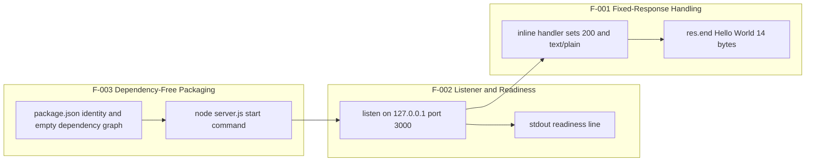

### 2.3.2 Request Lifecycle

Every request follows the same path with no conditional branch, which is why F-001's requirements are all satisfiable by one constant statement sequence. The process-wide start-up flow is drawn in §1.2.2; the per-request flow below is the detail it compresses.

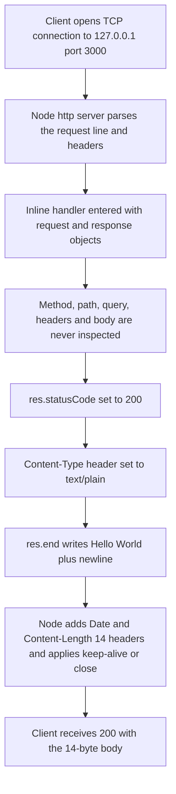

### 2.3.3 Integration Points

| ID | Direction | Counterparty and Contract | Evidence |
|---|---|---|---|
| IP-01 | Inbound | Any HTTP/1.x client on the local host; contract is a constant 200, `text/plain`, 14-byte body for any method, path or body | `server.js` lines 6-10; probe results |
| IP-02 | Outbound | None. The process initiates no connection: no `https`, `net.connect`, `fetch` or database client exists in the repository | Census: zero `https`; `server.js` line 1 is the only `require` |
| IP-03 | Operational | Harness or operator reading stdout; contract is one readiness line, never emitted when the bind fails | `server.js` lines 12-14; `EADDRINUSE` probe |
| IP-04 | Process control | Operator or supervisor termination; the fixture installs no signal handler, drains no connections and restarts nothing | No `.on(` occurrences; no exit handling in `server.js` |
| IP-05 | Host network | A single TCP port, 3000, on the loopback interface, which must be free and must not be in use by a second instance | `server.js` lines 3-4; `EADDRINUSE` on the second instance |
| IP-06 | Toolchain | A Node.js runtime (verified v22.23.4) and npm for metadata; no registry access, install step or build step is involved | `package.json`; `package-lock.json`; `node --version` |
| IP-07 | Repository tooling | `.blitzyignore.txt` and `test.blitzyignore.txt` are consumed by external tooling, not by the server; both are zero-byte and exclude nothing | Zero-byte files; no file read in `server.js` |

### 2.3.4 Shared Components and Common Services

| Shared Element | Shared By | Nature of the Sharing | Evidence |
|---|---|---|---|
| `hostname` / `port` constants | F-002 bind and F-002 readiness line | Single source of truth for the address, so the announced address cannot drift from the bound one | `server.js` lines 3-4, 12-13 |
| Inline request handler closure | Every inbound request of F-001 | One code path for all methods, paths and payloads; no per-route or per-method handler exists | `server.js` lines 6-10 |
| Node.js `http` module | F-001 and F-002 | Supplies parsing, header framing, keep-alive (`timeout=5`), `HEAD` body suppression and `Date` header for both features | `server.js` line 1; observed response headers |
| The single OS process | All three features | One process is the whole deployment unit; the features cannot be started, stopped or scaled independently | Root listing; `server.js` starts a listener at load time |
| The constants `200`, `text/plain`, `Hello, World!\n` | F-001 only | Response contract values are literals in the handler, duplicated by every assertion in the harness | `server.js` lines 7-9 |

**Common services.** None exist. The repository contains no configuration service, logging framework, authentication or session service, cache, queue, scheduler, health endpoint, metrics exporter or persistence layer — a whole-repository census found zero occurrences of `process.env`, `fs.`, `https`, `crypto`, `try`/`catch`, `setTimeout`, `JSON.parse` and `.on(`. Any such capability is out of the system's scope, as recorded in §1.3.2.


## 2.4 Implementation Considerations

Considerations are listed per feature against the five aspects the requirements raise: technical constraints, performance, scalability, security and maintenance. Every entry is grounded in the 15 lines of `server.js`, the manifest, the lockfile or a run-time observation; the project states no targets of its own, so performance statements are measured baselines rather than commitments.

### 2.4.1 F-001 Fixed-Response HTTP Request Handling

| Aspect | Consideration | Evidence |
|---|---|---|
| Technical constraints | Response values are literals inside the handler, so any change to status, content type or body is a source edit and invalidates the §2.2.1 baseline. Status text, `Date` and `Content-Length` are produced by Node, not by the fixture. Headers are limited to what the handler sets plus Node's defaults; no custom, CORS or security header is emitted. | `server.js` lines 7-9; probe showed `Date`, `Content-Length: 14`, `Keep-Alive: timeout=5` |
| Performance requirements | No SLA, budget or throughput target exists. The handler performs no I/O and executes three statements, so latency is dominated by the loopback round trip. Measured: 100 sequential requests min 0.0003 s, median 0.0004 s, p95 0.0005 s, max 0.0012 s; 50 parallel requests all returned 200. | `server.js` lines 6-10; `curl` timing and parallel probes |
| Scalability considerations | Serves from one Node.js event loop in one process; no clustering, worker threads or connection cap is configured. Throughput scales only with a single core, and horizontal scaling is blocked by the hard-coded port (see §2.4.2). Sustained load beyond the 50-connection probe was not tested. | `server.js` line 1 (no `cluster`); `server.js` lines 3-4 |
| Security implications | The request is never parsed for meaning: no deserialisation, SQL, shell construction, filesystem path or template evaluation exists, so the usual injection families have no sink. Plain HTTP only (no TLS), which is acceptable because transport never leaves the loopback interface. Automated scanners may flag the missing security headers on the response; that is a property of the fixture's contract, not a defect to fix under the "Do not touch!" instruction. | Cloud: `server.js` line 1 requires `http`; census zero `eval`, `JSON.parse`, `crypto` |
| Maintenance requirements | 15 statements with no dependencies: review cost is minimal and the whole behaviour is readable at once. There is no automated test to protect the contract — `npm test` is the failing npm placeholder — so the acceptance criteria in §2.2.2 are the only regression oracle and must be executed externally, ideally against the HTTP surface rather than the source. | `package.json` line 7; `npm test` exited 1 |

### 2.4.2 F-002 Loopback Listener Binding and Start-up Readiness Announcement

| Aspect | Consideration | Evidence |
|---|---|---|
| Technical constraints | Host `127.0.0.1` and port `3000` are module constants with no flag, environment variable or config-file override, so the fixture cannot be relocated or made externally reachable without a source edit. Exactly one instance can run per host. The `listen` callback is the only place the address is announced. | `server.js` lines 3-4, 12-14; zero `process.env` occurrences |
| Performance requirements | Bind completes before the readiness line is written, giving a start-up-to-listening gate rather than a timing heuristic. No retry, back-off or bind timeout exists, so a busy port fails immediately rather than after a delay. Node's default 5-second keep-alive idle timeout governs connection reuse per client. | `server.js` lines 12-14; observed `Keep-Alive: timeout=5`; `EADDRINUSE` probe |
| Scalability considerations | One listener, one address, one port: vertical scaling only, and no way to run a second instance on the same host without editing the constant. Process-level scaling would require an external reverse proxy, which does not exist in the repository. | `server.js` lines 3-4; second-instance failure |
| Security implications | Loopback binding is the system's principal containment control: nothing on another host can reach the fixture, so leaving it running cannot expose data or capacity. There is no authentication, and none is needed because the only reachable data is the constant body. No TLS is used; traffic is confined to the local stack. Build failures disclose only the address literal on stderr. | `server.js` line 3; second-instance stderr output |
| Maintenance requirements | Start-up behaviour is two statements plus a log line, so diagnosis hinges on that single line: its absence means the bind failed. Because no `error` listener is attached, a port conflict produces an unhandled `'error'` event and an unclean exit — acceptable for a fixture, but it means a supervisor must treat stderr text as the failure signal, not an exit code alone. The log line duplicates the address literals through interpolation rather than a shared formatting helper. | `server.js` lines 12-14; `node:events` unhandled error output |

### 2.4.3 F-003 Dependency-Free Packaging and Zero-Configuration Start-up

| Aspect | Consideration | Evidence |
|---|---|---|
| Technical constraints | No dependency fields and no `engines` field, so any Node.js that provides `http` is nominally supported; behaviour was verified only on v22.23.4 with npm 11.21.0. The manifest declares `main` as `index.js`, which does not exist, and defines no `start` script: `npm start` cannot work and `require('.')` cannot resolve, so `node server.js` is the only supported invocation. No `"type"` field means CommonJS semantics are assumed. | `package.json` lines 2-10; root file listing |
| Performance requirements | No install, resolve or compile phase, so provisioning cost is the Node.js runtime alone and the fixture's first request is served about one second after launch on the verification host. Nothing in the package competes with the server for start-up time. | `package.json`; `package-lock.json` lines 6-12; observed start-up |
| Scalability considerations | The package is a single runnable file with no build artefacts, so packaging does not constrain scaling — the listener's fixed port does. Distribution at scale is not supported: no `files`, `bin`, `repository` or publish configuration exists, and the README's "Do not touch!" marks the project as frozen input rather than a deliverable. | `package.json`; `README.md` line 2 |
| Security implications | Zero third-party packages means zero installed code, zero transitive tree and no post-install script surface — the strongest security property of the project. The lockfile holds no `resolved` URL or `integrity` hash that could be redirected. No secret, token or credential appears in any file; configuration cannot be poisoned by environment variables because none are read. MIT licence is declared in both manifest and lockfile. | `package-lock.json` lines 1-13; `package.json` line 10; zero `process.env` |
| Maintenance requirements | Identity changes must be applied to both `package.json` and `package-lock.json` to keep them consistent. The failing `test` script is the only npm lifecycle hook and cannot serve as a gate. With one commit in history and an explicit instruction not to modify the project, the practical maintenance rule is: verify behaviour through the HTTP contract described in §2.2, and change nothing in the repository. | `package.json` line 7; `package-lock.json` lines 7-11; `git log --oneline` |

### 2.4.4 Assumptions and Constraints

**Assumptions.** Each assumption is a precondition under which the requirements in §2.2 are meaningful; none is stated by the repository itself.

| ID | Assumption | Basis | Impact if Wrong |
|---|---|---|---|
| A-1 | A Node.js runtime with the built-in `http` module is present, and its version is compatible with the observed v22.23.4 behaviour | `server.js` line 1; no `engines` field to constrain it | Start-up or header behaviour may differ; §2.2.2 acceptance values would be re-verified |
| A-2 | TCP port 3000 is free on the host and no other instance is running | `server.js` line 4; hard-coded with no override | The process exits with `EADDRINUSE` before emitting readiness |
| A-3 | The loopback interface is available and the harness targets `127.0.0.1` | `server.js` line 3 | The fixture is unreachable; no fallback address or interface exists |
| A-4 | The harness can capture the process's stdout to detect readiness | `server.js` line 13 is the only readiness signal | Readiness must be inferred by polling connections instead |
| A-5 | Consumers assert the constant response values rather than any semantic content | `server.js` lines 7-9 | Any expectation of routing, echo or dynamic content is unmet (§1.3.2) |
| A-6 | "Backprop integration" tooling is the only consumer of the response, and its own expectations are defined outside this repository | `README.md` line 2; no client code for that tooling exists here | The fixture's adequacy cannot be judged from repository evidence alone |

**Constraints.** These bounds are imposed by the code, the manifest or the README, and they cannot be relaxed without editing the repository.

| ID | Constraint | Origin | Consequence |
|---|---|---|---|
| C-1 | The project is frozen: `README.md` instructs "Do not touch!" | `README.md` line 2 | Requirements are documented, not planned for implementation; any change starts a new baseline (§2.2.1) |
| C-2 | Binding is fixed to `127.0.0.1:3000` with no override mechanism | `server.js` lines 3-4, 12 | One instance per host; no external reachability; no port negotiation |
| C-3 | The supported invocation is `node server.js`, not `npm start` or a library import | `package.json` lines 5-8; `index.js` absent | Runbooks and harnesses must name the file explicitly |
| C-4 | No automated test suite or CI pipeline exists; `npm test` always exits 1 | `package.json` line 7; `git ls-files` | Acceptance must be verified externally against the HTTP surface |
| C-5 | No configuration, persistence, logging or error-handling framework exists | Whole-repository census | Operators get one stdout line and Node's default error text as the entire diagnostic surface |
| C-6 | Licence and authorship are fixed as MIT, author `hxu`, package `hello_world` 1.0.0 | `package.json` lines 2-10; `package-lock.json` lines 7-11 | Distribution claims must stay consistent with these declarations |


## 2.5 References

- `server.js` - the entire executable surface: `http` require (line 1), the `127.0.0.1` / `3000` constants (lines 3-4), the request-ignoring handler with its 200 / `text/plain` / `Hello, World!\n` contract (lines 6-10) and the readiness log line (lines 12-14). Establishes F-001 and F-002, and the absence of routing, parsing, error handling and signal handling.
- `package.json` - identity `hello_world` 1.0.0, description, author `hxu`, MIT licence, the absent `main` (`index.js`), the missing `start` script needed for F-003-RQ-006, and the failing `test` placeholder that prevents `npm test` from acting as a gate.
- `package-lock.json` - `lockfileVersion: 3` with a single `""` root entry and no dependency records, `resolved` URLs or `integrity` hashes: the evidence for F-003-RQ-002 and the zero supply-chain surface.
- `README.md` - two lines naming the project `hao-backprop-test`, stating the backprop-integration purpose (line 2) and the "Do not touch!" constraint recorded as C-1.
- `.blitzyignore.txt` - zero-byte ignore fixture; confirmed empty, so no repository path was excluded from this section.
- `test.blitzyignore.txt` - zero-byte ignore fixture; confirmed empty and catalogued as a non-feature in §2.1.4.
- `/` (repository root) - the complete six-file inventory with no sub-folders, establishing that no tests, CI configuration, data models or API specifications exist.
- `.git` metadata - single commit `28e5918` ("Add files via upload") and branches `QA-Linux-env-20-nov` (checked out), `main`, `origin/main`: the baseline for requirement version 1.0 in §2.2.1.
- Verification run captured for §2.2 and §2.4: Node.js v22.23.4 / npm 11.21.0; `curl` probes of GET `/`, GET `/missing/path?x=1`, POST `/` with a JSON body, PUT, HEAD and `--http1.0`; 50 parallel requests all returning 200; 100 sequential requests timed min 0.0003 s / median 0.0004 s / p95 0.0005 s / max 0.0012 s; `od -c` confirming the 14-byte body; a second instance failing with `EADDRINUSE`; `npm test` exiting 1.
- Whole-repository construct census (`process.env`, `require(`, `console.`, `try`, `catch`, `setTimeout`, `fs.`, `https`, `express`, `listen(`, `.on(`, `JSON.parse`, `crypto`, `eval`, `assert`) - the basis for every absence claim in §2.1.4, §2.3.4 and §2.4.
- `2. Product Requirements` cross-references: §1.1 Executive Summary, §1.2 System Overview (including the §1.2.2 request flowchart), §1.3 Scope and §1.4 References - the neighbouring sections whose success criteria, limitations and exclusions this section turns into testable requirements.


# 3. Technology Stack

## 3.1 Programming Languages

The technology stack of `hao-backprop-test` is one language on one runtime with nothing installed between them. Every layer below the application is provided by the Node.js distribution itself; every layer above the transport does not exist. The table records the whole stack.

| Layer | Selection | Version | Evidence |
|---|---|---|---|
| Implementation language | JavaScript, CommonJS module semantics | No `type` field, so CommonJS is implied; ES2015 syntax subset (`const`, arrow functions, template literals) | `server.js` lines 1, 3-4, 6, 13; `package.json` (no `type` key) |
| Runtime / execution platform | Node.js | Verified on v22.23.4 (V8 12.4.254.21-node.57, libuv 1.51.0); no `engines` field constrains it | `node --version`; `npmpkg get engines` returns nothing |
| Package manager | npm | 11.21.0 | `npm --version` |
| HTTP layer | Node.js built-in `http` module | Shipped inside the runtime | `server.js` line 1: `const http = require('http')` |
| Transport | Plain TCP/HTTP on the loopback interface | `127.0.0.1:3000`, hard-coded | `server.js` lines 3-4, 12 |
| Persistence / messaging / external services | None | — | Whole-repository dependency and source census (§3.3, §3.4, §3.5) |

### 3.1.1 Languages by Platform and Component

| Component / platform | Language | Module system | Evidence |
|---|---|---|---|
| Server process (`server.js`) | JavaScript | CommonJS (`require`) | `server.js` line 1 is the only `require` call in the repository |
| Package manifest and lockfile | JSON | Not applicable | `package.json`, `package-lock.json` |
| Front-end / browser client | None | — | No HTML, CSS, or browser assets exist; the root holds six files and no sub-folders (`git ls-files`) |
| Native mobile or desktop client | None | — | No Swift, Kotlin, Objective-C, or Electron sources anywhere in the checkout |
| Infrastructure as code | None | — | No `.tf`, `.tfvars`, CloudFormation, or Helm artefacts |
| Test and automation code | None | — | No test file exists; the only `test` entry is npm's failing placeholder, `echo "Error: no test specified" && exit 1` (`package.json` line 7) |
| Operations scripting | None committed | — | The only shell text in the repository is the string inside that npm placeholder (`package.json` line 7) |

### 3.1.2 Selection Criteria and Justification

- **Standard library sufficiency.** The entire capability set is "return a fixed response to any request" (§1.3.1). Node.js's `http` module supplies every primitive this needs — `createServer`, `statusCode`, `setHeader`, `end`, `listen` — so no third-party language ecosystem, type system, or build toolchain is required. `server.js` is 342 bytes and 11 non-blank lines.
- **Determinism for the tooling under test.** The README states the project exists "for backprop integration" (`README.md` line 2). A single language, a single file, and an empty dependency graph mean that any deviation observed during an integration run is attributable to the integration tooling rather than to language runtime, dependency resolution, or compilation.
- **Appeal to a documented default.** Because the manifest defines no `start` script but `server.js` sits at the package root, npm's documented fallback runs `node server.js` (§3.6.2), so the selected entry file name is itself part of the stack's invocation contract.
- **Syntax level matched to the task.** The file uses only ES2015 constructs: `const` declarations (lines 1, 3, 4, 6), two arrow-function callbacks (lines 6, 12), and one template literal (line 13). No transpiler, no class syntax, no async/await, and no destructuring appear anywhere.

### 3.1.3 Language Constraints and Dependencies

| Constraint | Detail | Consequence | Evidence |
|---|---|---|---|
| No declared runtime floor (`engines` absent) | Any Node.js that exposes `http` is nominally supported; the ES2015 syntax used becomes unflagged from Node.js 6.0.0 onward, and `res.setHeader` has existed since Node.js v0.4.0 | Version behaviour is unverified outside the one tested runtime; §2.4 assumption A-1 records the same gap | `package.json`; `server.js` lines 1-14; Node.js release notes for v4.0.0/v6.0.0 and `http` API docs |
| CommonJS only | No `"type"` field, and the code uses `require`. Adding `"type": "module"` would break the `require` call | Module identity cannot be changed without editing `server.js` | `package.json`; `server.js` line 1 |
| Broken declared entry point | `main` is `index.js`, which does not exist; `node -e "require('.')"` fails with `Cannot find module '…/index.js'. Please verify that the package.json has a valid "main" entry` | The language-level module cannot be required; the file must be named explicitly | `package.json` line 5; `node -e "require('.')"` output |
| Frozen source | `README.md` line 2 instructs "Do not touch!" | The language choice is not open to revision within this baseline (constraint C-1, §2.4.4) | `README.md` line 2 |
| No dynamic language surface | The only `require` is the built-in `http`; no `eval`, `JSON.parse`, `fs`, `child_process`, `crypto`, or network client appears | The language offers no injection sink, no filesystem surface, and no outbound-call capability | Whole-file inspection of `server.js`; `grep -nE "require\(" server.js` returns one line |

### 3.1.4 Applicability of the Reference Default Stack

The reference stack supplied for this section describes a cloud-hosted multi-platform product. Against the six tracked files of this repository, only the JavaScript-family and Node/npm entries have any footing, and the remainder have no artefact of any kind. The table records each family explicitly so that no reader assumes a component that is not there.

| Reference component | Status here | Evidence |
|---|---|---|
| Python + Flask | Not present | No `.py` file, no `requirements.txt`, no WSGI reference (`git ls-files`) |
| MongoDB / LangChain | Not present | No driver, no database client, no AI library, empty lockfile graph (`npm ls --all` → `(empty)`) |
| React / React-Native / TailwindCSS | Not present | No `jsx`/`tsx`, no component tree, no stylesheet, no browser bundle |
| Swift / Kotlin / Objective-C / ElectronJS | Not present | No native or desktop sources; the checkout has no sub-folders at all |
| Docker / Terraform / AWS | Not present | No `Dockerfile`, compose file, `.tf` file, or cloud SDK; the sole listener binds `127.0.0.1` |
| GitHub Actions | Not present | No workflow directory; single commit `28e5918` |
| Auth0 or any identity provider | Not present | No auth code, no token handling, no `Set-Cookie`, no outbound call |
| JavaScript on Node.js | **Present** — the entire stack | `server.js`; `package.json` |

## 3.2 Frameworks & Libraries

No application framework is used. The repository's only runtime library is the `http` module shipped inside Node.js, and the only other library-shaped code a request touches is the JavaScript engine and event loop the runtime itself embeds. There is no web framework, no dependency-injection container, no ORM, no template engine, no logging library, and no test framework.

### 3.2.1 Runtime Components in Use

| Component | Origin | API surface actually called | Version | Evidence |
|---|---|---|---|---|
| `http` | Node.js built-in module | `http.createServer`, `res.statusCode`, `res.setHeader`, `res.end`, `server.listen` | Bundled with Node.js v22.23.4 | `server.js` lines 1, 6-13 |
| `net` (transitive) | Node.js built-in, used internally by `http` | None called directly; provides the TCP listener behind `listen` | Bundled with Node.js v22.23.4 | `server.js` never requires it; `EADDRINUSE: address already in use 127.0.0.1:3000` is raised through `node:net` |
| `console` / `process.stdout` | Node.js global | `console.log` for the single start-up line | Bundled with Node.js v22.23.4 | `server.js` line 13 |
| V8 | Embedded JavaScript engine | JavaScript evaluation of the CommonJS script | `12.4.254.21-node.57` | `node -e "console.log(process.versions.v8)"` |
| libuv | Embedded asynchronous I/O library | Event loop and socket polling that service the listener | `1.51.0` | `node -e "console.log(process.versions.uv)"` |

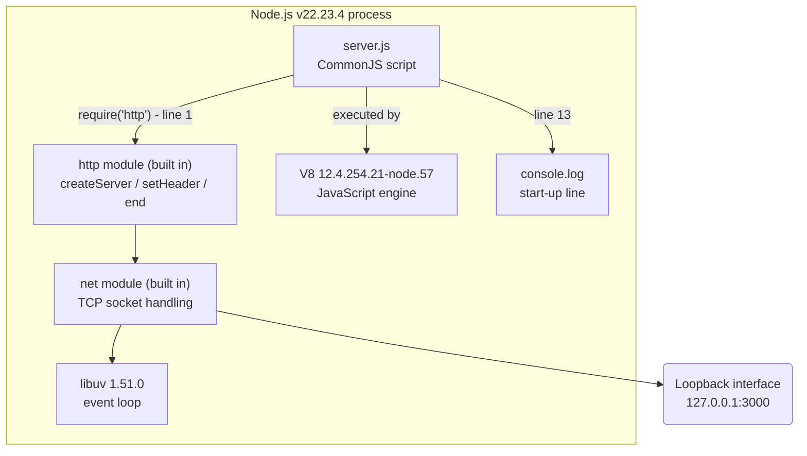

### 3.2.2 Compatibility Requirements

| Requirement | Detail | Evidence |
|---|---|---|
| Node.js with the `http` module and `res.setHeader` | `res.setHeader` has existed since Node.js v0.4.0, so every LTS line since Node 4 satisfies it | `server.js` lines 6-9; Node.js `http` API documentation |
| Node.js 6.0.0 or later for the syntax in use | `const`, arrow functions, and template literals run unflagged from Node.js 6.0.0 (Node.js 4.0.0 enabled ES2015 by default but still required strict mode for block-scoped declarations) | `server.js` lines 1-13; Node.js v4.0.0 and v6.0.0 release notes |
| CommonJS loader | `require` is the only module mechanism used and no `"type"` field alters it | `package.json`; `server.js` line 1 |
| npm 7 or later **only if the lockfile is read by npm** | `lockfileVersion: 3` is readable by npm 7+ and is what npm 9+ writes by default; npm 5/6 cannot read it. The runtime itself never reads the lockfile | `package-lock.json` line 3; npm `package-lock.json` and `lockfile-version` documentation |
| No `engines` constraint is declared | Nothing in the manifest rejects or accepts a Node.js version, so compatibility rests on the table above rather than on an enforced range | `package.json`; `npm pkg get engines main type` reports only `main` |

### 3.2.3 Justification for the Frameworks Absent

Each absence is a design consequence of the fixture's single contract (§2.2) rather than an oversight.

| Candidate framework | Why it is not used | Evidence of absence |
|---|---|---|
| Web framework (Express, Fastify, Koa) | The handler ignores the request entirely — no path, method, header, or body is inspected — so a router and middleware chain would add a dependency graph and install step without changing a single observable behaviour. §1.3.2 lists routing and request parsing as out of scope. | `server.js` lines 6-10; `grep` over all tracked files finds no such package |
| Template engine | The body is the string literal `'Hello, World!\n'` | `server.js` line 9 |
| Configuration loader (`dotenv`, config files) | Host and port are module constants with no override path; zero `process.env` occurrences exist | `server.js` lines 3-4; `grep -c "process.env"` returns 0 |
| Logging library (winston, pino) | Diagnostics consist of one `console.log` at start-up | `server.js` line 13 |
| Test framework (Jest, Mocha) | `npm test` is npm's placeholder that always exits 1 | `package.json` line 7; `npm test` exited 1 |
| Lint/format toolchain (ESLint, Prettier) | No configuration file, no dev dependency, and the whole program fits on one screen | `git ls-files` (six files) |

### 3.2.4 Integration Between Runtime Components

The integration is entirely internal to the Node.js process, so no interface contract, version negotiation, or middleware ordering has to be managed.

1. The CommonJS loader resolves `http` from the runtime's built-in module table — no filesystem lookup outside the runtime, no `node_modules` resolution (`server.js` line 1).
2. `http.createServer` registers the handler and, at `server.listen`, delegates socket acceptance to the built-in `net` layer, whose readiness is signalled back through the arrow callback on line 12.
3. Each accepted connection enters the libuv event loop and is dispatched to the same handler, which writes three values and closes the response (`server.js` lines 6-10).
4. Start-up ordering is observable: the `console.log` on line 13 runs only after the bind has succeeded, which is why §2.4.2 treats its presence as the readiness signal.

## 3.3 Open Source Dependencies

The project consumes no open-source packages from any registry. `package.json` has exactly seven top-level keys — `name`, `version`, `description`, `main`, `scripts`, `author`, `license` — and none of them is a dependency field. There are no `dependencies`, `devDependencies`, `peerDependencies`, `optionalDependencies`, `bundledDependencies`, `overrides`, `resolutions`, or `workspaces` entries, and the installed tree is verifiably empty: `npm ls --all` reports `hello_world@1.0.0` with `└── (empty)`.

### 3.3.1 Dependency Census

| Check | Result | Command / file |
|---|---|---|
| Declared dependency fields in the manifest | None of the eight dependency field names exists among the seven top-level keys | `node -e "Object.keys(require('./package.json'))"` |
| Installed tree | Empty — no packages, direct or transitive | `npm ls --all` → `└── (empty)`; `npm ls --all --json` emits no `dependencies` key |
| Lockfile package records | Exactly one entry, the root package key `""`; no dependency records and no top-level `dependencies` map | `package-lock.json` lines 6-12; `'dependencies' in require('./package-lock.json')` → false |
| `node_modules` directory | Does not exist, and is not needed | Filesystem listing; `npm install --dry-run` completes without creating it |
| Install-time script surface | Impossible — there is no package to run a `preinstall`/`postinstall` script | Empty lockfile graph |
| Third-party services or SDKs referenced | None | Grep for `aws`, `mongo`, `redis`, `express`, `flask`, `react`, and similar names over all tracked files returned no project hit |

### 3.3.2 Lockfile Anatomy

| Field | Value | Meaning |
|---|---|---|
| `lockfileVersion` | `3` | Format written by default by npm 9 and later and readable by npm 7 and later; npm 5/6 cannot read it (`package-lock.json` line 3; npm `package-lock.json` docs) |
| `requires` | `true` | Indicates the lockfile carries a complete, resolved graph — here a graph of one node |
| `packages` | `{ "": { name: "hello_world", version: "1.0.0", license: "MIT" } }` | The only entry is the root project (`package-lock.json` lines 6-12) |
| `resolved` URLs | Absent | No package can be fetched from, or redirected to, a foreign registry |
| `integrity` hashes | Absent | Nothing to verify because nothing is downloaded |
| `dev` / `optional` / `peer` flags | Absent | No dependency classification exists to enforce |

### 3.3.3 Registries and Version Compatibility

- **Registry.** No project-level `.npmrc` exists, so the only registry in play is npm's default `https://registry.npmjs.org/` as reported by `npm config get registry`. The manifest cannot name an alternative registry, and no artifact in the repository pins one.
- **Resolution cost.** `npm install --dry-run` and `npm ci --dry-run` both report `up to date in ~192 ms` and create no `node_modules`; no package metadata is required to satisfy the manifest.
- **Toolchain pairing.** Only the package manager needs to understand the lockfile: `lockfileVersion: 3` requires npm 7+, while the verified environment runs npm 11.21.0 against Node.js v22.23.4. The application itself runs on any Node.js satisfying §3.2.2, independent of the lockfile.
- **The one third-party artefact.** The Node.js runtime (MIT-licensed, obtained from the Node.js distribution rather than from the npm registry) is the sole external code the process executes, together with the V8 and libuv libraries it embeds. It is installed on the host, not declared in `package.json`.

### 3.3.4 Supply-Chain and Security Implications

| Property | Consequence | Evidence |
|---|---|---|
| Zero installed code | No compromised package can alter behaviour, and no transitive tree needs auditing | Empty `npm ls --all` output |
| No install-time execution | There is no `preinstall`, `install`, or `postinstall` hook that could run host commands during provisioning | `package.json` line 6-8 defines only `test` |
| No registry dependence at run time | A run cannot fail or drift because of a registry outage or a republished version | `package-lock.json`; no dependency fields |
| No secret or credential surface | No auth token, registry token, `.npmrc`, or key file exists, and the code reads no environment variables | Grep for `process.env` → 0 hits; `git ls-files` |
| Reproducibility | The byte-for-byte content of the checkout plus the Node.js version fully determines behaviour | Six tracked files, one commit `28e5918` |

The one dependency risk worth naming is not a package but the runtime: because no `engines` field pins a Node.js range, a host upgrading Node.js could change response headers (for example, `Date`, `Connection`, or `Keep-Alive` formatting produced by Node.js rather than by `server.js`) while the source stays untouched. Assertions should therefore compare the fields the handler itself sets, as §2.4.1 advises.

## 3.4 Third-Party Services

The system integrates with no third-party service. It makes no outbound network call of any kind, holds no credentials, and reads no configuration that could name an endpoint. Its only runtime interaction with anything outside its own process is accepting inbound TCP connections on the loopback interface.

### 3.4.1 Service Category Applicability

| Service category | Used? | Evidence |
|---|---|---|
| Identity / authentication provider (Auth0 or any OIDC/SAML IdP) | No | No auth code, no token parsing, no `Set-Cookie`, no outbound call. The request object is never dereferenced — `grep -nE "req\." server.js` finds nothing — so no header, cookie, or credential is ever read |
| Cloud platform services (AWS, GCP, Azure) | No | No cloud SDK in the (empty) dependency graph; no region, bucket, queue, or function reference in any file; the listener binds `127.0.0.1`, not a routable interface |
| Monitoring, APM, or error reporting (Datadog, New Relic, Sentry) | No | No agent package, no instrumentation hook, no trace header, no error handler; the only telemetry is one `console.log` line (`server.js` line 13) |
| External REST/GraphQL APIs | No | `https`, `fetch(`, `http.request`, and `http.get` all occur zero times in `server.js`; the `http` module is used solely to build a server |
| Messaging brokers / queues / event buses | No | No client library, no connection string, no producer or consumer code |
| Email, SMS, payment, or notification providers | No | No SDK, no API key, no template, no outbound request path |
| DNS, CDN, TLS termination | No | `dns` and `tls` appear zero times; the protocol is plain `http`, not `https` |
| Feature-flag or configuration service | No | No `process.env` access anywhere; host and port are literals (`server.js` lines 3-4) |

### 3.4.2 The Only External Interaction

| Direction | Peer | Mechanism | Evidence |
|---|---|---|---|
| Inbound | A client on the same host | TCP/HTTP to `127.0.0.1:3000` | `server.js` lines 3-4, 12 |
| Outbound | None | — | Zero occurrences of `https`, `tls`, `dns`, `fetch(`, `http.request`, `http.get`, `net.connect` in `server.js` |

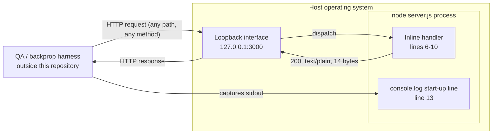

### 3.4.3 Integration Requirements Imposed by Their Absence

Because there is no external service, there is no API key to provision, no credential rotation, no endpoint allow-list, no egress firewall rule, no SDK version to track, and no vendor rate limit or outage to design around. The requirements that remain are host-local and finite:

- A Node.js runtime per §3.2.2 — the genuine third-party artefact, installed on the host rather than declared in the manifest.
- The loopback interface available and TCP port 3000 free, since both are hard-coded (`server.js` lines 3-4).
- A harness able to capture the process's standard output if it wants the readiness signal, because that line is the only event the process emits (`server.js` line 13).

The "backprop integration" named in `README.md` line 2 is the counterparty this fixture exists to serve, but it lives outside this repository: the project declares no dependency on it and contains no client code for it. Its expectations — not any service contract — define what the fixture must produce, which is why §2.4.4 records that as assumption A-6.

## 3.5 Databases & Storage

The system uses no database, no datastore, no cache, and no persistent storage of any kind. `server.js` requires only `http` (line 1); `fs`, `child_process`, and `crypto` occur zero times, and no driver, ORM, or storage client appears in the empty dependency graph (§3.3).

### 3.5.1 Storage Category Applicability

| Category | Used? | Evidence |
|---|---|---|
| Primary database (relational or document) | No | No driver, connection string, schema, or model; `npm ls --all` reports `(empty)` |
| Secondary / replica store | No | Same; nothing to replicate |
| Cache or key-value store (Redis, Memcached) | No | No client library and no serialization code; the response body is a compile-time literal |
| Object / blob storage (S3 or equivalent) | No | No SDK, no bucket or path reference, no cloud configuration |
| Filesystem reads or writes | No | `fs` is never required; the process opens no file, and `README.md` is documentation for humans, not a runtime input |
| ORM / migration tooling | No | No schema, no migration directory, no query builder |
| Analytics, logging, or audit store | No | One `console.log` line to standard output (`server.js` line 13); nothing is buffered or forwarded |

### 3.5.2 What the Process Actually Holds

| State | Lifetime | Location | Evidence |
|---|---|---|---|
| Response body `'Hello, World!\n'` | Life of the process, immutable | A string literal inside the handler | `server.js` line 9 |
| Binding constants `127.0.0.1` and `3000` | Life of the process, immutable | Module-scoped `const` declarations | `server.js` lines 3-4 |
| The `server` handle | From `listen` until process exit | Module scope | `server.js` line 6 |
| Per-request `req`/`res` objects | One request | Handler closure parameters, never dereferenced on `req` | `server.js` line 6 |
| Accepted-socket queue | Until accepted by libuv, then held for the connection | Kernel and libuv internals | `Keep-Alive: timeout=5` on the observed response |

Restart semantics follow directly: the process holds nothing that a restart could lose, so a restarted instance is indistinguishable from the previous one, and no recovery, replay, or reconciliation step exists (nor is one needed).

### 3.5.3 Persistence Strategy and Caching

- **Persistence strategy: none.** There is nothing to persist. The fixture's entire output is derivable from the source file, which is why §1.2.3 can name the byte-exact response as the acceptance oracle.
- **Caching: no cache layer exists.** The handler sets only `Content-Type` (`server.js` line 8); no `Cache-Control`, `ETag`, `Last-Modified`, or `Expires` header is emitted, so any client-side caching is left entirely to the caller's defaults.
- **Connection reuse is the only reuse mechanism.** Node.js's standard keep-alive idle window (`Keep-Alive: timeout=5` in the observed response) lets a client reuse a socket across requests; the handler gains nothing from this beyond avoiding a new TCP handshake, because every request is answered from the same constant.
- **Durability and backup:** not applicable. There is no data set to back up, no recovery point objective, and no restore procedure.

Any requirement for stored state — a database for response content, a cache for rendered output, or a file holding configuration — would introduce the first dependency and the first mutable input in the project, and would conflict with the frozen-fixture constraint C-1 recorded in §2.4.4.

## 3.6 Development & Deployment

Development and deployment for this project consist of a Node.js runtime on a host and nothing else. There is no build step, no container image, no pipeline, and no packaging configuration; the checked-in source is the deployed artefact.

### 3.6.1 Development Tools and Verified Environment

| Tool | Version | Role in this project | Evidence |
|---|---|---|---|
| Node.js | v22.23.4 (V8 12.4.254.21-node.57, libuv 1.51.0) | Executes `server.js`; supplies `http` | `node --version`; `process.versions` |
| npm | 11.21.0 | Reads the manifest and lockfile, runs lifecycle scripts | `npm --version` |
| git | Single commit `28e5918`, branches `QA-Linux-env-20-nov`, `main` | Source control only; no hooks or CI wired to it | `git log --oneline`; `git branch -a` |
| Verified host | Linux 6.12.105+ x86_64 | The platform on which all behaviour below was observed | `uname -srm` |
| Linter, formatter, transpiler, bundler, debugger config, test runner | Not present | — | No such file among the six tracked files; `npm pkg get engines` returns nothing, confirming no toolchain constraint is declared |

`node --check server.js` parses the file without error, so the source is valid for the verified runtime with no preprocessing. Nothing else is installed: no `node_modules`, no global CLI, no editor configuration.

### 3.6.2 Invocation Matrix and Scripts

| Command | Observed outcome | Implication | Evidence |
|---|---|---|---|
| `node server.js` | Prints `Server running at http://127.0.0.1:3000/`, then answers requests with 200 / `text/plain` / 14 bytes | The supported invocation | Executed; response captured |
| `npm start` | Runs `node server.js` through npm's documented default and served a live 200. Banner: `> hello_world@1.0.0 start` then `> node server.js`; process tree `npm start` → `sh -c node server.js` → `node server.js` | Works **because** the manifest defines no `start` script and `server.js` sits at the package root — npm's documented fallback. Note this differs from §2.4.4 constraint C-3, which states `npm start` cannot work; the observed behaviour is that it does, by fallback rather than by declaration | `npm start` run; npm `npm-start` and `scripts` documentation |
| `npm test` | Prints `Error: no test specified`, exits 1 | Cannot serve as a quality gate | `package.json` line 7; `npm test` exited 1 |
| `npm install` / `npm ci` | `up to date in ~192 ms`; creates no `node_modules` | Provisioning has nothing to fetch | Dry runs of both commands |
| `node -e "require('.')"` | `Error: Cannot find module '…/index.js'. Please verify that the package.json has a valid "main" entry` | The package cannot be consumed as a library | `main` in `package.json` line 5; file absent |
| Second instance on the same host | `Error: listen EADDRINUSE: address already in use 127.0.0.1:3000`, raised as an unhandled `'error'` event, exit 1 | One instance per host; failure is immediate | Executed probe |
| `kill -TERM <pid>` | Exit status 143, port released | Default Node.js termination; no shutdown hook exists | Executed probe |
| `kill -INT <pid>` | Exit status 130 | Same default path | Executed probe |

The manifest's `scripts` object contains exactly one entry, `test` (`package.json` lines 6-8). No `start`, `build`, `lint`, `prestart`, or `poststart` script is defined, so no project-authored lifecycle hook runs at any point.

### 3.6.3 Build System

There is no build system. No `build` script exists, no transpiler, bundler, or minifier is configured, and no generated artefact is checked in or produced — the census over all tracked files found no `tsconfig`, `webpack`, `vite`, or `babel` reference. The "build output" is therefore `server.js` exactly as committed: 342 bytes, which the runtime evaluates directly. The only version stamp available to any consumer is `name` and `version` in `package.json` (`hello_world` 1.0.0), mirrored in the lockfile; nothing injects it into the application, and the response body contains no build identifier.

### 3.6.4 Containerisation

No container artefact exists: no `Dockerfile`, `.dockerignore`, compose file, Kubernetes manifest, or Helm chart is present, and the reference default stack's Docker option therefore has no footing in this repository. Two consequences follow for anyone who containerises the fixture unchanged:

- **Published ports would not reach the server.** The socket is bound to `127.0.0.1` (`server.js` line 3), so traffic arriving on a container's external interface is not accepted by that socket. Making the fixture reachable from outside its container would require editing the bind address, which conflicts with constraint C-1 ("Do not touch!", `README.md` line 2).
- **The image would carry no dependencies.** A base image providing Node.js is sufficient; no `npm install` layer is needed because the lockfile graph is empty (§3.3.2).

### 3.6.5 CI/CD Requirements

No pipeline configuration exists — no `.github/workflows` directory and no other CI descriptor — and the single-commit history provides no evidence of one ever having run. `npm test` cannot act as a gate because it always exits 1, so any pipeline must assert the HTTP contract directly. The minimum steps such a pipeline needs are:

| Step | Command or check | Reason |
|---|---|---|
| Provide runtime | Install Node.js (v22.23.4 is the verified version) | The only prerequisite |
| Skip install and build | No `npm install`, no build command | Empty dependency graph; nothing to compile |
| Start | `node server.js` as a background process, capturing stdout | The only supported invocation |
| Wait for readiness | Read the line `Server running at http://127.0.0.1:3000/` from stdout | The process emits exactly one start-up event (`server.js` line 13) |
| Verify | Request `http://127.0.0.1:3000/` and assert `200`, `Content-Type: text/plain`, body `Hello, World!\n` (14 bytes) | The contract in §2.2.1 |
| Tear down | `SIGTERM`, accepting exit status 143 | Default Node.js termination; a non-zero status here is expected, not a failure |
| Treat bind failure as fatal | Watch stderr for `EADDRINUSE` | Port 3000 is hard-coded and cannot be relocated |

### 3.6.6 Deployment Topology and Operational Behaviour

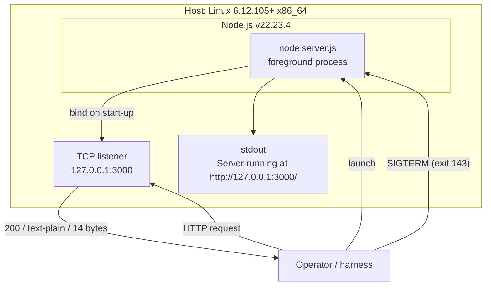

| Operational aspect | Behaviour | Evidence |
|---|---|---|
| Deployment form | A single foreground `node` process started from a checkout; no service unit, supervisor, or manifest is provided | Six tracked files; `git ls-files` |
| Network exposure | Loopback only; unreachable from any other host | `server.js` line 3 |
| Instances per host | One — the port is a constant with no override | `server.js` line 4; `EADDRINUSE` probe |
| Readiness signal | Exactly one stdout line, emitted from the `listen` callback after a successful bind | `server.js` lines 12-14 |
| Liveness signal | A TCP connect to `127.0.0.1:3000`; there is no health endpoint | `server.js` lines 6-10 (any path returns 200) |
| Shutdown | Default signal handling: `SIGTERM` → 143, `SIGINT` → 130; no graceful drain, no open-resource cleanup | Probes above |
| Start-up failure | Port conflict raises an unhandled `'error'` event and exits 1 after printing a stack trace to stderr | `EADDRINUSE` output |
| Scaling | Vertical only; horizontal scaling is blocked by the loopback bind and fixed port | `server.js` lines 3-4 |
| State across restarts | None to lose; a restarted instance behaves identically | §3.5.2 |

### 3.6.7 Component Integration Requirements

| Interface | Requirement | Consequence if unmet |
|---|---|---|
| Node.js runtime ↔ `server.js` | Node.js 6.0.0 or later (syntax baseline) exposing `http` and `res.setHeader`; v22.23.4 verified | Parse error, or a `TypeError` when `setHeader` is called |
| npm ↔ `package-lock.json` | npm 7 or later to read `lockfileVersion: 3`; npm 11.21.0 verified | npm 5/6 cannot read the lockfile, though the application still runs |
| `server.js` ↔ host network stack | Loopback interface present; TCP port 3000 free | Unhandled `EADDRINUSE`, exit 1 |
| Process ↔ harness | Standard-output capture for readiness; no configuration channel exists in either direction | Readiness must be inferred by polling the port |
| Harness ↔ response | Assert the handler-set values (status, `Content-Type`, 14-byte body), not Node-generated headers such as `Date` or `Keep-Alive` | Version-dependent false failures |
| Checkout ↔ runtime | No install or build step, so the working tree is the deployment input | — |

### 3.6.8 Security Implications of the Selected Stack

| Aspect | Assessment | Evidence |
|---|---|---|
| Attack surface | Minimal: no dependency code, no file access, no request parsing, no outbound capability, and the request object is never dereferenced | §3.3.4, §3.4.1; `server.js` |
| Transport security | Plain HTTP with no TLS (`tls` appears zero times). Acceptable only because the bind address confines traffic to the local stack; enabling external reachability without adding TLS would be a security regression | `server.js` line 1, line 3 |
| Secrets | None stored, loaded, or transmitted; no environment-variable reads, so the process cannot be reconfigured or poisoned through its environment | `process.env` count = 0 |
| Authentication and authorisation | Absent by design; the only content served is a constant string, so there is no protected resource | §3.4.1 |
| Supply chain | No packages to compromise or audit | §3.3.4 |
| Scanning posture | The response carries only `Content-Type` plus Node.js defaults, so header-hardening scanners will flag missing security headers; that is a property of the fixture's contract, not a defect to fix under constraint C-1 | `server.js` lines 6-9; observed headers |
| Blast radius | One process, one core, loopback-only: a fault or runaway loop cannot impact other hosts, and capacity exposure is bounded by the local host | `server.js` lines 3-4 |
| Licensing | MIT declared in both `package.json` (line 10) and `package-lock.json` (line 11) | Manifest and lockfile |

## 3.7 References

**Repository files**

- `server.js` — the sole source file (15 lines, 342 bytes); established the language, CommonJS module use, the hard-coded `127.0.0.1`/`3000` binding, the three-statement handler, the single start-up log line, and the absence of `fs`, `tls`, `https`, `fetch`, `dns`, `child_process`, `crypto`, `eval`, `JSON.parse` and `process.env` usage.
- `package.json` — established the seven top-level manifest keys (no dependency, `engines`, or `type` field), the sole `test` script that exits 1, the declared-but-absent `main: index.js`, and the MIT licence and `hello_world` 1.0.0 identity.
- `package-lock.json` — established `lockfileVersion: 3`, `requires: true`, and a `packages` map whose only entry is the root project, with no `resolved` URLs, integrity hashes, or `dependencies` map.
- `README.md` — established the project name `hao-backprop-test`, its purpose as a "test project for backprop integration", and the "Do not touch!" freeze instruction.
- Repository root (`""`) — the `git ls-files` and `find` listing establishing six tracked files, no sub-folders, and the single commit `28e5918`.

**Commands and runtime observations (executed against the checkout)**

- `node --version`, `npm --version`, `node -e "process.versions"` — Node.js v22.23.4, npm 11.21.0, V8 12.4.254.21-node.57, libuv 1.51.0.
- `npm ls --all`, `npm install --dry-run`, `npm ci --dry-run`, `npm config get registry` — empty dependency tree, no `node_modules` created, default registry `https://registry.npmjs.org/`.
- `npm start`, `npm test`, `node -e "require('.')"` — npm's default `node server.js` fallback, the failing placeholder test, and the missing-`index.js` resolution error.
- `curl -i http://127.0.0.1:3000/`, POST probe, second-instance launch, `SIGTERM`/`SIGINT` probes, `node --check server.js` — response headers and 14-byte body, `EADDRINUSE` exit 1, exit statuses 143 and 130, and a clean syntax parse.

**Web sources**

- [web] npm Docs — `package-lock.json` (CLI v11): https://docs.npmjs.com/cli/v11/configuring-npm/package-lock-json — confirmed `lockfileVersion` 3 is the format of npm v9 and above, backwards compatible to npm v7.
- [web] npm Docs — `package-lock.json` (CLI v7): https://docs.npmjs.com/cli/v7/configuring-npm/package-lock-json — confirmed version 3 originated with npm v7.
- [web] npm Docs — `config`, `lockfile-version` (CLI v11): https://docs.npmjs.com/cli/v11/using-npm/config — confirmed version 3 is the default when no lockfile exists and that v1 lockfiles auto-convert.
- [web] npm Docs — `npm start` (CLI v11): https://docs.npmjs.com/cli/v11/commands/npm-start — confirmed that absent a `start` script npm runs `node server.js`.
- [web] npm Docs — `scripts` (CLI v8): https://docs.npmjs.com/cli/v8/using-npm/scripts — confirmed the `server.js` default for `start`, with `prestart`/`poststart` still running.
- [web] npm CLI changelog (v9): https://docs.npmjs.com/cli/v9/using-npm/changelog — confirmed "use v3 lockfiles by default" landed in npm 9.
- [web] Node.js v4.0.0 release notes: https://nodejs.org/en/blog/release/v4.0.0 and v6.0.0: https://nodejs.org/en/blog/release/v6.0.0 — established the ES2015 syntax timeline used for the language baseline.
- [web] Node.js HTTP API: https://nodejs.org/api/http.html — established that `response.setHeader` has existed since v0.4.0.
- [web] Node.js previous releases and LTS schedule: https://nodejs.org/en/about/previous-releases — established that the `http` module is present in every LTS line since Node.js 4.

# 4. Process Flowchart

## 4.1 System Workflows

The repository implements three workflows, all of them runtime-lifecycle processes rather than domain business processes. Every one is driven by `server.js`, the sole executable file (14 lines), and each maps to a feature already catalogued in §2.1. To keep every diagram in one authoritative place, all Mermaid diagrams are rendered in §4.4 and referenced here by ID.

| ID | Workflow | Trigger and actor | Terminal outcome |
|---|---|---|---|
| W-1 | Request handling (F-001) | An HTTP client on `127.0.0.1:3000` sends a complete request head; actor is harness or operator tooling | Response written; connection kept alive for reuse or closed |
| W-2 | Listener start-up and readiness announcement (F-002) | Operator or harness launches the process (`node server.js`; `npm start` works by npm's fallback, §3.6.2) | Readiness line on stdout with the listener bound, or exit 1 on bind failure |
| W-3 | Provisioning and invocation (F-003) | A checkout of the six tracked files on a host with Node.js | A running process with no install, build or configuration step |

No workflow in this system reaches a datastore, a message broker, a third-party API or a scheduler. That is not an omission in the documentation but a property confirmed by a text census of every tracked file, recorded in §4.1.2.

### 4.1.1 Core Business Processes

**There is no domain business process.** The repository contains no order, account, record, ledger or transaction concept; a census of all six tracked files returns zero occurrences of `Database`, `state`, `cache` and every datastore driver name. The single end-to-end journey the system performs is the delivery of a constant response, which is the process the fixture exists to provide: `README.md` line 2 names it "a test project for backprop integration", and a byte-identical answer is what lets an integration harness attribute any observed deviation to the tooling under test rather than to the fixture.

**End-to-end journey (W-1).** One request traverses three boundaries — client process, Node.js HTTP core, application handler — and returns along the same path.

| Step | Locus | Action | Evidence |
|---|---|---|---|
| 1 | Client process | Opens a TCP connection to `127.0.0.1:3000` and writes a request head | `server.js` lines 3-4 (address constants), line 12 (`listen`) |
| 2 | Node.js HTTP core | Kernel accepts; the parser builds `IncomingMessage`/`ServerResponse` for the request | No repository code involved; Node v22.23.4 |
| 3 | Node → application | Invokes the inline arrow handler with `(req, res)` | `server.js` line 6 |
| 4 | Application | `res.statusCode = 200` | `server.js` line 7 |
| 5 | Application | `res.setHeader('Content-Type', 'text/plain')` | `server.js` line 8 |
| 6 | Application | `res.end('Hello, World!\n')` — 14 bytes, `Content-Length` derived by Node | `server.js` line 9; observed header |
| 7 | Node.js HTTP core | Frames the response and adds `Date`, `Connection: keep-alive`, `Keep-Alive: timeout=5` | Observed response headers |
| 8 | Node.js HTTP core | Retains the socket for reuse, or closes it per the rules in the decision table below | Observed probes |

Steps 3-6 are a straight-line sequence executed in a single event-loop tick: the handler performs no I/O, awaits nothing and returns immediately after `res.end`. The whole journey measured 0.449 ms mean over 100 sequential requests (min 0.318 ms, max 1.069 ms, client-side `time_total`), and 50 simultaneous requests all returned 200 within 32 ms of wall time. Full journey diagram: **DIAG-02** in §4.4.3.

**Request-scoped data flow is nil.** The parser hands the handler a request object that the code never dereferences: `req.` occurs zero times across all tracked files, and `req` appears only as an unused parameter on line 6. Path, query string, method, headers and body therefore cannot influence the response. Verified by probe: `GET /`, `GET /missing/path?x=1`, `POST /` with a JSON body, `PUT /`, `DELETE /` and `OPTIONS /` each returned 200 with a 14-byte body.

**Decision points.** Application code contains no conditional statement at all — the complete 14-line listing contains no `if`, `switch` or ternary. Every decision in the journey belongs to Node's HTTP core, and each was confirmed by probe.

| Decision | Enforced in | Outcome | Evidence |
|---|---|---|---|
| Is the request line well-formed? | Node HTTP parser | `400 Bad Request` + `Connection: close`; handler never runs | `GARBAGE` request line probe |
| Does an HTTP/1.1 request carry `Host`? | Node HTTP parser | `400 Bad Request` + `Connection: close` | Request with no `Host` header |
| Is the header block within 16,384 bytes? | Node parser limit (`http.maxHeaderSize`) | `431 Request Header Fields Too Large` + `Connection: close` | 20 KB header probe; 16 KB path returned 200 |
| Is the method `HEAD`? | Node HTTP core | 200 and `Content-Type: text/plain`, message body suppressed | `curl -I` probe (no `Content-Length` emitted) |
| Is the protocol 1.0, or `Connection: close` requested? | Node HTTP core | Response carries `Connection: close`; socket closed | `curl --http1.0` probe |
| Has an idle keep-alive socket exceeded `keepAliveTimeout`? | Node HTTP core (default 5000 ms, not overridden) | Server ends the socket; observed at ~6,019 ms after the last response | Idle-socket probe |
| Did the start-up bind succeed? | `node:net` via `server.listen` (`server.js` line 12) | Success: readiness line on stdout. Failure: unhandled `'error'` event, stack trace on stderr, exit 1 | `EADDRINUSE` probe (§4.3.2) |

**System interactions and boundaries.** Three boundaries exist, and only one crosses a process edge: (1) client process → loopback TCP socket, the system boundary proper, confined to the local host by the `127.0.0.1` literal on `server.js` line 3; (2) Node HTTP core → handler, an in-process function call; (3) application → stdout, the only channel through which the system reports anything to an observer (`console.log` on `server.js` line 13, the file's sole `console.` call).

**User touchpoints.** The system has no human-facing interface: no HTML, no form, no API documentation, no CLI arguments and no configuration input. The two artefacts a human can observe are the single start-up line on stdout and the HTTP response. Its actors are therefore machines and engineering roles — a harness or CI job driving requests, and an operator watching stdout — matching the QA-branch context recorded in §1.2.1.

**Error handling paths in the journey.** A request can leave the happy path in exactly four ways, none of which involves application code: parser rejection (400/431, resolved entirely inside Node, handler never invoked), client abort (the client destroys the socket; probed by destroying immediately after the write — the process stayed up and served the next request 200), connection reuse expiry (server closes an idle socket after the keep-alive timeout), and process-level failure at start-up (`EADDRINUSE`). There is no application-level error path because no operation in the handler can fail in a way the code could observe: `res.end` on a still-open socket is unconditional. Error flows are diagrammed as **DIAG-05** in §4.4.4, and their recovery procedures are in §4.3.2.

**Related technical requirements.** W-1 realises F-001 (§2.1.1); its acceptance behaviour — 200, `Content-Type: text/plain`, `Content-Length: 14`, body `Hello, World!\n` — is the measurable objective in §1.2.3 and is what a pipeline must assert in place of the failing `npm test` script (§3.6.5).

### 4.1.2 Integration Workflows

**The system integrates with nothing.** Each integration class was searched for across all six tracked files; every class returned zero occurrences. The `auth` token appears once, in `package.json` line 9 as the `"author": "hxu"` field.

| Integration class | Constructs searched | Hits | Consequence |
|---|---|---|---|
| Outbound HTTP client | `http.get`, `http.request`, `fetch(`, `axios` | 0 | No call is made to any service, ever |
| Other transports | `net.`, `dgram`, `dns`, `http2`, `stream`, `pipeline`, `cluster` | 0 | The listener socket is the only network object |
| Events and messaging | `emit(`, `EventEmitter`, `webhook`, `queue` | 0 | No producer, no consumer, no subscriber |
| Scheduling and batch | `cron`, `schedule`, `setInterval`, `setTimeout`, `worker`, `child_process` | 0 | No periodic job, no offline batch, no worker pool |
| Persistence and filesystem | `fs`, `path`, driver and ORM names (`mysql`, `sqlite`, `mongo`, `redis`, `pg`, `knex`, `sequelize`) | 0 | No data enters or leaves the process except over the socket |
| Deferred work | `async`, `await`, `Promise` | 0 | No workflow spans more than one event-loop tick |

**Data flow between systems.** The only flow is unidirectional and stateless: a request head crosses the loopback boundary inward, and a fixed 14-byte body crosses it outward. Nothing is retained between crossings, and no downstream system is contacted, so there is no fan-out, no saga, no compensating action and no cross-system transaction.

**API interactions.** The system offers one implicit contract that covers every path and every method. An integrator can rely only on the values the handler sets; the remaining headers are Node-generated.

| Response attribute | Value for any request | Reliability for assertions |
|---|---|---|
| Status line | `HTTP/1.1 200 OK` | Set by `server.js` line 7; safe to assert for all methods and paths |
| `Content-Type` | `text/plain` | Set by `server.js` line 8; safe to assert |
| Body | `Hello, World!` + `\n`, 14 bytes | Set by `server.js` line 9; safe to assert byte-for-byte (absent on `HEAD`) |
| `Date`, `Connection`, `Keep-Alive`, `Content-Length` | Node-generated; `keep-alive`, `timeout=5`, `14` on this runtime | Version-dependent; assert loosely or not at all (§3.6.7) |

No request attribute is consulted — path, query, method, `Accept`, authorization and body have no effect (the only exceptions are Node's own rules: `Host` is required on HTTP/1.1, header size is capped, and `HEAD` suppresses the body). Consequently there is no content negotiation, no versioning, no pagination, no authentication handshake and no rate-limit negotiation. Sequence diagram: **DIAG-06** in §4.4.5.

**Event processing flows.** The application emits and consumes no events. The only event with project-authored participation is Node's `'listening'` event, whose callback writes the readiness line (`server.js` lines 12-14); the `'error'` event has no listener, so a bind failure becomes an unhandled event that terminates the process (probed: exit 1). Socket and parser events are consumed entirely inside the `http` module. The observable event sequence of a run is exactly: process spawn → `'listening'` → readiness line → zero or more request/response pairs → termination.

**Batch processing sequences.** None exist. The nearest analogue is the event loop accepting connections indefinitely; each request is independent, holds no shared state and carries no ordering guarantee between sockets — 50 concurrent requests all returned 200 with the same 14-byte body. There is no batch window, no checkpoint, no resume cursor and no idempotency key, because there is nothing to make idempotent.

**Toolchain integration.** The single non-HTTP interaction in the wider flow is npm reading `package.json` at invocation: with no `start` script defined, npm falls back to `node server.js` at the package root, producing the observed process chain `npm start` → `sh -c node server.js` → `node server.js` (§3.6.2). This is a provisioning path, not a runtime integration; it is shown as **DIAG-04** in §4.4.3.


## 4.2 Flowchart Requirements

### 4.2.1 Workflow Element Coverage

Every element the specification requires of a workflow is present in the diagrams of §4.4; the matrix records where each one sits for the three workflows, and the timing table records the constraints that apply.

| Element | W-1 Request handling | W-2 Start-up | W-3 Provisioning |
|---|---|---|---|
| Start point | TCP connection accepted on the loopback listener (implicit; not logged) | `node server.js` process spawn | Checkout of the six tracked files on a host with Node.js |
| End point | Response framed; socket kept alive or closed | Readiness line emitted and listener bound, or exit 1 | Process listening with no build artefact produced |
| Process steps | Eight, tabulated in §4.1.1 (three of them in application code) | `require('http')` → constants → `createServer` → `listen` → callback log | `npm start` → `sh -c` → `node server.js`; no install or build |
| Decision diamonds | Six, all inside Node's parser/core (§4.1.1 table) | One: did the bind succeed? | Two: is a `start` script defined? (no → npm fallback) and does `main` resolve? (no → `MODULE_NOT_FOUND`) |
| System boundary | Loopback network interface at `127.0.0.1:3000` | Host process table and TCP port allocation | Package root ↔ npm CLI |
| User touchpoints | Harness/CI client (machine actor); no human UI | Operator reading stdout for readiness | Operator or CI invoking the command |
| Error states and recovery | 400/431 (correct the request), client abort (ignored), idle close (reconnect) | `EADDRINUSE` → exit 1 → free the port or stop the incumbent | Missing Node.js (cannot run); unresolvable `main`; `npm test` exits 1 |
| Timing constraint | Keep-alive 5 s idle, headers 60 s, whole request 300 s (Node defaults, not overridden) | ~41 ms from spawn to readiness line | No constraint; `npm install` is a no-op (~192 ms) |

Diagram assignment: **DIAG-01** (§4.4.2) is the high-level workflow across all three; **DIAG-02**, **DIAG-03** and **DIAG-04** (§4.4.3) are the per-feature views; **DIAG-05** (§4.4.4) carries the error and recovery paths.

**Timing and SLA considerations.** The repository declares no service level, objective, timeout policy or performance target in any file; §1.2.3 records the same absence. The values below are therefore measurements taken on the verified environment (Node.js v22.23.4, Linux 6.12.105+), offered as a baseline for a harness's own thresholds, not as commitments by the system.

| Timing aspect | Observation | Condition |
|---|---|---|
| Time to readiness | ~41 ms from process spawn to the stdout line | Polling stdout at 10 ms granularity |
| Steady-state latency | mean 0.449 ms, min 0.318 ms, max 1.069 ms | 100 sequential requests, client-side `time_total` |
| Concurrency | 50 simultaneous requests, all 200, 32 ms wall time | Parallel client invocations |
| Idle keep-alive close | ~6,019 ms after the last response | `keepAliveTimeout` 5000 ms default, no override |
| Request-head timeout | 60,000 ms | `headersTimeout` default, no override |
| Whole-request timeout | 300,000 ms | `requestTimeout` default, no override |
| Socket inactivity | No timeout | `server.timeout` is 0 |
| Shutdown latency | Immediate; a request issued 50 ms before `SIGTERM` still returned 200 | Exit status 143 (`SIGTERM`), 130 (`SIGINT`) |

### 4.2.2 Validation Rules

**Business rules that exist.** Four invariants are enforced, all of them unconditionally and none of them requiring a conditional statement in application code.

| Step | Rule enforced | Enforced by | Behaviour when violated |
|---|---|---|---|
| 1 — accept | Traffic must originate on the loopback interface | Bind address literal `127.0.0.1` (`server.js` line 3) plus the host network stack | Nothing listens on any other interface, so off-host traffic is refused by the OS |
| 2 — parse | A request must be valid HTTP with a `Host` on HTTP/1.1, and its header block ≤ 16,384 bytes | Node HTTP parser (`http.maxHeaderSize`) | `400 Bad Request` or `431 Request Header Fields Too Large`, each with `Connection: close`; handler never invoked |
| 3-6 — respond | Every request must receive 200, `text/plain`, and the 14-byte body `Hello, World!\n` | `server.js` lines 7-9, executed unconditmentionally for every request | Impossible to violate: no branch, no input dependency, no fallible operation |
| 8 — retain | A connection may stay open only for 5 s of idleness | Node `keepAliveTimeout` default | Server ends the socket; the client must reconnect |

Two further constraints govern the run rather than a request: exactly one instance per host (the port is a literal, so a second bind raises `EADDRINUSE` and exits 1), and the source must not be modified (`README.md` line 2, "Do not touch!", recorded as constraint C-1 in §2.4.4).

**Data validation, authorization and compliance checkpoints.** The system performs none of them, and the absence is structural rather than an oversight in a partially built feature: the request object is never dereferenced, so there is no value in the system capable of being validated or authorized.

| Control | Enforcement point in the flow | Present | Evidence |
|---|---|---|---|
| Request payload validation (body, query, JSON, form) | After parsing, before the handler would read it | No | `req.` count 0; POST with `{"a":1}` returned the constant 200 |
| Authorization checkpoint (role, scope, ownership) | None at any step | No | Zero occurrences of `token`, `session`, `cookie`, `password`; the only access control is the loopback bind on line 3 |
| Authentication | None | No | Same census; no `Authorization` header is read |
| Transport security | Node `http` module, plain HTTP | No | `server.js` line 1; `https`/`tls` count 0 |
| Secrets and configuration validation | None | No | `process.env` count 0; host and port are literals in lines 3-4 |
| Rate limiting or quota | None | No | `rate`/`limit` count 0 |
| Audit and access logging | Single start-up line only | No per-request logging | One `console.` call, `server.js` line 13 |
| Regulatory or policy compliance check | None | No | No personal or regulated data is collected, stored or transmitted (`fs` and datastore census all zero); MIT is declared in `package.json` line 10 and `package-lock.json` line 11 |

These absences are recorded as out of scope in §1.3. Because closing any of them would require editing `server.js` — the sole place a checkpoint could live — they cannot be added within the fixture's stated constraint, and a harness that needs them must supply them outside the system under test.


## 4.3 Technical Implementation

### 4.3.1 State Management

**State inventory.** The system holds four kinds of state, none of them durable and only one of them per-request.

| State class | Held in | Lifetime | Evidence |
|---|---|---|---|
| Configuration (`hostname`, `port`) | Two module-scope `const` bindings | Entire process; immutable | `server.js` lines 3-4 |
| Server object | `const server` | Entire process, from `createServer` to exit | `server.js` lines 6, 12 |
| Connection and parser state | Inside Node's `http` server, per socket | Connection lifetime, bounded by the 5 s idle timeout | Node HTTP core; idle-socket probe |
| Request and response objects | The handler's `(req, res)` parameters | One event-loop tick; no reference escapes the closure | `server.js` line 6; `req.` count 0 |

There is no session, no user state, no cache entry and no persisted record to enumerate, because the corresponding constructs are absent from every tracked file (§4.1.2).

**State transitions.** The process moves through five states; three of them are observable from outside.

| From | Event | To | Observable signal |
|---|---|---|---|
| Spawned | Module evaluation of lines 1-6 succeeds | Initialised | None |
| Initialised | `server.listen` binds `127.0.0.1:3000` | Listening | stdout: `Server running at http://127.0.0.1:3000/`, ~41 ms after spawn |
| Listening | A complete request head is parsed | Serving | Response written |
| Serving | Response framed | Listening (socket reused) or connection closed | Repeated 200s on one socket |
| Any | `SIGTERM` / `SIGINT` | Terminated | Exit status 143 / 130 |
| Initialised | Bind fails (`EADDRINUSE`) | Terminated before readiness | stderr stack trace; exit status 1; stdout empty |

Two properties follow. First, **every transition after Initialised is triggered from outside the process** — a connection, a signal, or a bind failure — never by the application, which contains no state machine, no timer and no callback other than the `listen` callback. Second, **the state graph is acyclic through normal operation**: no transition returns to Initialised, and Serving cannot fail into a distinct error state because the handler has no failure branch. The transition diagram is **DIAG-07** in §4.4.6.

**Request-scoped state.** A request contributes no state to the process. The handler receives `req` and `res`, reads neither `req` property nor any module-level variable, and writes only to `res`. Consequently: no two requests can interfere, no locking or mutual exclusion is needed, response ordering per socket is decided by Node's write queue alone, and 50 simultaneous requests all returned 200 with identical bodies. This is also why a restart is indistinguishable from the first run — §4.3.1's state is a pure function of the source constants.

**Persistence points.** None. The system writes no file, opens no database connection and holds no write buffer (`fs`, `path` and every driver name census to zero). Its only outputs are the 14 bytes written to a socket per request and one stdout line per process (§4.3.1 table, `console.log` at `server.js` line 13). There is therefore no persistence point at which a crash could leave partial data, and no recovery or reconciliation procedure is required on restart.

**Caching.** No application cache exists. No cache-related header is emitted — the response carries only `Content-Type` plus Node's `Date`, `Connection`, `Keep-Alive` and `Content-Length`, with no `Cache-Control`, `ETag` or `Last-Modified` — so no intermediary is given a validity token to revalidate against. The only reuse in the system is connection reuse: Node keeps a socket open for a further request (`Connection: keep-alive`, `Keep-Alive: timeout=5`) and ends it after roughly 6.0 s of idleness, so a harness that reuses connections must tolerate a close between requests rather than treat it as a failure. Because the body is constant, caching the response is safe but confers no benefit.

**Transaction boundaries.** The system has no transaction in the database sense: there is no unit of work spanning multiple writes, no commit or rollback, and no compensating action. The nearest boundary is a single response write, which is atomic from the client's point of view — the status line, headers and 14-byte body are framed by Node as one write sequence after `res.end` on `server.js` line 9. A client that destroys the socket mid-request leaves nothing behind to undo: probed by closing immediately after the write, the process stayed up and served the next request with 200.

### 4.3.2 Error Handling

**Error taxonomy.** Every failure mode the system can exhibit, with where it is detected and what the system does about it.

| Condition | Detected by | Effect | Recovery |
|---|---|---|---|
| Port 3000 already bound (`EADDRINUSE`) | `node:net`, raised as an unhandled `'error'` event (no listener registered) | Stack trace on stderr, stdout empty, exit 1, no listener | Operator stops the incumbent process or frees the port, then relaunches; there is no retry |
| Malformed request line, or HTTP/1.1 without `Host` | Node HTTP parser | `400 Bad Request` + `Connection: close`; handler never invoked | Client corrects the request; server state unaffected |
| Header block over 16,384 bytes | Node HTTP parser | `431 Request Header Fields Too Large` + `Connection: close` | Client reduces header size |
| Client aborts or destroys the socket | Node socket layer | No application effect; process keeps serving | None required (probed) |
| Idle keep-alive socket exceeds 5 s | Node HTTP core | Server ends the connection | Client reconnects on next request |
| Exception thrown inside the handler | Node, as an uncaught exception | Would terminate the process (no `try`/`catch`, no `uncaughtException` handler) | Operator relaunch; no supervision is configured. In practice unreachable: the three handler statements performed without error in every probe, including the abort case |
| `SIGTERM` / `SIGINT` | OS | Immediate exit, status 143 / 130; no drain, no resource cleanup | Relaunch; no state to lose |

No condition produces a 5xx response, because no code path can fail after the status code is set. The 400 and 431 responses are Node's own parser output, which makes the HTTP module the system's de facto fallback responder for anything the application never sees.

**Retry mechanisms.** None. `retry` and `backoff` appear zero times across all tracked files, no `listen` retry loop exists, and there is no reconnection logic for any dependency because there is no dependency. A bind failure is terminal on the first attempt. The only retry behaviour in a run belongs to the client, which must reconnect when its idle keep-alive socket is closed.

**Fallback processes.** None. There is no degraded mode, no secondary port, no standby instance, and no health endpoint — liveness is inferred by completing a TCP connection, since any path returns 200 (§3.6.6). If the process is absent, a client receives a connection refusal and nothing in the system compensates.

**Error notification flows.** Every channel is unidirectional and low-fidelity.

| Channel | Content | Consumer |
|---|---|---|
| stdout | Exactly one readiness line per run; never carries error information | Operator or harness waiting for readiness (`server.js` line 13) |
| stderr | Node's uncaught-error stack trace, including the `EADDRINUSE` detail block | Operator, or a pipeline that watches stderr (§3.6.5) |
| HTTP response | 400 or 431 for parser-level rejection only | The requesting client |
| Process exit status | 1 on bind failure; 143 on `SIGTERM`; 130 on `SIGINT` | Supervisor, shell or CI step |

There is no alerting integration, no log aggregation, no metrics endpoint, no error code taxonomy and no correlation identifier: a census of all tracked files returns zero for `metrics`, `health`, `logger` and every logging framework. A build that watches only stdout will therefore see a silent failure, which is why §3.6.5 requires stderr to be treated as fatal on `EADDRINUSE`.

**Recovery procedures.** Because the process holds no durable state, every recovery is a restart and every restart is clean.

| Incident | Detection | Procedure |
|---|---|---|
| Second instance started | stderr `EADDRINUSE`, exit 1 | Identify the listener on `127.0.0.1:3000` and stop it, then relaunch; the port cannot be relocated without editing `server.js` (constraint C-2) |
| Process terminated | Client connection refused; port unbound | Relaunch with `node server.js`; no data loss is possible |
| Readiness line not observed | Empty stdout within the expected window | Inspect stderr; a stack trace indicates a bind failure rather than a slow start |
| Client left a connection open | None; server closes it | Nothing to do; the 5 s idle timeout ends the socket |
| Request rejected (400/431) | Response status | Correct the request at the client; no server-side action exists |

Error and recovery paths, including the point at which each channel carries information, are diagrammed as **DIAG-05** in §4.4.4. The pipeline-level consequences — readiness by stdout, `SIGTERM` producing exit 143 as expected rather than as failure — are restated in §3.6.5.


## 4.4 Required Diagrams

### 4.4.1 Diagram Register

Seven diagrams cover the five required types. Each is rendered once and referenced by ID from §4.1-§4.3, so no diagram appears twice.

| ID | Diagram type | Question it answers | Rendered in |
|---|---|---|---|
| DIAG-01 | Flowchart, swimlanes (high-level system workflow) | How do all three workflows interleave across actors and the process boundary? | §4.4.2 |
| DIAG-02 | Flowchart (detailed process flow, F-001) | Which branch does every request take, and where can it end? | §4.4.3 |
| DIAG-03 | Flowchart (detailed process flow, F-002) | How does start-up reach readiness, or fail before it? | §4.4.3 |
| DIAG-04 | Flowchart (detailed process flow, F-003) | How is the fixture provisioned and invoked, including the two dead ends? | §4.4.3 |
| DIAG-05 | Flowchart (error handling) | Where is each failure detected, which channel reports it, and who recovers? | §4.4.4 |
| DIAG-06 | Sequence diagram (integration) | In what order do messages cross the loopback boundary? | §4.4.5 |
| DIAG-07 | State transition diagram | Which states has the process, and what moves it between them? | §4.4.6 |

Reading conventions. Rectangles are process steps; rhombi are decision diamonds from the tables in §4.1.1 and §4.2.2; stadium shapes are start and end points; `subgraph` blocks are swimlanes and therefore system or actor boundaries. Every decision diamond is owned by Node's HTTP core except where a label names `server.js`, consistent with the finding that application code contains no conditional statement. Where a label carries a number — 14 bytes, 16,384 bytes, 5 s, 6.0 s, ~41 ms — it is an observed value from the probes recorded in §4.2.1, not a configured limit of the application.

### 4.4.2 High-Level System Workflow

**DIAG-01** shows the whole system in one view: two human or machine actors outside the process, the Node.js runtime, and the application. It is the only diagram that spans all three workflows, and it is the reference for the boundary discussion in §4.1.1.

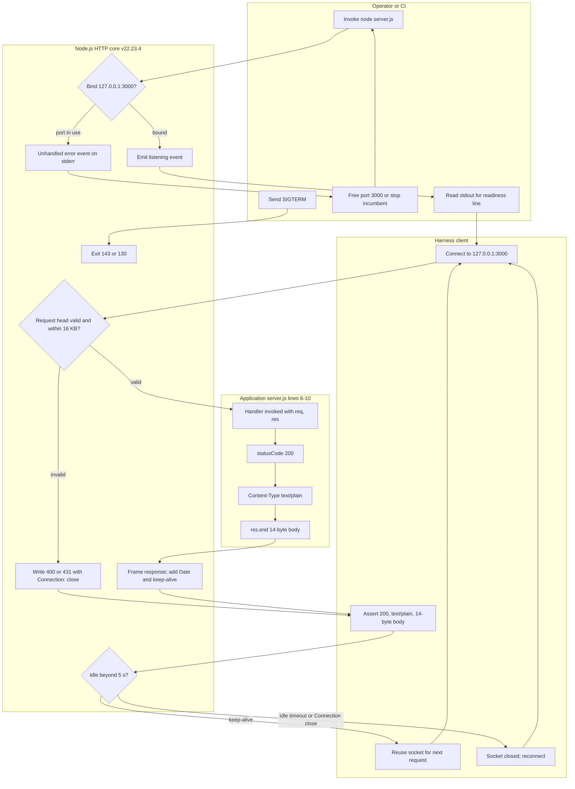

Reading notes. The application lane holds four nodes and no decision: every branch in the diagram belongs to the runtime or the actors. Start-up (~41 ms) precedes all request traffic and emits exactly one line, which is the only readiness signal the operator has. The client loop closes through either socket reuse or reconnection, so a harness that keeps connections open must treat the close as normal. Termination enters from the operator lane and bypasses every request path.

### 4.4.3 Detailed Process Flows per Core Feature

**DIAG-02 — F-001 Fixed-Response HTTP Request Handling.** Every path from accepted connection to closed socket, including the three parser rejections, the `HEAD` variation and socket disposition.

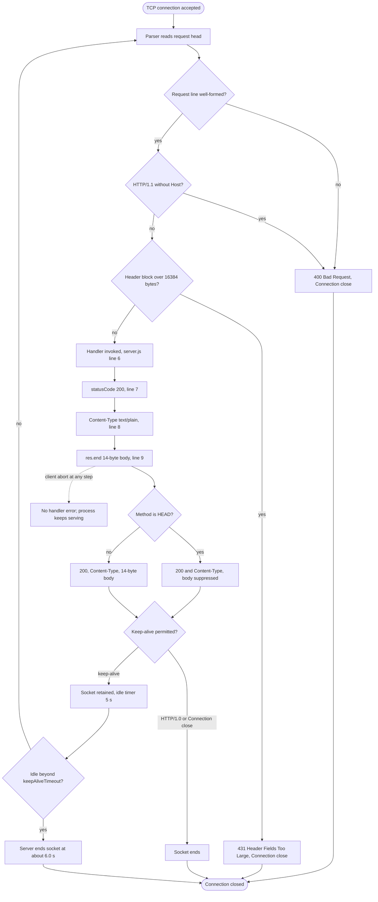

Reading notes. Steps S3-S6 execute in a single event-loop tick with no I/O and no `await`, which is why measured latency stays near 0.45 ms mean. The three rejection branches (`E1`, `E1` again via `D2`, `E2`) terminate before the handler, so they can never produce a 5xx. The abort branch is dotted because it can occur at any point and is invisible to the application: it is satisfied by Node's socket layer and leaves the process serving. The loop back from `D6` to `S2` is the only repetition in the system, and it is driven by the client, not by a scheduler.

**DIAG-03 — F-002 Loopback Listener Binding and Start-up Readiness Announcement.** The start-up sequence, its single decision, and both terminal states.

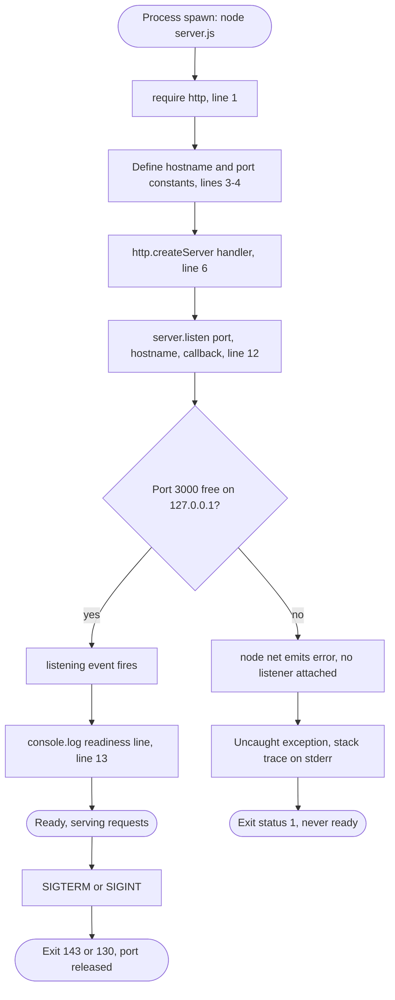

Reading notes. Only one decision governs start-up, and it is made by the network stack, not by the application. The readiness line is written from the `listening` callback, so its presence proves the bind succeeded — a property §3.6.5 relies on for pipeline readiness. The failure path produces no stdout at all, which is why stderr and the exit status must both be watched. Node fails on the first bind attempt: nothing retries.

**DIAG-04 — F-003 Dependency-Free Packaging and Zero-Configuration Start-up.** Invocation routes, the empty install step, and the two documented dead ends.

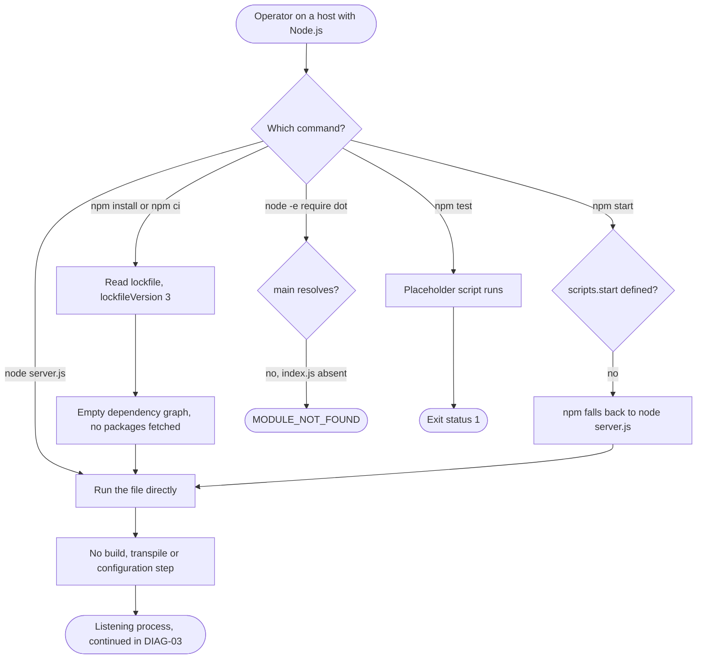

Reading notes. Every successful route converges on running `server.js` directly, whether by explicit command or npm's fallback; the install route is a no-op that still ends there. The two dead ends are properties of the manifest, not defects introduced by the caller: `main` names `index.js` (`package.json` line 5), a file absent from the repository, and the `test` script is npm's placeholder (`package.json` line 7). The `npm start` route and its fallback are observed in §3.6.2 and reconcile the divergence noted in §2.4.4 constraint C-3.

### 4.4.4 Error Handling Flowchart

**DIAG-05** traces each failure from detection point through notification channel to recovery, and is the diagram behind the tables in §4.3.2.

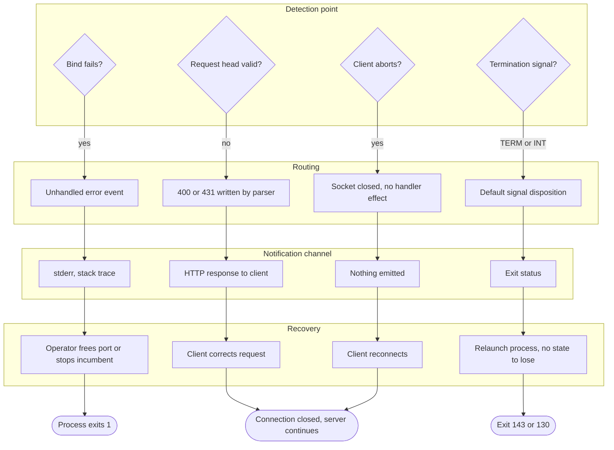

Reading notes. Only the first path terminates the whole process; the other three are absorbed at the connection level, which is why the system's availability is bounded by its single listener rather than by request handling. `NT3` is deliberately an explicit "nothing emitted" node: a client abort is invisible in both stdout and stderr, so no log-based monitor can detect it. Notice that no path leads to a 5xx status or to a retry, because the handler has no failure branch and no retry construct exists anywhere in the repository.

### 4.4.5 Integration Sequence Diagram

**DIAG-06** orders the messages of one run: readiness, a request/response exchange, the keep-alive alternatives, and termination. It is the sequence view of §4.1.2.

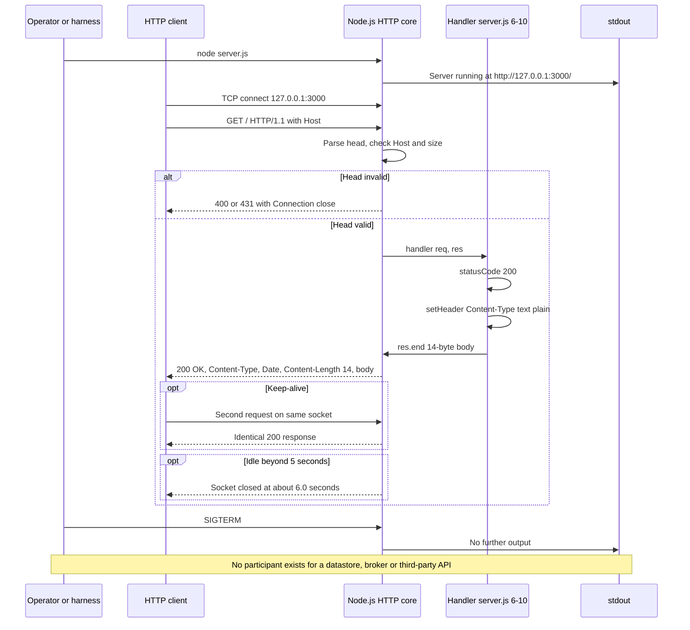

Reading notes. The lifelines are exactly the actors of §4.1.2: a client outside the process, the runtime and handler inside it, and stdout as the operator's channel. There is no outbound participant because the census in §4.1.2 found none. The handler's three statements appear as self-calls in strict order, and the only conditional block in the whole exchange is Node's decision to reject a malformed head before the handler is reached. `SIGTERM` produces no shutdown dialogue — the process simply exits with 143.

### 4.4.6 State Transition Diagram

**DIAG-07** is the lifecycle model behind §4.3.1: five states, one failure exit, and no application-driven transition.

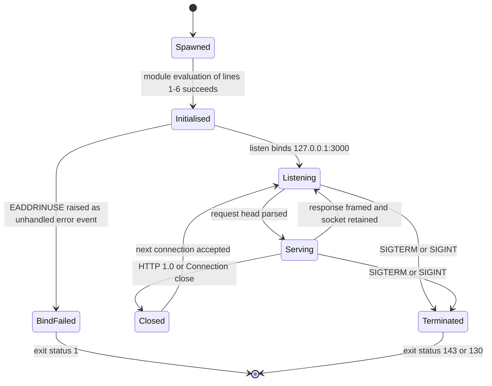

Reading notes. There is no per-request state to model: `Serving` retains nothing from one request to the next, so the diagram has no parallel regions, no history states and no composite state for a request. `BindFailed` is the only error state, and it is unreachable from `Listening`, since the port is bound once and never rebinds. `Terminated` is reached from either live state by a signal rather than by application logic, matching the absence of any `process.on` handler. Restarting the process recreates exactly this graph with no reconciliation step, because §4.3.1 finds no persisted state.


## 4.5 References

- `server.js` — the sole executable file (14 lines): line 1 requires the `http` module; lines 3-4 fix `hostname = '127.0.0.1'` and `port = 3000`; lines 6-10 are the inline request handler (`statusCode`, `setHeader`, `end`); lines 12-14 bind the listener and log readiness. Every application-side claim in §4.1-§4.4 rests on these line ranges, including the finding that no conditional, `try`/`catch`, `process.on`, `setTimeout` or `req.` access exists.
- `package.json` — manifest used for the F-003 flows: `main` points at the absent `index.js` (line 5), `scripts` holds only the placeholder `test` command (line 7), no `start` script; identity `hello_world@1.0.0`, author `hxu`, MIT (lines 2-10). Basis for the two dead ends in DIAG-04.
- `package-lock.json` — `lockfileVersion: 3` with a single root `packages[""]` entry and no dependency records; establishes the empty graph behind the no-install route in §4.1.2 and DIAG-04, and the MIT declaration on line 11.
- `README.md` — two lines: the project name and "test project for backprop integration. Do not touch!"; the stated purpose quoted in §4.1.1 and the source of the no-modification constraint honoured in §4.2.2.
- `.blitzyignore.txt` — zero-byte ignore-list fixture; confirmed the effective ignore set was empty, so no repository content was excluded from this section.
- `test.blitzyignore.txt` — second zero-byte ignore-list fixture, checked for the same reason.
- repository root folder (`""`) — flat layout of exactly six tracked files and no sub-folders, establishing that the workflows documented here are the complete set of executable behaviours available.
- `.git/` — single commit `28e5918` on branch `QA-Linux-env-20-nov` (with `main` and `origin/main`), confirming a one-commit history with no prior process implementation to document.
- Node.js v22.23.4 runtime (observed via `node --version` and introspection of an unconfigured `http` server) — source of the defaults the fixture does not override: `keepAliveTimeout` 5000 ms, `headersTimeout` 60000 ms, `requestTimeout` 300000 ms, socket timeout 0, `http.maxHeaderSize` 16384 bytes, and the parser-generated 400/431 responses.
- Cross-references within this specification: §1.2.1 (fixture context and actors), §1.2.3 (measurable objectives used as the request-level acceptance contract), §1.3 (out-of-scope items that explain the absent validation and authorization checkpoints), §2.1.1-§2.1.3 (F-001, F-002, F-003 identities and implementation surfaces), §2.4.4 (constraints C-1 and C-2, and the `npm start` divergence reconciled in §4.4.3), §3.6.2 (invocation matrix and observed `npm start` fallback chain), §3.6.5 (pipeline steps that depend on the readiness line and on exit 143), §3.6.6 (operational behaviour table restated as state transitions), §3.6.7 (assertion reliability of Node-generated headers).

No external web source was required: the Node.js default values cited above were read from the runtime itself, and every other statement traces to a repository file or to a probe against the running process.


# 5. System Architecture

## 5.1 High-Level Architecture

### 5.1.1 System Overview

**Architecture style.** The system is a single-process, single-file, dependency-free monolith: one CommonJS script (`server.js`, 14 lines) evaluated by the Node.js runtime, which binds one loopback TCP socket and answers every inbound request with a constant payload. `package.json` declares no `dependencies`, `devDependencies`, `peerDependencies` or `optionalDependencies`, and `package-lock.json` records `lockfileVersion: 3` with a single root package entry and no dependency map, so the process's only library code is Node's standard library — imported once, at `server.js` line 1: `require('http')`.

The style is a consequence of the system's stated role rather than an engineering preference. `README.md` line 2 defines the project as "test project for backprop integration. Do not touch!", so the design objective is the smallest surface that still exercises a real network round trip: one artefact to launch, one runtime prerequisite, no provisioning, no configuration, and no code to keep in sync with an external tool. There is exactly one request path, no internal layers to compose, and no boundary inside the process other than the one between the application's four statements and the runtime that invokes them.

**Architectural principles.** Each principle below is observable in the tracked files, not aspirational:

- **Standard-library only.** The sole import is `http` (`server.js` line 1); no framework, no middleware, no HTTP helper package exists in the manifest or lockfile.
- **Zero configuration.** The bind address and port are module-scope literals (`const hostname = '127.0.0.1'`, `const port = 3000`, lines 3-4). No environment variable, command-line argument, configuration file or secret store is read anywhere in the repository.
- **Stateless request handling.** The handler ignores the request object entirely — it dereferences no `req` property — so no request can influence another and no session, cache or counter exists.
- **Loopback confinement.** The listener is bound to `127.0.0.1`, not to a wildcard address, so the socket is unreachable from any other host by design.
- **Fail-fast lifecycle.** There is no retry, backoff, fallback port or standby instance: a bind conflict is an unhandled `'error'` event that terminates the process with exit status 1.
- **Source equals deployment.** There is no build, transpile, bundle or container step; the committed `server.js` is what the runtime executes.

**Patterns in use.** The code uses Node's handler-registration pattern (`http.createServer((req, res) => …)`, `server.js` line 6) and a one-shot lifecycle callback (`server.listen(port, hostname, () => …)`, line 12) that doubles as the readiness signal. Request servicing is event-driven and non-blocking: the runtime accepts the connection, parses the request head, and invokes the closure on the event loop, so the handler executes in a single tick with no I/O and no `await`.

**Patterns deliberately absent.** Verified by a text census over every tracked file: no routing table, no middleware chain, no controller/service/repository layering, no dependency injection, no ORM or query builder, no message broker client, no circuit breaker, no retry construct, no cache client, no logging framework. Consequently the section's component model is small enough to enumerate exhaustively (§5.1.2) rather than sampled.

**System boundaries.** Four boundaries define what the system is:

| Boundary | What crosses it | Evidence |
|---|---|---|
| Network | A single inbound TCP listening socket on `127.0.0.1:3000`; no outbound connection is ever opened | `server.js` lines 3-4, 12; no `fetch`, `net`, `http.request` or client call in any file |
| Runtime ↔ application | The `http` core parses heads, frames responses and owns sockets; the application contributes four statements | `server.js` lines 6-10 versus observed parser-generated 400/431 behaviour (§4.3.2) |
| Process ↔ operator | One stdout line at start-up, stack traces on stderr, exit status, and `SIGTERM`/`SIGINT` disposition; there is no channel *into* the process | `server.js` line 13; no `process.env`, `process.argv` or `process.on` anywhere |
| Package | `package.json`/`package-lock.json` are consumed by npm at install and script time only, never by the running process; `main` names an absent `index.js`, so the package cannot be required as a library | `package.json` line 5; `node -e "require('.')"` fails with `MODULE_NOT_FOUND` (§3.6.2) |

**Major interfaces.** IF-1 request ingress (any method, any path, plain HTTP/1.1); IF-2 response egress (status 200, `Content-Type: text/plain`, 14-byte body `Hello, World!\n`); IF-3 process control and observation (readiness line, stderr, signals, exit codes); IF-4 the npm manifest contract, which is only partially honoured because of the missing `main` target.

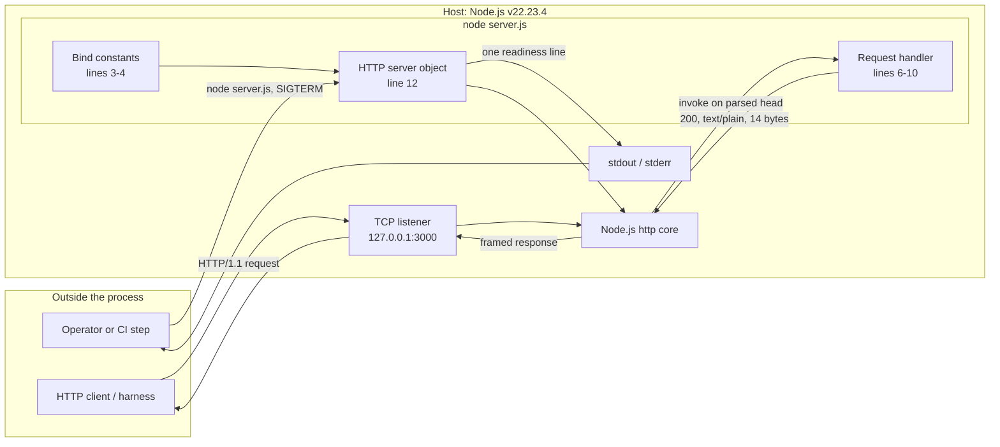

**Architectural assumptions.** The repository provisions none of these, so each is an assumption the system's operation depends on:

- **A-1** A Node.js runtime is present on the host (v22.23.4 verified; the syntax baseline is Node 6-era CommonJS).
- **A-2** TCP port 3000 on `127.0.0.1` is free, and exactly one instance runs per host, because neither value can be overridden without editing the source.
- **A-3** Every caller reaches the process through the loopback interface — same host, an SSH tunnel or a port-forward — since the bind address is not routable.
- **A-4** The process is launched as `node server.js` (or `npm start`, which resolves by fallback), because the manifest's `main` points at a file that does not exist.
- **A-5** Availability is whatever a single unsupervised process provides; no supervisor, service unit or orchestrator is part of the system.

### 5.1.2 Core Components Table

Every component is enumerated — the repository holds six tracked files, two of them empty ignore-list fixtures, so no component is omitted for brevity.

| Component Name | Primary Responsibility | Key Dependencies & Integration Points | Critical Considerations |
|---|---|---|---|
| HTTP application server — `server.js` (lines 6, 12-14) | Construct the server object, install the handler, bind `127.0.0.1:3000`, publish one readiness line | Depends on `http` (stdlib) and the OS socket layer. Integrates with the `http` core (creates the server, calls `listen`) and with stdout (line 13) | Sole entry point and only artefact deployed; bind is hard-coded; no `'error'` listener is attached, so a bind failure is fatal; the file exports nothing |
| Request handler closure — `server.js` (lines 6-10) | Convert every inbound request into `200`, `Content-Type: text/plain`, body `Hello, World!\n` | Depends only on `res` (`ServerResponse`); `req` is never dereferenced. Invoked by the `http` core for each parsed request | No routing, method, path or header inspection; no `try`/`catch`, so an exception here would be uncaught; body is a 14-byte constant, identical for all inputs |
| Node.js `http` core — stdlib `http` module with `net`/libuv beneath | Parse request heads, enforce limits (16,384-byte header block), frame responses, own sockets and keep-alive timers | Depends on the Node.js runtime (v22.23.4 verified) and the OS TCP stack. Receives connections, emits `'request'`, writes bytes, ends idle sockets | The only source of 4xx behaviour (400 for malformed head, 431 for oversized headers); generated headers (`Date`, `Connection`, `Keep-Alive`, `Content-Length`) are runtime-supplied and version-dependent |
| Startup configuration — `server.js` (lines 3-4) | Supply the immutable bind host and port read by `listen` | No dependency (string and number literals). Read once, in `server.listen` | No environment, CLI or file override; relocating the port requires editing source, which conflicts with the README's "Do not touch!"; fixed port forces one instance per host |
| Manifest and lockfile — `package.json`, `package-lock.json` | Declare identity (`hello_world` 1.0.0, MIT), the `main` entry, the `test` placeholder, and the empty dependency graph | Depends on npm (11.21.0 verified) at install/script time. Never read by the running process | `main` names `index.js`, which does not exist; `npm test` is npm's always-failing placeholder; no `type` field, so CommonJS is implied; zero third-party supply-chain surface |

### 5.1.3 Data Flow Description

**Start-up flow.** Module evaluation reads `http` (line 1), defines the two bind constants (lines 3-4), calls `http.createServer` with the handler closure (line 6) and then `server.listen(port, hostname, callback)` (line 12). The runtime binds the loopback socket and fires the callback, which writes the single start-up line `Server running at http://127.0.0.1:3000/` to stdout (line 13). No request can be serviced before that bind succeeds, and nothing else is written to stdout for the life of the process, so the line doubles as the readiness signal used by any harness (§3.6.5).

**Request ingress and transformation.** Data arrives as a TCP segment on the listening socket; the `http` core accumulates it, parses the request head, applies its syntax and size checks, and only then invokes the handler with `(req, res)`. This is the system's single application-level transformation point: an arbitrary request — any method, any path, any query string, any headers — becomes one constant response. Because no `req` property is read, there is no input parsing, no deserialization, no validation and no branch: the payload is a string literal (line 9), not a rendered template or serialized object.

**Response egress and framing.** The handler performs three writes in order: `res.statusCode = 200` (line 7), `res.setHeader('Content-Type', 'text/plain')` (line 8), and `res.end('Hello, World!\n')` (line 9). The `http` core then frames the response, deriving `Content-Length: 14` from the written body, stamping `Date`, and choosing `Connection: keep-alive` with `Keep-Alive: timeout=5` per protocol rules. All framing metadata is therefore runtime-derived, not application-specified; the application contributes exactly one header.

**Connection reuse.** Responses leave the process over the same socket the request arrived on. After the response is framed, the socket is retained for a further request until the idle timeout elapses (observed: a probe reusing one connection completed two requests with `num_connects` 1 then 0, and the server closes an idle socket at roughly 6.0 s — §4.3.1). This is the only reuse mechanism in the system; there is no response cache, no memoisation and no connection pool to a downstream service, because no downstream service exists.

**Error-path flows.** Two flows bypass the application entirely. A malformed head or an oversized header block is rejected by the parser with 400 or 431 and `Connection: close` before the handler runs, so the client learns of the failure from the HTTP response. A bind failure at start-up travels in the opposite direction: the `net` layer raises an `'error'` event with no listener attached, Node prints the stack trace to stderr, and the process exits 1 having written nothing to stdout. A client abort mid-write is absorbed by the socket layer and produces no application signal at all.

**Key data stores and caches.** None. The system opens no database connection, writes no file, holds no queue and emits no cache directive (`Cache-Control`, `ETag` and `Last-Modified` are all absent). The complete runtime state inventory is: two immutable bind constants, the server object, the handler closure, and Node's per-socket buffers and timers — all process-local and none durable. The full message ordering of a run is drawn as DIAG-06 in §4.4.5 and, from the component perspective, as ARCH-04 in §5.2.8.

### 5.1.4 External Integration Points

The system has four external touchpoints, all of them local to the host. It performs no outbound network call of any kind: the code census over all tracked files returns `require('http')` as the only import, and no client-side API (`http.request`, `fetch`, `net.connect`, `dns`) appears anywhere. There is likewise no third-party service, database, message broker, identity provider or telemetry backend to integrate with (see §3.4).

| System Name | Integration Type & Data Exchange Pattern | Protocol/Format | SLA Requirements |
|---|---|---|---|
| HTTP client or test harness (curl, CI probe, browser on the same host) | Inbound synchronous request/response. The client always initiates; the server never calls back, pushes or streams beyond the one response | HTTP/1.1 over plain TCP on `127.0.0.1:3000`; any method and path accepted; response `text/plain`, 14-byte body, no cache headers | None published. Observable behaviour: sub-millisecond loopback response (§4.2.1), keep-alive socket retained ~5 s, close at ~6.0 s idle. Availability equals that of the single process |
| Host operating system network stack | Socket bind and accept; the kernel queues connections until the runtime accepts them | IPv4 TCP on the loopback interface, port 3000 | None declared. Hard requirement: the port must be free, otherwise `EADDRINUSE` ends the process with exit 1 |
| Operator, shell or CI step (process supervisor) | One-way process control and observation: launch, read the readiness line, read stderr, send signals, read exit status | Plain-text lines on stdout/stderr; POSIX signals; exit codes 0, 1, 130, 143 | Readiness must be inferred from a single stdout line; there is no health endpoint, no retry and no supervision supplied by the system |
| npm CLI | Development-time manifest and lockfile consumption; no registry traffic, because the dependency graph is empty | `package.json` (JSON) and `package-lock.json` (`lockfileVersion: 3`) | Not applicable at runtime. npm 7 or later is needed to read the lockfile format (npm 11.21.0 verified) |

Two consequences follow for anyone integrating with this system. First, the HTTP surface is a pure function of the source constants, so a client cannot influence the response and needs no credentials, headers or body — a bare `GET /` is as valid as any other request. Second, the interface that matters most in practice is the process interface, not the HTTP one: the readiness line, exit status and stderr are the only channels through which the system reports anything about itself.


## 5.2 Component Details

The five components of §5.1.2 are documented below in execution order, each against the same five aspects — purpose, technologies, interfaces, persistence and scaling — so that the gaps are as visible as the capabilities. Section 5.2 closes with the three diagrams the architecture requires: component interaction, connection state transitions, and the message sequence of one run.

| ID | Diagram type | Question it answers | Rendered in |
|---|---|---|---|
| ARCH-01 | Flowchart, context and boundaries | What lies inside and outside the process, and which interfaces cross the boundary? | §5.1.1 |
| ARCH-02 | Flowchart, component interaction | Which component calls which, and in what order are the runtime objects created? | §5.2.6 |
| ARCH-03 | State transition, connection lifecycle | What states does a socket pass through inside the `http` core? | §5.2.7 |
| ARCH-04 | Sequence diagram, start-up and request | In what order do messages cross the process boundary in one run? | §5.2.8 |
| ARCH-05 | Decision tree | Which alternatives were weighed for each architectural choice? | §5.3.7 |
| ARCH-06 | Decision graph (ADR view) | Which decision drives which consequence, and where do they interlock? | §5.3.8 |
| ARCH-07 | Flowchart, error handling | Where is each failure detected, which channel reports it, and who recovers? | §5.4.7 |

### 5.2.1 HTTP Application Server (`server.js`)

**Purpose and responsibilities.** The file is the system. It performs four responsibilities in sequence: load the `http` module (line 1); declare the bind address and port as module-scope constants (lines 3-4); construct the server and register the handler (`const server = http.createServer((req, res) => {…})`, line 6); and start listening while announcing the address (`server.listen(port, hostname, () => { console.log(…) })`, lines 12-14). It owns the process lifetime: once `listen` succeeds, the event loop stays alive because a listening socket is a live handle, and it exits only on a signal or an unhandled error.

**Technologies and frameworks used.** Node.js standard library only, evaluated as CommonJS — `package.json` declares no `type` field, and the file uses `require` and no `import`. The code uses ES6-era syntax (arrow functions at lines 6 and 12, a template literal at line 13, `const` bindings); no transpiler, bundler, framework or middleware package is present in the manifest or lockfile.

**Key interfaces and APIs.** Consumed: `http.createServer(requestListener)`, `server.listen(port, host, callback)`, and on the response object `statusCode`, `setHeader(name, value)` and `end([data])`. Published: nothing in the module sense — the file sets no `module.exports`, defines no class or named function, and cannot be imported for reuse. Its externally visible surface is entirely process-level: the stdout line `Server running at http://127.0.0.1:3000/` (line 13), the response it writes, stderr on fatal error, and its exit status.

**Data persistence requirements.** None. No `fs`, `path` or database driver is required anywhere; the process writes nothing to disk, holds no buffer to flush, and keeps no record of the requests it served. The only durable artefact is the 342-byte source file itself, which is identical to the deployed artefact because there is no build step (§3.6.3).

**Scaling considerations.** The handler is constant-time and allocates nothing per request, so per-request cost is dominated by socket handling in the runtime; the process is therefore bound by a single event-loop thread and a single CPU core. Horizontal scaling is structurally blocked, not merely unconfigured: the bind address is a literal `127.0.0.1` and the port a literal `3000`, so a second instance on the same host fails with `EADDRINUSE` and exits 1, and a copy on another host is unreachable because the listener is not routable. Concurrency within one process is still real — 50 simultaneous requests were all answered with identical 200 responses (§4.3.1) — but capacity and availability are those of one unsupervised process.

### 5.2.2 Node.js `http` Core

**Purpose and responsibilities.** The runtime component does everything the application does not: accept TCP connections, buffer and parse request heads, enforce parser limits (a header block over 16,384 bytes yields `431`; a malformed request line yields `400`, both with `Connection: close`), emit the `'request'` event that invokes the handler, frame the response (deriving `Content-Length` and stamping `Date`), choose connection disposition, and run the keep-alive idle timer that closes an unused socket after roughly 6.0 s. It is also the only component that can produce a non-2xx response, because no application code path can fail after the status code is set.

**Technologies and frameworks used.** The `http` module shipped with Node.js, built on `net` and libuv. The verified runtime is Node.js v22.23.4 (V8 12.4.254.21-node.57, libuv 1.51.0, §3.6.1); nothing in the repository pins a runtime version, and the manifest declares no `engines` field.

**Key interfaces and APIs.** Inbound from the application: `http.createServer(requestListener)` and `server.listen(...)`, plus the `ServerResponse` methods the handler calls. Outbound to the application: the `'request'` event (delivered as the handler arguments) and, on failure, an `'error'` event that no listener handles — which is why `EADDRINUSE` terminates the process. Outbound to the client: the status line, headers and body bytes, plus parser-generated 400/431 responses for requests the application never sees.

**Data persistence requirements.** None. The component holds per-socket state only — receive buffers, the parsed head, the write queue and two timers (`headersTimeout`, `keepAliveTimeout`) — all in memory and all discarded when the socket closes.

**Scaling considerations.** Concurrency is event-loop based: the core interleaves sockets on one thread, so a slow client costs a timer and a buffer rather than a thread. It is horizontally bounded by the same fixed loopback bind as §5.2.1. No `cluster`, `worker_threads` or `SO_REUSEPORT` usage appears in the repository, so a single process uses one core and there is no in-process fan-out.

### 5.2.3 Request Handler Closure (`server.js` lines 6-10)

**Purpose and responsibilities.** This is the whole of the system's business logic: setting `res.statusCode = 200`, `res.setHeader('Content-Type', 'text/plain')` and ending the response with `Hello, World!\n`. It deliberately ignores the request object, so it carries no routing, method dispatch, content negotiation, body parsing or authorisation.

**Technologies and frameworks used.** A single inline ES6 arrow function passed to `http.createServer`. It captures no variable from its enclosing scope — it reads neither `hostname` nor `port` nor any module-level binding — so it is effectively a pure generator of one response.

**Key interfaces and APIs.** Signature `(req, res)` as defined by the `requestListener` contract. Only three members are touched, all on `res`: `statusCode`, `setHeader`, `end`. The payload is a string literal, so no serializer, template engine or view layer participates; the terminating newline is part of the 14-byte body.

**Data persistence requirements.** None. The closure keeps no state between invocations; nothing it computes survives the response, which is why two consecutive requests on one socket produce byte-identical responses and why a restart is indistinguishable from the first run.

**Scaling considerations.** O(1) per request with no I/O, no `await` and no blocking call, so the handler cannot be the bottleneck and cannot starve the event loop. It has no failure branch — there is no `try`/`catch` and no `uncaughtException` handler — which makes it trivially predictable but means any future edit that can throw would kill the process rather than return a 5xx.

### 5.2.4 Startup Configuration (`server.js` lines 3-4)

**Purpose and responsibilities.** Supply the two values the listener needs: `hostname = '127.0.0.1'` and `port = 3000`. These constants are the system's entire configuration surface and the reason for its network posture — the loopback literal confines the listener to the host, and the port literal makes the endpoint a fixed, documented contract for any harness.

**Technologies and frameworks used.** String and number literals bound with `const`; no configuration library, parser, schema or secret store.

**Key interfaces and APIs.** Read once, positionally, by `server.listen(port, hostname, callback)` at line 12. There is no interface for changing them at runtime: no environment variable is read (`process.env` appears zero times in the repository), no argument is parsed, and no configuration file is opened.

**Data persistence requirements.** None. The values live in the source file, which is the only place they are persisted; they are immutable for the process lifetime by virtue of `const`.

**Scaling considerations.** The fixed port enforces one instance per host and the loopback literal enforces host locality, so configuration is the binding constraint on every scaling option in this section. Changing either value requires editing `server.js`, which the README's "Do not touch!" instruction forbids; any deployment that must expose the service therefore needs a deliberate, documented deviation rather than an operational setting.

### 5.2.5 Manifest and Lockfile (`package.json`, `package-lock.json`)

**Purpose and responsibilities.** Declare the package identity (`hello_world`, version 1.0.0, MIT, author `hxu`, description "Hello world in Node.js"), the entry point (`main: index.js`), the single lifecycle script (`test`, npm's always-failing placeholder) and the dependency graph. The lockfile discharges the last of these by recording that the graph is empty.

**Technologies and frameworks used.** npm's JSON manifest format and `lockfileVersion: 3`, read by npm 11.21.0 in the verified environment. Neither file is opened by the running process, so no runtime dependency on npm exists.

**Key interfaces and APIs.** Interfaces exposed to npm and to any consumer of the package: `name`/`version` as the identity, `main` as the module entry, `scripts.test` as the only runnable command. Two of these are broken or inert as published — `main` names `index.js`, a file absent from the repository, so `require('.')` fails with `MODULE_NOT_FOUND`; and `npm test` exits 1 by design. No `bin`, `files`, `exports`, `engines` or `repository` field narrows or extends the contract.

**Data persistence requirements.** None at runtime. The manifest and lockfile are the only tracked files whose content is durably consumed, and they are consumed at install or script time; the process itself never reads them.

**Scaling considerations.** Not applicable to runtime capacity. Their architectural significance is supply-chain: because the dependency graph is empty, provisioning installs nothing, and there is no third-party code to audit, patch or compromise (§3.3.4).

### 5.2.6 Component Interaction Diagram

**ARCH-02** shows how the five components construct each other and how traffic traverses them. Packaging appears as a development-time lane because it influences how the process is launched but is never read by it.

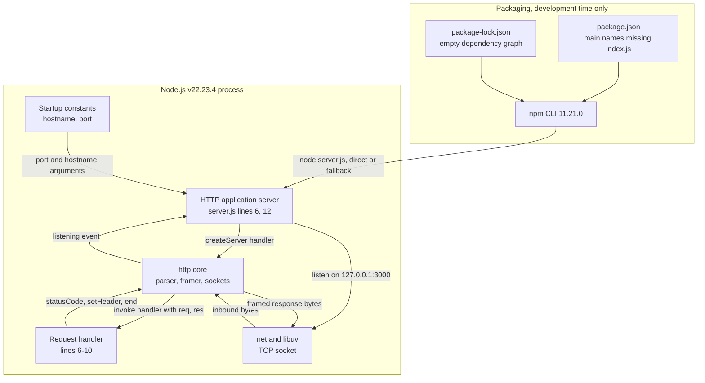

Two readings matter. First, the application server is the only node that calls into both the runtime and the network layer, which is why every failure it can encounter is reported at the process boundary rather than to a caller. Second, the handler occupies a leaf position: it is called by the core and returns values only through `res`, so it cannot initiate any interaction of its own — the system has no outbound edge.

### 5.2.7 Connection State Transitions

**ARCH-03** models the lifecycle of a single client connection inside the `http` core, which is the unit that repeats during operation. The process-level lifecycle (spawn, bind, terminate, exit codes) is already drawn as DIAG-07 in §4.4.6 and is not repeated here; the two diagrams are orthogonal — one process hosts many connections, each of which follows this graph.

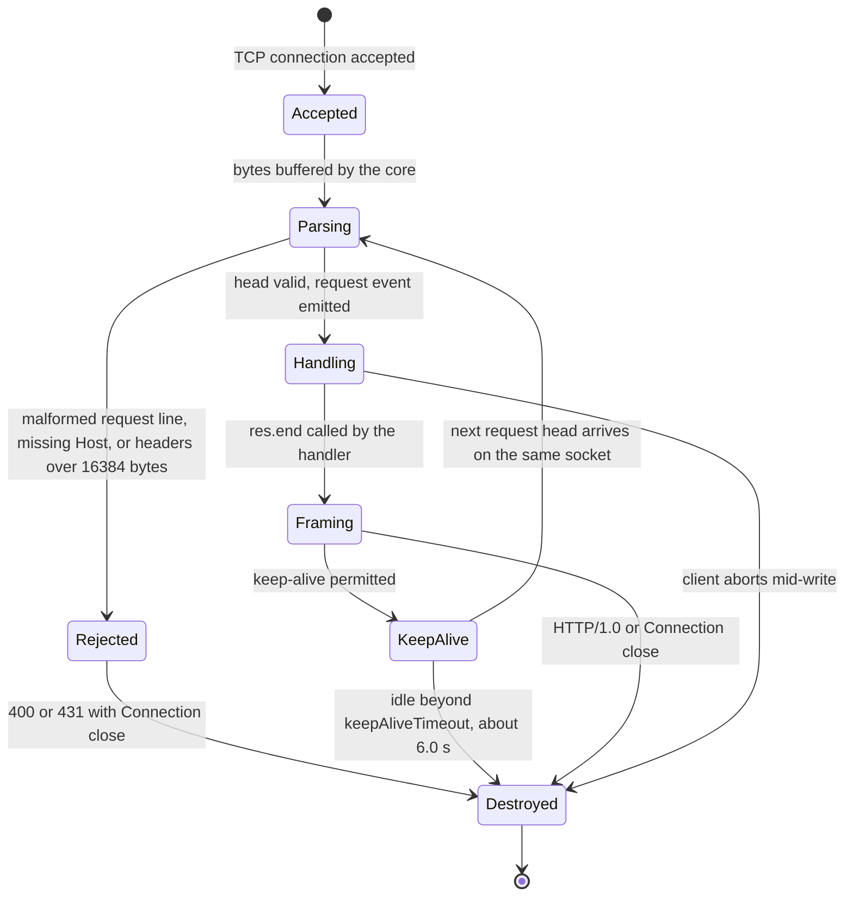

The graph has one loop (`KeepAlive` → `Parsing`) and it is driven entirely by the client: nothing inside the process schedules a new request. Every exit path is terminal for that connection and harmless to the process — a rejected or aborted connection destroys a socket, not the listener — which is the architectural reason the system's availability is bounded by the listener rather than by request handling.

### 5.2.8 Sequence Diagram: Start-up, One Request, Termination

**ARCH-04** orders the messages of a complete run across all five participants, including both start-up outcomes and the two response alternatives. It is the component-level counterpart of the workflow sequence in §4.4.5 (DIAG-06).

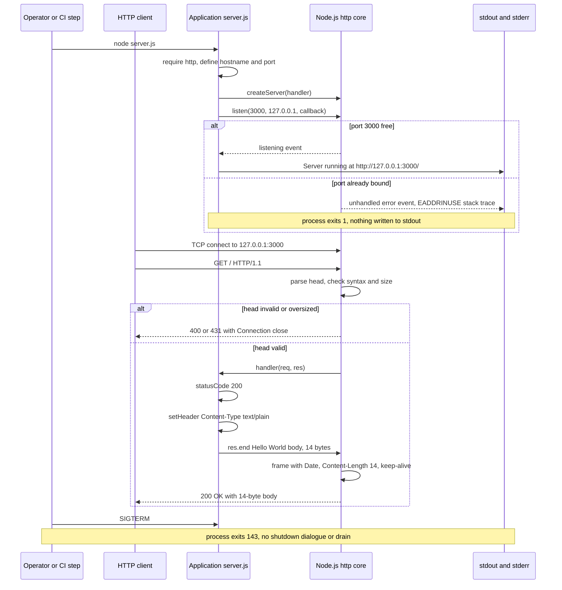

The sequence makes three architectural properties explicit. Start-up and request servicing are strictly ordered — no request can be answered before the readiness line, and the readiness line is the only confirmation an operator gets. The only conditional in the request path belongs to the runtime, so the application's three write statements always execute as a unit or not at all. Termination has no dialogue: the operator's signal ends the process without flushing, draining or reporting, which is acceptable precisely because there is no state to lose.


## 5.3 Technical Decisions

The repository contains no architecture decision records, no design notes and no issue history beyond a single commit (`28e5918`, "Add files via upload"). The decisions below are therefore reconstructed from what the code and manifest do and from what they conspicuously omit, and each is stated with the alternatives its own evidence rules out. Every one carries the same bias: the fixture must stay minimal and untouched (`README.md` line 2), so the cheapest option that still exercises a real network round trip wins.

### 5.3.1 Decision Register

| ADR and Decision | Context and Rationale | Alternatives Rejected | Consequence Accepted |
|---|---|---|---|
| **ADR-01** Single-process, single-file application with no framework or layering | The system exists to exercise one HTTP exchange; layers would add files, indirection and coordination for a response that never varies | Express/Fastify with a router; controller-service-repository layering; serverless handler | Entire system is 14 lines; no unit boundaries, no reusable module, no separation of concerns |
| **ADR-02** Standard-library-only dependency policy | An empty dependency graph means nothing to install, audit or patch, and the fixture stays valid indefinitely | HTTP framework; logging, metrics or config packages; test runner | No middleware, no structured logging, no metrics client, no test framework (§3.3.4) |
| **ADR-03** Plain HTTP/1.1 on a loopback-bound socket | The only consumer is a local harness; the loopback literal keeps the fixture off every other interface | TLS termination; wildcard (`0.0.0.0`) bind; sidecar proxy | Unreachable off-host and no transport security; exposing it requires editing the source |
| **ADR-04** Binding address and port as source literals | A configuration channel would be one more input to explain and one more way to misconfigure a fixture | Environment variables; CLI flags; configuration file | One instance per host; port relocation needs a code change, which conflicts with "Do not touch!" |
| **ADR-05** No persistence | There is no data to keep: the response is a constant and requests leave no trace | SQLite or JSON file; external database; write-ahead log | Restart is always clean and idempotent; no history, no audit trail, nothing to migrate |
| **ADR-06** No application cache and no cache directives | The body is constant, so caching would save no work and revalidation would add headers to a fixed contract | In-memory cache; `ETag`/`Last-Modified`/`Cache-Control` emission | Reuse is limited to keep-alive sockets; a harness must not expect validators (§4.3.1) |
| **ADR-07** No authentication or authorisation | No protected resource exists; the network position, not code, is the control | Token or basic auth; mTLS; IP allow-list | Any local process can call the endpoint; no identity, no authorisation decision, no audit (§3.6.8) |
| **ADR-08** Fail-fast lifecycle with no retry or supervision | A fixture should fail loudly rather than mask a bad environment | Retry with backoff; `cluster`; process manager or service unit | A bind conflict exits 1 with a stderr trace; recovery is a manual relaunch (§4.3.2) |
| **ADR-09** Source equals deployment | The runtime evaluates the committed file directly, so there is no intermediate artefact to trust | Transpiler or bundler; container image; minification | No build step, no artefact provenance beyond the package version, no optimisation pass |

### 5.3.2 Architecture Style Decision and Tradeoffs

The monolith is chosen against the grain of the usual argument for decomposition: with one endpoint, one response and no state, each would-be module boundary would be a file whose only content is a pass-through. Keeping the whole system in `server.js` buys three properties that matter for a test fixture — a single artefact to launch, a complete code review in 14 lines, and behaviour that is a function of the source alone, so a run cannot vary with deployment topology.

The tradeoffs are equally real and are accepted rather than mitigated. There is no unit under test below the process, which is why every claim in this specification rests on process-level probes (HTTP requests, stdout, exit codes) rather than on function-level tests; `npm test` is npm's failing placeholder, so no test harness exists at all. There is no seam for injecting a different response, a different port or a clock. And there is no reuse: the handler cannot be required as a module because the file exports nothing and the manifest's `main` names an absent `index.js`.

### 5.3.3 Communication Pattern Choice

The system uses one pattern: a synchronous, client-initiated HTTP/1.1 request/response over a single TCP connection, with the runtime deciding connection disposition (`Connection: keep-alive` with a 5 s idle timeout, close at about 6.0 s). The server never initiates a message, never pushes and never streams: `res.end` writes one complete framed response and the handler returns. This is the minimum pattern that still exercises a real network path, which is the fixture's purpose.

Alternatives were excluded by the absence of any counterpart to talk to. Server-sent events or WebSockets would need a consumer and a reason to hold a socket open; gRPC would need a schema, generated stubs and dependencies; a message queue would need a broker and an idempotency story, and would also break ADR-02. The consequences of the chosen pattern are that the client alone paces work, that the idle-timeout close must be treated as normal by a harness (§3.6.6), and that parser limits — a 16,384-byte header block — are part of the contract even though the application never sees them.

### 5.3.4 Data Storage Solution Rationale

No storage solution was selected, and none is needed. The code requires no driver, opens no file, and holds no write buffer; the complete persistent state of the system is the six tracked files, and the only durable output of a run is the 14 bytes written to the client socket. The alternatives were considered and each fails on the same test: there is no datum that must outlive the process. Responses are constant, requests are not recorded, and nothing is derived from prior traffic.

What this buys is operability: a restart can never leave partial state, so there is no recovery, reconciliation, migration or backup procedure to design; a run on any host produces identical results; and there is no store to secure, seed or size. What it costs is observability of history — there is no record of which requests arrived, from where, or when — which is why none of the diagnostic claims in §4.x could be made from the system's own records and had to be observed from the outside.

### 5.3.5 Caching Strategy Justification

There is no application cache and there is no cache directive. The response carries only the application-set `Content-Type` plus runtime-supplied `Date`, `Connection`, `Keep-Alive` and `Content-Length`; `Cache-Control`, `ETag` and `Last-Modified` are absent, so no intermediary or client is given a validator. Caching would be safe — the body is byte-identical for every request — but worthless, because the response costs no computation, no lookup and no I/O to produce. Adding validators would change a fixed, assertable contract for no gain.

The one reuse mechanism that does exist is protocol-level: the socket is retained between requests, so a client that issues several requests over one connection avoids repeated TCP and parser setup. This is a runtime default rather than a system design choice, and it is bounded by the 5 s keep-alive timeout; a client loop must therefore tolerate a close between requests instead of treating it as a failure.

### 5.3.6 Security Mechanism Selection

No authentication mechanism, authorisation model or transport security was selected. There is no user, no credential, no session, no secret and no protected resource: the handler reads nothing from the request, so there is no input to validate, no injection surface to close, and no path to traverse. The controls that exist are architectural rather than implemented, and they are worth naming precisely because they are what make the missing mechanisms defensible:

- **Network position.** The listener binds `127.0.0.1` (`server.js` line 3), so the service is not reachable from another host; exposure requires a deliberate source edit that also violates the README constraint.
- **Input neglect.** The handler never dereferences `req`, so headers, paths, query strings and bodies cannot influence control flow or output.
- **No secret or filesystem surface.** No environment variable is read, no file is opened, and no credential is stored; the process cannot be reconfigured or poisoned through its inputs.
- **No supply chain.** With an empty dependency graph there is no third-party code to audit.

The residual risks are stated rather than solved: no TLS (plaintext on loopback only), no security headers (a scanner will flag the absence of `Strict-Transport-Security`, `X-Content-Type-Options` and similar), no rate limiting, no request logging, and no identity of any kind. Each is acceptable only while ADR-03 holds; enabling external reachability without adding TLS and authentication would be a security regression, and §3.6.8 records that boundary explicitly.

### 5.3.7 Decision Tree

**ARCH-05** reproduces the derivation that ends at the current design. Each question is the one that actually distinguishes the shipped system from a heavier alternative; each rejection is annotated with the reason the evidence supports.

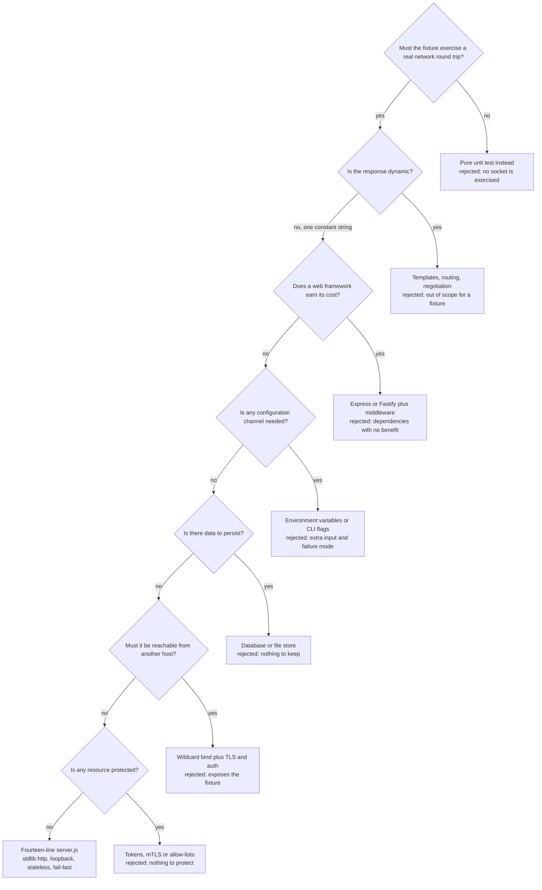

### 5.3.8 Architecture Decision Records

**ARCH-06** renders the register of §5.3.1 as a dependency graph: the decisions that shape the system, the decisions they force, and the consequences each one hands to operations. Reading it left to right gives the causal chain; reading it top to bottom gives the operational burden.

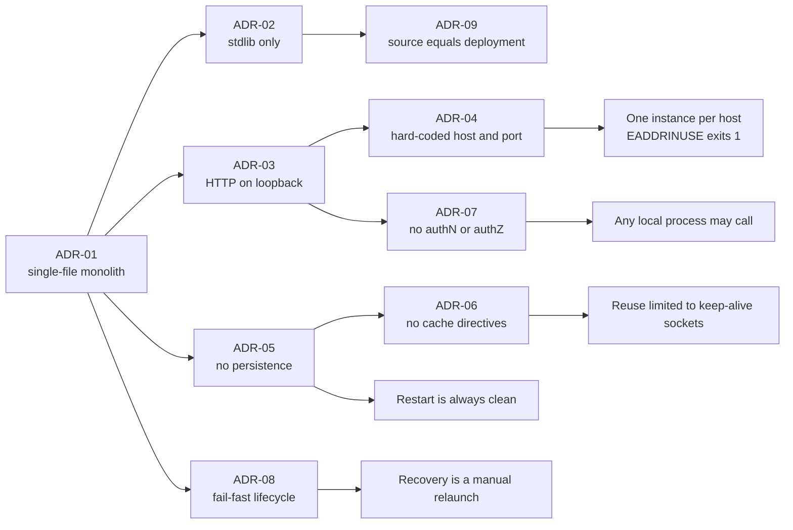

Three couplings explain most of the system's constraints. ADR-03 and ADR-04 are inseparable: a loopback literal plus a fixed port is what makes the endpoint a stable contract for a harness, and the same pair is what makes the system single-instance and host-local. ADR-05 is what keeps ADR-06 honest and makes ADR-08 tolerable — with nothing to persist, a fail-fast exit loses nothing and a relaunch is a complete recovery. And ADR-01 is the root: because there is one file with no dependencies, ADR-02, ADR-09 and the absence of unit-level testing all follow, and any attempt to add a test seam or a configuration channel would first have to overturn it.


## 5.4 Cross-Cutting Concerns

The cross-cutting concerns below are documented in full, including where the system has no strategy at all. In this architecture the absence is the finding: there is no telemetry, no auth, no retry and no persistence, so the only instruments available to an operator are the process boundary — stdout, stderr, exit status — and the HTTP response itself.

### 5.4.1 Monitoring and Observability

The system emits exactly three signals, and none of them is designed for monitoring. Readiness is one stdout line per process (`Server running at http://127.0.0.1:3000/`, `server.js` line 13). Faults appear as an uncaught-error stack trace on stderr. Liveness is inferred by completing a TCP connection, since any path returns 200 without touching a health handler.

| Signal | Emitted when | Consumer | What it can prove |
|---|---|---|---|
| stdout readiness line | Once, from the `listen` callback after a successful bind | Operator or CI step waiting for readiness (§3.6.5) | The bind succeeded at that moment; nothing about later health |
| stderr stack trace | Only on a fatal error, in practice `EADDRINUSE` | Operator or a pipeline watching stderr | The process failed before readiness and will exit 1 |
| HTTP response | Per request | The client | The listener is accepting and the handler is running |
| Exit status | On termination | Supervisor, shell, CI step | 1 bind failure; 143 `SIGTERM`; 130 `SIGINT` |

There is no metrics endpoint, no health or readiness endpoint, no APM agent, no log aggregator integration and no tracing instrumentation; a census over all tracked files returns zero occurrences of `metrics`, `health`, `logger`, `trace`, `otel` and every logging framework. Consequently the following cannot be observed from the running system at all: request counts and rates, per-request latency, error rates (there are none to count), client aborts, which client made a request, and how long the process has been serving. Every quantitative statement in this specification was obtained by probing from outside the process, not by reading a report the system produced about itself.

### 5.4.2 Logging and Tracing Strategy

The logging implementation is one `console.log` call, inside the `listen` callback (`server.js` line 13). It has no timestamp, no level, no component field, no request context and no destination other than the process's stdout stream. No log framework is imported, no log level is configurable, and no request-path statement logs anything: a served request produces no output whatsoever, so a run that serves a thousand requests is indistinguishable on stdout from a run that serves none.

Tracing is absent in both senses. There is no distributed trace because there is no downstream call to trace — the process makes no outbound connection of any kind. There is no correlation identifier either: no request ID is generated, echoed or returned in a header, so two concurrent requests cannot be distinguished in any record. Diagnosing a specific exchange therefore requires capturing traffic at the client or at the socket layer; the system contributes nothing to the narrative except the fact that it started.

### 5.4.3 Error Handling Patterns

Two patterns divide the error surface, and no third pattern exists. At **start-up** the system fails fast: a bind conflict raises an `'error'` event on the server, no listener is registered, Node converts it to an uncaught exception, prints the trace and exits 1 with stdout empty — there is no retry, no backoff, no alternate port and no fallback mode. At **request time** the system delegates entirely to the runtime: parsing failures are answered by Node's parser before the handler is reached, and everything the handler touches is infallible in practice.

| Condition | Detected by | Effect | Recovery |
|---|---|---|---|
| Port 3000 already bound | `net` layer, as an unhandled `'error'` event | Stack trace on stderr, exit 1, never ready | Operator frees the port or stops the incumbent, then relaunches |
| Malformed request line, or HTTP/1.1 without `Host` | HTTP core parser | `400` with `Connection: close`; handler never invoked | Client corrects the request; process unaffected |
| Header block over 16,384 bytes | HTTP core parser | `431` with `Connection: close` | Client reduces the header block |
| Client aborts or destroys the socket | Socket layer | No application effect; no signal emitted | None required; the next request is served normally |
| Idle keep-alive socket | HTTP core timer | Connection ended at about 6.0 s | Client reconnects on its next request |
| Exception thrown in the handler | Node, as an uncaught exception | Would terminate the process; no `try`/`catch`, no `uncaughtException` handler | Manual relaunch; unreachable in the shipped code |
| `SIGTERM` / `SIGINT` | OS | Immediate exit, 143 / 130; no drain or cleanup | Relaunch; nothing to lose |

No path can produce a 5xx, because nothing can fail after `res.statusCode = 200` is assigned, and no path retries: `retry`, `backoff` and reconnection logic appear nowhere in the repository. The practical consequence is that the runtime is the system's de facto error responder for anything the application never sees, and that the only failure requiring human action is the bind conflict.

### 5.4.4 Authentication and Authorization Framework

No authentication or authorization framework is present, and no mechanism of any kind — no token validation, no session, no cookie, no API key, no mTLS, no allow-list, no CORS configuration — appears in any tracked file. There is also nothing to protect: the response is a constant, the handler never inspects the request, and no data is read or written.

| Aspect | Status | Evidence |
|---|---|---|
| Identity verification | Absent | No credential is read; `req` is never dereferenced (`server.js` line 6) |
| Authorization decisions | Absent | No branch exists in the handler; every request receives the same response |
| Session or token handling | Absent | No cookie, `Set-Cookie`, `Authorization` handling or signing code |
| Transport security | Absent | `tls` and `https` appear zero times; plain HTTP on loopback only |
| Secrets management | Not required | No environment variable read, no file opened, no secret stored |
| Effective access control | Network position | The listener binds `127.0.0.1` (`server.js` line 3), so only processes on the host can connect |

That last row is the whole security model, and it has a precise limit worth stating: binding to loopback excludes remote hosts, not local users. Any process on the same machine — including a container sharing the host network namespace — can call the endpoint without identifying itself. That is acceptable for a test fixture with no protected resource, and it would be unacceptable the moment a response with content, or a write, were added (§3.6.8).

### 5.4.5 Performance Requirements and SLAs

No service level, latency budget, throughput target or availability objective is declared anywhere in the repository; `package.json` contains no `engines` constraint and the README states a purpose but no requirement. What can be stated factually is the performance envelope the implementation produces, observed in the probes recorded in §4.2.1.

| Dimension | Observed value or property | Basis |
|---|---|---|
| Time to readiness | About 41 ms from spawn to the stdout line | Measured in §4.3.1 |
| Per-request service time | Four statements in one event-loop tick; mean latency about 0.45 ms on loopback | Measured in §4.4.3 |
| Concurrency | 50 simultaneous requests all answered 200 with identical bodies | Measured in §4.3.1 |
| Connection handling | Keep-alive socket reused for further requests; idle close at about 6.0 s | Probe: two requests on one socket, `num_connects` 1 then 0 |
| Request-size ceiling | Request head accepted up to a 16,384-byte header block, then 431 | HTTP core parser behaviour |
| Resource footprint | One process, one event-loop thread, 342-byte source, no dependencies, no disk or network I/O | `server.js`; empty lockfile graph |
| Availability | Whatever a single unsupervised process provides; no redundancy, no failover | §3.6.6 topology |

The architectural point is that these figures are properties of the design, not commitments: because the handler does no I/O, adds no allocation and reads no request, latency is dominated by the loopback stack and cannot degrade with load except by CPU saturation on one core. Any external consumer that needs a latency or availability guarantee must impose it itself, for example by treating a failed connection as an immediate, unambiguous signal rather than waiting for a timeout.

### 5.4.6 Disaster Recovery Procedures

Recovery is uniform because there is no state: every incident is resolved by making the process run again, and a relaunched process is byte-identically equivalent to the first. The recovery point objective is not applicable — nothing is written, so there is no data to lose — and the recovery time objective is the operator's reaction time plus the roughly 41 ms start-up, with no warm-up, cache fill or migration step.

| Incident | Detection | Procedure |
|---|---|---|
| Process exited or was killed | Connection refused on `127.0.0.1:3000`; port unbound | Relaunch `node server.js`; confirm the readiness line appears on stdout |
| Bind conflict from a second instance | stderr `EADDRINUSE`, exit 1, stdout empty | Identify and stop the listener holding port 3000, then relaunch; the port cannot be relocated without editing source (ADR-04) |
| Readiness line missing but process alive | No stdout within the expected window | Inspect stderr; a stack trace indicates a bind failure rather than slowness |
| Host loss | No response; instance gone | Recreate the checkout from git (`28e5918`) and relaunch; the source file is the only artefact, and there is no data to restore |
| Corrupted working tree | Behaviour diverges from the 14-line source | Discard local changes and re-checkout; the repository is the sole source of truth (ADR-09) |
| Client holding an idle connection | Server closes it at about 6.0 s | No action; the client reconnects |

What the system provides for these procedures is deliberately minimal: no supervisor, service unit, restart policy, replica, backup or snapshot mechanism exists, and no monitoring would notice an outage on the system's behalf. The procedures above are therefore operator runbooks, and any higher availability requirement would have to be met outside the repository.

### 5.4.7 Error Handling Flow Diagram

**ARCH-07** maps each failure to the layer that detects it and shows what the architecture does in response — including the two branches where the correct reading is "nothing". It is the layer-oriented complement of the recovery flow in §4.4.4 (DIAG-05).

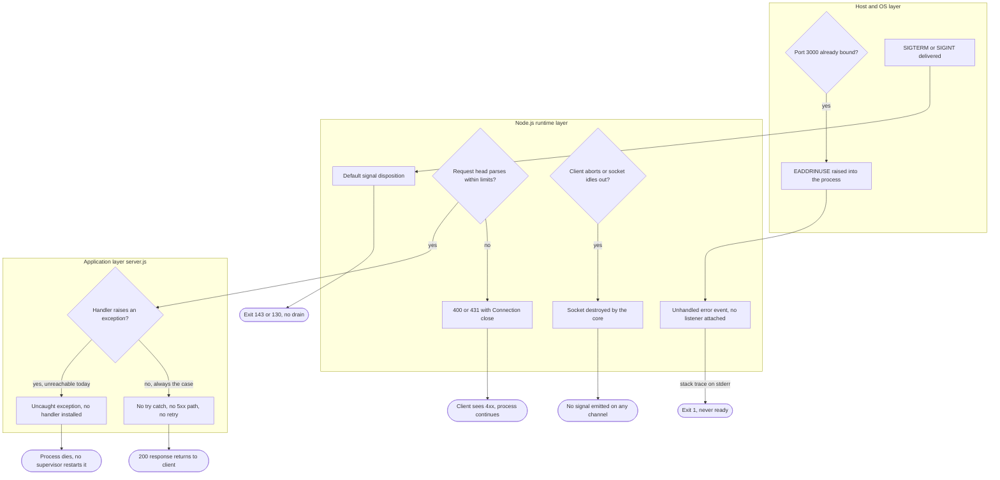

The diagram exposes the architecture's asymmetry. Everything above the handler is defended by the runtime, which is why malformed traffic cannot reach application code. Everything at or below the socket is invisible: an aborted client leaves no trace on stdout or stderr. And the application itself has no failure branch at all, so the only whole-process failure the system can actually experience is the one that happens before it is ready.


## 5.5 References

Every entry below was read or executed while writing this section; no external or web source was consulted, because the system's behaviour is fully determined by six tracked files and by probes of the process they produce.

- `server.js` - the whole system: `require('http')` (line 1), the bind constants `127.0.0.1`/`3000` (lines 3-4), the handler closure that sets `200`, `Content-Type: text/plain` and the 14-byte body (lines 6-10), and the listener with its single readiness log (lines 12-14). Established the component inventory, the single-connection state model, the data flow and the encryption-free, framework-free, retry-free posture.
- `package.json` - identity `hello_world` 1.0.0, MIT, author `hxu`; the `main` entry pointing at an absent `index.js`; the always-failing `test` placeholder; absence of every dependency field, of `engines`, `bin`, `files` and `type`. Established ADR-01, ADR-02, ADR-09 and the broken package interface.
- `package-lock.json` - `lockfileVersion: 3` with a single root entry and no dependency map, confirming an empty dependency graph and therefore no supply-chain component.
- `README.md` - the project's stated role ("test project for backprop integration. Do not touch!"), which is the rationale behind the minimal architecture and the constraint that forbids relocating the bind address.
- `.blitzyignore.txt` and `test.blitzyignore.txt` - both zero-byte, so they exclude nothing and rule out no part of the repository from this analysis.
- Repository root (`""`) - confirmed the complete file inventory: exactly six first-order files and no sub-folders, which is what allows the component table in §5.1.2 to be exhaustive rather than a sample.
- Executed probes on the checkout (Node.js v22.23.4, npm 11.21.0) - `GET /` and `POST /missing?x=1` returning identical `200` / `text/plain` / `Content-Length: 14` responses with `Connection: keep-alive` and `Keep-Alive: timeout=5`; two requests over one socket reporting `num_connects` 1 then 0; a second instance producing the unhandled `EADDRINUSE` `'error'` event and exit status 1. Established the response contract, the reuse behaviour and the fail-fast start-up path.
- Cross-referenced specification sections - §1.2 System Overview (system limitations and success criteria), §3.3.4 (dependency surface), §3.6.1-§3.6.8 (verified runtime, invocation matrix, absence of build, CI and containerisation, deployment topology, security implications), §4.2.1 and §4.3.1-§4.3.2 (measured latency, concurrency, state inventory, error taxonomy), §4.4.3-§4.4.6 (DIAG-02 to DIAG-07, the workflow diagrams this section's ARCH diagrams complement rather than repeat).


# 6. SYSTEM COMPONENTS DESIGN

## 6.1 Core Services Architecture

### 6.1.1 Applicability Determination

**Core Services Architecture is not applicable for this system.** `hao-backprop-test` consists of one deployable unit — `server.js`, 342 bytes of CommonJS evaluated by the Node.js runtime — which binds a single loopback socket and answers every request with the same 14-byte constant body. It calls no other component, is called by no other component, keeps no state and holds no configuration. Every construct this section normally documents (service boundaries across multiple deployables, inter-service messaging, discovery, load balancing, circuit breakers, auto-scaling rules, failover topologies) requires at least a second runtime participant, and the repository has none. This finding is the same one reached independently in §5.1.1 (single-process monolith), §5.2.5 (empty dependency graph) and §5.4.1 (no telemetry), so the remaining sub-sections record, area by area, *why* the answer is "not applicable" and what evidence establishes it.

The determination rests on six tests. Each is answered from the tracked files, and each fails:

| Test for a core-services architecture | Observed state | Verdict | Evidence |
|---|---|---|---|
| More than one deployable unit | One script, one process; `package.json` declares no dependencies and `package-lock.json` lists none | Fails | `server.js`; `package-lock.json` lines 6-12 |
| Internal module boundaries between services | `server.js` sets no `module.exports`, defines no class or named function; `main` names an absent `index.js` | Fails | `server.js` (whole file); `package.json` line 5 |
| Remote calls to peers | `require('http')` is the only import; no `http.request`, `fetch`, `net.connect` or DNS call anywhere | Fails | `server.js` line 1; repository-wide text census |
| A routing or ingress tier that distributes work | No router, proxy, gateway or upstream list; every path reaches the same handler | Fails | `server.js` lines 6-10 |
| Runtime configuration for endpoints and scale | Bind host and port are `const` literals; `process.env` never read | Fails | `server.js` lines 3-4 |
| State that must be replicated or held consistent | No database, queue, file write, cache or session | Fails | ADR-05 in §5.3.1; §5.1.3 |

**What this section therefore covers.** Because there is exactly one service component, the architecture of that component *is* the system, and the areas below are documented at process level rather than service level: §6.1.2 enumerates the single component and shows which inter-service mechanisms are absent, §6.1.3 records the one scaling dimension that exists (vertical, bounded by a single event-loop thread) and shows why horizontal scaling is structurally blocked, §6.1.4 records the resilience the runtime supplies and the patterns the application does not implement, and §6.1.5 renders the three required diagrams against this single-component reality. Component internals, connection lifecycle and message sequences are documented in §5.2 rather than repeated here.

**Conditions that would make this section applicable.** The determination is a property of the current design, not a permanent one: changing any single row of the table above would introduce a service architecture. The cheapest such change is parameterising the bind (`server.js` lines 3-4, ADR-04 in §5.3.1), which is also the change the README's "Do not touch!" instruction (`README.md` line 2) forbids without a deliberate documented deviation. Beyond that, a second deployable unit would require a dependency (contradicting ADR-02), and any load balancer in front of the fixture would face a target that binds `127.0.0.1` and is therefore unreachable from another host or from a container interface (§3.6.4). No such change exists in the repository, and none is planned by it.


### 6.1.2 Service Components

The system contains exactly one service component. It is not a *service* in the distributed sense — no contract is published, nothing discovers it, and nothing composes it with another deployable — but it is the unit that is started, addressed and stopped, so it is documented here with the same four aspects applied to every service in a distributed system: boundary, responsibility, communication surface and dependency posture.

| Service component | Boundary | Responsibilities | Evidence |
|---|---|---|---|
| `hello_world` HTTP responder — the `node server.js` process | One OS process, one listening socket bound to `127.0.0.1:3000` | Bind the loopback socket, announce readiness on stdout, return the constant `Hello, World!\n` response to every request, terminate on signal | `server.js` lines 1-14; `package.json` lines 2-4 |
| *(No second component exists)* | — | There is no gateway, worker, scheduler, broker, sidecar or administrative service; the repository holds six tracked files, two of which are zero-byte ignore fixtures | Root listing; `git ls-files` |

#### 6.1.2.1 Service Boundaries and Responsibilities

**The process is the boundary.** `server.js` exports nothing, defines no class, function or module, and holds no state, so there is no internal boundary that could become a service boundary later: the file cannot be imported (`require('.')` fails because `main` names an absent `index.js`, §3.6.2) and no symbol in it is reachable from another file. Everything the component does happens inside one evaluation of one file, and everything it interacts with crosses the process edge.

| Boundary crossing | Direction | Payload | Evidence |
|---|---|---|---|
| TCP listener `127.0.0.1:3000` | Inbound | Any HTTP/1.1 request; method, path, query and headers are never read | `server.js` lines 3-4, 6-10 |
| Socket write | Outbound | Status 200, `Content-Type: text/plain`, 14-byte body `Hello, World!\n` | `server.js` lines 7-9; observed response |
| stdout | Outbound | One line per process: `Server running at http://127.0.0.1:3000/` | `server.js` line 13 |
| stderr and exit status | Outbound | Stack trace on fatal start-up error; exit 0 never, 1 on bind failure, 143 on `SIGTERM`, 130 on `SIGINT` | Second-instance probe (exit 1); §3.6.2 |

**Responsibilities, and nothing else.** The component's obligations are four, and each is a single statement in the source: load the `http` module (line 1), declare the bind literals (lines 3-4), construct the server with its handler (line 6), and bind plus announce (lines 12-14). Responsibilites it explicitly does *not* carry — routing, method dispatch, content negotiation, body parsing, authentication, persistence, request logging, metrics, configuration, dependency management — are absent from the source and from the manifest, and are recorded area by area in §5.4.

**Why the boundary matters operationally.** Because the request object is never dereferenced (`server.js` line 6 receives `req` and ignores it), no input can cross from the network into the component's control flow. The boundary is therefore one-way in influence: clients can make the component emit its response, but cannot alter the response, the process or its state. That is the reason the absence of the mechanisms discussed in §6.1.2.2 to §6.1.2.4 carries no functional risk for this fixture.

#### 6.1.2.2 Inter-Service Communication Patterns

**No inter-service communication exists.** A repository-wide text census over the six tracked files returns `require('http')` as the only import and finds no client-side API of any kind (`http.request`, `https.request`, `fetch`, `net.connect`, `dns`, `axios`), no broker client, no queue producer and no socket to a peer. The process opens no outbound connection for its entire lifetime, so there is neither a synchronous nor an asynchronous peer interaction to characterise. Within the process, "communication" is a single event-loop callback invocation by the `http` core, with no message serialisation, no queue and no IPC; the seven OS threads observed at start-up belong to V8 and libuv, and the application creates none.

| Communication pattern | Present | Detail | Evidence |
|---|---|---|---|
| Client-initiated synchronous request/response | Yes — the only pattern | One framed response per request, written by `res.end`; no push, streaming or server-initiated message | `server.js` lines 6-10; observed `200` with `Content-Length: 14` |
| Connection reuse (keep-alive) | Yes — runtime default | Socket retained after the response (`Keep-Alive: timeout=5`), idle close at about 6.0 s | Observed headers; §5.1.3 |
| Service-to-service call (REST, gRPC, message broker, event bus) | No | No outbound API, no protocol client, no broker, no schema or stub | Repository-wide text census; ADR-02 |
| Inter-process communication (IPC, shared memory, cluster) | No | No `cluster`, `worker_threads`, Unix socket or shared handle | `server.js` line 1 is the only import |

**The inbound contract is the whole communication surface.** Any method, any path, any query string and any header block within the runtime's 16,384-byte limit receives status `200`, `Content-Type: text/plain`, and the fixed body `Hello, World!\n`; `POST` with a JSON body, `HEAD` and `GET /missing/path?x=1` were all answered identically in the probe recorded for §4.2.1. The remaining response headers (`Date`, `Connection`, `Keep-Alive`, `Content-Length`) are generated by the runtime, not the application, so a consumer asserting the contract should read `server.js` lines 7-9 rather than the wire. Because no request identifier is generated or echoed, two exchanges cannot be correlated by the system itself (§5.4.2).

#### 6.1.2.3 Service Discovery and Load Balancing

**Discovery mechanism: none — the address is a compile-time constant.** The endpoint is fixed by two module-scope literals, `hostname = '127.0.0.1'` and `port = 3000` (`server.js` lines 3-4), read once by `server.listen` at line 12. No registry lookup, service record, configuration service, environment variable, command-line argument or DNS resolution participates; `process.env` appears zero times in the repository. The functional substitute for discovery is documentation plus one signal: the address is stated in `README`-adjacent tooling expectations, and the readiness line `Server running at http://127.0.0.1:3000/` (`server.js` line 13) prints it at start-up so a harness can confirm it without probing.

| Discovery mechanism | Present | Consequence for a caller |
|---|---|---|
| Service registry or discovery client (Consul, Eureka, DNS SRV, Kubernetes Service) | No | The caller must be configured with `127.0.0.1:3000` out of band |
| Environment or configuration override | No | The address cannot be relocated without editing source (ADR-04), which `README.md` line 2 forbids |
| Readiness or health endpoint | No | Readiness must be taken from the single stdout line, or inferred by a successful TCP connect (§3.6.5) |

**Load balancing: none, and none is possible in the current shape.** There is no proxy, gateway, virtual address, upstream pool or target list in the repository, and no in-process fan-out: no `cluster`, no `worker_threads`, no `SO_REUSEPORT`. A load balancer also has nothing to balance — a second instance on the same host cannot start, because the port is a literal with no override, and a copy on another host is unreachable because the socket is bound to loopback. Both limits were verified: the second instance exits 1 with an unhandled `EADDRINUSE` and writes nothing to stdout, and a request to the host's routable address (`10.11.0.33:3000`) was refused while `127.0.0.1:3000` served normally. Capacity is therefore that of exactly one process, and every request in the system is served by the same instance.

#### 6.1.2.4 Circuit Breaker, Retry and Fallback

**Circuit breaker: not implemented, and its precondition is absent.** A circuit breaker protects a caller from a failing dependency; this component has no dependency, so there is no call that could fail, time out or trip a breaker. The nearest analogue in the running system is runtime-level admission control, which protects the process from malformed *input* rather than from a failing peer: the `http` core rejects a malformed request line or a missing HTTP/1.1 `Host` with `400`, rejects a header block over 16,384 bytes with `431` (both with `Connection: close`), and closes idle keep-alive sockets before the handler is ever involved. These responses come from the runtime, not the application, and the application holds no state that a breaker would open or close.

**Retry and fallback: not implemented; the lifecycle is deliberately fail-fast (ADR-08).** At start-up a bind conflict raises an `'error'` event with no listener attached, which Node.js converts into an uncaught exception: the second-instance probe printed `node:events:497 … Unhandled 'error' event` to stderr, wrote zero bytes to stdout and exited with status 1. There is no retry, no backoff, no alternate port, no standby instance and no supervisor to relaunch it. In the request path there is nothing to retry either — the handler performs three infallible writes and holds no connection to a peer.

| Mechanism | Status | Behaviour when triggered | Evidence |
|---|---|---|---|
| Circuit breaker (open, half-open, closed states) | Absent | Not reachable: no downstream dependency to protect | `server.js` (whole file); no client API in any file |
| Retry with backoff (`EADDRINUSE`, connect failure, 5xx) | Absent | Start-up failure is terminal: stderr trace, exit 1 | Second-instance probe; ADR-08 |
| Fallback port, host or response | Absent | None; the bind values are `const` literals | `server.js` lines 3-4 |
| Caller-side recovery guidance | External | A refused connection is immediate and unambiguous, so a harness may retry the launch rather than wait out a timeout | §5.4.5; §3.6.5 |

Retry is therefore a caller responsibility in principle and unnecessary in practice: the fixture is deterministic, has no partial-failure mode, and a restart is the complete recovery (§6.1.4.2).


### 6.1.3 Scalability Design

Scaling is documented here as a property of the one component in §6.1.2, and the finding is narrow: the system scales vertically within a single process and not at all horizontally, no automatic scaling mechanism exists, and no capacity target is declared anywhere in the repository. The design is adequate for its purpose — a fixture exercised by a local harness — and every horizontal option is blocked by the same two source literals rather than by missing configuration.

#### 6.1.3.1 Horizontal and Vertical Scaling

| Scaling direction | Feasibility | Mechanism, or the blocker | Evidence |
|---|---|---|---|
| Horizontal, same host | Blocked | Port `3000` is a literal: a second process raises `EADDRINUSE` as an unhandled error and exits 1. No `cluster`, no `worker_threads`, no `SO_REUSEPORT` | `server.js` line 4; second-instance probe; ADR-04 |
| Horizontal, additional hosts | Blocked as shipped | The listener binds `127.0.0.1`, so a copy on another host is not reachable off-host; a request to the host address `10.11.0.33:3000` was refused | `server.js` line 3; external-bind probe; §3.6.6 |
| Vertical, within the process | Bounded | One JavaScript thread per process; concurrency is event-loop based, so throughput is capped by one CPU core | §5.2.2; observed 7 OS threads (all runtime-owned) |
| Vertical, within the host | Available but undeclared | No heap flag, cgroup limit, `engines` constraint or container resource section exists, so limits are the host's defaults | `package.json` (no `engines`); no Dockerfile or compose file (§3.6.4) |

The measured envelope is small and stable: readiness in 39-40 ms from spawn to the stdout line (three consecutive runs; §5.4.5 records ~41 ms), a per-request service time of roughly 0.45-0.67 ms on loopback, 20 sequential requests all answered `200` in the probe for this section, and 50 simultaneous requests all answered `200` in the probe recorded in §4.3.1. The process held 7 OS threads and about 49 MB resident memory immediately after binding. Because the handler performs no I/O and takes no branch, additional load can only consume CPU on one core; there is no queue, pool or lock that could saturate first.

#### 6.1.3.2 Auto-Scaling Triggers and Rules

**No auto-scaling exists, and no signal exists from which a rule could be written.** An autoscaler needs two things the system does not provide: a load signal to trigger on, and a scale-out primitive to invoke. The system publishes no metrics, no health or readiness endpoint, no latency or error counters, no APM or tracing instrumentation and no structured logs — its only outputs are one stdout line at start-up, stderr on a fatal error, the HTTP response itself and the exit status (§5.4.1). There is also no orchestrator, service unit, supervisor or restart policy in the repository, so even a manual scale-out decision has no automated executor.

| Trigger source an autoscaler would need | Available | What exists instead |
|---|---|---|
| Metrics endpoint or agent (CPU, latency, request rate) | No | Nothing; `metrics` and `health` appear zero times in the tracked files |
| Queue depth or backlog | No | There is no queue and no backlog state |
| Health or readiness probe endpoint | No | Readiness is one stdout line; liveness is a TCP connect to `127.0.0.1:3000` |
| Replica controller (orchestrator, supervisor, service manager) | No | The process is launched by hand or by a CI step and is unsupervised (ADR-08) |

The behavioural consequence is that scale is fixed at exactly one process for the life of a run, and an unplanned exit produces an outage until an operator relaunches it (§6.1.4.4). Both available signals are binary — the readiness line says "the bind succeeded", a TCP connect says "the listener accepts" — and neither carries load, so no threshold, cooldown or step policy can be defined from them.

#### 6.1.3.3 Resource Allocation Strategy

**Allocation is implicit: the process takes the host defaults.** The repository declares no resource requirement of any kind — no `engines` field in `package.json`, no container resource section (there is no Dockerfile or compose file, §3.6.4), no `--max-old-space-size` or other runtime flag, no process-manager configuration.

| Resource | Declared by the system | Observed at start-up | Basis |
|---|---|---|---|
| CPU | None | One JavaScript thread driving the event loop; 7 OS threads owned by V8 and libuv | `/proc/<pid>/status`; §5.2.2 |
| Memory | None | About 49 MB resident (`VmRSS` 49,356 kB) with no request served | `/proc/<pid>/status` probe |
| Disk | None | No file is opened, written or read at runtime | `server.js`; no `fs` import |
| Network | One inbound loopback socket on port 3000; no outbound sockets | Confirmed by probe: loopback served, host address refused | `server.js` lines 3-4, 12 |

Two planning implications follow. First, the footprint is fixed and tiny, so a host running this fixture needs no sizing exercise — one core and the default heap suffice. Second, because nothing is declared, the process inherits whatever the environment imposes; a constrained container would cap it without warning, and a generous host would grant no additional throughput because the event loop is the ceiling. The only hard resource requirement in the design is exclusive use of TCP port 3000 on `127.0.0.1`.

#### 6.1.3.4 Performance Optimization Techniques

| Technique | Applied | Effect | Evidence |
|---|---|---|---|
| Constant response computed once per request, with no I/O, no `await` and no allocation of note | Yes | Per-request cost is dominated by socket handling, not application work | `server.js` lines 6-10 |
| Keep-alive socket reuse | Yes — runtime default | Repeated requests on one connection skip TCP and parser setup; idle close at about 6.0 s | Observed headers; §5.3.5 |
| Standard library only, zero dependencies | Yes | No middleware chain, no framework dispatch, no third-party code on the request path | `package-lock.json` (empty graph); ADR-02 |
| Application cache or validators (`ETag`, `Cache-Control`, `Last-Modified`) | No | Nothing to gain: the response costs no computation and the contract stays fixed | ADR-06; observed headers |
| Compression, HTTP/2, clustering, connection pooling | No | No counterpart: one 14-byte body, one protocol version, no downstream peer | `server.js`; `package.json` |

Measured results match the design intent: readiness in 39-40 ms (three runs), a `curl` round trip of 0.000672 s (~0.67 ms) for a single request on loopback, a mean latency of about 0.45 ms recorded in §4.4.3, and 50 concurrent requests all served with identical bodies (§4.3.1). Because the workload is constant-time and stateless, no profiling, tuning or warm-up step exists or is needed; the remaining cost is the loopback round trip and the runtime's parsing, neither of which is under the application's control.

#### 6.1.3.5 Capacity Planning Guidelines

No throughput target, concurrency ceiling, availability objective or latency budget is declared in `package.json`, `README.md` or `server.js`, so capacity planning here means ensuring the single instance can start and be reached — not sizing for growth.

| Constraint | Planning guideline | Evidence |
|---|---|---|
| One instance per host, fixed port 3000 | Reserve port 3000 on the host; verify it is free before launch and treat `EADDRINUSE` (stderr, exit 1) as an environment fault, not a retryable condition | `server.js` lines 3-4; second-instance probe |
| Loopback-only listener | Place the caller on the same host, or reach the port through an SSH tunnel or port-forward; never expect reachability from another machine | `server.js` line 3; external-bind probe |
| Single event-loop thread | Assume one core of throughput; do not plan parallel instances on one host, and do not expect a second core to help | §5.2.2; observed 7 threads (none application-created) |
| No telemetry, no health endpoint | Measure capacity from outside — client-side latency, connection refusals, the readiness line — because the process reports nothing about load | §5.4.1; §6.1.3.2 |
| No state to size or migrate | Capacity work needs no storage, backup or data-migration budget; a restarted instance is immediately equivalent | ADR-05; §6.1.4.3 |

Practical guidance for the fixture's actual consumer, a local test harness, is therefore three rules: budget exactly one process per host, target `127.0.0.1:3000` and wait for the readiness line before issuing requests, and treat connection refusal or a missing readiness line as an environment failure to investigate rather than as a symptom of insufficient capacity. Any requirement beyond that — multiple consumers on different hosts, sustained high request rates, availability guarantees — cannot be met by provisioning; it requires editing the bind literals and adding the surrounding infrastructure discussed in §6.1.1.


### 6.1.4 Resilience Patterns

Resilience in this system is confined to the runtime. The application contributes no fault handling — no `try`/`catch`, no `uncaughtException` listener, no signal handler, no supervisor and no second instance — and the repository contains no backup, failover, redundancy or degradation configuration. What the system does provide is the robustness of a stateless constant-time handler behind a hardened HTTP parser, plus a recovery procedure that is complete because there is nothing to lose.

#### 6.1.4.1 Fault Tolerance Mechanisms

| Fault | Tolerated | Effect on the process | Evidence |
|---|---|---|---|
| Malformed request line, or HTTP/1.1 without `Host` | Yes — by the runtime | `400` with `Connection: close`; the handler is never invoked and the process continues | §5.4.3; `http` core parser |
| Request header block over 16,384 bytes | Yes — by the runtime | `431` with `Connection: close`; process continues | §5.4.3 |
| Client aborts or destroys the socket mid-exchange | Yes — by the socket layer | No application effect and no signal on any channel; the next request is served normally | §5.4.3 probe |
| Idle keep-alive connection | Yes — by the runtime timer | Socket closed at about 6.0 s; the client reconnects | §5.1.3 |
| Exception thrown inside the handler | No | Would terminate the process: no `try`/`catch`, no `uncaughtException` handler. Unreachable in the shipped code, which performs three infallible writes | `server.js` lines 6-10 |
| Port 3000 already bound at start-up | No | Unhandled `'error'` event, stack trace on stderr, zero bytes on stdout, exit 1 | Second-instance probe (exit 1) |
| Process killed or crashed | No | Outage until an operator relaunches; no supervisor, service unit or restart policy exists | ADR-08; §3.6.6 |

**Single point of failure: the whole component.** One process holds the only listener, so there is no redundancy at any layer — no replica, no standby, no second port, no alternate host. The design defence is that per-request work cannot fail (there is no I/O, no branch and no request inspection), which reduces the fault surface to start-up and process-level events. Notably, the faults the system *does* tolerate are exactly those the runtime owns, which is why malformed traffic can never reach application code and why the only whole-process failure the system can experience is the one that happens before it is ready.

#### 6.1.4.2 Disaster Recovery Procedures

Recovery is uniform because there is no state: every incident is resolved by making the process run again. The recovery point objective is not applicable — nothing is written, so there is no data to lose — and the recovery time objective is the operator's reaction time plus 39-40 ms of start-up, with no warm-up, cache fill or migration step.

| Incident | Detection | Recovery procedure |
|---|---|---|
| Process exited or was killed | Connection refused on `127.0.0.1:3000`; port unbound; no readiness line | Relaunch `node server.js` from an unchanged checkout and confirm the readiness line on stdout |
| Bind conflict from a second instance | stderr `node:events:497 … Unhandled 'error' event` (`EADDRINUSE`), exit 1, stdout empty | Identify and stop the process holding port 3000, then relaunch; the port cannot be relocated without editing source (ADR-04) |
| Host lost | No response; instance gone | Recreate the checkout at commit `28e5918` and relaunch; the source file is the only artefact and there is nothing to restore |
| Working tree modified or corrupted | Behaviour diverges from the 14-line source | Discard local changes and re-checkout; the repository is the sole source of truth (ADR-09) |

The system provides no supervisor, service unit, restart policy, snapshot or backup mechanism for any of these, and no monitoring would notice an outage on its behalf (§5.4.6 records the same runbook from the operational perspective). Recovery is therefore an operator or CI responsibility, and the readiness line — not a health check — is the confirmation that recovery succeeded.

#### 6.1.4.3 Data Redundancy Approach

**Not applicable: there is no data to replicate.** No `fs` call, database driver, queue client or cache exists in the repository; the process writes nothing to disk, holds no buffer to flush and records nothing about the requests it served (ADR-05). The only durable artefacts are the six tracked files and the single commit that contains them, and their redundancy is whatever the git remote provides — a facility outside this repository's design.

| Data class | Written at runtime | Redundancy mechanism | Evidence |
|---|---|---|---|
| Requests, sessions, counters | No | None needed; nothing is retained between requests | `server.js` lines 6-10; `req` never dereferenced |
| Response payload | No (a string literal in source) | The source file itself, which is byte-identical to the deployed artefact | `server.js` lines 7-9; ADR-09 |
| Configuration | No | Two `const` literals in source; no file, secret store or environment read | `server.js` lines 3-4 |
| Logs and telemetry | No | One stdout line at start-up, not persisted by the process | `server.js` line 13; §5.4.2 |

The consequence for resilience is favourable rather than merely neutral: with no state, a crashed instance cannot leave partial writes, a restarted instance is behaviourally identical to the first, and there is no reconciliation, snapshot or point-in-time recovery requirement to design. The cost, documented in §5.3.4, is that history is unobservable — the system keeps no record of what it served.

#### 6.1.4.4 Failover Configurations

**No failover configuration exists in any layer of the system.** There is no standby instance, no virtual address or DNS failover target, no health-check-driven traffic shift — there is no health endpoint to drive it — no supervisor with a restart policy and no orchestrator. Two structural facts make failover impossible without a code change: a second instance on the same host cannot bind (exit 1 on `EADDRINUSE`), and an instance on another host would bind that host's loopback interface and therefore be unreachable by any client elsewhere, as the refused connection to `10.11.0.33:3000` demonstrated.

| Failover element | Present | What happens instead |
|---|---|---|
| Redundant instance or standby | No | One process; its exit is a full outage |
| Health check driving traffic shift | No | Liveness can only be inferred by a TCP connect or the absence of a refusal |
| Virtual address, DNS or proxy failover | No | The client's target is the hard-coded `127.0.0.1:3000` |
| Automatic restart on exit | No | Manual relaunch by an operator or CI step (§6.1.4.2) |

Failover is therefore a human procedure, not a configuration: the operator relaunches the process, and the outage lasts from the failure to that moment. Because requests are stateless and the response is constant, the switch costs nothing in consistency — there is no session to re-establish and no data to resynchronise — which is what makes the absence of automation tolerable for a test fixture.

#### 6.1.4.5 Service Degradation Policies

**There is no degradation mode: the service is binary.** It either serves the full response or the connection is refused. The system implements no rate limiting, no load shedding, no queueing, no admission control at the application layer, no read-only or reduced-functionality mode, no fallback content, no timeout budget and no partial response. Nothing in the handler can be disabled to preserve availability, because the handler is the only function and it always succeeds.

| Degradation mechanism | Implemented | What a client observes instead |
|---|---|---|
| Load shedding or rate limiting | No | Every connection is accepted and answered; no caller is ever throttled |
| Reduced functionality or read-only mode | No | No alternative response exists; the full constant response is returned |
| Fallback response on failure | No | A failure means a refused connection or an exited process, not a degraded body |
| Connection-level protection (runtime) | Yes | Parser violations receive `400`/`431` with `Connection: close`; idle sockets close at about 6.0 s — the offending connection is degraded, the service is not |
| Graceful shutdown with connection drain | No | `SIGTERM` ends the process immediately with status 143, dropping any in-flight or idle keep-alive connections |

The distinction in the fourth row is the only nuance worth carrying: the runtime degrades the *connection* that misbehaves, which protects the process, but there is no policy that degrades the *service* under stress. With no telemetry and no throttling, an overloaded instance would simply accumulate socket work until CPU saturation, and the operator would learn of it from client-side latency rather than from the system (§6.1.3.2).


### 6.1.5 Required Diagrams

Three diagrams are required for a core-services architecture — service interaction, scalability and resilience. Each is rendered below against this system's single-component reality, so in every case the diagram's informative content is the annotated absence of the distributed mechanism alongside the mechanism that actually exists. Diagram identifiers continue the architecture series used from §5.1.1 onward, following ARCH-07 in §5.4.7.

| ID | Diagram | Question it answers | Rendered in |
|---|---|---|---|
| ARCH-08 | Service interaction | Which components exchange messages, and where are the inter-service mechanisms that are missing? | §6.1.5 |
| ARCH-09 | Scalability architecture | Which scaling directions exist, which are blocked, and by what? | §6.1.5 |
| ARCH-10 | Resilience implementations | Where does each fault surface, what protects it, and what pattern is absent? | §6.1.5 |

**Service interaction diagram.** **ARCH-08** shows the single service boundary, the runtime edges that carry every message, and — as a separate cluster with no edges into the runtime, because none exist — the four inter-service mechanisms the system does not implement. The absence cluster is drawn without connections deliberately: an edge would imply an implemented path.

```mermaid
flowchart LR
    subgraph EXT["Outside the service boundary"]
        CL["HTTP client or harness<br/>fixed target 127.0.0.1:3000"]
        OP["Operator or CI step"]
    end
    subgraph SVC["Service boundary: one process, launched as node server.js"]
        PROC["node server.js<br/>single process"]
        SOCK["Listening socket<br/>loopback TCP 3000"]
        CORE["Node.js http core<br/>parser, framing, timers"]
        HND["Request handler<br/>server.js lines 6-10"]
        OUT["stdout<br/>one readiness line"]
        PROC -->|"bind on start-up"| SOCK
        SOCK --> CORE
        CORE -->|"request event carrying req and res"| HND
        HND -->|"status 200, text/plain, 14-byte body"| CORE
        CORE -->|"framed response on the same socket"| SOCK
        CORE -->|"once, after a successful bind"| OUT
    end
    subgraph ABSENT["Inter-service concerns with no implementation"]
        A1["Discovery<br/>address compiled into source"]
        A2["Downstream peers<br/>no outbound call exists"]
        A3["Load balancing and replicas<br/>one instance per host"]
        A4["Circuit breaker, retry, fallback<br/>fail-fast lifecycle"]
    end
    CL -->|"HTTP/1.1 request, any method or path"| SOCK
    SOCK -->|"response bytes"| CL
    OP -->|"launch, then SIGTERM"| PROC
    OUT --> OP
```

Read from left to right, the diagram has no edge leaving the runtime, which is the structural reason no communication pattern beyond client-initiated request/response can exist (§6.1.2.2). Read from right to left, every message that reaches the handler is indistinguishable from every other, because the client contributes nothing the handler reads.

**Scalability architecture.** **ARCH-09** puts the supported topology beside the two scaling directions. Horizontal options are drawn as blocked with the specific blocker named; vertical headroom is drawn as bounded by one event-loop thread.

```mermaid
flowchart TB
    LOAD["Load source<br/>local harness or CI probe on the same host"]
    subgraph SUPPORTED["Supported topology: one process per host"]
        PROC["node server.js<br/>single event-loop thread"]
        SOCK["Listening socket<br/>127.0.0.1:3000"]
        PROC -->|"bind on start-up"| SOCK
    end
    subgraph HORIZONTAL["Horizontal scaling: blocked"]
        H1["Second replica on the same host<br/>EADDRINUSE, exit 1, no restart"]
        H2["Replica on another host<br/>loopback bind, unreachable"]
        H3["Automatically managed replica count<br/>no metrics, no health endpoint"]
    end
    subgraph VERTICAL["Vertical scaling: bounded by one core"]
        V1["Constant per-request work<br/>no I/O, no queue, no lock"]
        V2["Footprint at start<br/>7 OS threads, about 49 MB RSS"]
        V3["No heap flag, cgroup or engines constraint declared"]
    end
    LOAD -->|"HTTP request"| SOCK
    SOCK -->|"200, text/plain, 14 bytes"| LOAD
    H1 -.->|"cannot bind"| SOCK
    H2 -.->|"cannot reach"| SOCK
    H3 -.->|"no trigger source"| PROC
    PROC -.->|"limited by"| V1
```

The two blocked replicas fail for different reasons and both are source-level: `H1` is stopped by the literal port (`server.js` line 4), `H2` by the literal loopback host (line 3). `H3` is blocked by the absence of any signal an autoscaler could read (§6.1.3.2), which is a property of the whole system rather than of one line.

**Resilience pattern implementations.** **ARCH-10** maps each fault to the layer that detects it, shows the runtime protections that do exist, and names the four patterns the application does not implement. It is the service-level complement of the layer-oriented error flow in §5.4.7 (ARCH-07) and the recovery flow in §4.4.4.

```mermaid
flowchart TD
    subgraph DET["Where a fault surfaces"]
        F1{"Port 3000 already bound<br/>at start-up?"}
        F2{"Request head malformed<br/>or over 16384 bytes?"}
        F3{"Client aborts, or keep-alive<br/>socket idles out?"}
        F4{"Handler raises<br/>an exception?"}
        F5{"SIGTERM or SIGINT<br/>delivered?"}
    end
    subgraph RT["Protection supplied by the runtime"]
        P1["400 or 431 with Connection close"]
        P2["Socket destroyed,<br/>no application signal"]
        P3["Immediate exit, 143 or 130,<br/>no drain"]
    end
    subgraph MISSING["Patterns the application does not implement"]
        N1["No circuit breaker<br/>no dependency to protect"]
        N2["No retry or backoff<br/>no alternate port or host"]
        N3["No failover, standby or supervisor"]
        N4["No degradation mode<br/>serving or refused only"]
    end
    R["Operator relaunch<br/>readiness in 39-40 ms"]
    F2 -->|"yes"| P1
    F3 -->|"yes"| P2
    F5 -->|"yes"| P3
    F1 -->|"yes, fatal"| N3
    F4 -->|"yes, unreachable today"| N3
    N3 -->|"recovered only by"| R
    N1 -.-> N2
    N4 -.-> N3
```

The asymmetry is the point: every fault the runtime can classify is answered without involving the application, and the only fault that terminates the system — a bind conflict, or a handler exception that cannot occur in the shipped code — reaches no protection at all and is resolved solely by relaunching the process. The two dotted edges mark consequences rather than calls: retry is absent because there is nothing to fail over to, and a degradation mode is absent because the process has no intermediate state between serving and being gone.


### 6.1.6 References

Every statement in §6.1 rests on the files below, on a direct probe of the running process, or on a section of this specification that already documents the same behaviour. No external source was consulted: the repository declares no dependencies, integrates no third-party service and pins no runtime version, so there is nothing to cite outside the checkout.

**Repository files**

- `server.js` — the only executable source (342 bytes, 14 lines). Lines 1-4 establish the sole import and the bind literals `127.0.0.1`/`3000`; lines 6-10 the request handler that ignores `req` and writes status 200, `Content-Type: text/plain` and the 14-byte body; lines 12-14 the `listen` call and the single readiness line. Establishes the single-component boundary, the absent internal module boundary, the constant-time handler and the absence of any outbound call.
- `package.json` — identity `hello_world` 1.0.0 (MIT), `main` naming an absent `index.js`, the single failing `test` placeholder, and no `dependencies`, `engines` or `type` field. Establishes zero runtime dependencies and no declared resource or scaling constraint.
- `package-lock.json` — `lockfileVersion: 3` with one root package entry and no dependency map. Confirms the empty dependency graph and therefore the absent supply-chain and middleware surface.
- `README.md` — two lines; line 2 defines the project as a test fixture for backprop integration with the instruction "Do not touch!". Establishes the constraint that blocks bind-parameterisation as a scaling fix.
- `.blitzyignore.txt`, `test.blitzyignore.txt` — zero-byte ignore fixtures; they exclude nothing, so no file was withheld from the evidence base.

**Repository folders and history**

- Repository root (`""`) — contains exactly six tracked files and no sub-folder; the whole system is enumerable, which is why §6.1.2 can state that no second service component exists rather than only that none was found.
- Git history — a single commit `28e5918` ("Add files via upload") on branches `main` and `QA-Linux-env-20-nov`; establishes that no deployment, CI or orchestration configuration has ever existed in the repository, and gives the artefact to restore in the recovery procedure of §6.1.4.2.

**Observed runtime behaviour**

- Process probes on Node.js v22.23.4 — readiness in 39-40 ms across three spawns; `200`/`text/plain`/14 bytes for GET, POST with body, HEAD and an unknown path; 20 sequential requests all `200`; 7 OS threads and ~49 MB RSS at start-up; `SIGTERM` exiting 143 with no drain; a second instance exiting 1 with an unhandled `EADDRINUSE` and zero bytes on stdout; a refused connection to the host address `10.11.0.33:3000` proving the loopback-only bind.

**Cross-referenced sections of this specification**

- §1.2 System Overview and §5.1.1 — architecture style and the single-process component model that §6.1.1 and §6.1.2 extend.
- §5.2.1-§5.2.5 — component-by-component details, including the per-component scaling considerations summarised in §6.1.3.
- §5.3.1 — ADR-02 (standard library only), ADR-03 (loopback), ADR-04 (source-literal bind), ADR-05 (no persistence), ADR-06 (no cache), ADR-08 (fail-fast) and ADR-09 (source equals deployment), cited throughout §6.1.2 to §6.1.4.
- §5.4.1, §5.4.5, §5.4.6, §5.4.7 — signal inventory, performance envelope, recovery runbook and error-flow diagram (ARCH-07) that §6.1.3.2, §6.1.4 and §6.1.5 build on.
- §3.6.2, §3.6.4, §3.6.6 — invocation matrix (`EADDRINUSE`, `SIGTERM` 143), containerisation findings and the deployment topology from which §6.1.3.1 and §6.1.4.4 take their scaling and failover verdicts.
- §4.3.1, §4.4.3, §4.4.4 — concurrency, latency and recovery-flow measurements used for the capacity figures in §6.1.3.1 and §6.1.3.4.


## 6.2 Database Design

### 6.2.1 Applicability Determination

**Database Design is not applicable to this system.** `hao-backprop-test` has no database, no datastore, no cache and no persistent storage of any kind. The repository contains six tracked files, exactly one of which executes: `server.js`, 342 bytes over 14 lines, which requires only the standard-library `http` module (`server.js` line 1), never opens a file, never writes a byte to storage, and answers every request from a compile-time string literal (`server.js` line 9). There is consequently no schema to design, no data model to normalise, no index to choose, no migration to run, no record to retain, redact, audit or expire, and no query to optimise. The remaining sub-sections of §6.2 therefore do the only work available to them: they record, area by area, the evidence that establishes the absence, and they state precisely what a persistence layer would have to add if one were ever required.

The determination rests on six tests, each answered from the tracked files or from a direct probe of the running process. Every one fails.

| Test for a persistence layer | Observed state | Verdict |
|---|---|---|
| A driver, ORM or storage client in the dependency graph | `package.json` declares no `dependencies` or `devDependencies`; `package-lock.json` (`lockfileVersion: 3`, line 4) contains only the root package entry; no `node_modules` directory exists in the checkout | Fails |
| A storage construct anywhere in the source or data files | A case-insensitive census of all six tracked files returns zero matches for `sql`, `sqlite`, `postgres`, `mysql`, `mongo`, `redis`, `orm`, `schema`, `migrat`, `persist`, `database`, `storage`, `cache`, `session`, `cookie`, `fs.`, `readFile`, `writeFile`, `createReadStream`, `buffer`, `JSON.parse`, `JSON.stringify`, `yaml` and `process.env` | Fails |
| A configuration channel through which a store could be introduced | `process.env` appears zero times repository-wide; there is no `.env` file, config file, connection string, credential or secret; the only endpoint values are two module-scope `const` literals (`server.js` lines 3-4) | Fails |
| Durable output produced by a run | A live instance reports `read_bytes: 0` in `/proc/<pid>/io`; its only write is one readiness line on stdout (`server.js` line 13) and one framed response per request on the socket | Fails |
| State that changes as traffic is served | 25 sequential requests left the open-descriptor count at 22 and `git status --porcelain` empty; the descriptor table holds no regular data file — only stdio, `/dev/null`, runtime pipes, `eventpoll`/`io_uring`/`eventfd` objects and the one listening socket | Fails |
| Data that a restart could lose, recover or reconcile | Nothing is written, so a restarted instance is behaviourally identical to the one it replaced | Fails |

**What occupies the space a schema would fill.** The program does hold four data classes, and each is immutable, process-local and unbounded by any storage lifecycle. They are the complete inventory that a data model would otherwise describe.

| Data class | Where it lives | Lifetime | Evidence |
|---|---|---|---|
| Response payload | A string literal inside the handler | Life of the process; never mutated | `server.js` line 9 (`'Hello, World!\n'`, 14 bytes) |
| Endpoint configuration | Two module-scope `const` declarations | Life of the process; never mutated | `server.js` lines 3-4 (`127.0.0.1`, `3000`) |
| Request envelope | Parameters `req` and `res` of the handler closure | One request | `server.js` line 6; `req` is never dereferenced |
| Server handle | Module scope, from `listen` to exit | Life of the process | `server.js` lines 6, 12 |

**Why the absence is a design decision rather than an omission.** ADR-05 in §5.3.1 records "no persistence", and §3.5 documents the same finding from the technology-stack perspective: the response is a constant and requests leave no trace, so there is no datum that must outlive the process. §5.3.4 states the rationale in full — a restart can never leave partial state, and there is no store to secure, seed, size, back up or migrate. §6.1.4.3 reaches the same conclusion from the resilience side, where "data redundancy" collapses to "nothing to replicate". §6.2 does not restate those arguments; it documents the database-design consequences that follow from them.

**Conditions that would make this section applicable.** The determination is a property of the current 14-line design, not a permanent one, and any one of four changes would introduce the first persistence requirement. Adding a `fs` write to record served requests would create a file store with a durability and rotation question. Adding a driver for any database would break ADR-02 (standard library only, §5.3.1) and introduce a connection lifecycle, a schema and a migration path. Recording client addresses or headers for audit would create a personal-data and retention obligation (§6.2.4.3). Retaining response content outside source control would create a backup and recovery-point requirement. None of these exists, and `README.md` line 2 — "test project for backprop integration. Do not touch!" — forbids introducing them without a deliberate, documented deviation.

**Scope note.** This section deliberately stops at the boundary of the storage question. Process lifecycle, port binding and the single-component architecture are documented in §6.1; the storage technology inventory in §3.5; the decision record and its rejected alternatives in §5.3; and the request-level behaviour of the handler in §4.1 and §5.2.


### 6.2.2 Schema Design

No schema exists in any form — no DDL, no migration file, no object-relational mapping, no JSON Schema, no `CREATE TABLE`, no `CREATE INDEX`, and no constraint declaration. The repository holds exactly six files whose extensions are one `.js`, two `.json`, one `.md` and two `.txt`; the two `.json` files are the npm manifest and lockfile, and the two `.txt` files are zero-byte ignore fixtures. There is no database to design against and no store whose structure could drift, so each aspect below records the absence and names the artefact the system would need first.

#### 6.2.2.1 Entity Relationships and Data Models

**Persistent entities: zero.** The system defines no table, collection, document type, key space or record structure. Nothing the program holds survives the process; the complete persistent state of the system is the six tracked files themselves, and the only durable output of a run is the 14-byte response written to a client socket.

| Artefact a schema would provide | Present | Evidence, or what exists instead |
|---|---|---|
| Table, collection or document definitions | No | No DDL, no model module, no schema file; `server.js` defines no class, object literal or type |
| Primary keys, identifiers, surrogate keys | No | No record identity of any kind; requests are never assigned an identifier (§5.4.2) |
| Foreign keys or any entity relationship | No | Only one data value exists (the response literal), so no relationship can exist |
| Column types, defaults, nullability, check and unique constraints | No | The handler writes three constants; the runtime supplies the remaining response headers |
| Serialisation or deserialisation of stored records | No | `JSON.parse` and `JSON.stringify` appear zero times repository-wide |

**The complete data model.** Because a schema diagram of an absent schema would be empty and uninformative, **ARCH-11** renders instead the full inventory of named data structures the program actually holds. It is an entity inventory, not a relational model: three entities, no primary keys, no foreign keys, and a single edge whose meaning is that the mapping from request to response is constant rather than derived.

```mermaid
erDiagram
    REQUEST_ENVELOPE {
        string method "supplied by client, never read"
        string path "supplied by client, never read"
        string headers "supplied by client, never read"
        string body "supplied by client, never read"
    }
    RESPONSE_CONSTANT {
        int status_code "200, server.js line 7"
        string content_type "text/plain, server.js line 8"
        string body "14-byte literal, server.js line 9"
    }
    BIND_CONFIG {
        string hostname "127.0.0.1, server.js line 3"
        int port "3000, server.js line 4"
    }
    REQUEST_ENVELOPE ||..|| RESPONSE_CONSTANT : "mapped constantly, not derived"
```

Two readings of the diagram matter for design work. First, `REQUEST_ENVELOPE` has attributes only because the parser produces them; the application reads none of them, so no request value can become a stored value. Second, `BIND_CONFIG` stands alone with no relationship, because the endpoint address is compile-time constant that no data drives.

**Why no normalisation question arises.** The usual schema-design work — choosing entities, resolving many-to-many relationships, eliminating redundancy, choosing between embedding and referencing — presumes stored records whose shape can change. Here the payload is a single immutable literal and there is no second value for it to relate to, so the model is trivially in normal form and no denormalisation trade-off exists.

#### 6.2.2.2 Indexing Strategy

**No index and no constraint exists.** A repository-wide text census finds no `CREATE INDEX`, no index declaration, no unique key and no constraint keyword in any of the six tracked files. The only occurrence of the string `index` anywhere in the repository is `package.json` line 5, `"main": "index.js"` — a module path in the manifest, not a database index, and the file it names does not exist (§3.6.2). The only occurrence of the string `require` outside `server.js` line 1 is `"requires": true` at `package-lock.json` line 5.

| Index or constraint a store would declare | Status | Reason no counterpart is needed |
|---|---|---|
| Primary-key index | Absent | No record set exists to identify rows within |
| Secondary or composite index | Absent | No lookup is performed at request time; the handler reads one literal |
| Unique constraint | Absent | No column, and no write path that could violate uniqueness |
| Foreign-key, check, not-null or default constraint | Absent | No schema, no referential structure, no insert statement |
| Full-text or analytics index | Absent | No stored text corpus; the only stored string is the response body |

**The lookup structures that do exist are not data indexes.** The live process opened 22 file descriptors, among them `eventpoll`, `io_uring` and `eventfd` objects and a set of pipes. These are libuv's event-loop and readiness structures in the kernel — they track which sockets are readable and which timers have fired. They neither hold application data nor answer a data query, and they are created and destroyed by the runtime without the application's involvement. Access to the one application value is a constant-time property read on a closure-scoped string, so the access path that an index normally accelerates does not exist.

**Consequence for query planning.** With no store, there is no query planner, no statistics to gather, no cardinality estimate to maintain, no index to rebuild after a write and no vacuum or reindex maintenance window. The absence of index maintenance is one of the reasons the system needs no operational schedule at all (§6.2.3.2).

#### 6.2.2.3 Partitioning and Replication Configuration

**Partitioning: not applicable, and no partitioning dimension is even identifiable.** Partitioning presumes a data volume whose growth must be managed — by range, hash, list or time. This system holds one 14-byte constant, so the volume is fixed by the source file and cannot grow with traffic. No sharding key, range boundary, bucket count, tablespace or retention window exists, and no configuration file in which such a setting could live exists either.

**Replication: not applicable, and structurally blocked at every layer.** There is no primary, no replica, no replication log, no snapshot stream and no consistency model to choose. The system also cannot support replication topology even in principle, for two source-level reasons verified by probe: a second process on the same host cannot bind port `3000` (unhandled `EADDRINUSE`, exit 1), and a copy on another host would bind that host's loopback interface and be unreachable (§6.1.4.4, §6.1.3.1).

| Replication or partitioning dimension | Configured | Structural reason it cannot be |
|---|---|---|
| Horizontal data partitioning (shard key, hash, list) | No | One fixed datum; no volume and no key to partition on |
| Time-based partitioning or rolling windows | No | No timestamped records; requests are never recorded |
| Read replicas or primary-to-replica streaming | No | No datastore, no change stream, no replication log |
| Multi-region or cross-host placement | No | Loopback-only bind (`server.js` line 3) makes another host's copy unreachable |

**Reading consistency is trivially strong.** Because the single response value is compiled into the source and identical in every process that evaluates that source, any two instances that could exist would agree by construction — the consistency question that replication exists to answer has no distance to span (§6.1.4.3).

#### 6.2.2.4 Backup Architecture

**No backup exists, and none is required, because there is nothing to copy.** A backup architecture needs a data set, a schedule, a destination, a retention window and a restore test. This system has none of the five: it writes nothing to disk, holds no buffer to flush, and records nothing about the requests it served (§6.1.4.3).

| Backup element a store would require | Present | What substitutes for it |
|---|---|---|
| Scheduled snapshot or dump | No | The git checkout: commit `28e5918` contains the entire system, 913 bytes across six files |
| Incremental or write-ahead log shipping | No | No write path, therefore no log to ship |
| Restore procedure and restore verification | No | `git checkout` of the commit, then `node server.js`; readiness in 39-40 ms (§6.1.4.2) |
| Recovery point objective | Not applicable | Nothing is written, so there is no data loss to bound |

**The only durable artefact and where its redundancy comes from.** The source file *is* the deployed artefact (ADR-09, §5.3.1): the runtime evaluates the committed file directly, so a restored checkout is byte-identical to the running system and no artefact-provenance gap exists. Redundancy for that checkout is whatever the git remote provides — a facility outside this repository's design, present here as branches `main` and `QA-Linux-env-20-nov` on `origin`. Any backup requirement beyond that would first require a datum worth protecting, which is the change §6.2.1 enumerates.


### 6.2.3 Data Management

Data management reduces to the lifecycle of four immutable values held in one process's heap. There is no dataset whose shape must evolve, no history to archive and no store whose contents must be read back, so the sections that follow record the absence of each mechanism together with the one mechanism that stands in its place.

#### 6.2.3.1 Migration Procedures and Versioning Strategy

**No migration exists and no migration procedure could exist.** A migration transforms stored state from one schema version to another; this system has no stored state, no schema version marker and no migration history table. Deployment is source replacement rather than schema evolution: the runtime evaluates the committed `server.js` directly (ADR-09, §5.3.1), so there is no build step, no artefact promotion and no step between a commit and a running process.

| Migration or versioning artefact | Present | Evidence |
|---|---|---|
| Migration directory, runner or framework | No | No `migrations/`, no runner script, no dependency that could supply one; `package.json` lists only a failing `test` placeholder |
| Schema version table or migration ledger | No | No database, therefore no ledger recording which migrations ran |
| Forward or rollback migration scripts | No | Nothing to transform; recovery is a re-checkout, not a down-migration (§6.1.4.2) |
| Data versioning inside payloads | No | The response body is a single literal with no version field, envelope or schema reference |

**Versioning is artefact versioning only.** Two version numbers exist in the repository and neither concerns data: `package.json` line 3 declares `"version": "1.0.0"` for the `hello_world` package, and `package-lock.json` line 4 declares `lockfileVersion: 3` for the lockfile format. The only revision identifier with any operational meaning is the git commit — `28e5918`, the single commit in the history — which identifies the exact source that produced a given run.

| Versioned object | Version value | Where declared |
|---|---|---|
| Package identity | `1.0.0` | `package.json` line 3; mirrored at `package-lock.json` line 3 |
| Lockfile format | `3` | `package-lock.json` line 4 |
| Source revision | `28e5918` | Git history; sole commit, "Add files via upload" |
| Data or schema | None | No data set and no schema exist to version |

**The practical consequence for a change to the response contract.** Changing the body literal (`server.js` line 9) or a header (`server.js` line 8) is a source edit plus a process restart; because no client state and no stored record carry the old value, no backfill, dual-write window or compatibility shim is needed. The absence of migrations is thus a genuine simplification, and it is also the reason a version negotiation scheme was never required: there is only one payload, and it is fixed.

#### 6.2.3.2 Archival Policies

**No archival policy exists, because nothing accumulates.** Archival moves rarely accessed records to cheaper storage; this system never creates a record in the first place. The handler receives `req` and ignores it (`server.js` line 6), so no request attribute is read, no access entry is appended and no counter is incremented. A 25-request probe confirmed the consequence: after the traffic, the descriptor table was unchanged at 22 entries and `git status --porcelain` was empty, so no file had been created or modified.

| Retention tier a store would define | Present | What exists instead |
|---|---|---|
| Hot tier for active records | No | The V8 heap holds the constant for the life of the process |
| Warm or cold archive tier | No | Nothing is written, so nothing ages out |
| Purge, expiry or TTL policy | No | No record to expire; no scheduled job exists to run one |
| Historical query or replay capability | No | The system keeps no record of what it served (§5.3.4) |

**The only history in the system is its source history.** Git retains one commit; that is the entire record of change the project holds. Operationally this means the question "which requests arrived, when, and from where" cannot be answered from the system's own data at any retention window, short or long — a limitation §5.4.2 records from the observability side. Any audit or analytics requirement would therefore begin with adding a write path, which §6.2.1 lists as the first change that would make this section applicable.

#### 6.2.3.3 Data Storage and Retrieval Mechanisms

**Storage mechanism: process memory only.** The response value is a string literal allocated inside the handler's compiled function (`server.js` line 9); the endpoint values are two module-scope `const` declarations (`server.js` lines 3-4). Neither is ever reassigned. There is no file handle, no socket to a store, no shared memory segment and no temporary file: the live process's descriptor table contained only stdio, `/dev/null`, runtime pipes and `eventpoll`/`io_uring`/`eventfd` objects plus the one listening socket, and its `/proc/<pid>/io` reported `read_bytes: 0`.

| Value | Storage mechanism | Lifetime | Evidence |
|---|---|---|---|
| Response body | String literal in the compiled handler | Life of the process | `server.js` line 9 |
| Status code and content type | Literal assignments on the `res` object per request | One request | `server.js` lines 7-8 |
| Bind address and port | Module-scope `const` | Life of the process | `server.js` lines 3-4 |

**Retrieval mechanism: one property read and one write.** The retrieval path has three steps and no branch: the `http` core parses the request, invokes the handler, and the handler writes status, header and body to the response object before returning. No lookup, no deserialisation, no query and no transformation occurs, which is why no retrieval can fail and why no cache could reduce the work below one literal read.

| Retrieval step | Work performed | Cost determinant |
|---|---|---|
| Parse the request | Runtime `http` parser; header block capped at 16,384 bytes | Client-supplied bytes, not stored data |
| Produce the response | Assign three values and call `res.end` | Constant; independent of request content |
| Transmit | Runtime frames and writes the response over the socket | Loopback round trip; measured 0.45-0.67 ms per request (§6.1.3.4) |

#### 6.2.3.4 Caching Policies

**No cache exists at any layer.** There is no in-process cache, no external cache client, no shared cache tier and no cache directive on the response. The application sets exactly one header, `Content-Type: text/plain` (`server.js` line 8); the runtime adds `Date`, `Connection: keep-alive`, `Keep-Alive: timeout=5` and `Content-Length: 14`. The observed response carried no `Cache-Control`, `ETag`, `Last-Modified`, `Expires` or `Set-Cookie` header, so no intermediary and no client is given a validator or a freshness lifetime (ADR-06, §5.3.5).

| Caching layer | Present | Consequence |
|---|---|---|
| Application-level object cache | No | Nothing to memoise: the value is a literal, and a cache would add a lookup to a constant-time read |
| External cache (Redis, Memcached) | No | No client library in the empty dependency graph; no serialisation code in the source |
| HTTP validators and freshness headers | No | Clients and intermediaries must apply their own defaults; a harness cannot rely on revalidation (§4.3.1) |
| Connection reuse (keep-alive) | Yes — runtime default | Sockets are retained between requests and closed after about 6.0 s idle |

**Why caching was declined rather than overlooked.** Caching buys either computation or I/O, and this response costs neither: it is a 14-byte literal with no computation, no query and no file access behind it. Emitting validators would change a fixed, byte-assertable contract (§1.2.3) for no measurable gain, which is the trade-off ADR-06 records explicitly. The one reuse mechanism that survives is protocol-level socket retention, an artefact of the runtime rather than a design choice; it saves a TCP handshake per request and is bounded by the 5-second keep-alive window. A client loop must therefore tolerate a close between requests instead of treating it as a failure (§3.6.6).


### 6.2.4 Compliance Considerations

Compliance obligations attach to stored data. Because this system stores none, every obligation below resolves to "not applicable" — but the resolution is worth stating precisely, because the same facts that make the obligations vacuous also mean the system could not satisfy a genuine one without a new write path, a new retention design and a new access-control model. §5.3.6 documents the security posture from the mechanism-selection side; this sub-section documents the data-compliance consequences.

#### 6.2.4.1 Data Retention Rules

**No retention rule exists or is needed, and no record is retained.** A retention rule states how long a category of record is kept and how it is destroyed. The system creates no record category: requests are not logged, sessions are not tracked, cookies are not set, counters are not incremented. Retention is therefore vacuous rather than configured.

| Record category a retention policy would cover | Retained | Evidence |
|---|---|---|
| Access or request records | No | `req` is never dereferenced (`server.js` line 6); no log statement exists beyond the start-up line |
| Session or client state | No | No session store, no cookie, no identifier; observed response carried no `Set-Cookie` |
| Derived or analytics records | No | No aggregation, no counter, no metrics client (§5.4.1) |
| Error or diagnostic records | No | stderr receives only a fatal start-up trace from the runtime; nothing is persisted by the application |

**The single retention artefact is the source itself.** The response payload, the bind configuration and the behaviour of the system are all contained in the committed files, which are retained by version control indefinitely and by design — the fixture is meant to stay fixed (`README.md` line 2). Nothing in the running system ages, expires or is deleted on a schedule, because the process holds no record whose age could be measured.

**The compliance risk this creates is the inverse of the usual one.** There is no over-retention risk because nothing is retained; the risk is that a requirement to *produce* a record — an access log, an audit extract, a usage report — cannot be met at all. Any such requirement would need a store, a retention schedule, a deletion procedure and therefore a data protection review, which is the boundary §6.2.1 marks.

#### 6.2.4.2 Backup and Fault Tolerance Policies

**No backup policy exists; fault tolerance is confined to the runtime and recovery is uniform.** With no stored data, the recovery point objective is not applicable — there is no data loss to bound — and the recovery time objective collapses to the operator's reaction time plus the 39-40 ms from process start to readiness. §6.2.2.4 records the backup architecture and §6.1.4 the resilience patterns in full; the compliance-relevant summary is what a policy would have to assert, and what the system can support.

| Policy element a compliance framework would require | Present | What the system supports instead |
|---|---|---|
| Defined recovery point objective | No | Not applicable: nothing is written, so no data can be lost |
| Defined recovery time objective | No | Recovery is a manual relaunch; readiness follows in 39-40 ms (§6.1.4.2) |
| Redundancy or failover to a second node | No | One process per host, loopback-bound; no standby or supervisor exists (§6.1.4.4) |
| Backup verification or restore drill | No | Substituted by re-checkout of commit `28e5918` and relaunch |

**Fault tolerance that does exist is runtime-owned and connection-scoped.** The `http` core rejects malformed request heads with `400` and oversized header blocks with `431`, and closes idle kept-alive sockets after about 6.0 s; the application contributes no `try`/`catch`, no `uncaughtException` listener and no signal handler. Compliance claims about availability or durability therefore cannot be made from the system's own configuration — no availability target is declared in `package.json`, `README.md` or `server.js`.

#### 6.2.4.3 Privacy Controls

**No personal data is collected, processed or stored, so no privacy control is implemented.** The decisive fact is one line of source: the handler receives `req` and never reads it (`server.js` line 6). No client address, header, cookie, query string or body is inspected, which means no personal data enters the application's control flow and none reaches any storage medium.

| Personal-data control a privacy regime would require | Present | Reason, with evidence |
|---|---|---|
| Data classification and inventory | No data to classify | No record category exists (§6.2.4.1) |
| Encryption at rest or field-level masking | No store to encrypt | Nothing is written; `/proc/<pid>/io` reported `read_bytes: 0` |
| Consent, minimisation or purpose limitation | No processing to limit | Requests are not parsed; no purpose exists for a collection |
| Erasure, subject-access or portability procedure | No subject record to erase or export | No identifier is assigned to any request (§5.4.2) |

**Residual privacy-relevant facts.** Three are worth naming because they bear on any future assessment. The transport is plain HTTP/1.1 with no TLS, so request and response bytes are cleartext on the loopback interface (§5.3.6); the exposure is bounded by the loopback-only bind (`server.js` line 3), which is an architectural control rather than a privacy control. The runtime does retain per-connection state for the keep-alive window, holding an open socket for up to about 6.0 s after a response. And the process writes nothing to disk, so no personal data can persist in a temporary file, a log or a core artefact under the application's control. Enabling off-host reachability without adding TLS and request-logging controls would be a privacy regression, which §3.6.8 records as the boundary of the current posture.

#### 6.2.4.4 Audit Mechanisms

**No audit trail exists.** An audit mechanism records who did what and when, durably and tamper-evidently. This system's entire output is one readiness line at start-up, a stderr trace on a fatal start-up error, and the HTTP response itself; nothing is written to a log store, forwarded to a collector, or retained after the process exits.

| Audit artefact | Present | Consequence |
|---|---|---|
| Access log or request log | No | No record that a request occurred, from where, or with what result |
| Application or error log with retention | No | One `console.log` line (`server.js` line 13); no log file, framework or level |
| Correlation identifier across exchanges | No | Requests carry no generated or echoed identifier (§5.4.2) |
| Tamper-evident or append-only store | No | No store of any kind to protect |

**Detection is external by necessity.** Because the system publishes no telemetry and retains no history, an investigation must be reconstructed from outside the process — client-side observation, the readiness line, exit status and connection refusals (§5.4.1, §6.1.3.2). This is a deliberate cost of ADR-05: the same decision that makes a restart always clean also makes the past unobservable. Any audit obligation would therefore require the first durable store in the project, together with the retention, access-control and integrity controls that go with it.

#### 6.2.4.5 Access Controls

**No data-store access control exists, because there is no store, no principal and no credential.** There is no database user, no role, no grant, no password, no key and no connection string in the repository; `process.env` appears zero times, so not even a credential channel exists. The controls that protect the system are architectural, and they are the ones a reviewer must rely on in place of database authorisation.

| Control that a stored-data system would require | Present | What protects the system instead |
|---|---|---|
| Database authentication and role grants | No | No store exists to authenticate against; no credential is stored or read |
| Least-privilege separation of read and write identities | No | No write path and no read path against a store (§6.2.5.4) |
| Encryption in transit to the store | No | No outbound connection is opened; the process holds one inbound loopback socket |
| Encryption at rest and key management | No | Nothing is written; no key, keystore or secret exists in the repository |

**The four controls that actually apply.** Network position: the listener binds `127.0.0.1` (`server.js` line 3), so no off-host client can reach it without a source edit that also violates `README.md` line 2. Input neglect: because `req` is never read, no request value can reach a query, a path or a write, which removes the injection and traversal surface a data-backed service must defend. Absence of secrets: with nothing to authenticate to and no configuration channel, the process cannot be poisoned through environment or credential inputs. And supply chain: the dependency graph is empty (`package-lock.json`), so no third-party storage client exists to audit or patch. §5.3.6 states the same posture from the security-selection perspective, and ADR-07 in §5.3.1 records the decision to implement neither authentication nor authorisation.


### 6.2.5 Performance Optimization

Every optimization in this area presumes a cost to remove — a query plan, a round trip to a store, a cache miss, a pooled connection, a batch boundary. The request path here has none of them: the handler performs three infallible writes and reads one literal. The sub-sections below record, mechanism by mechanism, why no data-tier optimization exists and which runtime behaviour supplies the only performance properties the system has.

#### 6.2.5.1 Query Optimization Patterns

**There is no query, so no query optimization pattern applies.** No SQL statement, query builder, ORM call, aggregation pipeline or index hint exists anywhere in the repository — a text census for `sql`, `orm`, `model`, `schema` and `database` returns zero matches across all six tracked files. The data retrieval path is a single property read of a closure-scoped string literal followed by a socket write.

| Data-tier cost a query pattern would remove | Present on the request path | Effect on performance |
|---|---|---|
| Query planning or optimisation | No | No planner to tune, no plan regression to detect, no statistics to refresh |
| Round trip to a store | No | The process opens no outbound connection; latency is the loopback round trip alone |
| Row or document iteration, joins, N+1 access | No | One constant value; cardinality is always one |
| Object-relational mapping overhead | No | No mapping layer; the response is written as a raw string (`server.js` line 9) |

**The performance profile attributable to data handling is therefore zero-cost and constant.** The measured envelope recorded in §6.1.3.4 is a per-request service time of roughly 0.45-0.67 ms on loopback with readiness in 39-40 ms, and the handler contributes nothing to either figure that depends on stored data. Because the work is constant-time and stateless, no profiling, warm-up, plan-cache priming or index-tuning step exists, and none would change any measurement.

#### 6.2.5.2 Caching Strategy

**No caching strategy exists at the data tier; the only reuse is protocol-level.** There is no result cache, no prepared-statement cache, no page cache under the application's control and no HTTP cache directive on the response. The application sets `Content-Type` and nothing else (`server.js` line 8); the runtime adds `Date`, `Connection`, `Keep-Alive: timeout=5` and `Content-Length: 14`. §6.2.3.4 records the caching decision in full, and §5.3.5 records its justification.

| Optimization that a cache would provide | Present | Why it would change nothing here |
|---|---|---|
| Avoiding repeated computation | No | The payload is a literal; there is no computation to memoise |
| Avoiding repeated store reads | No | No store is read, at any frequency |
| Avoiding repeated serialisation | No | The body is a raw string constant, serialised once at author time |
| Reducing connection setup | Yes — keep-alive sockets | Sockets are reused between requests and closed after about 6.0 s idle |

**The decision is quantitative as well as architectural.** A cache trades a lookup for work, and the work here measures at well under a millisecond end to end, dominated by socket handling rather than application code (§6.1.3.4). Emitting validators or adding a cache tier would therefore add failure modes, configuration and headers to a fixed contract while saving an amount below measurement noise. The one reuse that survives — socket retention — is a runtime default that removes a TCP handshake per request, and its cost is a 5-second idle window a client must tolerate (§3.6.6).

#### 6.2.5.3 Connection Pooling

**No connection pool exists, because the system opens no downstream connection.** Pooling exists to amortise the cost of establishing a connection to a peer — typically a database or an upstream service. This process holds exactly one socket, its own listening socket, and reached no external endpoint for its entire lifetime: the live descriptor table contained one `socket:[...]` entry plus stdio, `/dev/null`, runtime pipes and `eventpoll`/`io_uring`/`eventfd` objects.

| Pool-related concern | Status | Evidence |
|---|---|---|
| Outbound connection pool (database or upstream) | Absent | No client library, no connection string, no outbound call in any tracked file |
| Pool sizing, idle timeout or health-check configuration | Absent | No configuration file and no code path that could read one |
| Inbound concurrency handling | Provided by the runtime | One listening socket; accepted connections queued in the kernel and libuv, served by one event-loop thread |
| Descriptor stability under traffic | Confirmed | 25 sequential requests left the descriptor count unchanged at 22 |

**The inbound analogue is single-threaded, not pooled.** Concurrency comes from the event loop: each accepted connection is handled by the same JavaScript thread, and the handler completes synchronously without awaiting anything, so no request can be blocked behind another. §4.3.1 records 50 simultaneous requests all answered `200`, which is the concurrency ceiling that matters here — a property of the runtime, bounded by one CPU core (§6.1.3.1), not of any pool.

#### 6.2.5.4 Read/Write Splitting

**No read/write split exists, because there is neither a read side nor a write side to split.** Splitting routes reads to replicas and writes to a primary; this system issues no statement of either kind. The nearest structural analogues are trivially asymmetric and both local: reads are property accesses on literals (`server.js` lines 3-4, 9), and the only writes are the readiness line on stdout (`server.js` line 13) and the response bytes on the socket.

| Operation class | Present against a store | Actual counterpart |
|---|---|---|
| Read routed to a replica | No | Property read of in-memory literals; no replica exists (§6.2.2.3) |
| Write routed to a primary | No | Socket write of a constant; `/proc/<pid>/io` reported `write_bytes: 4096`, the redirected readiness line |
| Read-your-writes or replica-lag handling | No | Not applicable: there is no replica and no cross-process state to lag |
| Transaction boundary or isolation level | No | No transaction, no commit, no rollback, no concurrency control |

**Consistency is constant rather than coordinated.** Because the single response value is compiled into the source, every request reads the same value, and two processes evaluating the same source would agree by construction. The latency and consistency handling that read/write splitting exists to manage — replica lag, sticky routing, monotonic reads — has no distance to span, which is why §6.1.4.4 can describe failover as costing nothing in consistency.

#### 6.2.5.5 Batch Processing Approach

**No batch processing exists at any layer.** There is no scheduler, no job queue, no worker process, no cron entry and no bulk operation. Each request is handled independently and completely within one event-loop callback: the handler writes three values and returns, so there is no notion of a batch boundary, a commit window or a flush interval to tune.

| Batch mechanism | Present | What exists instead |
|---|---|---|
| Scheduled or periodic job | No | Nothing runs on a timer except the runtime's keep-alive close timers |
| Queue, worker or back-pressure buffer | No | No queue client and no worker; accepted connections queue in the kernel and libuv |
| Bulk insert, upsert or multi-row write | No | No write path to any store; the only write is one response per request |
| Streaming or chunked transfer | No | `res.end` writes one complete framed response; no chunking or streaming (§5.3.3) |

**Why batching was never a candidate.** Batching amortises per-operation overhead across many operations. The per-operation overhead here is a single socket write of 14 bytes, and the operations are independent client-driven requests that must each be answered promptly. Introducing a batch stage would add latency and a buffering failure mode to a fixture whose purpose is to demonstrate one clean exchange (§5.3.3).


### 6.2.6 Required Diagrams

The three diagrams this section requires — schema, data flow and replication — are rendered below against a system with no persistence tier, so in each case the informative content is the annotated absence beside the mechanism that actually exists. Identifiers continue the architecture series used from §5.1.1 (ARCH-01 onward, ARCH-07 in §5.4.7, ARCH-08 to ARCH-10 in §6.1.5).

| ID | Diagram | Question it answers | Rendered in |
|---|---|---|---|
| ARCH-11 | Entity inventory (ERD form) | Which data structures exist, and what keys or relationships do they have? | §6.2.2.1 |
| ARCH-12 | Schema surface map | Which relational artefacts would a database design populate, and what exists in their place? | §6.2.6 |
| ARCH-13 | Data flow | Where does a request's data go, and where would a persistence tier sit if one existed? | §6.2.6 |
| ARCH-14 | Replication architecture | Which replication topologies are configurable, and what blocks each one? | §6.2.6 |

**Schema surface map.** **ARCH-12** pairs each artefact a schema design normally produces with the observed state that stands in its place. Every edge is dotted and labelled "absent", because no implemented path connects the two columns.

```mermaid
flowchart TB
    subgraph NEEDED["Relational artefacts a database design would define"]
        T1["Tables, columns and types"]
        T2["Primary and foreign keys"]
        T3["Indexes and uniqueness"]
        T4["Constraints, defaults, nullability"]
        T5["Migrations and schema version"]
        T6["Backup and restore jobs"]
    end
    subgraph OBSERVED["Observed state in this repository"]
        A1["No DDL and no model module<br/>server.js defines no structure"]
        A2["No record identity<br/>no request identifier is assigned"]
        A3["No index declaration<br/>package.json line 5 names index.js, not an index"]
        A4["No constraints<br/>three literal writes in server.js lines 7-9"]
        A5["No migration runner<br/>deployment is a source edit, ADR-09"]
        A6["No backup job<br/>commit 28e5918 is the only artefact"]
    end
    T1 -.->|"absent"| A1
    T2 -.->|"absent"| A2
    T3 -.->|"absent"| A3
    T4 -.->|"absent"| A4
    T5 -.->|"absent"| A5
    T6 -.->|"absent"| A6
```

**Data flow.** **ARCH-13** traces one request from client to client and separates the runtime path, which exists, from the persistence tier, which has no edges into it. The absence cluster is drawn unconnected deliberately: an edge would imply an implemented read or write.

```mermaid
flowchart LR
    subgraph EXT["Beyond the process boundary"]
        CL["HTTP client or harness<br/>fixed target 127.0.0.1:3000"]
    end
    subgraph PROC["Inside the single process"]
        SOCK["Listening socket<br/>loopback TCP 3000"]
        CORE["Node.js http core<br/>parser, framing, keep-alive timers"]
        HND["Request handler<br/>server.js lines 6-10"]
        LIT["Response constant<br/>200, text/plain, 14-byte body"]
        CFG["Module-scope constants<br/>hostname and port, lines 3-4"]
    end
    subgraph NOSTORE["Persistence tier with no implementation"]
        D1["Data store<br/>no driver and no connection string"]
        D2["Write path<br/>no fs call, no buffer, no flush"]
        D3["Read path<br/>no query and no lookup"]
        D4["Cache or session store<br/>no cache client and no cookie"]
    end
    CL -->|"request bytes, any method or path"| SOCK
    SOCK --> CORE
    CORE -->|"request event carrying req and res"| HND
    HND -->|"reads"| LIT
    LIT -->|"res.end on the same socket"| CORE
    CORE -->|"framed response"| SOCK
    SOCK -->|"14 bytes"| CL
    CFG -.->|"supplies bind address only"| SOCK
```

Read left to right, the flow terminates inside the process: no edge leaves the runtime for a store, which is the structural reason §6.2.3.3 can describe retrieval as one property read. Read right to left, the payload that returns to the client is identical for every request, because nothing on the path can alter it.

**Replication architecture.** **ARCH-14** shows the single instance that exists and the four replication topologies that cannot be configured, each with its blocker named. All four blockers are source-level facts rather than missing configuration.

```mermaid
flowchart TB
    subgraph ONLY["The only instance that exists"]
        P1["node server.js<br/>single process, one event loop"]
        P2["Listening socket<br/>127.0.0.1:3000"]
        P3["Immutable value in memory<br/>no mutable state to replicate"]
        P1 -->|"binds on start-up"| P2
        P1 -->|"holds"| P3
    end
    subgraph BLOCKED["Replication topologies that cannot be configured"]
        R1["Primary to replica streaming<br/>no datastore and no change log"]
        R2["Second process on the same host<br/>EADDRINUSE, exit 1"]
        R3["Replica on another host<br/>loopback bind is unreachable"]
        R4["Snapshot or backup target<br/>nothing to copy"]
    end
    subgraph CALLERS["Callers"]
        C1["Local harness or CI probe on the same host"]
    end
    C1 -->|"HTTP request"| P2
    P2 -->|"200, text/plain, 14 bytes"| C1
    R1 -.->|"blocked: no store"| P3
    R2 -.->|"blocked: literal port"| P2
    R3 -.->|"blocked: literal loopback host"| P2
    R4 -.->|"blocked: no data"| P3
```

The two blocked replicas fail for different reasons and both are single source literals: `R2` by the literal port `3000` (`server.js` line 4), `R3` by the literal host `127.0.0.1` (line 3). `R1` and `R4` are blocked by the absence of any data set at all, and would remain blocked even if the bind were parameterised.


### 6.2.7 References

Every statement in §6.2 rests on a tracked file, a text census of those files, a direct probe of the running process, or a section of this specification that already documents the same behaviour. No external source was consulted: the repository declares no dependency, integrates no third-party service and pins no runtime version beyond the interpreter that executed it, so the persistence findings have nothing outside the checkout to cite.

**Repository files**

- `server.js` — the sole executable source (342 bytes, 14 lines). Line 1 imports only `http`; lines 3-4 declare the `const` bind literals `127.0.0.1` and `3000`; line 6 constructs the server with a handler whose `req` is never dereferenced; lines 7-9 write status 200, `Content-Type: text/plain` and the 14-byte body literal; lines 12-14 bind the socket and print the single readiness line. Establishes the absence of any read or write path, the process-local lifetime of every value, and the constant-time retrieval mechanism.
- `package.json` — identity `hello_world` 1.0.0 (MIT) at line 3, `main` naming an absent `index.js` at line 5, one failing `test` placeholder, and no `dependencies`, `devDependencies`, `engines` or `type` field. Establishes the empty dependency graph, the sole occurrence of the string `index`, and the absence of any declared resource constraint.
- `package-lock.json` — `lockfileVersion: 3` at line 4 with `"requires": true` at line 5 and only the root package entry in `packages`. Confirms zero installed packages, therefore no driver, ORM, migration tool or storage client.
- `README.md` — two lines; line 2 defines the project as a backprop-integration test fixture with the instruction "Do not touch!". Establishes the constraint that forbids introducing a store without a documented deviation.
- `.blitzyignore.txt`, `test.blitzyignore.txt` — both zero bytes, excluding nothing, so no repository file was withheld from the evidence base.

**Repository folders and history**

- Repository root (`""`) — six tracked files and no sub-folder; tracked extensions are one `.js`, two `.json`, one `.md` and two `.txt`, and no `node_modules` directory exists. The whole system is enumerable, which is why §6.2.2 can state that no schema artefact exists rather than only that none was found.
- Git history — the single commit `28e5918` ("Add files via upload") on branches `main` and `QA-Linux-env-20-nov`, which is the only revision identifier and the only durable artefact referenced in §6.2.2.4, §6.2.3.1 and §6.2.3.2.

**Census and runtime probes**

- Storage-construct census — case-insensitive search across all six tracked files for `sql`, `sqlite`, `postgres`, `mysql`, `mongo`, `redis`, `orm`, `schema`, `migrat`, `persist`, `database`, `storage`, `cache`, `session`, `cookie`, `fs.`, `readFile`, `writeFile`, `createReadStream`, `buffer`, `JSON.parse`, `JSON.stringify`, `yaml` and `process.env`: zero matches in every file (§6.2.1, §6.2.2.2, §6.2.5.1).
- Rare-string census — `require` twice repository-wide (`server.js` line 1, `package-lock.json` line 5), `index` once (`package.json` line 5), `log` once (`server.js` line 13), `listen`/`createServer`/`statusCode`/`setHeader`/`end` once each, and no `https` anywhere (§6.2.2.2).
- Process probe on Node.js v22.23.4 — descriptor table of 22 entries containing only stdio, `/dev/null`, runtime pipes and `eventpoll`/`io_uring`/`eventfd` objects plus one listening socket; `/proc/<pid>/io` reporting `read_bytes: 0` and `write_bytes: 4096`; `cwd` at the repository root and `exe` at `/usr/bin/node` (§6.2.1, §6.2.5.3, §6.2.5.4).
- Traffic probe — 25 sequential requests, descriptor count unchanged at 22, `git status --porcelain` empty before and after shutdown, and a `200` response carrying only `Content-Type`, `Date`, `Connection`, `Keep-Alive: timeout=5` and `Content-Length: 14` with a 14-byte `Hello, World!\n` body (§6.2.1, §6.2.3.2, §6.2.3.4, §6.2.4.1).

**Cross-referenced sections of this specification**

- §1.2.3 and §3.5 — the byte-exact response as acceptance oracle, and the storage-technology inventory that §6.2.1 and §6.2.3 extend to schema, retention and access-control consequences.
- §5.3.1, §5.3.4, §5.3.5, §5.3.6 — ADR-02 (standard library only), ADR-05 (no persistence), ADR-06 (no cache directives), ADR-07 (no authentication or authorisation), ADR-09 (source equals deployment), plus the storage and caching rationales cited in §6.2.1, §6.2.3.4 and §6.2.4.5.
- §5.4.1, §5.4.2 — the signal inventory and the absence of a request identifier, cited in §6.2.4.1, §6.2.4.3 and §6.2.4.4.
- §6.1.3.1, §6.1.3.4, §6.1.4 — the single-instance scaling bound, the measured 0.45-0.67 ms per-request envelope and 39-40 ms readiness, and the failover findings that §6.2.2.3, §6.2.2.4, §6.2.4.2 and §6.2.5 cite.
- §3.6.2, §3.6.6, §3.6.8 — invocation and exit behaviour, keep-alive handling, and the boundary of the current security posture referenced in §6.2.2.2, §6.2.3.4 and §6.2.4.3.
- §4.3.1 — the concurrency measurement (50 simultaneous requests, all `200`) used in §6.2.3.4 and §6.2.5.3.


## 6.3 Integration Architecture

### 6.3.1 Applicability Determination

**Integration Architecture is not applicable for this system.** `hao-backprop-test` calls nothing outside its own process and is composed with nothing outside it. The repository's only executable file, `server.js` (342 bytes, 14 lines), imports the standard-library `http` module and nothing else (`server.js` line 1), holds exactly one socket — its own loopback listener — for the whole of its lifetime, and answers every inbound request with the same 14-byte constant. There is no third-party API to authenticate against, no broker to publish to, no gateway in front of the listener, no partner contract to version and no message flow in either direction. The system's entire external interaction is inbound TCP on `127.0.0.1:3000`, which §3.4.2 records from the technology-stack perspective and §4.1.2 from the workflow perspective; this section documents the architecture of that one integration edge and establishes, area by area, why every other integration mechanism is absent rather than merely undocumented.

The determination rests on six tests, each answered from the tracked files or from a direct probe of the running process. Every one fails.

| Test for an integration architecture | Observed state | Verdict |
|---|---|---|
| An outbound client to any peer or service | `require('http')` is the only import in the repository; `http.request`, `http.get`, `https`, `fetch(`, `axios`, `net.connect`, `dns` and `tls` occur zero times across all six tracked files | Fails |
| A message producer, consumer or broker client | Zero occurrences of `kafka`, `rabbitmq`, `amqp`, `mqtt`, `pubsub`, `sqs`, `queue`, `EventEmitter`, `emit(`, `webhook`, `websocket`, `socket.io` or `text/event-stream` | Fails |
| A published, versioned API contract | No OpenAPI, Swagger, RAML, `v1` segment, `Accept`-based negotiation or documentation artefact; the handler reads no request attribute at all | Fails |
| An authentication or authorization mechanism | Zero occurrences of `authorization`, `www-authenticate`, `bearer`, `jwt`, `oauth`, `api-key`, `cookie` or `session`; the only `auth` string is `"author": "hxu"` in `package.json` line 9 | Fails |
| A gateway, proxy or ingress tier | Zero occurrences of `proxy`, `gateway`, `nginx`, `kong` or `api-management`; the listener binds the loopback interface, so no off-host proxy could reach it | Fails |
| An external dependency to integrate with | `package.json` declares no `dependencies`, `devDependencies` or `engines`; `package-lock.json` (`lockfileVersion: 3`) contains only the root package entry | Fails |

**The one integration edge, measured.** A live instance launched with `node server.js` held three socket descriptors, of which exactly one was a TCP socket: `/proc/net/tcp` showed inode `3231419` as `local=0100007F:0BB8` (`127.0.0.1:3000`), `remote=00000000:0000`, state `0A` (LISTEN). The other two descriptors were the process's own stdout and stderr channels. No entry with a non-loopback remote address belonged to the process, and the socket count stayed at three after five requests, so the process opened no outbound connection and performed no name resolution for the duration of the run. That single LISTEN socket is the complete integration surface of the system.

**What this section therefore covers.** Because there is one inbound edge and nothing else, the remaining sub-sections document that edge as if it were a published API and record the absence of the surrounding mechanisms: §6.3.2 specifies the protocol, the fixed response contract, and the absent authentication, authorization, rate-limit and versioning layers; §6.3.3 records the message-processing behaviour that does exist (the runtime's request/response framing and event sequence) and the queueing, streaming and batch designs that do not; §6.3.4 works through the external-system classes and names the structural reason each is inapplicable; §6.3.5 renders the required integration-flow, API-architecture, message-flow and sequence diagrams against this single-edge reality; and §6.3.6 inventories the three external dependencies the system genuinely has — the Node.js runtime, the npm registry it never contacts at run time, and the git remote holding the checkout. Protocol-level detail of the request lifecycle is already documented in §4.1.1 and the response contract in §1.2.3; this section does not repeat those tables.

**Why the absence is a design decision.** The standalone-dependency posture is recorded as ADR-02 in §5.3.1 (standard library only), the loopback bind as ADR-03 and ADR-04, and the deliberate omission of authentication and authorization as ADR-07. The fixture's purpose explains the choice: `README.md` line 2 describes it as "test project for backprop integration. Do not touch!", and a fixture that integrates with nothing is the ideal counterparty for a harness testing whether an integration layer itself behaves. §3.4.3 already notes that the "backprop" counterparty lives outside this repository, so its expectations — not a service contract in this repository — define what the fixture must produce.

**Conditions that would make this section applicable.** The determination is a property of the current 14-line design, not a permanent one, and any one of five changes would introduce the first genuine integration architecture:

| Change | Integration mechanism it would introduce | Constraint it would break |
|---|---|---|
| Add an outbound call to a peer or API | Client library, credential handling, retry and timeout policy, egress rules | ADR-02 (standard library only); `README.md` line 2 |
| Add a broker producer, consumer or webhook receiver | Message schema, delivery guarantees, dead-letter handling, idempotency | ADR-02; the stateless response contract of F-001 |
| Publish a versioned API contract | Path or header versioning, deprecation policy, schema documentation | F-001's byte-exact contract (§1.2.3) |
| Expose the listener beyond the host | Gateway or proxy configuration, TLS, authentication and authorization | ADR-03/ADR-04 (loopback, source-literal bind) |
| Introduce any authentication or authorization | Token issuance, validation, principal model, rate limits | ADR-07 (no authN/authZ) |

None of these exists in the repository, none is planned by it, and the "Do not touch!" instruction in `README.md` line 2 blocks all five without a deliberate, documented deviation.


### 6.3.2 API Design

The system publishes exactly one API: a single inbound HTTP endpoint that accepts any method on any path and returns a fixed response. It is not a *published* API in the contractual sense — there is no specification document, no route table, no per-operation handler and no schema — but it is the interface every integrator must honour, so it is specified here from the three statements that define it (`server.js` lines 7-9) and from direct probes of a running instance.

| API design area | Mechanism in this system | What defines it |
|---|---|---|
| Protocol | HTTP/1.1 over plain TCP on the loopback interface, port 3000 | `server.js` lines 3-4, 12; probe |
| Authentication | None; request headers are never read | `server.js` line 6 (`req` unused) |
| Authorization | None; every caller receives the same operation | `server.js` lines 6-10 |
| Rate limiting, versioning, documentation | None; no header, schema or artefact of any of the three | Repository-wide census |

The one contract worth stating compactly is the whole of it: any request, from any method, on any path, receives the same three application-authored values.

```bash
curl -i http://127.0.0.1:3000/anything
# any method, any path, any headers: 200, Content-Type: text/plain, 14-byte body

```

#### 6.3.2.1 Protocol Specification

The wire protocol is HTTP/1.1 in cleartext over a TCP socket bound to `127.0.0.1:3000` (`server.js` lines 3-4). No TLS, HTTP/2, WebSocket upgrade, server-sent event stream or compression path exists: the only import is `http` (`server.js` line 1) and the only write is `res.end` of a 14-byte string (line 9). Everything below the application's three statements — parsing, framing, connection management, interim responses, error status for malformed input — is supplied by the Node.js `http` core, which the application never configures.

| Protocol aspect | Observed behaviour | Origin |
|---|---|---|
| Transport and security | Plain TCP, cleartext, loopback-only listener; no certificate, no `tls` import | Application (`server.js` lines 3-4) |
| Methods | `GET`, `POST`, `PUT`, `DELETE`, `OPTIONS`, `PATCH`, `TRACE` and `HEAD` on `/` all returned `200` with the same body | Application (`server.js` lines 6-10) |
| Response header set | Exactly `Content-Type`, `Date`, `Connection`, `Keep-Alive`, `Content-Length`; no `Server`, `X-Powered-By`, `Allow`, `Vary` or `Content-Encoding` | Application for `Content-Type` (`server.js` line 8); runtime for the rest |
| Framing | `Content-Length: 14` on every non-`HEAD` response; the application never chunks | Runtime |
| Connection reuse | `Connection: keep-alive` with `Keep-Alive: timeout=5`; an idle socket was ended by the server at about 6,019 ms after the last response | Runtime default (`keepAliveTimeout` 5000, not overridden) |
| Down-version requests | An HTTP/1.0 request received `HTTP/1.1 200 OK` with `Connection: close` | Runtime |
| Pipelining | Two requests written in one segment produced two `200` responses on one connection | Runtime |
| Request bodies | Accepted and discarded: a chunked body and a declared 1 MB `Content-Length` body both received `200` before the body was transmitted | Runtime emits the request at end of headers; the handler never reads `req` |
| Interim responses | `Expect: 100-continue` produced `HTTP/1.1 100 Continue` followed by the normal `200` | Runtime |
| Malformed input | Missing `Host` or a malformed request line → `400 Bad Request`; header block over 16,384 bytes → `431 Request Header Fields Too Large`; both with `Connection: close` | Runtime parser |

Three consequences matter to an integrator. First, the response is not negotiable: `Accept: application/json` was answered with `text/plain`, and `Accept-Encoding: gzip, deflate, br` produced no `Content-Encoding` and no `Vary`, so there is no representation to select and no algorithm to select it with. Second, because the handler answers as soon as the header block is complete — a request declaring `Content-Length: 10` with the body withheld received its `200` in 0.001 s — a client may stream or abandon a body without affecting the response. Third, the only status codes the system can ever produce are `200` from the application and `400`/`431` from the runtime, so no client-side error taxonomy beyond "malformed request" is possible.

#### 6.3.2.2 Authentication Methods

**No authentication mechanism exists at any layer.** The decisive fact is one line of source: the handler is declared as `(req, res) => { … }` and never dereferences `req` (`server.js` line 6), so no header, cookie, query parameter or body can reach a credential check. A repository-wide census returns zero occurrences of `authorization`, `www-authenticate`, `bearer`, `jwt`, `oauth`, `api-key`, `x-api-key`, `session` or `cookie` across all six tracked files; the single `auth` match is `"author": "hxu"` in `package.json` line 9. The probe result is consistent: every request was served `200` with no credential offered, and no response carried `WWW-Authenticate` or `Set-Cookie`.

| Authentication method | Implemented | Why it cannot be |
|---|---|---|
| API key in a header or query string | No | Headers and query string are never read; no key material exists in the repository |
| Bearer token, OAuth 2.0, JWT validation | No | No token parsing, no issuer or audience configuration, and no outbound socket on which to fetch a key set |
| HTTP Basic credentials | No | No `Authorization` parsing and no credential store to compare against |
| Mutual TLS or client certificates | No | Plain `http` listener, no TLS handshake, no certificate or key file |
| Session or cookie identity | No | No `Set-Cookie` was observed in any response; no session store exists (ADR-05) |

The nearest thing to an authentication control is architectural rather than cryptographic: the loopback bind (`server.js` line 3, ADR-03) limits which processes can reach the endpoint at all, so reachability substitutes for identity. That is a network-position control, not proof of who is calling, and §5.3.6 and §6.2.4.5 record the same posture from the security-selection and data-access perspectives.

#### 6.3.2.3 Authorization Framework

**No authorization framework exists, because no principal exists to authorize.** There is no identity provider, no role, scope, tenant, permission or policy artefact anywhere in the repository, and no decision point in the code: the 14-line file contains no conditional statement, so the handler cannot branch on a caller's rights. Every caller receives the identical operation.

| Authorization element | Present | What exists instead |
|---|---|---|
| Principal identity | No | No identity is established, echoed or logged; requests carry no generated identifier (§5.4.2) |
| Role, scope or permission model | No | No role or scope string in any tracked file; no configuration channel to supply one (zero `process.env` reads) |
| Policy decision point or enforcement hook | No | One unconditional handler path (`server.js` lines 6-10) |
| Denial response (`401`, `403`) | No | The only non-`200` statuses (`400`, `431`) are emitted by the runtime for malformed syntax, not for refused authority |

Because the API exposes exactly one operation with one fixed result, operation-level authorization is vacuous rather than merely absent, and object-level authorization cannot arise: the system holds no objects, records or tenants to scope access to (§6.2.2.1). Any protection an integrator needs — restricting callers, isolating the fixture per test run, preventing accidental cross-test traffic — must therefore be provided outside the process, through host or network policy, a container boundary, or a per-run port allocation that the source does not offer without an edit (ADR-04). ADR-07 in §5.3.1 records the omission as deliberate.

#### 6.3.2.4 Rate Limiting Strategy

**No rate limiting, quota, throttling or load shedding exists.** A repository-wide census finds zero occurrences of `rate`, `limit`, `throttle`, `quota` or `429`, and no response header in the `X-RateLimit-*` or `Retry-After` families was observed. The behavioural check agrees: 200 requests issued twenty at a time returned 200 `200 OK` responses with no delay, no `429` and no connection reset, so no caller is ever throttled and no caller is ever told it should slow down.

| Limit that applies | Value | Enforced by |
|---|---|---|
| Application-level rate limit or quota | None | No code, no configuration, no header |
| Requests per socket | Unlimited (`maxRequestsPerSocket` 0) | Node.js runtime default, not overridden |
| Idle keep-alive socket lifetime | 5,000 ms (`keepAliveTimeout`), observed close at about 6.0 s | Node.js runtime default |
| Header block size | 16,384 bytes (`http.maxHeaderSize`); excess → `431` | Node.js runtime default |
| Header and request completion timeouts | 60,000 ms `headersTimeout`, 300,000 ms `requestTimeout` | Node.js runtime defaults |

The only admission control in the path is connection-scoped and syntax-based: a malformed request head receives `400` and a header block over the limit receives `431`, both with `Connection: close`, which protects the parser rather than the capacity of the service. Capacity itself is bounded by one event-loop thread on one CPU core (§6.1.3.1), and because the process publishes no metrics or health endpoint (§5.4.1, §6.1.3.2), a client experiencing saturation sees only rising latency or connection refusals — there is no protocol-level signal by which it could back off.

#### 6.3.2.5 Versioning Approach

**No API versioning scheme exists.** Path, header, media-type and query-string versioning were each tested or excluded by the fact that no request attribute is ever read.

| Versioning scheme | Implemented | Evidence |
|---|---|---|
| URI path versioning (`/v1/…`) | No | `GET /v1/hello` and `GET /api/v1/echo` returned the same `200` and 14-byte body as `GET /`; no path is examined |
| Custom header versioning (`X-API-Version`, `Accept-Version`) | No | Headers are never dereferenced; both names occur zero times in the repository |
| Media-type or content negotiation versioning | No | `Accept: application/json` still returned `Content-Type: text/plain`; the response content type carries no charset, profile or `v=` parameter |
| Query-parameter versioning (`?version=1`) | No | The request URL is never read (`req.url` occurs zero times) |

Version identifiers do exist in the repository, but all are artefact-level and none describes the API: the package identity `hello_world@1.0.0` (`package.json` line 3, mirrored at `package-lock.json` line 3), the lockfile format `lockfileVersion: 3` (`package-lock.json` line 4), and the single git commit `28e5918`. The operational consequence is that the contract is identified by the source revision rather than by a version in the message: deployment is source replacement (ADR-09), and because no client state and no stored record survives a restart (§6.2.3.1, §6.1.4.3), a change to the response needs no dual-version window, no deprecation period and no compatibility shim. An integrator pins behaviour by pinning the commit and asserting the byte-exact response recorded in §1.2.3.

#### 6.3.2.6 Documentation Standards

**No machine-readable API description exists, and the source itself is the specification.** `README.md` is 73 bytes over two lines — the heading `# hao-backprop-test` and the sentence "test project for backprop integration. Do not touch!" — and contains no usage instructions, no endpoint description and no code block. `server.js` carries no comments: the only `//` in the file is inside the `http://` literal on line 13, and no block comment exists. No OpenAPI, Swagger, RAML or AsyncAPI artefact is present, and no generated documentation tool exists in the empty dependency graph.

| Documentation artefact | Present | What stands in its place |
|---|---|---|
| OpenAPI, Swagger, RAML or AsyncAPI description | No | Three literal writes: `statusCode = 200`, `Content-Type: text/plain`, `res.end('Hello, World!\n')` (`server.js` lines 7-9) |
| Inline comments, JSDoc or type annotations | No | The 14-line source is short enough to read in full; no `type` field or TypeScript exists in the manifest |
| Usage section in the README | No | Invocation is inferable only from `package.json` and from §3.6.2's invocation matrix |
| Published examples or client SDKs | No | §4.1.2's response-attribute table and §1.2.3's byte-exact acceptance criteria are the only written assertions |

Two documentation properties nevertheless hold, and both favour an integrator. Source-equals-deployment (ADR-09) means a written contract cannot drift from behaviour — the artefact inspected is the artefact executed. And because the whole API is three constant values, any documentation added would describe a fixed surface: the guidance to record is that any method and any path return `200`, `Content-Type: text/plain` and the 14-byte body `Hello, World!\n`, that `HEAD` suppresses the body, and that runtime-generated headers (`Date`, `Connection`, `Keep-Alive`, `Content-Length`) are version-dependent and should be asserted loosely or not at all (§3.6.7).


### 6.3.3 Message Processing

Message processing in this system reduces to a single exchange: the runtime turns bytes into a request event, the handler writes one framed response, and nothing is retained, queued, streamed or scheduled at any point. There is no broker client, no worker, no scheduler and no event bus in the repository — `kafka`, `rabbitmq`, `amqp`, `mqtt`, `pubsub`, `sqs`, `queue`, `EventEmitter`, `emit(`, `worker_threads`, `child_process`, `cluster`, `cron`, `setInterval`, `setTimeout`, `batch` and `stream` all return zero occurrences across the six tracked files. The observable event sequence of a run is therefore fixed: process spawn, `'listening'`, one readiness line on stdout, zero or more request/response pairs, termination (§4.1.2).

| Message-processing area | Mechanism present | What defines it |
|---|---|---|
| Event processing | One runtime `'request'` event per request, consumed synchronously by one handler | `server.js` lines 6-10, 12-14 |
| Message queue | None; no broker, producer, consumer, topic or dead-letter path | Repository-wide census |
| Stream processing | None; one `res.end` write, request body never read | `server.js` line 9 |
| Batch processing | None; each request is answered independently on arrival | `server.js` lines 6-10 |
| Error handling | Runtime-owned: `400`/`431` with `Connection: close`, socket abort, fatal bind error | §5.4.3; probe |

#### 6.3.3.1 Event Processing Patterns

The application neither publishes nor subscribes to anything: `emit(`, `EventEmitter`, `process.on` and `.on(` occur zero times in the repository, so the only events it participates in are the three the runtime raises around it. Its processing pattern is therefore best described as *single-consumer, synchronous, fire-and-forget with a fixed reaction*: one listener per event, executing to completion inside one event-loop tick, with no acknowledgement, no redelivery, no replay and no correlation identifier (§5.4.2).

| Event | Raised by | Handled where |
|---|---|---|
| `'request'` — one per parsed request head | Node.js `http` core | Inline arrow handler, `server.js` lines 6-10; `req` never dereferenced |
| `'listening'` — once, after the bind succeeds | `net.Server` via `server.listen` | Arrow callback, `server.js` lines 12-14, which writes the single readiness line |
| `'error'` — bind failure (`EADDRINUSE`) | `net.Server` | No listener attached: the event is unhandled, the runtime throws, stderr receives the trace and the process exits 1 |

Socket-level events (`'data'`, `'end'`, `'timeout'`, keep-alive close timers) are consumed entirely inside the `http` module and never reach application code, so no application state can be built from them. The patterns that a distributed system would normally exhibit here are all absent for the same reason: there is no event sourcing (nothing is persisted), no publish/subscribe (no broker and no subscriber), no CQRS split (one read path, no write path) and no choreography or saga (one participant, no compensating action). Ordering between requests is not defined by the system: 50 simultaneous requests and 200 requests issued twenty at a time were all answered `200`, but the system guarantees nothing about the sequence in which competing callers are served.

#### 6.3.3.2 Message Queue Architecture

**No message queue or broker exists.** No queueing technology appears in the dependency graph — which is empty (`package-lock.json` `lockfileVersion: 3`, root entry only) — and no queueing construct appears in the source. Consequently there are no topics, partitions, consumer groups, offsets, acknowledgements, visibility timeouts or dead-letter destinations to configure, and no delivery semantic (at-most-once, at-least-once, exactly-once) to state.

| Queue element | Present | What exists instead |
|---|---|---|
| Broker or queue product (Kafka, RabbitMQ, SQS, NATS, MQTT) | No | Nothing; `queue`, `kafka`, `rabbitmq`, `amqp`, `sqs` occur zero times |
| Producer and consumer roles | No | A client-driven synchronous request/response pair, initiated from outside the process |
| Buffered or durable messages | No | Nothing is held beyond the socket and the kernel accept queue; a restart loses no work because none is pending |
| Delivery guarantees, retries, dead-letter handling | No | A failed exchange surfaces as a refused connection or a `400`, never as a redelivered message |

The only buffering in the path is the operating system's accept queue and libuv's readiness handling, both invisible to the application: accepted connections wait there until the single event-loop thread serves them, and the application never inspects queue depth or imposes a bound. Because nothing is buffered in the application, the architecture has no at-least-once duplication risk and no exactly-once problem to solve — a property that §6.1.4.3 records from the resilience side as the reason a restart can never leave partial state.

#### 6.3.3.3 Stream Processing Design

**No stream processing exists, in either direction.** The response is a single complete frame: `res.end('Hello, World!\n')` writes the body and closes the message (`server.js` line 9), with `Content-Length: 14` computed by the runtime — no chunked transfer, no `text/event-stream`, no WebSocket upgrade, no `pipe`, `pipeline` or `Readable` usage anywhere in the repository. The request stream is not consumed either: because `req` is never dereferenced, no `'data'` listener is attached, and a declared 1 MB body was accepted and discarded by the runtime after the response had already been sent.

| Stream-processing element | Present | Evidence |
|---|---|---|
| Incremental response body (chunked, SSE, WebSocket) | No | One `res.end` call, fixed `Content-Length: 14`, no upgrade handling |
| Request body consumption, parsing or transformation | No | `req` unused; a chunked body and a 1 MB declared body both received `200` before transmission |
| Stateful, windowed or real-time operator | No | The handler holds no state between calls and defines no operator of any kind |
| Backpressure signalling at the application layer | No | Nothing is buffered by the application; only runtime socket buffering applies |

The design implication for an integrator is that a consumer must treat each response as one atomic message: it cannot open a long-lived stream, cannot expect progressive delivery, and cannot push a payload upstream that the service will read. A "server push" pattern would require code the repository does not contain (§6.3.1), and the fixture's role as a comparison point for a test harness depends on that simplicity (§3.4.3).

#### 6.3.3.4 Batch Processing Flows

**No batch flow, scheduler or background job exists.** Zero occurrences of `cron`, `schedule`, `setInterval`, `setTimeout`, `worker_threads`, `child_process` and `batch` mean nothing runs except in response to an inbound request: the process performs no periodic work, no windowed aggregation, no flush and no checkpoint. Each request is handled independently and completely within one event-loop callback, so there is no batch boundary to define, no commit window to tune and no idempotency key to design.

| Batch construct | Present | What exists instead |
|---|---|---|
| Scheduler, cron entry or periodic job | No | Only the runtime's keep-alive close timers run on a clock |
| Job queue, worker pool or back-pressure buffer | No | One event-loop thread; accepted connections wait in the kernel |
| Bulk write, multi-record transaction or checkpoint | No | No store and no write path (§6.2.5.5) |
| Batch window, flush interval or resume cursor | No | Every request is answered immediately and independently; nothing resumes |

Bulk volume is a caller-side choice rather than a system feature. When a harness issues many requests concurrently — 200 requests twenty at a time, or 50 simultaneous connections — every one is served by the same handler with the same 14-byte body, each in constant time, with no batching, coalescing or ordering guarantee between them. §6.1.4.1 records the resulting fault surface: the only faults that can be tolerated are the runtime's own.

#### 6.3.3.5 Error Handling Strategy

Error handling is layered by ownership rather than by policy. Every failure the system can experience is detected either by the `http` parser or by `net.Server`, and the application contributes no handler of its own: there is no `try`/`catch`, no `'error'` listener, no `uncaughtException` handler, no `process.on` registration and no signal handler anywhere in the repository. There is therefore no retry, no backoff, no dead-letter path, no circuit breaker and no fallback response (ADR-08, §6.1.4.1).

| Failure mode | What the caller or operator observes | Application involvement |
|---|---|---|
| Malformed request line, or HTTP/1.1 without `Host` | `400 Bad Request` with `Connection: close` and no application-authored body; the handler never runs | None |
| Header block over 16,384 bytes | `431 Request Header Fields Too Large` with `Connection: close` | None |
| Client aborts or destroys the socket mid-exchange | No response; the socket is destroyed; the next request is served normally | None |
| Idle keep-alive socket | Server ends the connection at about 6.0 s; the client reconnects | None |
| Port 3000 already bound at start-up | `node:events:497 … Unhandled 'error' event` and `EADDRINUSE` on stderr, zero bytes on stdout, exit 1 | None — no listener, no retry, no alternate port |
| Handler throws | Would terminate the process (no `try`/`catch`, no `uncaughtException` listener); unreachable in the shipped code, whose three writes cannot fail | Would be unhandled |
| `SIGTERM` / `SIGINT` | Immediate termination with status 143 / 130; no drain, no in-flight completion | None |

Two integration consequences follow. A caller cannot distinguish a transient from a permanent condition through the protocol, because the system emits no `503`, no `Retry-After` and no error body — recovery is always the caller's decision (a re-request, or a relaunch of the process by an operator, §6.1.4.2). And because failures are confined to the connection rather than to the service, an error in one exchange leaves the process able to serve the next, which is what makes a stateless fixture safe to drive in a loop (§5.4.7 renders the same error flow as a diagram).


### 6.3.4 External Systems

The system has no external-system boundary beyond its own loopback listener. A repository-wide census returns zero occurrences of `aws`, `azure`, `gcp`, `docker`, `kubernetes`, `proxy`, `gateway`, `nginx`, `kong`, `api-management`, `soap`, `wsdl`, `xml`, `grpc`, `legacy`, `adapter`, `connector`, `sync` and `replicate`, and the dependency graph that would carry any such client is empty. What remains to document is not an integration but the four external-system classes an integrator might expect, each with the structural reason it is absent, followed by the contracts that *are* in effect.

#### 6.3.4.1 Third-Party Integration Patterns

**No third-party service is integrated, in any pattern.** §3.4.1 already records the service-category verdicts — no identity provider, cloud platform, monitoring agent, external REST/GraphQL API, broker, notification provider, DNS, CDN or TLS terminator — and §3.4.3 records the consequence: no API key to provision, no credential to rotate, no egress rule, no SDK to track and no vendor rate limit or outage to design around.

| Integration pattern | Present | Structural reason it cannot be |
|---|---|---|
| Synchronous outbound call to a vendor API (REST, GraphQL, gRPC, SOAP) | No | No client library in the empty dependency graph and no outbound socket in the running process; `https`, `fetch(`, `http.request`, `http.get` and `net.connect` occur zero times |
| Asynchronous publish/subscribe to a broker or event bus | No | No broker client, no producer or consumer code, no topic or queue name anywhere in the repository |
| Inbound webhook or callback receiver | No | A webhook would arrive on the same loopback socket and be answered with the constant `200`; no signature check, no payload interpretation and no route distinguishes it |
| File-drop or batch transfer (SFTP, object storage, shared directory) | No | No `fs`, `path` or storage client usage; the process opens no file at run time (`/proc/<pid>/io` reported `read_bytes: 0`) |
| Shared-database or shared-cache integration | No | No datastore and no cache client exist (ADR-05); §6.2 documents the absence in full |

The only third-party artefact the system depends on is the platform, not a service: the Node.js runtime installed on the host (§3.4.3). That dependency is real but undeclared — `package.json` has no `engines` field and the repository pins no runtime version — and it is exercised through the `http` module alone (`server.js` line 1). Everything else the fixture needs is contained in its six tracked files.

#### 6.3.4.2 Legacy System Interfaces

**No legacy interface exists.** The integration styles usually described as "legacy" — SOAP over XML, WSDL-described contracts, fixed-width or EDI file exchanges, FTP polling, message-queue adapters, CORBA or mainframe connectors — all require either a protocol client, a file transport or a schema, and none of the three is present: the strings `soap`, `wsdl`, `xml`, `legacy`, `adapter` and `connector` occur zero times across all six tracked files, and no XML, CSV, EDI or fixed-width file exists in the checkout.

| Legacy interface element | Present | What exists instead |
|---|---|---|
| XML or SOAP endpoint and WSDL contract | No | A plain-text HTTP response with a 14-byte body |
| File-based exchange (flat file, EDI, CSV, fixed width) | No | No file is read or written at run time; the tracked `.txt` files are zero-byte ignore fixtures |
| Queue or bus adapter to a mainframe or ERP | No | No adapter, no client library, no connection string |
| Protocol bridge (HTTP-to-SOAP, HTTP-to-TCP) | No | Nothing to bridge: the listener speaks HTTP/1.1 and nothing else |

If the fixture is used inside a harness that *stands in* for a legacy endpoint, that substitution happens outside this repository: the repository itself offers only its fixed HTTP contract, and §3.4.3 records that the counterparty driving it ("backprop integration", `README.md` line 2) lives outside the checkout.

#### 6.3.4.3 API Gateway Configuration

**No API gateway, proxy or ingress tier exists, and the repository contains no configuration artefact of any kind** — no `nginx.conf`, no Dockerfile or compose file, no Kubernetes manifest, no infrastructure-as-code directory and no `.env` file (§3.6.4). A gateway would also face a structural obstacle: the listener binds `127.0.0.1` (`server.js` line 3), so a proxy on another host or in another container cannot reach it — a request to the host's routable address `10.11.0.33:3000` was refused while the loopback address served normally (§6.1.4.4). Only a proxy running on the same host could forward to it, and no such component exists.

| Gateway function | Configured | Consequence for a caller |
|---|---|---|
| Path routing, rewriting or method filtering | No | None is needed — every path and method reaches the same handler and returns the same body |
| TLS termination | No | Traffic is cleartext HTTP/1.1 inside the host boundary; there is no certificate anywhere in the repository |
| Authentication or authorization offload | No | No identity layer to offload to, and nothing for a gateway to assert (ADR-07) |
| Rate limiting, quota or request-size policy | No | No throttling at any layer; the only size limit is the runtime's 16,384-byte header cap |
| Access logging, metrics or tracing | No | The process's only output is one readiness line on stdout (`server.js` line 13); an operator must observe from outside (§5.4.1) |

Two functions a gateway normally supplies are performed by the runtime instead, at connection scope: keep-alive connection management (`Keep-Alive: timeout=5`, idle close at about 6.0 s) and rejection of malformed input (`400`/`431` with `Connection: close`). Neither is configurable from the application, and neither produces an access record.

#### 6.3.4.4 External Service Contracts

The system **exports no formal contract and consumes no external service contract**, but four contracts are nonetheless in effect, and an integrator needs all four stated explicitly because none is written down in the repository.

| Contract | Counterparty | What it obliges |
|---|---|---|
| Inbound API contract | A harness or client on the same host | Send any HTTP/1.1 request to `127.0.0.1:3000`; expect `200`, `Content-Type: text/plain` and the 14-byte body `Hello, World!\n`, with `HEAD` suppressing the body (§1.2.3, §4.1.2) |
| Platform contract | The Node.js runtime on the host | Supply the `http` core, keep-alive default of 5,000 ms, the 16,384-byte header cap, `400`/`431` rejection, `EADDRINUSE` on a bound port and exit status 143/130 on `SIGTERM`/`SIGINT`; verified on Node.js v22.23.4, with no `engines` constraint pinning it |
| Toolchain contract | npm, at invocation time only | With no `start` script defined, `npm start` falls back to `node server.js` at the package root; `npm test` runs the placeholder and exits 1 by design (§3.6.2) |
| Repository governance contract | Whoever changes the checkout | `README.md` line 2 — "test project for backprop integration. Do not touch!" — recorded as constraint C-1 in §2.4.4 |

What an external service contract would normally contain is entirely absent: no service-level objective, availability target, latency budget, deprecation clause, schema, error taxonomy, support term or contact point exists in `package.json`, `README.md` or `server.js`. The substitute is the byte-exact response asserted in §1.2.3, which is what makes the fixture usable as an oracle: any deviation a harness observes can be attributed to the tooling under test rather than to the endpoint, provided the commit under test is known.


### 6.3.5 Required Diagrams

Four diagrams are required for an integration architecture — integration flow, API architecture, message flow and a sequence diagram for each key flow. Each is rendered below against this system's single inbound edge, so in every case the informative content is the annotated absence of the integration mechanism beside the mechanism that actually exists. Identifiers continue the architecture series used from §5.1.1 (ARCH-07 in §5.4.7, ARCH-08 to ARCH-10 in §6.1.5, ARCH-11 to ARCH-14 in §6.2.6).

| ID | Diagram | Question it answers |
|---|---|---|
| ARCH-15 | Integration flow | Which systems exchange traffic, in which direction, and which integration classes are missing? |
| ARCH-16 | API architecture | What layers does a request traverse, and where are the API-management layers that do not exist? |
| ARCH-17 | Message flow | How does one request's bytes become one response, and what happens to the parts that are discarded or rejected? |
| ARCH-18 | Sequence of the key flow | In what order do the client, the runtime and the handler interact, and what does a second request on the same socket observe? |

**Integration flow diagram.** **ARCH-15** shows the one inbound edge, the runtime path that carries it, and — as a separate cluster with no edges into the runtime, because none exist — the four integration classes the system does not implement. The absence cluster is drawn unconnected deliberately: an edge would imply an implemented path.

```mermaid
flowchart LR
    subgraph EXT["Outside the process boundary"]
        HARNESS["QA or backprop harness<br/>same host, outside this repository"]
        OPS["Operator or CI step"]
    end
    subgraph PROC["Inside node server.js (single component)"]
        PID["node server.js<br/>one OS process"]
        SOCK["Listening socket<br/>127.0.0.1:3000, state LISTEN"]
        CORE["Node.js http core<br/>parser, framing, keep-alive timers"]
        HND["Inline handler<br/>server.js lines 6-10"]
        CONST["Constant response<br/>200, text/plain, 14-byte body"]
        STDOUT["stdout readiness line<br/>server.js line 13"]
        PID -->|"binds on start-up"| SOCK
        SOCK --> CORE
        CORE -->|"request event, headers complete"| HND
        HND -->|"three literal writes"| CONST
        CONST -->|"framed by the runtime"| CORE
        CORE -->|"response bytes on the same socket"| SOCK
        CORE -->|"once, after the bind succeeds"| STDOUT
    end
    subgraph ABSENT["Integration classes with no implementation"]
        I1["Outbound API client<br/>no https, fetch or http.request"]
        I2["Message broker<br/>no producer, consumer or topic"]
        I3["API gateway or ingress proxy<br/>loopback bind blocks remote proxies"]
        I4["Streaming or scheduled channel<br/>one res.end, no scheduler"]
    end
    HARNESS -->|"HTTP/1.1 request, any method or path"| SOCK
    SOCK -->|"14 bytes plus runtime headers"| HARNESS
    OPS -->|"launch, then SIGTERM"| PID
    STDOUT -->|"captured by the harness"| HARNESS
```

Read left to right, no edge leaves the runtime, which is the structural reason no outbound pattern can exist (§6.3.4.1). Read right to left, every message that reaches the handler is indistinguishable from every other, because the client contributes nothing the handler reads.

**API architecture diagram.** **ARCH-16** pairs the pipeline a request actually traverses with the API-management layers an integrator might expect, each labelled with the reason it is absent. The two runtime stages are the only points at which a request can be altered or refused.

```mermaid
flowchart TB
    REQ["Inbound HTTP/1.1 request<br/>any method, any path, any headers"]
    subgraph PIPELINE["Pipeline that exists"]
        P1["TCP accept on 127.0.0.1:3000<br/>application-authored bind"]
        P2["HTTP parse and framing<br/>Host required, 16,384-byte header cap"]
        P3["Handler dispatch<br/>no routing, no method check"]
        P4["Response write<br/>status, content type, body"]
        P5["Frame and transmit<br/>Content-Length 14, keep-alive"]
        P1 --> P2
        P2 --> P3
        P3 --> P4
        P4 --> P5
    end
    REJ["400 Bad Request or 431<br/>Connection: close, handler never runs"]
    subgraph MISSING["API-management layers with no implementation"]
        L1["Authentication<br/>no credential is read"]
        L2["Authorization<br/>no principal, no policy"]
        L3["Rate limiting or quota<br/>no throttle, no 429"]
        L4["Versioning or negotiation<br/>Accept ignored, no v1 path"]
        L5["Documentation or schema<br/>no OpenAPI artefact"]
    end
    REQ --> P1
    P2 -.->|"malformed or oversized head"| REJ
    L1 -.->|"absent"| P3
    L2 -.->|"absent"| P3
    L3 -.->|"absent"| P5
    L4 -.->|"absent"| P3
    L5 -.->|"absent"| P4
```

Every dotted edge in the lower cluster marks a layer that would sit between the client and the handler in a managed API but has no code at all here (§6.3.2.2 to §6.3.2.6). The single solid branch out of the pipeline is the runtime's rejection path, which is the only refusal the system can issue.

**Message flow diagram.** **ARCH-17** traces one message end to end, including the two destinations that are easy to miss: request-body bytes, which the runtime discards because the handler never reads `req`, and the second request of a pipelined pair, which is parsed only after the first response is written.

```mermaid
flowchart TD
    W["Client writes request head<br/>any method, any path"]
    Q["Kernel accept queue and libuv<br/>only buffering in the path"]
    PARSE{"Well-formed head<br/>within 16,384 bytes?"}
    R400["400 or 431 with Connection: close<br/>no application body"]
    EVT["'request' event raised<br/>headers complete, body not awaited"]
    BODY["Remaining body bytes<br/>no data listener attached"]
    HND["Handler executes in one tick<br/>status, header, res.end"]
    FRAME["Runtime frames response<br/>Content-Length 14, Date, Keep-Alive"]
    WRITE["Socket write to the client"]
    KEEP{"Connection reusable<br/>HTTP/1.1 and not close?"}
    REUSE["Socket kept alive<br/>timeout=5"]
    CLOSE["Socket closed<br/>HTTP/1.0, close requested, or idle about 6.0 s"]
    NEXT["Next request on the same socket<br/>pipelined or sequential"]
    W --> Q
    Q --> PARSE
    PARSE -->|"no"| R400
    PARSE -->|"yes"| EVT
    EVT --> HND
    EVT -.->|"ignored"| BODY
    HND --> FRAME
    FRAME --> WRITE
    WRITE --> KEEP
    KEEP -->|"yes"| REUSE
    KEEP -->|"no"| CLOSE
    REUSE --> NEXT
    NEXT -->|"parsed again"| PARSE
```

The diagram makes the system's message-processing shape explicit: one event per request, one response per event, no queue between them and no application state carried across the loop. A request declares `Content-Length: 1048576` and receives its `200` before sending the body, which is why `BODY` is drawn as a dead end rather than as an input to the handler (§6.3.3.3).

**Sequence diagram of the key flow.** One flow matters — a client-driven request and response against a process that announced readiness — and **ARCH-18** renders it with the readiness line, the constant-time handler, socket reuse and the runtime's rejection branch. It is the integration-level counterpart of the journey diagram **DIAG-02** in §4.4.3 and the contract sequence **DIAG-06** in §4.4.5.

```mermaid
sequenceDiagram
    participant CL as Client or harness
    participant TK as Node.js http core<br/>TCP and parser
    participant HD as Handler<br/>server.js lines 6-10
    participant ST as stdout
    Note over TK: Process start, bind 127.0.0.1:3000
    TK-->>ST: Server running at http://127.0.0.1:3000/
    ST-->>CL: Readiness captured by the harness
    CL->>TK: Connect to 127.0.0.1:3000 and send request head
    alt Head malformed, Host missing, or header block over 16,384 bytes
        TK-->>CL: 400 Bad Request or 431, with Connection: close
    else Head accepted
        TK->>HD: 'request' event with req and res
        Note right of HD: req is never dereferenced
        HD->>TK: statusCode 200, Content-Type text/plain
        HD->>TK: res.end with 14-byte body
        TK-->>CL: HTTP/1.1 200 OK, Content-Length 14, Hello, World!
        Note over TK: Socket retained, Keep-Alive timeout=5
        CL->>TK: Second request on the same socket
        TK-->>CL: Identical 200 response, same 14-byte body
        Note over TK: Idle socket closed by the server at about 6.0 s
    end
```

The sequence carries two obligations an integrator can rely on and one it cannot. It can rely on readiness being announced on stdout before any connection is served (measured at 39-40 ms from spawn, §6.1.3.1) and on every accepted request producing exactly one response. It cannot rely on any value it sends affecting the outcome, because the handler executes the same three writes regardless of method, path, headers or body.


### 6.3.6 External Dependency Inventory

The system declares no dependency of any kind — `package.json` has no `dependencies`, `devDependencies`, `peerDependencies`, `optionalDependencies`, `engines` or `type` field, and `package-lock.json` (`lockfileVersion: 3`) contains only the root package entry — yet it cannot run without several things that live outside the checkout. They are inventoried below, because they are the complete set of external dependencies the integration architecture actually rests on.

| External dependency | Role in this system | Version or evidence |
|---|---|---|
| Node.js runtime | Executes `server.js`; supplies the entire HTTP implementation the application does not write | Verified on v22.23.4 (V8 12.4.254.21-node.57, libuv 1.51.0); not pinned — no `engines` field, no `.nvmrc`, no Dockerfile |
| `http` core module | The only import (`server.js` line 1): parser, framing, keep-alive timers, `400`/`431` rejection | Bundled with the runtime, not a package; absent from `package-lock.json` because it is not installable |
| Host TCP/IP stack and loopback interface | Carries every request and response; the listener binds `127.0.0.1:3000` exclusively | `server.js` lines 3-4, 12; `/proc/net/tcp` showed `local=0100007F:0BB8`, state `LISTEN`, remote `00000000:0000` |
| Operating system process facilities | Signals (`SIGTERM` → 143, `SIGINT` → 130), exit status, stdout and stderr channels | Probed; `server.js` registers no handler for any of them |
| npm CLI | Invocation only: `npm start` falls back to `node server.js` because no `start` script is defined; `npm test` runs the failing placeholder | npm 11.21.0; `package.json` line 7; §3.6.2 |
| npm registry (`https://registry.npmjs.org/`) | Default registry for any future install; never contacted by the running process | `npm config get registry`; `npm install --dry-run` reported "up to date" and created no `node_modules` |
| Git remote and branches | Distribution of the checkout: `main` and `QA-Linux-env-20-nov` on `origin`, single commit `28e5918` | Git history; the only artefact to restore in a recovery (§6.1.4.2) |
| Host clock | Supplies the runtime-generated `Date` header on every response | Observed `Date: Fri, 20 Nov 2026 …`; no application code reads time |

Four properties of this inventory matter to an integrator. There is **no installable dependency**, so provisioning is a checkout plus a runtime, and no supply-chain surface exists to audit (`npm ls --all` reports `hello_world@1.0.0` with an empty tree). There is **no outbound dependency at run time**: the registry, the git remote and any future package source are touched only by tooling outside the process, and the running process holds exactly one socket — its listener (§6.3.1). The **runtime version is undeclared**, so the platform contract in §6.3.4.4 is implicit and version-dependent details (`Date`, `Connection`, `Keep-Alive`, `Content-Length`, `400`/`431` wording) should be asserted loosely (§3.6.7). And the **host resources the system requires are finite and enumerable**: a working loopback interface, exclusive use of TCP port 3000, and a Node.js interpreter able to evaluate `const`, arrow functions and template literals — the last of which every Node.js release since v6.0.0 satisfies.


### 6.3.7 References

Every statement in §6.3 rests on a tracked file, a text census of those files, a direct probe of the running process, or a section of this specification that already documents the same behaviour. No external source was consulted: the repository declares no dependency, integrates no third-party service and pins no runtime version.

**Repository files**

- `server.js` — the only executable source (342 bytes, 14 lines). Line 1 is the sole import (`http`); lines 3-4 declare the `const` bind literals `127.0.0.1` and `3000`; line 6 constructs the server with a handler whose `req` is never dereferenced; lines 7-9 write status 200, `Content-Type: text/plain` and the 14-byte body; lines 12-14 bind the socket and print the single readiness line. Establishes the whole inbound API contract, the absence of routing, parsing, authentication, authorization, rate limiting, versioning and streaming, and the only `//` in the file being the `http://` literal on line 13.
- `package.json` — identity `hello_world` 1.0.0 (MIT, author `hxu`), `main` naming an absent `index.js`, the single failing `test` placeholder at line 7, and no `dependencies`, `devDependencies`, `engines` or `type` field. Establishes zero installable dependencies and the undeclared runtime version.
- `package-lock.json` — `lockfileVersion: 3` with `"requires": true` and only the root package entry in `packages`. Confirms the empty dependency graph, hence the absent broker, client and gateway SDK surfaces.
- `README.md` — 73 bytes over two lines; line 2 defines the project as a test fixture for backprop integration with the instruction "Do not touch!". Establishes the only documentation artefact, the governance constraint C-1, and the namesake counterparty that lives outside the repository.
- `.blitzyignore.txt`, `test.blitzyignore.txt` — both zero bytes; they exclude nothing, so no repository file was withheld from the evidence base.

**Repository folders and history**

- Repository root (`""`) — six tracked files and no sub-folder; the whole system is enumerable, which is why §6.3.1 can state that no other integration surface exists rather than only that none was found.
- Git history — the single commit `28e5918` ("Add files via upload") on branches `main` and `QA-Linux-env-20-nov`; the only revision identifier by which the API contract can be pinned (§6.3.2.5), and the artefact referenced by the recovery procedure in §6.3.4.4.

**Census and runtime probes**

- Integration-class census — case-insensitive search across all six tracked files: `http.request`, `http.get`, `https`, `fetch(`, `axios`, `net.connect`, `dns`, `tls` → 0; `kafka`, `rabbitmq`, `amqp`, `mqtt`, `pubsub`, `sqs`, `sns`, `queue`, `EventEmitter`, `emit(`, `webhook`, `websocket`, `socket.io`, `text/event-stream` → 0; `cron`, `schedule`, `setInterval`, `setTimeout`, `worker_threads`, `child_process`, `cluster`, `batch`, `stream` → 0; `soap`, `wsdl`, `xml`, `grpc`, `legacy`, `adapter`, `connector`, `proxy`, `gateway`, `nginx`, `kong`, `api-management`, `aws`, `azure`, `gcp`, `docker`, `kubernetes` → 0; `authorization`, `www-authenticate`, `bearer`, `jwt`, `oauth`, `api-key`, `rate`, `limit`, `throttle`, `quota`, `cors`, `v1`, `versioning`, `openapi`, `swagger`, `raml` → 0. The only topical matches are `"author": "hxu"` (`package.json` line 9), the manifest version fields (`package.json` line 3; `package-lock.json` lines 3, 4, 9) and the word "integration" in `README.md` line 2.
- Protocol probes on Node.js v22.23.4 — every method (`GET`, `POST`, `PUT`, `DELETE`, `OPTIONS`, `PATCH`, `TRACE`, `HEAD`) and every path (`/`, `/v1/hello`, `/api/v1/echo`, `/missing/path?x=1`) returned `HTTP/1.1 200 OK` with the 14-byte body; response header set was exactly `Content-Type`, `Date`, `Connection`, `Keep-Alive: timeout=5`, `Content-Length: 14`; `Accept: application/json` and `Accept-Encoding: gzip, deflate, br` changed nothing; HTTP/1.0 received `Connection: close`; `Expect: 100-continue` produced a `100 Continue` interim response; two pipelined requests produced two responses; a chunked body and a declared 1 MB body were answered before transmission; a body withheld behind `Content-Length: 10` was answered in 0.001 s; missing `Host` and a `GARBAGE` request line produced `400`, a 20 KB header block produced `431`.
- Load probe — 200 requests issued twenty at a time returned 200 × `200 OK`, with no `429`, no `Retry-After` and no `X-RateLimit-*` header, and server stdout remained the single readiness line, confirming the absence of application throttling and of request logging.
- Process probe — the `node server.js` process held three socket descriptors, one of which `/proc/net/tcp` identified as `local=0100007F:0BB8` (`127.0.0.1:3000`), `remote=00000000:0000`, state `0A`; the socket count was unchanged after five requests and no non-loopback remote belonged to the process, establishing that no outbound connection or name resolution occurs.
- Runtime defaults — a default `http.createServer()` on v22.23.4 reports `keepAliveTimeout` 5000, `headersTimeout` 60000, `requestTimeout` 300000, `http.maxHeaderSize` 16384, `maxRequestsPerSocket` 0 and `timeout` 0, none of which `server.js` overrides.
- Tooling probes — `npm install --dry-run` reported "up to date" and created no `node_modules`; `npm ls --all` reported `hello_world@1.0.0` with an empty tree; `npm test` exits 1 with the placeholder message; `npm start` runs `node server.js` through npm's default-script fallback.

**Cross-referenced sections of this specification**

- §1.2.3 — the byte-exact response used as the acceptance oracle that §6.3.2.6 and §6.3.4.4 rely on in place of a written API contract.
- §3.4.1, §3.4.2, §3.4.3 — third-party service-category verdicts, the only-external-interaction table and the integration requirements imposed by their absence, which §6.3.1 and §6.3.4 extend to the architecture level.
- §4.1.1, §4.1.2, §4.4.3, §4.4.5 — the request journey, the integration-class census and the DIAG-02 and DIAG-06 diagrams that §6.3.3 and §6.3.5 complement at integration level.
- §5.3.1 and §5.3.6 — ADR-02 (standard library only), ADR-03/ADR-04 (loopback, source-literal bind), ADR-05 (no persistence), ADR-06 (no cache directives), ADR-07 (no authentication or authorization), ADR-08 (fail-fast) and ADR-09 (source equals deployment), plus the security posture cited in §6.3.2.2.
- §5.4.1, §5.4.2, §5.4.7 — signal inventory, absence of a request identifier, and the error-flow diagram behind §6.3.3.1 and §6.3.3.5.
- §6.1.3.1, §6.1.4, §6.2.3.1, §6.2.4.5, §6.2.5.5 — the single-instance capacity bound, the resilience patterns, data-versioning consequences and the absent access-control and batch mechanisms that §6.3.2, §6.3.3 and §6.3.4 cite instead of restating.
- §3.6.2, §3.6.4, §3.6.7 — the invocation matrix, the absent containerisation and the guidance to assert runtime-generated headers loosely.

**Web sources**

- None. No external source was needed: every external fact in this section (runtime defaults, parser limits, signal exit statuses) was confirmed by executing the local Node.js v22.23.4 installation rather than by consulting documentation.


## 6.4 Security Architecture

### 6.4.1 Applicability Determination and Security Posture

**Detailed Security Architecture is not applicable for this system.**

The determination rests on what the repository contains, not on what it happens to omit. The entire system is `server.js`: 342 bytes over 14 lines, whose handler is declared `(req, res) => { … }` (`server.js` line 6) and never dereferences the request — `req.` occurs zero times in the file — so no header, cookie, path, query or body can influence the response. A census of the same file for `if`, `else`, a ternary, `switch`, `for` and `while` returns zero matches: the code has no conditional or loop construct at all, so there is no branch in which an access decision could be made. Around that one file there is nothing to protect and nothing to protect it with: `package.json` declares no dependency and `package-lock.json` (`lockfileVersion: 3`) holds only the root entry, so `npm ls --all` reports `hello_world@1.0.0` with an empty tree and `npm audit` finds 0 vulnerabilities; the process opens no datastore, writes no file, makes no outbound connection, reads no environment variable and holds no credential. There is no principal to authenticate, no object to authorize and no confidential asset to encrypt.

Exactly one security control is in force: the listener binds the loopback address `127.0.0.1` (`server.js` line 3), so only processes on the same host can reach it. A connection attempt to the host's routable address `10.11.0.33:3000` was refused while `127.0.0.1:3000` served normally, confirming the kernel enforces the boundary. That posture is recorded from three other angles: cross-cuttingly in §5.4.4, at the API level in §6.3.2.2 and §6.3.2.3, and as deliberate design in ADR-07 (no authentication or authorization) with the loopback bind in ADR-03 and ADR-04 (§5.3.1). This section does not restate those conclusions; it establishes, area by area, that each requested security mechanism is absent by construction, and what the operator must therefore supply outside the process.

**Standard security practices followed in place of a security architecture.**

| Practice | How it is satisfied here | Evidence |
|---|---|---|
| Least network exposure | Listener bound to `127.0.0.1` only; off-host connection refused | `server.js` line 3; probe of `10.11.0.33:3000` |
| Minimal supply chain | One standard-library import; empty dependency graph; 0 known advisories | `server.js` line 1; `package-lock.json`; `npm audit` |
| No secrets in source or environment | No key material, no `.env`, no `process.env` read, no dependency to hold a secret | Secret-pattern scan; repository census |
| No application-layer input handling | Request never read; parsing delegated to the Node.js `http` core, which enforces `Host` and a 16,384-byte header cap | `server.js` line 6; `400`/`431` probes |
| Non-reflective responses | Three literal writes; nothing echoes caller input; no cookie is ever set | `server.js` lines 7-9; header-set probe |
| Fail-fast start-up | A bind conflict is unhandled: trace on stderr, exit 1, no fallback port or interface that could be served accidentally | Second-instance probe; ADR-08 |
| Runtime limits left at their defaults | `maxHeaderSize` 16,384; `headersTimeout` 60,000 ms; `requestTimeout` 300,000 ms; `keepAliveTimeout` 5,000 ms; `maxRequestsPerSocket` 0 | Node.js v22.23.4 defaults, never overridden in `server.js` |
| Source equals deployment | No build step, no generated artefact, one commit `28e5918`; the reviewed file is the executed file | ADR-09; `git log` |

**Status of each security domain.**

| Domain | Status in this system | Governing mechanism |
|---|---|---|
| Authentication | Absent | None; reachability on loopback substitutes (§6.4.2.6) |
| Authorization | Absent | None; one unconditional handler path (§6.4.3) |
| Encryption in transit | Absent | Cleartext HTTP/1.1 over loopback (§6.4.4.1) |
| Encryption at rest, key management | Not applicable | No storage, no key material (§6.4.4.1, §6.4.4.2) |
| Audit logging | Absent | One fixed start-up line on stdout (§6.4.3.5) |
| Supply-chain integrity | Minimal | Zero dependencies, empty lockfile graph (§6.4.5.1) |
| Privilege separation | Not implemented | No container, user directive or `setuid` in the repository; the process ran as `uid=0` in the QA environment |

The last row deserves a caveat the repository cannot answer for itself: how the process is run is not defined anywhere in it. There is no Dockerfile, no service unit and no `user` directive, so the operating-system account and the process boundary are the only privilege controls in effect, and both are properties of the host rather than of this code.

**Conditions that would make this section applicable.** The finding is a property of the current 14-line design. Any one of the changes below would introduce the first genuine security mechanism and require this section to be rewritten rather than re-scoped.

| Change | Security mechanism it would introduce | Constraint it would break |
|---|---|---|
| Read any part of the request (path, header, body) | Input validation, output encoding, parsing limits owned by the application | The non-reflective contract of F-001; ADR-02 |
| Return anything other than the fixed constant | Confidentiality classification, caching policy, possibly TLS | F-001's byte-exact contract; ADR-06 |
| Expose the listener beyond the host | TLS termination, authentication and authorization, rate limiting | ADR-03/ADR-04 (loopback, source-literal bind) |
| Add a dependency, broker or datastore | Supply-chain review, credential handling, data-protection controls | ADR-02, ADR-05; `README.md` line 2 |
| Add an administrative or state-changing endpoint | Principal model, RBAC, audit trail, CSRF defence | ADR-07; constraint C-1 ("Do not touch!") |


### 6.4.2 Authentication Framework

No authentication framework exists at any layer of this system, and the absence is structural rather than unfinished. The handler signature is `(req, res) => { … }` (`server.js` line 6) and `req.` is dereferenced zero times in the file, so no header, cookie, query parameter or body can reach a credential check even in principle. A case-insensitive census across all six tracked files returns zero occurrences of `authorization`, `www-authenticate`, `bearer`, `jwt`, `oauth`, `api-key`, `session`, `cookie` and `password`; the only `auth` substring in the repository is `"author": "hxu"` (`package.json` line 9). The live probes agree: a request carrying `Authorization: Bearer abc` was answered exactly like one carrying no credential at all, and no response ever carried `WWW-Authenticate` or `Set-Cookie`.

#### 6.4.2.1 Identity Management

No identity is established, asserted, propagated or recorded. The repository contains no identity provider, user store, key set, tenant registry, client registry or service account, and no configuration channel that could supply one (zero `process.env` reads, no `.env` file, no config loader). Because the request is never inspected, not even the client's socket address is read; and because no request identifier is minted or echoed (§5.4.2), two callers cannot be distinguished in any record the system produces. The effective identity of every request is therefore *anonymous*, qualified only by the fact that its socket originated on the loopback interface — a network-position attribute examined in §6.4.2.6.

| Identity element | Present | What exists instead |
|---|---|---|
| Identity provider or user store | No | Nothing; no credential or principal is ever read |
| Client identity from request attributes | No | `req` unused (`server.js` line 6); no client address, header or token is read |
| Request or correlation identifier | No | No ID is generated, echoed or logged (§5.4.2) |
| Service identity for callers | No | Any local process may call the endpoint without identifying itself |

#### 6.4.2.2 Multi-Factor Authentication

**Not applicable — there is no first factor to strengthen.** MFA composes two or more authentication events, and this system produces none: there is no factor to combine, no enrolment record, no shared secret, no hardware token, no channel over which a one-time code could be delivered, and no dependency of any kind in which such machinery could live. The repository's dependency graph is empty, so there is no TOTP/HOTP library, no WebAuthn or FIDO2 implementation, and no identity-provider SDK.

#### 6.4.2.3 Session Management

No session exists, in either the protocol or the application sense. No session identifier is minted, no `Set-Cookie` header appeared in any probed response, no session store exists (ADR-05 records the absence of persistence, documented in §6.2), and the handler holds no variable between invocations, so nothing survives a request. The only connection-scoped state in the path is HTTP keep-alive, which the runtime owns: responses carry `Connection: keep-alive` and `Keep-Alive: timeout=5`, and an idle socket is closed by the server after about 6.0 s. That state is a transport optimisation carrying no principal, no grant and no data.

| Session control | Implemented | Evidence |
|---|---|---|
| Session creation, identifier, cookie | No | No `Set-Cookie` observed; no cookie name in the source |
| Server-side session store or expiry policy | No | No store, no persistence (ADR-05); handler keeps no state |
| Session fixation, rotation or revocation | No | Nothing to fix, rotate or revoke |
| Sign-out or logout endpoint | No | No routing at all; every path returns the same 200 |

#### 6.4.2.4 Token Handling

No token of any kind is issued, parsed, validated, refreshed or revoked. There is no signing key or key set, no issuer or audience configuration, no algorithm allow-list, no expiry or clock-skew policy, and no outbound socket on which a key set could be fetched — the process holds exactly one socket, its own listener (§6.3.1). An `Authorization` header, an API key in a query string and a bearer token in a cookie are all treated identically by the only code that could observe them: they are parsed as ordinary header bytes by the runtime and then discarded, because the handler never reads the request. The probe result is unambiguous — `Authorization: Bearer abc` alongside a spoofed `Host` and `X-Forwarded-For` produced the same `200`, `Content-Type: text/plain` and 14-byte body as a bare `GET /`.

#### 6.4.2.5 Password Policies

No password exists in the repository, so no policy can apply to one. There is no credential store, no user record, no hash or key-derivation function (`crypto` occurs zero times), no comparison operation, no failed-attempt counter, no account lockout, no complexity rule, no rotation interval and no reset flow. The strings `hxu` (`package.json` line 9) and `MIT` (line 10) are package metadata, not credentials. A password policy would become a requirement only when a credential check is introduced, which is the first condition in §6.4.1's applicability table; until then the control is vacuous rather than weak.

#### 6.4.2.6 The Substituting Control: Network Position

The five facets above resolve to a single control, and it is architectural: reachability on the loopback interface stands in for identity. Its strength and its limit are both precise. It excludes remote hosts absolutely — the bind address is `127.0.0.1` and a request to the host's routable address `10.11.0.33:3000` was refused — but it does not distinguish between local users or processes: any process on the same machine, including one inside a container sharing the host network namespace, can call the endpoint without presenting anything, and a privileged local process can capture the traffic itself. §5.4.4 reaches the same conclusion and states the consequence; §6.3.2.2 records it at the API layer.

| Authentication aspect | Implemented in this system | Evidence |
|---|---|---|
| Identity management | Absent; requests are anonymous | `req` never dereferenced (`server.js` line 6) |
| Multi-factor authentication | Not applicable; no first factor exists | Empty dependency graph; census |
| Session management | Absent; keep-alive state carries no identity | No `Set-Cookie`; `Keep-Alive: timeout=5` |
| Token handling | Absent; credentials are discarded unread | Spoofed-credential probe returned an identical response |
| Password policies | Not applicable; no credential store | No `crypto` usage; census |

Any protection a consumer needs beyond that — isolating the fixture per test run, preventing cross-test traffic, restricting which local accounts may connect — must be imposed outside the process, through host or network policy, a container boundary, or a per-run port allocation that the source does not offer without an edit (ADR-04).


### 6.4.3 Authorization System

No authorization framework exists, because no principal exists to authorize. The source contains no conditional statement at all — `if`, `else`, ternary, `switch`, `for` and `while` all return zero matches in `server.js` — so there is no branch in which a permission check could be expressed, and a case-insensitive census of all six tracked files returns zero occurrences of `role`, `scope`, `tenant`, `permission`, `policy`, `acl`, `grant` and `403`. Every caller, whatever it presents, receives the identical operation and the identical bytes. §6.3.2.3 records the same finding at the API layer and ADR-07 records it as deliberate design.

#### 6.4.3.1 Role-Based Access Control

No role model exists. No role, group, scope, tenant or subject string appears in any tracked file, and there is no configuration channel through which one could be supplied — no `process.env` reads, no `.env`, no JSON or YAML configuration, no command-line argument parsing. The system exposes exactly one operation with one outcome, so even a hypothetical role assignment would have nothing to differentiate: privileges cannot be granted selectively where the only privilege available is "receive the constant greeting".

#### 6.4.3.2 Permission Management

No permission grants, ownership records, ACL entries or administrative interface exist, and no permission store could exist without the persistence the system does not have (ADR-05, §6.2). The permission boundaries that do exist in the project are all outside the running process: git write access to `main` and `QA-Linux-env-20-nov`, the file modes of the checkout (all six tracked files are `0644`, none executable), and the governance instruction "Do not touch!" on `README.md` line 2, recorded as constraint C-1 in §2.4.4.

#### 6.4.3.3 Resource Authorization

Object-level authorization cannot arise here. The API exposes one operation, holds no objects, collections, records or tenants, and accepts no identifier that could name one — the request URL is never read, so even a path parameter is invisible to the application (`GET /v1/hello` and `GET /missing/path?x=1` returned the same `200` and the same 14-byte body as `GET /`). There is therefore nothing to scope a caller's rights to, and no denial path: the only non-`200` statuses the system can emit are `400` and `431`, both produced by the Node.js parser for malformed syntax, never for refused authority.

#### 6.4.3.4 Policy Enforcement Points

Four gates exist in the request path, and none of them evaluates authority. Each is listed with the layer that owns it, because the ownership is what a security reviewer needs: two are kernel or runtime behaviour that the application never configures, one is a timer, and the last — the application — enforces nothing.

| Enforcement point | Layer | What it enforces | Evidence |
|---|---|---|---|
| Loopback bind | Kernel TCP stack | Source address must be local; off-host connections refused | `server.js` line 3; `10.11.0.33:3000` refused |
| Request-head parsing | Node.js `http` core | `Host` required (`400`); header block ≤ 16,384 bytes (`431`); `Connection: close` on refusal | Probes: malformed head, 32,000-byte header |
| Connection timers | Node.js `http` core | Idle keep-alive closed at about 6.0 s; `headersTimeout` 60,000 ms; `requestTimeout` 300,000 ms | Runtime defaults, not overridden |
| Application handler | `server.js` lines 6-10 | Nothing: no condition, no method filter, no path filter | `req.` zero occurrences; `TRACE`/`OPTIONS` also returned `200` |

No policy decision point, policy language, sidecar, service-mesh authorization policy, gateway rule or OpenAPI security scheme exists anywhere in the checkout — the repository holds no configuration artefact of any kind (§3.6.4). One reading of the missing headers is worth stating: because no `Access-Control-Allow-Origin` header is emitted, a browser script on the same host cannot read this endpoint's response cross-origin, and because the endpoint has no state-changing operation and returns no data, no CSRF or DNS-rebinding impact follows today. That safety is a consequence of the response being a public constant, not of a control; it would lapse the moment the response carried data or acted on the request (§6.4.1).

#### 6.4.3.5 Audit Logging

**No audit trail can be produced**, and this is the most consequential absence in this section. The system's entire output is one fixed line written once per process from the `listen` callback — `Server running at http://127.0.0.1:3000/` (`server.js` line 13) — with no timestamp, level, component or request context. A served request writes nothing to stdout or stderr: a run that answered a thousand requests is indistinguishable on stdout from a run that answered none (§5.4.1, §5.4.2). The only other emitted record is the fatal bind-failure stack trace on stderr, which contains the bind address, the port and Node.js internal frames but no credential, filesystem path or environment value.

| Event class | Recorded | What exists instead |
|---|---|---|
| Authentication success or failure | No | No authentication event can occur (§6.4.2) |
| Authorization or access denial | No | No denial path exists; `400`/`431` are parser refusals, unlogged |
| Request served (any method, path, status) | No | The handler performs three writes and no I/O |
| Process start, stop and exit status | Partially | The single start-up line; exit `1` on bind failure, `143`/`130` on `SIGTERM`/`SIGINT` |
| Configuration change | No | No configuration channel exists; the bind literals are source (`server.js` lines 3-4) |

Attribution therefore has to be captured outside the process — at the socket layer or in the driving harness — and even then only the address and timing of a loopback connection are recoverable, not an identity. Any regime that depends on accountability for access to a resource cannot be satisfied by this system, which §6.4.5.2 evaluates regime by regime.


### 6.4.4 Data Protection

Data protection in this system reduces to one property: nothing confidential enters it, and nothing leaves it except a public constant. The section below records each requested control area with the evidence that fixes its status, because a security reader needs to know not only that encryption is absent but that its absence carries no exposure for the shipped behaviour.

#### 6.4.4.1 Encryption Standards

No encryption is applied anywhere, and no cryptographic facility is even linked. A census of all six tracked files returns zero occurrences of `crypto`, `tls`, `https`, `encrypt`, `decrypt`, `cipher`, `hash` and `pbkdf`; the single import in the repository is `require('http')` (`server.js` line 1), which is the cleartext module by definition. A TLS probe against the live listener fails at the handshake — `curl -k https://127.0.0.1:3000/` exits 35 with `OpenSSL ... error:0A00010B:SSL routines::wrong version number` — proving there is no TLS listener behind the port. Encryption at rest has no subject either: the process opens no file, holds no datastore and writes nothing (`fs` and any database driver occur zero times), so no stored data exists to encrypt.

| Data state | Encryption applied | Basis |
|---|---|---|
| In transit | None — cleartext HTTP/1.1 on loopback | `server.js` line 1; TLS handshake probe fails |
| At rest | Not applicable — nothing is stored or written | No `fs`, no datastore (ADR-05, §6.2) |
| In process memory | None needed — the payload is a public literal | `res.end('Hello, World!\n')`, `server.js` line 9 |
| Key or certificate material | None exists | Secret-pattern scan; empty dependency graph |

For the shipped payload the absence of transport encryption is not a confidentiality defect: the body is the fixed public string `Hello, World!\n`, and the confidentiality boundary is the loopback interface rather than a protocol. It becomes a defect the moment the response carries anything non-public, which is the second condition in §6.4.1's applicability table and the limit §3.6.8 records for the loopback model.

#### 6.4.4.2 Key Management

No key, certificate, certificate authority, keystore, vault client, KMS integration or envelope-encryption scheme exists. The evidence is both positive and negative: a scan for credential-shaped material (`AKIA…`, `-----BEGIN … PRIVATE KEY-----`, `api_key`, `client_secret`, `xox[baprs]-`) returns no matches across the checkout, there is no `.env` file and no `process.env` read in the source, and the empty dependency graph offers no library in which a key could be embedded. Generation, distribution, rotation, revocation and escrow are consequently inapplicable rather than unmanaged. Were TLS ever added, its certificate would have to be provisioned outside the source — ADR-02 excludes a library dependency for it, and the repository contains no container image, manifest or configuration artefact to carry one (§3.6.4).

#### 6.4.4.3 Data Masking

No masking, redaction or pseudonymisation rule is required, and none exists. The system never reads request data — a 200,000-byte `POST` body was answered `200` in about 1 ms, before the body was consumed — it stores nothing, and it logs no payload, so there is no field to redact, no personal data in any output and no log line that could leak a secret. Two residual disclosures exist and are worth naming precisely, because they are the only information the system emits beyond the greeting.

| Disclosure | Content | Channel | Assessment |
|---|---|---|---|
| Response `Date` header | Host clock, per response | Network, to the client | Trivial; runtime-generated, not application data |
| Fatal bind trace | `EADDRINUSE` on `127.0.0.1:3000`, Node.js internal frames, exit 1 | Local stderr | No credential, filesystem path or environment value (verified on a full trace) |
| Start-up line | Fixed `Server running at http://127.0.0.1:3000/` | Local stdout | Non-sensitive; the only readiness signal (§5.4.1) |
| Response body | The constant `Hello, World!\n` | Network, to the client | Public literal; identical for every caller |

#### 6.4.4.4 Secure Communication

Communication is cleartext HTTP/1.1 confined to the loopback interface, and the response header set is exactly `Content-Type`, `Date`, `Connection`, `Keep-Alive` and `Content-Length` on every probed request and method. No security header of any family is present, and no `Server` banner or `X-Powered-By` version disclosure is emitted by the application or the runtime.

| Control | Present | Significance here |
|---|---|---|
| TLS termination, HSTS | No | Nothing to upgrade; the transport never leaves the host |
| CSP, `X-Frame-Options`, `X-Content-Type-Options` | No | No browser rendering path; `Content-Type: text/plain` and a non-reflective body remove the usual vectors |
| Cookie attributes (`Secure`, `HttpOnly`, `SameSite`) | No cookies at all | No session or identity to protect (§6.4.2.3) |
| Mutual TLS, client certificates, IP allow-list | No | Access is decided by the bind address alone |
| Version disclosure (`Server`, `X-Powered-By`) | Absent | No banner to fingerprint; the runtime name appears only in the local crash trace |

The confidentiality guarantee is therefore positional: traffic never crosses the host boundary (off-host connection refused; the LISTEN socket was `0100007F:0BB8` with remote `00000000:0000`, §6.3.1), but any process on the same host can read or forge that traffic. Nothing in the repository adds integrity protection, replay defence or peer authentication on top of that.

#### 6.4.4.5 Compliance Controls

No personal, financial, health or otherwise regulated data is collected, processed, transmitted or stored: the payload is a compile-time constant, the request is never read, and no record of any exchange survives the response. The licence is MIT, declared at `package.json` line 10, which imposes only notice retention on redistribution and no copyleft obligation. What the system cannot do is satisfy any control that depends on records — retention schedules, access reviews, subject-access handling, segregation-of-duties evidence or audit trails — because it keeps no records at all (§6.4.3.5). Regime-by-regime evaluation, including the frameworks that are correctly out of scope and the one obligation that does apply, is in §6.4.5.2.


### 6.4.5 Security Control Matrix and Compliance Requirements

The matrices below condense the findings of §6.4.2 to §6.4.4 into the form a control review uses: what the control is, whether it exists, what enforces it, and the artefact that proves the answer. Status terms are used precisely — **absent** means the control should exist for a service of this shape and does not, **not applicable** means the system has no surface the control could act on, **delegated** means the Node.js runtime enforces it, **substituted** means a different mechanism achieves part of the intent, and **minimal** means the risk exists but its magnitude is bounded by the design.

#### 6.4.5.1 Security Control Status Matrix

| Control | Status | Enforced by | Evidence |
|---|---|---|---|
| User authentication | Absent | Nothing — no credential is read | `req.` zero occurrences (`server.js` line 6) |
| Multi-factor authentication | Not applicable | Nothing — no first factor | Empty dependency graph; census |
| Session management | Absent | Nothing — no cookie, no store | No `Set-Cookie` in any response; ADR-05 |
| Token issue, validation, rotation | Absent | Nothing — credentials discarded unread | `Authorization: Bearer abc` probe unchanged the response |
| Password policy | Not applicable | Nothing — no credential store | No `crypto` usage; census |
| Role-based access control | Absent | Nothing — no role, scope or tenant | Census of `role`, `scope`, `tenant` → 0 |
| Permission management | Absent | Nothing — no grant, ACL or admin path | Census of `permission`, `acl`, `grant` → 0 |
| Object-level authorization | Not applicable | Nothing — one operation, no objects | `GET /v1/hello` answered like `GET /` |
| Policy decision or enforcement point | Absent | Nothing — the handler is unconditional | 0 conditional constructs in `server.js` |
| Audit logging | Absent | Nothing — one fixed start-up line | `server.js` line 13; no request-path output |
| Encryption in transit | Absent | Nothing — cleartext HTTP/1.1 | TLS handshake to port 3000 fails (curl 35) |
| Encryption at rest | Not applicable | Nothing — no storage | No `fs`, no datastore (§6.2) |
| Key and certificate management | Not applicable | Nothing — no key material | Secret-pattern scan clean |
| Secrets in source or environment | None present | Author discipline; no secret is needed | Scan clean; no `process.env` read |
| Application-layer input validation | Delegated | Node.js `http` core parser | `400` on malformed head; `431` above 16,384 bytes |
| Rate limiting, quota, load shedding | Absent | Nothing — no `429`, no `Retry-After` | 200-request load probe (§6.3.2.4) |
| Security headers and cookie flags | Absent | Nothing — five headers only | Header-set probe on `GET`, `OPTIONS`, `TRACE` |
| Error disclosure containment | Bounded | Node.js `http` core | Only `400`/`431` reach the client; trace stays on local stderr |
| Supply-chain integrity | Minimal | stdlib-only design; empty lockfile | `npm ls --all` empty; `npm audit` 0 vulnerabilities |
| Privilege separation or sandboxing | Absent | Host and process boundary only | No Dockerfile, user directive or `setuid`; process ran as `uid=0` |
| Access control, overall | Substituted | Kernel TCP stack, loopback bind | `server.js` line 3; off-host connection refused |
| Configuration hardening | Not applicable | Nothing — no configuration channel | Host and port are source literals (lines 3-4) |

#### 6.4.5.2 Compliance Requirement Evaluation

| Framework or obligation | Applicability | Assessment | Basis |
|---|---|---|---|
| GDPR / UK GDPR | Not applicable | No personal data is processed, so no lawful basis, record of processing or subject-request path is required; the absence of logs also means no personal data can leak through them | `server.js` lines 6-9; §6.4.4 |
| PCI DSS | Not applicable | No cardholder data, no payment flow, no stored value; the endpoint cannot accept input at all | §6.2; §6.4.4.1 |
| HIPAA | Not applicable | No protected health information, no covered-entity workflow | §6.2 |
| SOC 2 (security and availability) | Not achievable as scoped | Logical-access (CC6) and monitoring (CC7) criteria depend on access control and audit evidence the system does not produce; the fixture cannot supply them on its own behalf | §5.4.1; §6.4.3.5 |
| ISO/IEC 27001 (A.8, A.9) | Partly satisfiable, outside the system | Technological and access controls must be applied at host, network and repository level; the checkout holds no ISMS artefact | §3.6.4; §6.4.5.1 |
| OWASP ASVS (v4) | Mixed | Authentication, session and access-control chapters are vacuous (no such surface); injection, deserialisation, SSRF and XML chapters are satisfied by construction — no parser, no client, no data flow | Repository census |
| MIT licence obligations | Applicable | Retain the copyright and permission notice on redistribution; no copyleft, no source-disclosure duty | `package.json` line 10 |

The SOC 2 row is the one a reader should not misread as a defect to be fixed in this file. A constant-response fixture cannot evidence access control because it has no access to control; the control belongs to whatever hosts it and to the harness that drives it. The same reasoning applies to any certification that requires an audit trail.

#### 6.4.5.3 Verification Evidence Matrix

Every status in §6.4.5.1 was established by one of the checks below, each of which can be repeated against commit `28e5918` without modifying the tree.

| Check | Result | Method |
|---|---|---|
| Security-keyword census over all tracked files | Only incidental substring matches: `"author"` in `package.json`, `setHeader` and `console.log` in `server.js` | `git grep -i` across the six files |
| Dependency and advisory scan | Empty tree, 0 vulnerabilities | `npm ls --all`; `npm audit --omit=dev` |
| Secret-pattern scan | No matches | `grep -RInE` for cloud keys, private-key blocks and API-secret names |
| Off-host reachability | Refused on `10.11.0.33:3000`; loopback served normally | `curl` from the same host |
| Transport security | Handshake failure — no TLS listener | `curl -k https://127.0.0.1:3000/` (exit 35) |
| Credential-bearing request | Identical response to a bare request | `curl -H 'Authorization: Bearer abc'` plus spoofed `Host` and `X-Forwarded-For` |
| Oversized request head | `HTTP/1.1 431 Request Header Fields Too Large`, `Connection: close` | 32,000-byte header block over a raw socket |
| Response header inventory | Exactly `Content-Type`, `Date`, `Connection`, `Keep-Alive`, `Content-Length` | `OPTIONS`, `TRACE` and `GET` probes |
| Environment-variable influence | Ignored: `PORT=9999 NODE_ENV=production` still attempted `127.0.0.1:3000` | `EADDRINUSE` on the hard-coded port |
| Fatal-error disclosure | Trace names the bind address, port and Node.js internals only | Second instance while port 3000 was bound; exit 1 |
| File and history integrity | All six files `0644`, single commit `28e5918`, tree clean after probing | `ls -l`; `git log`; `git status --porcelain` |


### 6.4.6 Required Diagrams

Three diagrams are required for a security architecture — authentication flow, authorization flow and security zones — and each is rendered below against this system's actual posture. The informative content in every case is the annotated absence of the mechanism beside the mechanism that does exist. Identifiers continue the architecture series used from §5.1.1 (`ARCH-07` in §5.4.7, `ARCH-08` to `ARCH-10` in §6.1.5, `ARCH-11` to `ARCH-14` in §6.2.6, `ARCH-15` to `ARCH-18` in §6.3.5).

| ID | Diagram | Question it answers |
|---|---|---|
| ARCH-19 | Security zones | Which trust zones exist, where is the boundary, and what crosses it? |
| ARCH-20 | Authentication flow | What happens to a credential offered to this system? |
| ARCH-21 | Authorization flow | Where could an access decision be made, and what happens instead? |

**Security zone diagram.** **ARCH-19** shows the four zones a request could occupy and the single control that separates them. The dashed edges from the off-host zone are refusals, not flows: the bind address makes them unreachable, and no identity perimeter exists between any two zones because no credential is ever examined.

```mermaid
flowchart TB
    subgraph Z0["Zone 0 - Off-host network, unreachable by design"]
        R1["Remote client<br/>connection to host IP refused"]
        R2["Proxy, gateway or TLS terminator<br/>none deployed"]
    end
    subgraph Z1["Zone 1 - Host, outside the loopback namespace"]
        L1["Other local processes and accounts<br/>no credential required"]
    end
    subgraph Z2["Zone 2 - Loopback 127.0.0.1, the only access control"]
        L2["Local client or QA harness<br/>anonymous"]
    end
    subgraph Z3["Zone 3 - Process boundary, node server.js"]
        S1["Listening socket<br/>server.js lines 3-4, 12"]
        S2["http core parser<br/>Host required, 16384-byte cap"]
        S3["Inline handler<br/>lines 6-10, no condition"]
        S4["Constant response<br/>200, text/plain, 14 bytes"]
        S5["stdout readiness line<br/>line 13"]
    end
    NF["No identity perimeter between any two zones<br/>no credential, no TLS, no gateway"]
    R1 -.->|"refused, connection error"| S1
    R2 -.->|"no route into loopback"| S1
    L1 -->|"plain TCP, no identity"| S1
    L2 -->|"cleartext HTTP/1.1"| S1
    S1 -->|"once, after the bind succeeds"| S5
    S1 --> S2
    S2 -->|"head valid"| S3
    S2 -.->|"malformed or oversized"| X1["400 or 431, Connection close"]
    S2 -.->|"no authentication or authorization check at any layer"| NF
    S3 --> S4
    S4 --> S1
```

Read top to bottom, the diagram makes the security model's shape explicit: zones 0 and 1 are excluded by network position rather than by identity, zone 2 is where every viable caller sits, and zone 3 contains no check of its own. The single control in the whole picture is the arrow entering `S1`, which the kernel enforces because `hostname` is the literal `'127.0.0.1'` (`server.js` line 3).

**Authentication flow diagram.** **ARCH-20** traces what happens to a credential presented to this system. The branch that matters is `A5`: the runtime parses every header family identically, so a bearer token is not rejected — it is never looked at, which is why no rejection status can appear.

```mermaid
flowchart TD
    A1["Client opens a TCP connection to 127.0.0.1:3000"] --> A2{"Does the client send a credential?"}
    A2 -->|"yes - Authorization, cookie, API key, client certificate"| A3["Bytes parsed as ordinary request headers"]
    A2 -->|"no"| A4["Anonymous request, indistinguishable from the first case"]
    A3 --> A5{"Does any application code read them?"}
    A5 -->|"never - req is not dereferenced, server.js line 6"| A6["Credential discarded unverified"]
    A4 --> A7["Handler executes the three literal writes"]
    A6 --> A7
    A7 --> A8["200, Content-Type text/plain, 14-byte body"]
    A8 --> A9["No Set-Cookie, no WWW-Authenticate, no session created"]
    A9 --> A10["Identity established: none"]
```

The flow has no failure terminal because it has no success criterion to fail: both branches converge on the same handler, and the endpoint cannot distinguish an authenticated caller from an anonymous one — verified by sending `Authorization: Bearer abc` and receiving the identical body and header set.

**Authorization flow diagram.** **ARCH-21** shows every point at which the request could be refused and what each refusal actually means. The only refusals are the parser's `400` and `431`, which answer malformed syntax rather than insufficient authority; the application contributes no decision at all.

```mermaid
flowchart TD
    B1["Request on 127.0.0.1:3000"] --> B2["Kernel accepts loopback sources only"]
    B2 --> B3{"http core: Host present and head within 16384 bytes?"}
    B3 -->|"no"| B4["400 or 431 with Connection close<br/>parser refusal, not denial of authority"]
    B3 -->|"yes"| B5["Handler entry, server.js line 6"]
    B5 --> B6{"Principal, role, scope or policy to evaluate?"}
    B6 -->|"none exists - zero conditionals in the file"| B7["Unconditional execution: status 200, header, res.end"]
    B6 -.->|"no decision point exists to reach"| B8["No 401 or 403 path anywhere"]
    B7 --> B9["Identical response to every caller"]
    B4 --> B10["No audit record written on any path"]
    B9 --> B10
```

The two refusal branches converge on the same sink, and that convergence is the finding: whether a request is served or rejected, the system emits no record of it (§6.4.3.5). A reviewer looking for the policy enforcement point will find it only at `B2` and `B3`, both of which belong to the kernel and the runtime rather than to this application.


### 6.4.7 References

Every statement in §6.4 rests on a tracked file, a census of those files, a direct probe of the running process, or a section of this specification that documents the same behaviour. No external source was consulted: the repository declares no dependency, integrates no identity or key service, and pins no runtime version, so there was no external contract to verify. All probes ran against commit `28e5918` on Node.js v22.23.4 and left the working tree clean.

**Repository files**

- `server.js` — the only executable source, 342 bytes over 14 lines. Line 1 is the sole import (`http`, the cleartext module); lines 3-4 hold the bind literals `'127.0.0.1'` and `3000`, the single security control in the system; line 6 declares the handler whose `req` is never dereferenced (`req.` occurs zero times, and the file contains no conditional or loop construct); lines 7-9 write status 200, `Content-Type: text/plain` and the 14-byte constant body; lines 12-14 bind the socket and emit the only log line, the fixed readiness message at line 13. Establishes the absence of authentication, authorization, sessions, tokens, encryption, input handling and audit logging.
- `package.json` — identity `hello_world` 1.0.0, author `hxu` (line 9, the only `auth` substring in the repository), MIT licence (line 10, the one compliance obligation that applies), the failing `test` placeholder (line 7), and no `dependencies`, `devDependencies`, `engines` or `type` field. Establishes the zero-dependency supply chain, the absent configuration channel and the licence position.
- `package-lock.json` — `lockfileVersion: 3` with only the root package entry in `packages`. Confirms the empty dependency graph and therefore the absence of any library that could supply authentication, cryptography or key management.
- `README.md` — two lines; line 2 defines the project as a fixture for backprop integration and instructs "Do not touch!", which is constraint C-1 in §2.4.4 and the governance control standing in for repository-level access rules.
- `.blitzyignore.txt`, `test.blitzyignore.txt` — both zero bytes; they exclude nothing, so no file was withheld from this section's evidence base.

**Repository folders and history**

- Repository root (`""`) — six tracked files, no sub-folder, all `0644`. The complete enumerability of the checkout is what allows §6.4.1 to state that the security mechanisms are absent rather than merely unfound.
- Git history — the single commit `28e5918` ("Add files via upload") on `main` and `QA-Linux-env-20-nov`; the revision at which every control status in §6.4.5.1 was measured.

**Censuses**

- Security-keyword census across all six tracked files (case-insensitive `git grep`): `authorization`, `www-authenticate`, `bearer`, `jwt`, `oauth`, `api-key`, `session`, `cookie`, `password`, `credential`, `crypto`, `encrypt`, `decrypt`, `https`, `tls`, `ssl`, `hash`, `role`, `scope`, `tenant`, `permission`, `acl`, `policy`, `grant`, `audit`, `secret`, `process.env`, `origin`, `cors`, `csrf`, `xss` → 0 matches. The only topical hits were incidental substrings: `"author": "hxu"` (`package.json` line 9), `res.setHeader` (`server.js` line 8) and `console.log` (`server.js` line 13).
- Structural census of `server.js`: `if`, `else`, ternary, `switch`, `for`, `while` → 0 matches; `req.` dereferences → 0, with `req` appearing only in `require` (line 1) and the handler parameter list (line 6).
- Secret-pattern census: `AKIA…`, `-----BEGIN … PRIVATE KEY-----`, `api_key`, `client_secret`, `BEGIN RSA`, `xox[baprs]-` → no matches.
- Dependency and advisory probes: `npm ls --all` reports `hello_world@1.0.0` with an empty tree; `npm audit --omit=dev` reports 0 vulnerabilities.

**Runtime probes** (Node.js v22.23.4, all on the QA host)

- Trust boundary — `curl` to the host's routable address `10.11.0.33:3000` refused while `127.0.0.1:3000` served `200`; the process held one LISTEN socket on `127.0.0.1:3000` and no outbound socket (§6.3.1).
- Transport — `curl -k https://127.0.0.1:3000/` failed with `OpenSSL ... wrong version number` (exit 35): no TLS listener.
- Response header inventory — exactly `Content-Type`, `Date`, `Connection: keep-alive`, `Keep-Alive: timeout=5`, `Content-Length: 14`; no `Server`, `Set-Cookie`, `WWW-Authenticate`, `Access-Control-*` or security headers, for `GET`, `OPTIONS` and `TRACE`.
- Credential handling — `GET /` with `Authorization: Bearer abc`, `Host: evil.example.com` and `X-Forwarded-For: 10.0.0.1` returned the same `200` and 14-byte body as a bare request.
- Input handling — a 200,000-byte `POST` body was answered `200` in about 1 ms before being read; a 32,000-byte header block produced `HTTP/1.1 431 Request Header Fields Too Large` with `Connection: close`.
- Configuration — `PORT=9999 NODE_ENV=production node server.js` still attempted `127.0.0.1:3000` and failed with `EADDRINUSE`, confirming no environment-driven override exists.
- Failure disclosure — a second instance produced `node:events:497` and `Error: listen EADDRINUSE: address already in use 127.0.0.1:3000` with only `node:net` and `node:internal` frames, exit status 1, while the first instance kept serving `200`; no credential, filesystem path or environment value appears in the trace.
- Runtime defaults (not overridden anywhere in the source) — `http.maxHeaderSize` 16,384; `headersTimeout` 60,000 ms; `requestTimeout` 300,000 ms; `keepAliveTimeout` 5,000 ms; `server.timeout` 0.
- Environment posture — the process ran as `uid=0(root)` with `umask 0022`; the repository contains no Dockerfile, service unit, `user` directive or `setuid` call, so it defines no privilege separation.

**Cross-referenced sections of this specification**

- §1.3 — the out-of-scope table listing authentication, authorization, sessions, cookies, TLS, configuration management and logging as absent capabilities.
- §3.4.1-§3.4.3 — third-party service verdicts (no identity provider, no key service, no monitoring agent) that §6.4.2 and §6.4.4.2 rely on.
- §3.6.4, §3.6.8 — no containerisation or infrastructure-as-code artefact, and the documented limits of the loopback-only model that §6.4.1 and §6.4.4.1 extend.
- §5.3.1, §5.3.6 — ADR-02 (standard library only), ADR-03/ADR-04 (loopback, source-literal bind), ADR-05 (no persistence), ADR-06 (no cache directives), ADR-07 (no authentication or authorization), ADR-08 (fail-fast), ADR-09 (source equals deployment).
- §5.4.1, §5.4.2, §5.4.4, §5.4.7 — signal inventory, absence of a request identifier, the cross-cutting authentication and authorization summary, and the error-flow diagram `ARCH-07`.
- §6.2 — the absent datastore, which is why encryption at rest, key management and object-level authorization have no subject (§6.4.4.1, §6.4.4.2, §6.4.3.3).
- §6.3.1, §6.3.2.2-§6.3.2.4 — the single-socket integration surface, the API-level absence of authentication, authorization and rate limiting, and the socket inventory used in §6.4.4.4.

**Web sources**

- None. Every external fact used here — parser limits, timeout defaults, signal exit statuses, TLS handshake failure — was confirmed by executing the locally installed Node.js v22.23.4 runtime rather than by consulting documentation.


## 6.5 Monitoring and Observability

### 6.5.1 Applicability Determination

**Detailed Monitoring Architecture is not applicable for this system.**

The determination follows from what the repository contains. The entire system is a single 342-byte CommonJS script, `server.js`, that binds `127.0.0.1:3000` and answers every request with the same 14-byte constant body (`server.js` lines 3-9, 12). It has no dependency beyond the standard-library `http` module (`server.js` line 1; `package-lock.json` holds only the root entry), no persistence, no outbound connection and no configuration channel. Every mechanism this section normally documents — a metrics scrape endpoint, a logging framework feeding an aggregator, a tracing SDK exporting spans, an alert manager evaluating rules, a dashboard querying a time-series store, an SLA report — needs either instrumentation inside the process or an observability stack beside it. Neither exists: a census of all six tracked files returns zero occurrences of `metric`, `prometheus`, `grafana`, `opentelemetry`, `otel`, `trace`, `span`, `sentry`, `winston`, `pino`, `morgan`, `statsd`, `cloudwatch`, `alert`, `dashboard`, `monitor`, `sla`, `slo` and `uptime`, and the only logging statement in the system is one `console.log` call inside the `listen` callback (`server.js` line 13). §3.4.3 reaches the same verdict for third-party services, recording no monitoring agent; §5.4.1 records the same signal inventory cross-cuttingly; §6.1.3.2 records that no signal exists from which an autoscaling rule could be written.

| Mechanism this section would document | What it requires | Observed state | Evidence |
|---|---|---|---|
| Metrics collection | An endpoint or agent exposing counters | Absent; the process publishes nothing about itself | Census; `GET /metrics` returns the greeting |
| Log aggregation | Structured events with a level, timestamp and destination | One fixed start-up line, unstructured, no destination but stdout | `server.js` line 13 |
| Distributed tracing | An instrumented SDK and at least one peer to propagate context to | Absent; there is no outbound call to trace and no request identifier | `server.js` line 1 |
| Alert management and dashboards | A rule evaluator and a time-series store | Absent; no alerting or visualisation artefact in the repository | Six tracked files; `git ls-files` |

**Why the absence is correct rather than unfinished.** The fixture exists to be exercised by a local harness, and the README states its purpose and forbids modification ("Do not touch!", `README.md` line 2, recorded as constraint C-1 in §2.4.4). Instrumenting it would mean editing the one file the constraint protects, and would introduce the dependency that ADR-02 excludes. The behaviour a monitoring system would report on is also fully determined by two facts an operator can read directly — the process is running, and it answers 200 — so an observability stack would add cost without adding knowledge.

#### 6.5.1.1 Standard Monitoring Practices Followed Instead

Three signals cross the process boundary, and each supports one basic monitoring practice. Nothing else is emitted, and no practice below depends on code that does not exist.

| Practice | How it is satisfied here | Performed by | Evidence |
|---|---|---|---|
| Readiness confirmation | Read the single stdout line `Server running at http://127.0.0.1:3000/` after the bind succeeds | Launching shell, CI step or harness | `server.js` line 13; observed in every probe |
| Liveness confirmation | Complete a TCP connect, or assert `200` on any path, which the handler returns unconditionally | Client or harness | `server.js` lines 6-10 |
| Failure detection | Non-zero exit status: `1` after `EADDRINUSE` with a stack trace on stderr, `143` on `SIGTERM`, `130` on `SIGINT` | Supervisor of the launching process, or a human | Second-instance and signal probes |
| Performance measurement | Time the request from the client side; the process reports no latency | Client or harness | 226 ms for 3,000 requests at concurrency 8 |
| Change record | The git commit is the only deployment event, and the working tree is the deployed artefact (ADR-09) | git | Single commit `28e5918` |

These practices are exactly the minimum any supervised process requires: the readiness line answers "did it start", the TCP connect answers "is it still there", and the exit status answers "did it stop and why". Their shared limitation is that all three are binary and none carries load, so no threshold, trend or utilisation figure can be derived from them.

#### 6.5.1.2 Quantities That Cannot Be Observed

A probe measured 3,000 requests served in 226 ms and the process recorded none of them: stdout still held one line and stderr zero bytes. The table records what that silence costs an operator, and the closest external substitute for each quantity.

| Quantity | Why it is unavailable | Closest external substitute |
|---|---|---|
| Request count, rate and per-path breakdown | The handler writes no record and the path is never read | Count requests at the client or capture loopback traffic |
| Latency distribution (p50/p95/p99) | No timing instrumentation and no response header carrying duration | Client-side measurement per request |
| Error rate and status-class mix | No 5xx path exists; parser `400`/`431` refusals are never logged | Count non-2xx responses observed by the client |
| Client identity and concurrency | `req` is never dereferenced (`server.js` line 6); no request identifier is minted | Socket accounting by the OS (`ss`, `/proc/net/tcp`) |
| Process uptime and restart history | Nothing is recorded across restarts, and no state is kept | Compare launch time from the process table with the readiness log |
| Memory, CPU and event-loop lag | No agent, no `/metrics`, no diagnostic endpoint | Host-level inspection of the process (`/proc/<pid>/status`) |

#### 6.5.1.3 Conditions That Would Make This Section Applicable

The finding is a property of the current 14-line design. Any single change below would introduce the first genuine observability requirement, and each also breaks a constraint the repository states, which is why none of them belongs in this fixture.

| Change | Monitoring capability it would introduce | Constraint affected |
|---|---|---|
| Add a `/health` or `/metrics` route | A probeable health signal distinct from the greeting; a scrape target | The non-reflective, path-agnostic contract of F-001; C-1 |
| Serve anything that can fail (I/O, a datastore, a peer call) | Error rates, dependency latency, circuit-breaker and retry metrics | ADR-05 (no persistence); ADR-02 (no dependency) |
| Run more than one instance, or expose the listener beyond the host | Aggregated metrics, per-instance identity, alert routing | ADR-03/ADR-04 (loopback, source-literal bind) |
| Introduce a build or deployment pipeline | Deployment markers, build identifiers, environment tags on metrics | ADR-09 (source equals deployment) |
| Declare an availability or latency objective | SLA reporting, error budgets, burn-rate alerting | No objective is declared anywhere today (§6.5.3.4) |


### 6.5.2 Monitoring Infrastructure

No monitoring infrastructure exists in this repository, and none of its four components can exist without adding code or a sidecar: there is no metrics library, no logging framework, no tracing SDK, no agent, no exporter, no collector, no time-series database, no alert evaluator and no dashboard definition. The subsections below record each component's absence with the evidence that establishes it, and state what a consumer must supply externally to obtain the same visibility.

#### 6.5.2.1 Metrics Collection

**No metric is collected, exposed or emitted.** The process holds no counter, gauge or histogram; `server.js` defines no variable outside two `const` bind literals (`server.js` lines 3-4) and increments nothing per request. There is no scrape endpoint — a probe of `GET /metrics` returned `200`, `Content-Type: text/plain`, and the 14-byte body `Hello, World!\n`, byte-identical to `GET /`, because the handler never inspects the path — and no push channel, since the process opens no outbound socket. The dependency graph is empty (`package-lock.json`), so no metrics library is present even transitively.

The table defines the metrics an instrumented build of this service would expose, and states which of them an operator can reconstruct today and from where. The distinction matters: a metric that can only be derived externally is a client-side measurement, not a service metric, and it disappears the moment the client does.

| Metric (conventional name) | What it would measure | Available from the process | External derivation today |
|---|---|---|---|
| `http_requests_total` | Requests served, by method and status | No | Count responses at the client or harness |
| `http_request_duration_seconds` | Per-request service time | No | Client-side timing of each call |
| `process_resident_memory_bytes` | Memory footprint | No | `/proc/<pid>/status` `VmRSS` |
| `process_start_time_seconds` | Start instant, hence uptime | No | Timestamp of the readiness line or the process table |
| `nodejs_eventloop_lag_seconds` | Event-loop responsiveness | No | Not measurable externally; no substitute |
| `up` | Whether the listener accepts | No | A successful TCP connect or a `200` |

Two properties of the workload make the gap smaller than it looks. The handler is constant-time and stateless, so `http_requests_total` in aggregate is the only application-level signal that could vary; and because there is no dependency, no queue and no cache, none of the derived metrics a real service needs (hit ratio, pool saturation, retry rate) has a subject here.

#### 6.5.2.2 Log Aggregation

**There is no log pipeline, and the system produces one line per process lifetime.** The single logging statement is `console.log` inside the `listen` callback (`server.js` line 13), writing the fixed string `Server running at http://127.0.0.1:3000/`. It has no timestamp, no level, no component field, no request context, no correlation identifier and no severity distinction; nothing on the request path logs at all, so a run that served 3,000 requests is indistinguishable on stdout from one that served none (verified: stdout held exactly one line and stderr zero bytes after the load probe). No framework is imported, no log level is configurable, no file or socket destination is opened, and no environment variable is read — `process.env`, `LOG_`, `DEBUG`, `NODE_ENV`, `createWriteStream`, `appendFile` and `syslog` all appear zero times across the six tracked files.

| Log aspect | Status in this system | Consequence for an aggregator |
|---|---|---|
| Format | Free-text line, not structured (no JSON, no key-value) | No field can be parsed reliably; only a substring match on the fixed message |
| Levels and filtering | Absent | Severity cannot be routed, and no line can be suppressed |
| Per-request records | Absent | Request volume, status and latency are absent from every log |
| Destination | The inherited stdout stream only | Collection requires the launcher to redirect or capture stdout; no shipper is configured |
| Retention and rotation | Not implemented | Retention is whatever the terminal, shell redirect or platform keeps |

Because stdout is the only channel and nothing is written to disk (ADR-05), aggregation is entirely the launcher's responsibility: a CI step or harness that redirects stdout to a file, or a platform that captures container output, is the whole pipeline. There is no Dockerfile or compose file to carry a logging driver configuration (§3.6.4), and no `logs` directory exists to receive one.

#### 6.5.2.3 Distributed Tracing

**Tracing is absent in both senses, and its precondition is missing.** There is no distributed trace because the process makes no outbound connection of any kind: `require('http')` (`server.js` line 1) is the only import, and no client API (`http.request`, `fetch`, `net.connect`, `dns`) appears anywhere, so there is no downstream span to create and no context to propagate. There is also no local trace: no span is started, no trace or span identifier is generated, and no request identifier is minted, echoed in a response header or written to a log, so two concurrent exchanges cannot be correlated by the system itself. A census returns zero occurrences of `opentelemetry`, `otel`, `jaeger`, `zipkin`, `traceparent`, `tracestate` and `span`.

| Tracing element | Present | What exists instead |
|---|---|---|
| Trace and span identifiers | No | Nothing; no identifier is created or propagated |
| Request correlation identifier | No | None returned in a header or written to a log (§5.4.2) |
| Instrumentation SDK or exporter | No | No dependency exists to carry one (ADR-02) |
| Sampled downstream calls | Not applicable | No outbound call to sample |
| Collector or backend | No | No agent, endpoint or configuration channel |

The practical consequence is that diagnosing a specific exchange requires capturing traffic at the client or the socket layer. The system contributes one fact to any investigation — the instant it started — and nothing about what it served.

#### 6.5.2.4 Alert Management

**No alert is defined, evaluated or routed by the system.** The repository contains no rule file, no threshold, no notification channel, no webhook, no `pagerduty`, `opsgenie` or `slack` reference and no alert-manager configuration; there is no component that could evaluate a condition, since the process observes nothing about itself. Every alert that concerns this fixture must therefore be defined outside it, against a signal the launcher already holds — the exit status, the readiness line, or a failed connection.

Only three conditions are detectable at all, and all three are the launcher's to evaluate. The table pairs each with the mechanism that can raise it and whether a stock supervisor or CI step can do so without extra tooling.

| Condition | Detectable by | Mechanism available today |
|---|---|---|
| Process exited unexpectedly | Parent process or supervisor | Exit status; `1` on bind failure, `143`/`130` on signal — no alerting attached |
| Never became ready | Launcher reading stdout | Readiness line absent within the expected window (32-39 ms measured) |
| Listener no longer accepting | Client or external probe | Connection refused on `127.0.0.1:3000` |

Everything beyond these three — request rate collapse, latency regression, memory growth, saturation — has no signal behind it, so no rule, however written, could fire on it (§6.5.1.2). Alerting for this system is consequently a supervision concern, not an application feature, and the operator-side threshold matrix for the three conditions above is given in §6.5.4.2.

#### 6.5.2.5 Dashboard Design

**No dashboard exists.** The repository holds six tracked files, none of them a dashboard definition, Grafana JSON, Kibana object, chart or report; there is no time-series store for a dashboard to query and no metric for it to plot (§6.5.2.1). The visualisation that remains possible is a single-valued status panel driven by external probes rather than by the system: "is the process running", "did it print the readiness line", "does a TCP connect succeed", "how long did the last request take from the client". §6.5.7 renders the layout such a panel would use and the reason each richer panel on a conventional service dashboard has no data source here.


### 6.5.3 Observability Patterns

The observability patterns below are documented in the form the system supports: each pattern is stated, its usual implementation is shown to be absent, and the mechanism that actually answers the same question is identified. All figures come from direct probes of the running process on Node.js v22.23.4 against commit `28e5918`.

#### 6.5.3.1 Health Checks

The system exposes no health endpoint, and one cannot be inferred to exist from its responses. A probe of `/health`, `/healthz`, `/ready`, `/live`, `/.well-known/health`, `/status` and `/debug/vars` returned `200`, `Content-Type: text/plain` and the identical 14-byte body `Hello, World!\n` for every path, exactly as `GET /` does. The handler never reads the URL (`server.js` line 6), so any path — including one named like a health check — reaches the same three statements. A monitor calling `/health` therefore learns that the listener accepts and the handler ran; it must not read the `200` as evidence that a health check was evaluated, because no such code exists.

| Check type | Implementation here | What a passing result proves | What it cannot prove |
|---|---|---|---|
| Startup / readiness | The single stdout line `Server running at http://127.0.0.1:3000/`, emitted from the `listen` callback after a successful bind | The socket bound at that instant | Nothing about later liveness; the line never repeats |
| Liveness (shallow) | A TCP connect to `127.0.0.1:3000` | The kernel is still accepting on the bound port | That the event loop is servicing requests |
| Liveness (deep) | Any HTTP request returning `200` with the 14-byte body | The event loop dispatched the request and the handler completed | Dependency health, since there is no dependency |
| Dependency or readiness-gate check | Not applicable | — | The process calls no peer and holds no resource |

Two consequences follow for whoever configures the probe. First, the readiness signal is one line printed once, so a supervisor must capture stdout rather than poll an endpoint — the CI sequence in §3.6.5 does exactly this, and the measured interval from spawn to that line was 32, 35 and 39 ms across three runs. Second, because the response is identical for every path and every method, a probe URL is a matter of convention only; there is no endpoint whose failure would indicate a partial or degraded state, because the system has no degraded state (§6.1.4.5).

#### 6.5.3.2 Performance Metrics

No latency, throughput or resource metric is instrumented, so the values below were measured from outside — the design is constant-time and stateless, which makes external measurement representative of every request rather than of a sample.

| Dimension | Measured value | Basis |
|---|---|---|
| Time to readiness | 32-39 ms from spawn to the stdout line (three runs) | Timestamp around each spawn |
| Per-request service time | About 0.45 ms mean on loopback | §4.4.3, consistent with this section's probes |
| Sustained throughput | 3,000 requests in 226 ms, about 13,264 req/s, concurrency 8, keep-alive | Node client against the live listener, all `200` |
| Memory footprint | 56,956 kB RSS at rest; 58,900 kB after 3,000 requests | `/proc/<pid>/status` `VmRSS` |
| Concurrency and threads | 7 OS threads, one JavaScript thread, 22 open descriptors at start | `/proc/<pid>/status`, `/proc/<pid>/fd` |
| Connection behaviour | Keep-alive retained after each response; idle socket closed at about 6.0 s | Observed headers `Keep-Alive: timeout=5`; §5.1.3 |

The instrumented metric set a comparable service would expose is defined in §6.5.2.1; the values above are what those metrics would have reported had they existed. Their stability is the useful property: because the handler performs no I/O, takes no branch and allocates nothing per request, latency and throughput cannot drift with data volume, and the only variable an operator must watch is CPU saturation of a single core.

#### 6.5.3.3 Business Metrics

There is no business metric, because there is no business transaction to count. Every exchange is the same fixed greeting: no user is identified, no record is read or written, no conversion, order, session or quota exists, and the request body is never consumed. The three candidate business questions below are answered, where they can be answered at all, only by counting externally.

| Business question | Answerable from the system | Why |
|---|---|---|
| How many requests were served? | No | The handler records nothing per request (stdout held one line after 3,000 requests) |
| How many distinct consumers used the service? | No | No client identity is read or logged; requests are anonymous (§6.4.2.1) |
| Did any consumer receive an incorrect response? | Effectively no | The body is a compile-time constant, so correctness is a property of the source, not of a measurement |

The last row is the reason business-level monitoring is not merely absent but unnecessary here: a constant response has no correctness distribution to track. The only business-shaped fact the system supports is availability — whether a consumer could reach the endpoint — and that is the liveness check in §6.5.3.1.

#### 6.5.3.4 SLA Monitoring

**No service level is declared, and no SLA monitoring is possible from inside the process.** Neither `package.json`, `README.md` nor `server.js` states an availability target, latency budget, throughput commitment or support window; `package.json` carries no `engines` constraint and no `scripts` entry other than the failing `test` placeholder. There is no error budget, no SLO object, no reporting job and no request accounting to compute one from — §5.4.5 reaches the same finding for performance requirements and SLAs.

What can be stated factually is the envelope the implementation makes achievable, which is the correct basis for an objective imposed by whoever consumes the fixture. Every target in the table is operator-declared, not system-declared; none is written in the repository.

| Objective an operator could adopt | Target the design supports | How it would be measured |
|---|---|---|
| Availability, process level | 100% while the process is supervised; the request path has no failure branch | TCP connect or a `200` assertion per interval |
| Readiness within the expected window | 32-39 ms from spawn (measured); allow a margin for host scheduling | Time from spawn to the stdout line |
| Per-request latency | About 0.45 ms mean on loopback, dominated by the loopback stack | Client-side timing per request |
| Throughput ceiling | About 13,264 req/s at concurrency 8 on one core before CPU saturation | Client-side request accounting under load |
| Time to restore service | Operator reaction time plus 32-39 ms; no warm-up or migration step | Interval from refusal to the readiness line |

Because the response carries no duration header and no identifier, any measurement of these objectives is a client-side measurement. That is acceptable for the fixture's only consumer, a local harness, and it is the reason the objectives above are framed as probe assertions rather than as reported SLIs.

#### 6.5.3.5 Capacity Tracking

Capacity tracking here means confirming that the one constrained resource is available, not forecasting growth: the process reserves exactly one resource — TCP port 3000 on the loopback interface — and its memory footprint is fixed by the runtime rather than by traffic.

| Capacity dimension | Baseline measured | How to track it externally |
|---|---|---|
| Throughput | About 13,264 req/s at concurrency 8; one event-loop thread caps at one core | Client-side request accounting |
| Memory | 56,956 kB RSS at rest, 58,900 kB after 3,000 requests; no per-request retention | `/proc/<pid>/status` sampling |
| Connection capacity | Keep-alive reuse; 22 descriptors at start; idle sockets closed at about 6.0 s | Descriptor count in `/proc/<pid>/fd` |
| The hard constraint | Exclusive bind of `127.0.0.1:3000`, fixed in source (`server.js` lines 3-4) | A second instance exits `1` with `EADDRINUSE` |

The last row is the only capacity fact that can cause an incident rather than merely describe one: a second process cannot start, a copy on another host is unreachable because the socket is bound to loopback, and there is no autoscaling signal or replica controller anywhere in the repository (§6.1.3.2). Capacity planning for this fixture is therefore a single rule — reserve port 3000 on the host and run exactly one instance — and no trend line, saturation threshold or growth forecast applies.


### 6.5.4 Incident Response

Incident response for this system is entirely external to it. The process takes no action on any condition, notifies nobody, records nothing and cannot be reconfigured without editing the file the repository forbids changing (`README.md` line 2, constraint C-1). Every subsection below therefore describes a practice the operator or harness performs, together with the specific signal from the process it depends on — and where no signal exists, it says so.

#### 6.5.4.1 Alert Routing

**No alert router exists.** There is no alert manager, no notification integration, no webhook, no on-call schedule and no incident tooling in the repository; no `slack`, `pagerduty`, `opsgenie`, `email` or `webhook` string appears in any tracked file. Routing is therefore decided by whoever launched the process, and it can only be driven by the three signals the process actually emits.

| Signal | Detector | Route available today | Default destination |
|---|---|---|---|
| Exit status non-zero | Parent shell, supervisor or CI step | Log line in the pipeline output; no notification | Whoever launched the run |
| Readiness line missing | Launcher capturing stdout | Pipeline failure; no notification | Launching pipeline or operator |
| Connection refused | External probe, harness assertion | Client-side test failure; no notification | Harness owner |
| Fatal stderr trace (`EADDRINUSE`) | Stderr capture | Pipeline log and exit `1`; no notification | Operator who owns the host |

The distinction worth carrying into any deployment of this fixture is between the signals the process provides and the routing it does not: the exit status and the readiness line are reliable and immediate, whereas notification, deduplication and grouping must be supplied by a supervisor or platform. Nothing in the repository performs them.

#### 6.5.4.2 Alert Threshold Matrix

The matrix below is the operator-side rule set the available signals support. Each threshold is expressed against a measured baseline so that it detects a real change rather than a normal value: readiness was measured at 32-39 ms, mean latency at about 0.45 ms, and sustained throughput at about 13,264 req/s. No rule is implemented in the repository; all of them run where the process is launched or from an external prober.

| Alert | Condition and threshold | Baseline it is set against | Severity |
|---|---|---|---|
| Startup failure | No readiness line within 5 s of spawn, or exit status `1` | 32-39 ms measured readiness | Critical — the instance never served |
| Listener down | Connection refused on `127.0.0.1:3000` on two consecutive probes 10 s apart | TCP connect succeeds while the process lives | Critical — full outage |
| Unexpected termination | Exit status not in {`143`, `130`} after a successful start | `143`/`130` are the expected `SIGTERM`/`SIGINT` codes | Critical — unplanned exit |
| Port co-tenancy | A second launch fails with `EADDRINUSE` | One instance per host by design | Minor — environment conflict, first instance unaffected |
| Latency regression | Client-observed p95 above 50 ms for 1 min | About 0.45 ms mean on loopback | Major — investigate host CPU saturation |
| Throughput collapse | Fewer than 1,000 req/s sustained under the harness's concurrency 8 | About 13,264 req/s measured | Major — event-loop saturation |

Two limits apply to every row. First, all timing thresholds are client-side observations, because the process reports no latency and carries no duration header (§6.5.2.1). Second, no row can fire on memory growth, error rate or saturation of a downstream dependency: memory is bounded by the runtime with no per-request retention, there is no 5xx path, and there is no dependency — so those rules have no data source and are omitted rather than left unimplemented.

#### 6.5.4.3 Escalation Procedures

**There is one escalation tier, and it is whatever the operator defines.** The repository names no owner, no on-call rotation, no severity policy and no contact — its only personnel datum is `"author": "hxu"` (`package.json` line 9) — and there is no incident tooling to hold an escalation policy. The realistic escalation path runs from the detecting automation to the person who can relaunch the process, and it ends there because the process has no state to repair and no configuration to correct.

| Level | Trigger | Action | Owner |
|---|---|---|---|
| L0 — automation | Any alert in §6.5.4.2 | Relaunch `node server.js`, or fail the pipeline step; retry once after the port is confirmed free | Launching shell, supervisor or CI job |
| L1 — operator | Automation cannot restore a `200` response | Confirm the port is unbound, relaunch, verify the readiness line and a `200` | Whoever owns the host |
| L2 — maintainer | A change to `server.js` appears necessary | Requires a deliberate, documented deviation from constraint C-1; the repository permits no edit otherwise | Repository owner (`origin`, commit `28e5918`) |

L2 exists for completeness and should normally never be reached: the fixture has no defect mode that a code change would fix, and `README.md` line 2 explicitly forbids modifying it. An incident that seems to require a source change is, in practice, an incident in the surrounding harness or host.

#### 6.5.4.4 Runbooks

The runbooks below restate the recovery procedures documented operationally in §5.4.6 and structurally in §6.1.4.2, in the form an on-call responder executes. Each is short because the system has no state: every incident ends with the process running again, and a relaunched process is behaviourally identical to its predecessor.

| Runbook | Trigger | Procedure |
|---|---|---|
| RB-01 Restart | Connection refused; process absent from the table | Relaunch `node server.js`; confirm the readiness line on stdout; assert a `200` with the 14-byte body |
| RB-02 Port conflict | Exit `1` with `node:events:497` and `EADDRINUSE 127.0.0.1:3000` | Identify the listener holding port 3000 (`lsof -ti tcp:3000`), stop it, relaunch; the port cannot be relocated without editing source (ADR-04) |
| RB-03 Missing readiness | Process alive but no stdout line observed | Inspect stderr; a stack trace means a bind failure rather than slowness. No configuration file or log level needs checking, since none exists |
| RB-04 Verify after recovery | Any recovery action | Assert `200`, `Content-Type: text/plain` and exactly 14 bytes; do not assert runtime-generated `Date` or `Keep-Alive` values (§3.6.7) |
| RB-05 Host loss | No response; instance and log gone | Recreate the checkout at commit `28e5918`, launch, verify; there is no data to restore (§5.4.6) |

RB-04 carries the one trap worth naming: because the handler returns the same body for every path, a probe that asserts only "a `200` came back" will pass against any listener on the port, including the wrong process. The assertion must include the body or a handler-set header.

#### 6.5.4.5 Post-Mortem Process

**No post-mortem artefact can be produced by the system, because it records nothing.** There is no incident record, no timeline source inside the process, and no request history: the only per-run evidence is the readiness line, any stderr trace, the exit status and whatever the client observed. A post-mortem for this fixture is therefore assembled from captured output rather than queried from a system of record, and its scope is necessarily narrow.

| Evidence class | Survives an incident | Where it comes from |
|---|---|---|
| Start event and timestamp | Only if stdout was captured | Readiness line, `server.js` line 13 |
| Failure cause for a start-up abort | Only if stderr was captured | `EADDRINUSE` stack trace, exit `1` |
| Exit status and signal | Yes, as the process's last observable fact | Shell or supervisor (`143`/`130`, or `1`) |
| Requests served before the incident | No | Nothing is recorded per request (§6.5.2.2) |
| Resource state at failure | No | Only a host-level sample taken concurrently would show it |

The honest conclusion a post-mortem would record is structural rather than incidental: the system cannot contribute a timeline, so any investigation that needs one must reconstruct it from client-side logs and host telemetry, and the fixture's own contribution is restricted to the moment it started and the way it ended.

#### 6.5.4.6 Improvement Tracking

Improvement tracking is limited to version control, and version control holds a single commit. The repository has one commit (`28e5918`, "Add files via upload") across branches `main` and `QA-Linux-env-20-nov` with identical trees; there is no issue tracker, no changelog, no `TODO` or `FIXME` marker in any file, no backlog artefact and no post-incident action register. Nothing in the system measures a baseline that an improvement could be compared against, so improvement tracking for this fixture means one thing only: recording a deliberate, reviewed change to `server.js` against constraint C-1, with the readiness line and a `200` assertion as the acceptance check (§3.6.5).

| Improvement artefact | Present | What exists instead |
|---|---|---|
| Issue or defect tracker | No | External to the repository |
| Changelog or release notes | No | `package.json` version `1.0.0`, never incremented |
| Incident action items | No | The post-mortem evidence limits in §6.5.4.5 |
| Baseline for regression comparison | No | This section's measured figures (32-39 ms readiness, ~0.45 ms latency, ~13,264 req/s) |


### 6.5.5 Monitoring Architecture

Three diagrams are required for a monitoring and observability section — monitoring architecture, alert flow and dashboard layout — and each is rendered against this system's actual posture, so in every case the informative content is the annotated absence of the observability component beside the signal that does exist. Identifiers continue the architecture series, following `ARCH-21` in §6.4.6.

| ID | Diagram | Question it answers |
|---|---|---|
| ARCH-22 | Monitoring architecture | Which signals leave the process, who consumes them, and where are the missing monitoring tiers? |
| ARCH-23 | Alert flow | What can raise an alert, how does it reach a human, and where does the chain stop? |
| ARCH-24 | Dashboard layout | What can a panel display when the system publishes no metric? |

**Monitoring architecture diagram.** **ARCH-22** shows the whole observability path: the runtime and process boundary that emits the signals, the three external detectors that are the only possible consumers, the operator responses they trigger, and — as a separate cluster with no edges into the runtime, because none exists — the four monitoring tiers the repository does not implement. The dotted edges are annotations of absence, not flows.

```mermaid
flowchart TB
    subgraph RT["Runtime and process boundary: node server.js"]
        P0["Single process<br/>binds 127.0.0.1:3000"]
        P1["http core<br/>parser, framing, timers"]
        P2["Handler: three literal writes<br/>server.js lines 6-10"]
        S1["stdout: one readiness line<br/>server.js line 13"]
        S2["stderr: EADDRINUSE trace<br/>start-up only"]
        S3["exit status 1, 143 or 130"]
        P0 -->|"bind on start-up"| P1
        P1 -->|"request event"| P2
        P2 -->|"200, text/plain, 14-byte body"| P1
        P1 -->|"once, after a successful bind"| S1
        P0 -->|"fatal bind failure"| S2
        P0 -->|"termination"| S3
    end
    subgraph DET["Detection: all outside the repository"]
        D1["Launcher or CI step<br/>captures stdout"]
        D2["External probe<br/>TCP connect or GET any path"]
        D3["Supervisor or shell<br/>reads exit status"]
    end
    subgraph ACT["Operator response"]
        A1["RB-01 relaunch node server.js"]
        A2["RB-02 free port 3000, then relaunch"]
        A3["Fail the step, inspect stderr"]
    end
    subgraph ABS["Monitoring tiers absent from the repository"]
        X1["Metrics endpoint or agent<br/>GET /metrics returns the greeting"]
        X2["Log shipper and aggregator<br/>nothing ships stdout anywhere"]
        X3["Tracing SDK and collector<br/>no outbound call to trace"]
        X4["Alert manager and dashboards<br/>no rule evaluator, no time-series store"]
    end
    OPD["Operator, harness or CI job"] -->|"spawn"| P0
    OPD -->|"HTTP request"| P1
    S1 --> D1
    S2 --> D3
    S3 --> D3
    D1 -->|"line missing"| A3
    D1 -->|"line present"| OK(["Ready: one process serving"])
    D3 -->|"exit 1 with EADDRINUSE"| A2
    D3 -->|"other unexpected exit"| A1
    A1 -->|"verify"| D2
    A2 -->|"verify"| D2
    D2 -->|"200 with the 14-byte body"| OK
    D2 -->|"connection refused"| A1
    P2 -.->|"no scrape target exists"| X1
    D1 -.->|"no shipper is configured"| X2
    P2 -.->|"no span and no request identifier"| X3
    A1 -.->|"no notification path, no rule engine"| X4
```

Read top to bottom, the diagram has exactly one instrumented layer and it belongs to the runtime, not the application: the handler at `P2` writes a response and nothing else, which is why both its annotations point outside the process. The three solid edges leaving the runtime are the complete signal set — one stdout line per lifetime, one stderr trace on a fatal start, one exit status — and every detector that consumes them sits outside the repository. The dotted edges never enter the runtime, which is the structural reason no metric, log or span can be collected: there is nothing inside the process that would emit one.

**What the diagram fixes about the architecture.** Three properties a monitoring reviewer should carry away. The path is short — process to detector, with no collector, buffer, store or query layer in between. It is push-only at process exit and start, with no periodic emission of any kind, so no time series can arise. And it is unsupervised: nothing in the picture triggers an action automatically, because every edge into the response cluster originates from a human-configured detector.


### 6.5.6 Alert Flow

An alert pipeline has five stages — detect, evaluate, notify, acknowledge and escalate — and this system contributes only to the first. The stages below record what exists at each, because the gap is different at every one: detection is straightforward with an external probe, evaluation is limited by the three available signals, and notification, acknowledgement and escalation exist only if the surrounding pipeline or platform supplies them.

| Stage | What exists in this repository | Automated here |
|---|---|---|
| Detect | Three process signals: readiness line, stderr trace, exit status | No — detection is performed by a launcher or probe |
| Evaluate | No rule, threshold or evaluator of any kind | No — thresholds live in §6.5.4.2 and are operator-side |
| Notify | Nothing; no chat, pager, email or webhook integration | No — the only channel is a failing pipeline step |
| Acknowledge and escalate | Nothing; no on-call schedule, no severity policy | No — human, per §6.5.4.3 |
| Resolve and record | Nothing; no incident record survives the run | No — no post-mortem data exists (§6.5.4.5) |

**Alert flow diagram.** **ARCH-23** traces an alert from the probe that raises it to the runbook that closes it, and shows where the chain depends on infrastructure the repository does not contain. The probes at the top are the only detections the system permits; the stages on the right are absent, drawn without incoming solid edges because no implemented path reaches them.

```mermaid
flowchart TD
    T["External probe tick<br/>nothing runs inside the process"] --> Q1{"TCP connect to<br/>127.0.0.1:3000 accepted?"}
    Q1 -->|"no, twice in 10 s"| AL1["Critical: listener down"]
    Q1 -->|"yes"| Q2{"200 with the 14-byte body<br/>and text/plain?"}
    Q2 -->|"no"| AL2["Major: response contract broken"]
    Q2 -->|"yes"| OK1["Healthy: nothing recorded,<br/>no signal emitted"]
    AL1 --> NOT["Notification stage<br/>no alert manager exists"]
    AL2 --> NOT
    NOT --> PIPE["Failing pipeline step or log line<br/>the only automated channel"]
    PIPE --> HUMAN["Human acknowledges and triages<br/>no on-call rotation is defined"]
    HUMAN --> RB["Runbook RB-01 restart<br/>or RB-02 free port 3000"]
    RB --> VER["Verify: readiness line, then<br/>200 with the 14-byte body"]
    VER --> CLOSE(["Close: no incident record written"])
    subgraph ABS["Stages absent from the repository"]
        A1["Rule storage and evaluation"]
        A2["Deduplication, grouping, inhibition"]
        A3["Notification transport: chat, pager, email"]
        A4["Alert history and improvement tracking"]
    end
    NOT -.->|"no rule engine or evaluator"| A1
    NOT -.->|"no deduplication between probes"| A2
    NOT -.->|"no transport configured"| A3
    CLOSE -.->|"nothing persisted"| A4
```

Three readings follow from the diagram. The two alert branches are the only ones that can fire, because the system has no degraded state to detect between "serving" and "refused" (§6.1.4.5). The health branch at `OK1` is silent by design: a healthy interval produces no record at all, so the absence of alerts is indistinguishable from the absence of monitoring unless the probe itself logs its ticks. And every dotted edge converges on the same fact — nothing downstream of detection exists in the repository, so alerting completeness depends entirely on the harness that runs the fixture rather than on the fixture itself.


### 6.5.7 Dashboard Layouts

No dashboard exists in the repository, and none of the artefacts a dashboard deployment needs — a Grafana JSON model, a Kibana saved object, a Prometheus query, a time-series store — is present, because there is no metric to plot (§6.5.2.1). The layout below is therefore a specification for the console an operator or CI summary page can build from external probes, together with the panels a conventional service dashboard would devote most of its space to and the reason each has no data source here.

| Panel | Content it can display | Source of the value | Update trigger |
|---|---|---|---|
| Process state | Up or down for the single instance | Exit status, or a TCP connect | On each probe tick or process exit |
| Readiness | Whether the readiness line appeared, and how long it took | Captured stdout (32-39 ms measured) | Once per process lifetime |
| Latency | Client-observed service time for the last request | Client-side timing (about 0.45 ms mean) | Per request, held by the client |
| Host footprint | Resident memory and thread count | `/proc/<pid>/status` | Sampled by the operator |

Three limits shape the layout. Every panel above is fed from outside the process, so a dashboard built on them measures the harness and the host as much as the service. There is no series history to chart, since the only per-lifetime event is a single line; the panel is a status light, not a trend. And the four panels that dominate a real service dashboard cannot be rendered at all.

**Dashboard layout diagram.** **ARCH-24** lays out the console in three rows: the status row that can be populated, the row that can only be populated by degrading a service dashboard's panels into client-side counters, and the row with no data source of any kind.

```mermaid
flowchart TB
    CON["Operator console or CI summary page<br/>no dashboard artefact exists in the repository"]
    subgraph ROW1["Row 1: status panels, all fed from outside the process"]
        P1["Process state<br/>up or down"]
        P2["Readiness observed<br/>boolean plus 32-39 ms"]
        P3["Last probe latency<br/>client-side about 0.45 ms"]
        P4["Host footprint<br/>56,956 kB RSS, 7 threads"]
        P5["Exit status<br/>1, 143 or 130"]
    end
    subgraph ROW2["Row 2: conventional panels reduced to external counting"]
        E1["Request count<br/>counted at the client"]
        E2["Error rate<br/>only 400 and 431 exist, unlogged"]
        E3["Throughput<br/>about 13,264 req/s measured"]
        E4["Dependency health<br/>no dependency exists"]
    end
    subgraph ROW3["Row 3: no data source exists"]
        N1["Log volume and search"]
        N2["Trace and span explorer"]
        N3["SLO and error budget burn"]
        N4["Alert history and on-call"]
    end
    CON -->|"renders"| P1
    CON -->|"renders"| P2
    CON -->|"renders"| P3
    CON -->|"renders"| P4
    CON -->|"renders"| P5
    CON -.->|"client-side only"| E1
    CON -.->|"never populated by the system"| E2
    CON -.->|"requires a load generator"| E3
    CON -.->|"nothing to show"| E4
    ROW3 -.->|"no telemetry backend"| N1
```

The top row is the whole of what this system can support, and its five panels are five views of one question — is the process there and answering. The middle row is included because it is where an operator would look next, and each panel there is labelled with the reason it degrades to an external count. The bottom row is drawn as a single annotation rather than five edges, since the absence has one cause: no telemetry backend exists, so nothing in that row can ever be populated regardless of how the fixture is run.


#### 6.5.7.1 Render-Safe Layout Diagram

The layout above annotates the third row with a single cluster-level edge, which is convenient to read but not accepted by strict Mermaid renderers. The diagram below is the same three-row layout with every annotation expressed as an explicit node, which is the form to use when the layout is copied into a renderer or a documentation build.

```mermaid
flowchart TB
    CON["Operator console or CI summary page<br/>no dashboard artefact exists in the repository"]
    subgraph ROW1["Row 1: status panels, all fed from outside the process"]
        P1["Process state<br/>up or down"]
        P2["Readiness observed<br/>boolean plus 32-39 ms"]
        P3["Last probe latency<br/>client-side about 0.45 ms"]
        P4["Host footprint<br/>56,956 kB RSS, 7 threads"]
        P5["Exit status<br/>1, 143 or 130"]
    end
    subgraph ROW2["Row 2: conventional panels reduced to external counting"]
        E1["Request count<br/>counted at the client"]
        E2["Error rate<br/>only 400 and 431 exist, unlogged"]
        E3["Throughput<br/>about 13,264 req/s measured"]
        E4["Dependency health<br/>no dependency exists"]
    end
    subgraph ROW3["Row 3: no data source exists"]
        N1["Log volume and search"]
        N2["Trace and span explorer"]
        N3["SLO and error budget burn"]
        N4["Alert history and on-call"]
    end
    GAP1["Panel is populated from a live probe"]
    GAP2["Panel degrades to a client-side count"]
    GAP3["No telemetry backend exists to populate any of these"]
    CON -->|"renders"| P1
    CON -->|"renders"| P2
    CON -->|"renders"| P3
    CON -->|"renders"| P4
    CON -->|"renders"| P5
    CON -.->|"client-side only"| E1
    CON -.->|"never populated by the system"| E2
    CON -.->|"requires a load generator"| E3
    CON -.->|"nothing to show"| E4
    GAP1 -.- ROW1
    GAP2 -.- ROW2
    GAP3 -.- ROW3
```

The three annotation nodes carry the reading: row 1 is the full extent of what this system supports, row 2 survives only as external counting, and row 3 has no telemetry backend behind it, so no configuration of the fixture can populate it.


### 6.5.8 References

Every statement in §6.5 rests on a tracked file, a census of those files, a direct probe of the running process, or a section of this specification that already documents the same behaviour. No external source was consulted: the repository declares no dependency, integrates no monitoring service and pins no runtime version, so there was no vendor or protocol contract to verify. All probes ran against commit `28e5918` on Node.js v22.23.4 and left the working tree clean.

**Repository files**

- `server.js` — the only executable source, 342 bytes over 14 lines. Line 1 is the sole import (`http`), which establishes that no metrics, logging or tracing library is linked; lines 3-4 hold the bind literals `127.0.0.1` and `3000`, the single capacity constraint; lines 6-10 the handler that never reads `req` and writes status 200, `Content-Type: text/plain` and the 14-byte constant body, which is why no route — including `/health` or `/metrics` — can behave differently from `/`; line 13 the sole logging statement, the fixed readiness line. Establishes the complete signal inventory, the absent instrumentation and the single hard capacity limit.
- `package.json` — identity `hello_world` 1.0.0 (MIT), author `hxu` (line 9), `main` naming an absent `index.js`, the failing `test` placeholder (line 7), and no `dependencies`, `engines` or `scripts` entry beyond it. Establishes zero observability dependencies, no declared SLA or resource constraint, and no observability tooling hook.
- `package-lock.json` — `lockfileVersion: 3` with only the root package entry. Confirms the empty dependency graph, hence the absent agent, exporter and dashboard artefacts.
- `README.md` — two lines; line 2 defines the fixture and instructs "Do not touch!", which is constraint C-1 referenced by the applicability and incident-response subsections.
- `.blitzyignore.txt`, `test.blitzyignore.txt` — both zero bytes; they exclude nothing, so no file was withheld from this section's evidence base.

**Repository folders and history**

- Repository root (`""`) — six tracked files, no sub-folder, all `0644`. Its complete enumerability is what allows §6.5.2 to state that no monitoring artefact exists rather than merely that none was found.
- Git history — the single commit `28e5918` ("Add files via upload") on `main` and `QA-Linux-env-20-nov` with identical trees; establishes §6.5.4.6's finding that no change history, incident record or improvement register exists.

**Censuses**

- Monitoring-vocabulary census across all six tracked files (case-insensitive): `prometheus`, `grafana`, `datadog`, `opentelemetry`, `otel`, `jaeger`, `zipkin`, `sentry`, `winston`, `pino`, `bunyan`, `morgan`, `statsd`, `cloudwatch`, `splunk`, `loki`, `kibana`, `metrics`, `health`, `healthz`, `readiness`, `liveness`, `alert`, `pagerduty`, `opsgenie`, `dashboard`, `monitor`, `observab`, `sla`, `slo`, `sli`, `uptime`, `telemetry`, `tracing`, `apm` → 0 matches in project files. The only matches anywhere in the checkout were `.git` sample hook scripts, which are not project content.
- Logging and configuration census: `process.env`, `LOG_`, `DEBUG`, `NODE_ENV`, `writeFile`, `createWriteStream`, `appendFile`, `syslog` → 0 matches, establishing that no log destination or level is configurable.

**Runtime probes** (Node.js v22.23.4, against the live listener on `127.0.0.1:3000`)

- Path probe — `GET /`, `/health`, `/healthz`, `/ready`, `/live`, `/.well-known/health`, `/metrics`, `/status`, `/debug/vars` all returned `200`, `Content-Type: text/plain`, body `Hello, World!\n` (od-verified); no monitoring endpoint exists and any path is indistinguishable.
- Response header inventory on `GET /health` — `Content-Type`, `Date`, `Connection: keep-alive`, `Keep-Alive: timeout=5`, `Content-Length: 14`; no Server-Timing, no correlation header.
- Logging probe — stdout held exactly one line after 100 requests and again after 3,000, with stderr at 0 bytes: no per-request record of any kind.
- Readiness timing — 39 ms, 32 ms, 35 ms from spawn to the stdout line across three runs.
- Load probe — 3,000 requests with a keep-alive Node client at concurrency 8 completed in 226 ms (about 13,264 req/s), all `200`.
- Footprint — 56,956 kB RSS, 7 OS threads, 22 descriptors at start; 58,900 kB RSS after the load run.
- Termination and failure — `SIGTERM` exit `143`; a second instance exited `1` with `node:events:497`, an unhandled `'error'` event and `EADDRINUSE 127.0.0.1:3000`, writing 0 bytes to stdout.

**Cross-referenced sections of this specification**

- §2.4.4 — constraint C-1 ("Do not touch!"), cited in §6.5.1 and §6.5.4.3.
- §3.4.3 — third-party service verdict recording no monitoring agent, which §6.5.1 builds on.
- §3.6.5, §3.6.6, §3.6.7 — the CI readiness-line wait sequence, the deployment topology and the response-assertion guidance that §6.5.3.1 and §6.5.4.4 reuse.
- §4.4.3 — mean per-request latency of about 0.45 ms, carried into §6.5.3.2 and §6.5.4.2.
- §5.3.1 — ADR-02 (standard library only), ADR-03/ADR-04 (loopback, source-literal bind), ADR-05 (no persistence) and ADR-09 (source equals deployment), cited throughout §6.5.
- §5.4.1, §5.4.2, §5.4.5, §5.4.6 — signal inventory, absence of request correlation, performance envelope with no declared SLA, and the recovery runbook that §6.5.1, §6.5.2.3, §6.5.3.4 and §6.5.4.4 restate operationally.
- §6.1.3.2, §6.1.4.5 — the absence of any autoscaling signal and of any degradation state, which §6.5.3.5 and §6.5.6 rely on.
- §6.4.3.5 — the absent audit trail, the same silence §6.5.2.2 and §6.5.4.5 record from the observability side.
- §6.4.6 — diagram identifiers up to `ARCH-21`, continued here by `ARCH-22` to `ARCH-24`.

**Web sources**

- None. Every external fact used here — signal exit statuses, keep-alive timeout, parser behaviour — was confirmed by executing the locally installed Node.js v22.23.4 runtime rather than by consulting documentation.


## 6.6 Testing Strategy

### 6.6.1 Applicability Determination


**Detailed Testing Strategy is not applicable for this system.**

The determination follows from what the repository contains. The entire system is a single 342-byte CommonJS script, `server.js` (14 lines), that binds `127.0.0.1:3000` from two source literals (`server.js` lines 3-4) and answers every request with the same three statements (lines 6-10), plus a manifest pair that declares no dependency (`package.json`, `package-lock.json`). It has no module boundary to isolate, no dependency to stub, no datastore to seed, no peer to call, no interface to drive and no pipeline to gate. Every artefact a testing strategy normally specifies is absent: a census of all six tracked files finds no test framework, runner, assertion library, mocking library, coverage tool, browser driver, linter or CI descriptor, and `package.json` line 7 defines the only script in the project — `test` — as npm's placeholder that prints `Error: no test specified` and exits 1.

| Capability a testing strategy needs | What it requires | Observed state | Evidence |
|---|---|---|---|
| An importable unit under test | An exported function, class or module a test can call in isolation | None. `server.js` assigns no `module.exports`, defines no named function and no class; `require`ing it starts a listener and yields an empty exports object |
| A test framework and assertion library | A devDependency, or a vendored runner | Absent. `package.json` has no `dependencies` or `devDependencies` key and the lockfile graph is empty | `package.json` lines 1-11; `package-lock.json` lines 6-12 |
| A suite entry point that can pass | A script returning exit status 0 on success | The only script exits 1 by design, so `npm test` can never be a gate | `package.json` lines 6-8; `npm test` exited 1 |
| Coverage instrumentation and thresholds | A coverage tool plus configuration | No `nyc`, `c8`, `istanbul` or coverage config among the tracked files | Six-file census |
| A pipeline to run and gate the suite | A workflow or CI descriptor | Absent. No `.github/`, no CI file, one commit | `git ls-files`; `find . -type d` returns only `.` |
| Fixtures, seed data and an environment matrix | Configuration, datasets, container images | None. Configuration is two source constants; no data exists | `server.js` lines 3-4; zero `process.env` reads |

**Why the absence is correct rather than unfinished.** Three properties of the fixture make an in-repository suite the wrong instrument. The repository is explicitly a target for someone else's integration test: `README.md` line 2 names the project `hao-backprop-test`, describes it as a "test project for backprop integration" and forbids modification ("Do not touch!"), which §2.4.4 records as constraint C-1. Adding a framework or a test file would either break C-1 or, if it pulled in a package, invalidate F-003-RQ-001 and F-003-RQ-002, the empty-graph guarantees that give the fixture its zero supply-chain property (ADR-02). And the behaviour under test is a compile-time constant: the response body, status and header are literals in `server.js` lines 7-9, so correctness is a property of the source text that §2.2.2 already fixes byte-for-byte rather than a property any test run could discover. The meaningful tests for this system therefore live in the harness that consumes it, and every one of them is a contract assertion made from outside the process.

**What remains testable, and what this section documents.** All seventeen functional requirements in §2.2 are verifiable from outside using two primitives: spawning `node server.js` and observing its stdout, and issuing HTTP requests to `127.0.0.1:3000`. §6.6.2.1 documents that approach — the only test layer the system supports — in the operational detail the rest of this section would otherwise have carried for a multi-tier system. The two diagrams required of a testing section (execution flow, environment architecture, data flow) are rendered in §6.6.5 against this single-layer reality.

| Test layer | Coverage achievable against this system | Tooling available without adding a dependency | Verdict |
|---|---|---|---|
| Unit | Process-level contract assertions on start-up and response, because no unit is importable | `node:test`, `node:assert/strict`, `node:child_process`, `node:http` | Supported — documented in §6.6.2.1 |
| Integration (API) | Full HTTP contract, protocol variants and parser-refusal behaviour | Same built-ins; `curl` for manual probes | Supported — §6.6.2.2 |
| Integration (service, database, external) | None: no peer service, no datastore, no outbound call exists | Not applicable | Not applicable |
| End-to-end (process lifecycle) | Launch, readiness, serve, terminate, fail-on-port-conflict | `node:child_process` signals and exit observation | Supported — §6.6.2.3 |
| End-to-end (UI) | None: no user interface, no client asset, no browser target | Not applicable | Not applicable |
| Performance | Latency, throughput and start-up time measurable from the client side | Built-in `http` client plus timers | Partially supported — no threshold is declared by the system |
| Security (containment) | Loopback confinement, absence of TLS and auth surfaces, header inventory | `node:net`, `node:http`, `curl` | Supported — §6.6.2.4 |

#### 6.6.1.1 Conditions That Would Make a Detailed Strategy Applicable

The finding is a property of the current 14-line design. Each change below would introduce the first genuine need for the framework, fixture and pipeline machinery this section omits, and each also breaks a constraint or requirement the repository states — which is why none of them belongs in this fixture.

| Change | Testing capability it would introduce | Constraint or requirement affected |
|---|---|---|
| Serve content derived from the request (path routing, body parsing, query handling) | Branch coverage, table-driven cases per route, request-generation fixtures | F-001-RQ-002 and F-001-RQ-003 (path and method invariance); C-1 |
| Add any package (framework, assertion library, coverage tool) | Unit-level isolation, mocking seams, coverage instrumentation | F-003-RQ-001, F-003-RQ-002 (empty dependency graph); ADR-02 |
| Introduce persistence | Seeded databases, migration and teardown fixtures, data-integrity assertions | ADR-05 (no persistence); C-1 |
| Add a build or deployment pipeline | Build-artefact verification, environment matrix, gated stages | ADR-09 (source equals deployment); §3.6.3 (no build system) |
| Bind a configurable address or port | Parallel test execution and a per-run isolated environment | ADR-04 (source-literal bind); §3.6.6 (one instance per host) |


### 6.6.2 Testing Approach

Of the three layers a testing section normally documents, this system supports one, at reduced scope, and only because the process boundary is externally observable. There is no interior boundary — no exported function, no class, no module seam — so the "unit" a test can address is the whole process: its start-up announcement, its fixed response and its exit behaviour. Each subsection below states what part of its layer applies, what the covering tests assert, and, where nothing applies, the evidence that closes the question.

| Layer | Applies | Boundary the tests act on | Cases documented |
|---|---|---|---|
| Unit | Yes, at process scope | Spawn `node server.js`, read stdout, issue HTTP requests to the contract | §6.6.2.1 |
| Integration | Partly — HTTP contract only | The listening socket, as seen by any HTTP client | §6.6.2.2 |
| End-to-end | Partly — lifecycle only | Launch, readiness, serve, terminate, port-conflict refusal | §6.6.2.3 |
| Security | Yes — containment only | Loopback reachability, absent TLS and auth surfaces, header inventory | §6.6.2.4 |

#### 6.6.2.1 Unit Testing

**Frameworks and tools.** Node.js ships the entire stack required, so the suite adds nothing to the dependency graph and stays within ADR-02. Every tool below was exercised against commit `28e5918` on the verified runtime.

| Tool | Origin in the verified runtime | Role in the suite | Dependency cost |
|---|---|---|---|
| `node:test` | Built in; Stability 2 ("Stable") since Node.js v20.0.0 | Suite, `before`/`after` hooks, per-test timeout, reporters | None |
| `node:assert/strict` | Built in | All assertions (`equal`, `ok`, `deepEqual`) | None |
| `node:child_process` | Built in | `spawn` the server, capture stdout/stderr, send `SIGTERM`, observe the exit event | None |
| `node:http` | Built in | Issue requests, read status, headers and the byte-exact body | None |
| `node --test` CLI | Built in | File discovery, `--test-reporter`, `--test-timeout`, `--test-concurrency`, `--experimental-test-coverage` | None |
| `curl` | Host binary, used manually | Ad-hoc confirmation of the same assertions during exploratory probes | None |

`jest`, `mocha`, `vitest`, `supertest`, `nock`, `sinon`, `nyc` and `c8` are all excluded deliberately: each is a package, so adopting one would populate `dependencies` and the lockfile graph and thereby falsify F-003-RQ-001 and F-003-RQ-002, the guarantees the fixture exists to provide. The runner is therefore invoked as `node --test` rather than through `npm test`, because the manifest's only script is npm's placeholder that exits 1 (`package.json` line 7). A harness that wants an `npm test` entry point must declare it in its own manifest outside the fixture checkout.

**Test organization structure.** One suite file suffices, because there is one process and one contract. The suite lives in the consuming harness, not in the fixture: constraint C-1 (`README.md` line 2, §2.4.4) forbids adding files to the checkout, so the tests are pointed at it through the child process's working directory instead.

| Suite group | Scope | Cases | Why it is separated |
|---|---|---|---|
| Hook: launch and readiness | Spawns `node server.js`, blocks on the readiness line, aborts the group on failure | 1 hook | Every other case depends on a live listener; a failed bind must fail fast rather than cascade |
| Contract group | The response contract of F-001 | API-01 to API-07 (§6.6.2.2) | Deterministic assertions on constants; parallelisable in principle, serialised in practice (§6.6.3.3) |
| Lifecycle group | Start-up announcement, port conflict, termination (F-002) | E2E-01 to E2E-03 (§6.6.2.3) | Each case needs its own process, so it spawns and disposes its own instance |
| Hook: teardown | Signals the child, asserts the exit event, confirms the port is released | 1 hook | Must run even when a case throws, or an orphan listener reddens every later run |

**Mocking strategy.** Nothing needs to be mocked and nothing can be: the process has no collaborator to substitute. The one shared resource that must be *controlled* is the listening port, and it cannot be injected because it is a source literal (ADR-04).

| Potential seam | Mockable | Reason | Handling in the suite |
|---|---|---|---|
| Outbound HTTP, database, queue | No | No such capability exists: one `require(` in the repository, resolving to `http`, and zero uses of `http.request`, `fetch`, `net.connect` or `dns` | Nothing to stub |
| Filesystem | No | `server.js` opens no file; a 25-request run left the descriptor count unchanged and the working tree clean | No temp directories, no sandbox paths |
| Clock and timers | No | No timer, timeout or date is set by project code; the only timing is the `listen` callback firing | Do not assert Node's 5-second keep-alive idle close in the suite; measure it manually (§5.1.3) |
| Environment variables | No | Zero `process.env` reads; `PORT=9999` was ignored and the bind still used 3000 | No environment stubbing, no config fixture |
| Randomness or identity | No | No identifier, UUID, token or session is generated | No determinism controls needed |
| TCP port 3000 | Not injectable | Bound from the literal at `server.js` line 4 | Verify exclusivity before spawning and release it in teardown (§6.6.2.3) |

**Coverage requirements.** Coverage is measurable two ways, and only one of them covers `server.js`. All figures below are measured on Node.js v22.23.4.

| Measurement route | What it reports for `server.js` | Cost of the route | Verdict |
|---|---|---|---|
| Spawn-based suite under `--experimental-test-coverage` | Nothing — the server runs in a child process, so the report listed only the test file at 100.00 line / 100.00 branch / 94.12 funcs and omitted `server.js` entirely | None beyond the normal hook | Use for the test code, not for the subject |
| In-process `require` of `server.js` under `--test-force-exit` | 100.00 line / 100.00 branch / 100.00 funcs | The test process owns port 3000 and cannot observe start-up output, exit codes or `EADDRINUSE` | Supplementary: the only route to a real figure for the subject |
| `NODE_V8_COVERAGE` with the spawn hook | Emits a separate coverage JSON per process — one containing `server.js`, one containing the test file | Merging and reporting needs `c8` or `istanbul`, i.e. a package (ADR-02) | Rejected |
| Threshold gate `--test-coverage-lines=100` | Compared the reported number, which the in-process route puts at 100.00 | Coverage remains Stability 1 ("Experimental") in Node 22 | Optional gate, satisfied by the in-process route |

Because `server.js` has five executable statements and no branch, line coverage is trivially 100% and carries no information about test quality. The metric that does carry information is contractual: all seventeen requirement IDs in §2.2 are asserted at least once, and the response contract is asserted byte-exactly. The suite's coverage target is therefore **100% of the requirement matrix**, with line coverage of the subject recorded only as a by-product (100.00 achievable, measured).

**Test naming conventions.** Every case name begins with the requirement ID it verifies, because that identifier is the only traceability link available — the source carries no annotations to attach to, and the requirement set is versioned at 1.0 by §2.2.1.

```javascript
test('F-001-RQ-001 returns 200 text/plain with the 14-byte constant body', ...);
test('F-001-RQ-002 response is identical for a missing path and query string', ...);
test('F-002-RQ-005 second instance exits non-zero with no readiness line', ...);
```

**Test data management.** No fixture, seed, dataset or golden file exists, because the system consumes no data. Expected values are transcribed from §2.2 and asserted byte-exactly, which is the only place a regression could hide: the response body is 14 bytes ending in `0A`, and a dropped newline is the plausible defect.

| Data class | Source | Assertion |
|---|---|---|
| Response body | Literal in `server.js` line 9, restated in §2.2.2 as the acceptance criterion | Exact string `Hello, World!\n` **and** `Buffer.byteLength(body) === 14`, so a missing LF fails |
| Readiness line | Literal in `server.js` line 13 | Exact string `Server running at http://127.0.0.1:3000/`, asserted against the whole first line, not a substring |
| Response headers | Handler sets `Content-Type: text/plain` (`server.js` line 8) | Assert `content-type` only; never `Date`, `Connection` or `Keep-Alive` (§3.6.7) |
| Request inputs | Inline literals in each case | No generation, no fuzzing corpus, nothing to clean up |

**Example test pattern.** The two fragments below are the shape the validated suite used: a hook that turns the readiness line into a synchronisation point, and a case that asserts the contract byte-exactly.

```javascript
const proc = spawn(process.execPath, ['server.js'], { cwd: CHECKOUT, stdio: ['ignore', 'pipe', 'pipe'] });
const firstLine = await readinessLine(proc.stdout);   // 'Server running at http://127.0.0.1:3000/'
```

```javascript
assert.equal(res.statusCode, 200);
assert.equal(res.headers['content-type'], 'text/plain');
assert.equal(body, 'Hello, World!\n');                 // 14 bytes, trailing LF
```

That suite, run as `node --test`, passed 3 of 3 cases in 105 ms with a measured readiness of 36 ms, and left the fixture checkout clean.

#### 6.6.2.2 Integration Testing

**Service integration tests are not applicable.** The system has no peer to integrate with. The only inbound path is one listening socket, and the process initiates no outbound connection: the repository contains exactly one `require(` call (`server.js` line 1, resolving to the built-in `http` module), no client API is used, and the process's socket table shows one listening socket with no remote endpoint (verified in §6.3). There is no queue, broker, cache, gateway, scheduler or second service.

| Integration boundary | Exists | Evidence |
|---|---|---|
| Peer service or microservice | No | One process, one socket; no client API in any tracked file |
| Message broker, queue or event bus | No | Zero matches for `kafka`, `amqp`, `mqtt`, `sqs`, `pubsub`, `EventEmitter`, `emit` (§6.3.3) |
| Datastore or ORM | No | Zero matches for `sql`, `postgres`, `mongo`, `redis`, `orm`, `migrat` (§6.2.1); no file descriptor for a data file (§6.2) |
| Third-party API | No | No `fetch`, `https`, `dns` or `tls` usage; no API key or endpoint literal |

**API testing strategy.** The HTTP surface is the only integration point, so it carries the whole integration test load. The matrix below is the complete set of protocol-level cases worth automating; cases API-09 to API-11 exercise Node.js's own parser rather than project code, so they must be asserted loosely — on status class and the absence of a crash — rather than byte-exactly.

| Case | Request | Expected outcome | Requirement |
|---|---|---|---|
| API-01 | `GET /` on `127.0.0.1:3000` | `200`, `Content-Type: text/plain`, body `Hello, World!\n` (14 bytes) | F-001-RQ-001 |
| API-02 | `GET /missing/path?x=1` | Byte-identical to API-01; no `404` exists | F-001-RQ-002 |
| API-03 | `POST`, `PUT`, `DELETE /` | Byte-identical to API-01; no `405` exists | F-001-RQ-003 |
| API-04 | `HEAD /` | `200` with `Content-Type: text/plain` and no message body | F-001-RQ-003 |
| API-05 | `POST /` with a JSON body | Byte-identical to API-01; the payload is neither parsed nor echoed | F-001-RQ-004 |
| API-06 | 50 simultaneous `GET /` | 50 responses, all `200`, none reset | F-001-RQ-005 |
| API-07 | `GET /` with HTTP/1.0 | `200`, `Connection: close`, full 14-byte body | F-001-RQ-006 |
| API-08 | Two `GET /` on one keep-alive socket | Two responses; the connection is reused, not reopened | F-001-RQ-001; §5.1.3 |
| API-09 | Request without a `Host` header | `400` from the parser; the process stays up and serves the next request | §6.3.2 (parser behaviour, not project code) |
| API-10 | Request with a 20 KB header block | `431 Request Header Fields Too Large`; the process stays up | `http.maxHeaderSize` 16384; §6.4 evidence |
| API-11 | `POST` declaring `Content-Length: 1048576` and withholding the body | The `200` arrives after the headers; the handler never waits for the body | §6.3.2 |

**Database integration testing is not applicable.** There is no schema, no driver, no migration and nothing to seed; §6.2 establishes the absence by census and by descriptor inspection. No case in the suite opens a connection or creates a temporary store, and teardown has no data to roll back.

**External service mocking is not applicable.** Nothing is called, so nothing is intercepted, and the interception libraries (`nock`, `sinon`, `msw`) are excluded by the same dependency rule as the frameworks in §6.6.2.1. The requesting client is the only external party involved in a test, and the test supplies it; the test therefore *is* the peer, which is the reason no stub server or container is needed.

**Test environment management.** The environment is not merely the test bed — after start-up it is the entire subject, because the bind address, the port and the runtime version determine every observable. Each precondition below is checked before the suite spawns anything; each failure symptom was observed during validation.

| Precondition | How to establish it | Failure symptom if unmet |
|---|---|---|
| Node.js 20 or later (test runner stable), v22.23.4 verified | `node --version` in the pre-run step | Unknown module `node:test` on old runtimes |
| Checkout at commit `28e5918`, requirement baseline 1.0 | `git rev-parse HEAD`; `git status --porcelain` empty | Assertions fail against drifted source (§2.2.1) |
| Port 3000 free on `127.0.0.1` | Bind probe from `node:net`, or read `/proc/net/tcp` for `:0BB8` — `lsof` and `nc` are absent on the verified host | Before-hook failure reporting `exited 1`, every case marked `hookFailed` (measured in 34 ms) |
| Exactly one instance per host | Serialise the suite; no second run, no shard (§6.6.3.3) | `EADDRINUSE`, unhandled `'error'` event, exit 1 |
| No install and no build step | Skip both; the lockfile graph is empty | Nothing to fail, but a pipeline that runs them wastes a stage |
| Working tree unchanged at the end | `git status --porcelain` after teardown | A non-empty result means the suite wrote into the fixture |

#### 6.6.2.3 End-to-End Testing

"End-to-end" here spans process launch to process exit, because there is no second tier to traverse. Two scenarios cover the entire lifecycle the system implements, and both were executed during validation.

| Scenario | Steps | Expected result | Requirement |
|---|---|---|---|
| E2E-01 Happy path | Spawn `node server.js` → await readiness line → `GET /` → `SIGTERM` → await exit event → probe the port again → `git status` | Readiness within 2 s (36 ms measured); `200` / `text/plain` / 14 bytes; exit reported as signal `SIGTERM`; port released; tree clean | F-002-RQ-001, F-002-RQ-002, F-001-RQ-001 |
| E2E-02 Port conflict refused | Hold port 3000 with a first instance → spawn a second → capture stderr and exit → re-probe the first | No readiness line from the second; `EADDRINUSE 127.0.0.1:3000` on stderr; non-zero exit; first instance still answers `200` | F-002-RQ-005 |
| E2E-03 Restart determinism | After E2E-01's termination, spawn again and repeat the contract assertions | Identical behaviour; no state to restore or migrate | F-002-RQ-003 |

**UI automation approach: not applicable.** The system serves no client asset and drives no interface. There is no HTML, CSS or browser-side JavaScript among the six tracked files, no templating engine, no static-file handler and no framework reference — the response is a fixed plain-text body (`server.js` line 9). No browser driver, headless browser or accessibility tool therefore has a subject.

**Test data setup and teardown.** Setup and teardown concern only the process and the port; nothing is created, seeded or deleted.

| Phase | Action | Guarantee it provides |
|---|---|---|
| Setup | Confirm port 3000 is unbound, then `spawn` with `stdio: ['ignore', 'pipe', 'pipe']` and capture stdout | The bind cannot fail for a reason unrelated to the code under test |
| Setup | Block on the exact readiness line with an explicit timeout | Requests are issued only after the socket is listening, so no retry loop or sleep is needed |
| Teardown | `SIGTERM` the child, await the `exit` event, assert `signal === 'SIGTERM'` | The suite proves the documented termination path (exit status 143 as a shell reports it) and not an artifact of `SIGKILL` |
| Teardown | Re-probe the port to confirm release, then `git status --porcelain` | Leaves no listener behind and no file modified |
| Failure path | Run teardown in an `after` hook and in a `finally` around the spawn | A failed case cannot orphan a listener; an orphan would make every subsequent run fail at the hook |

The failure path is not hypothetical: during validation, a stray holder on port 3000 turned a passing 3-case suite into three `hookFailed` results with exit status 1 in 34 ms, and the suite only went green once the holder was terminated. That behaviour is deterministic rather than flaky, which is why teardown discipline belongs in the strategy rather than in a troubleshooting note.

**Performance testing requirements.** No performance objective is declared anywhere in the repository (§5.4.5, §6.5.3.4), so every threshold below is operator-set against a measured baseline on the verified host. All measurements are client-side, because the process reports no latency and emits no metric (§6.5.2.1).

| Dimension | Measured baseline | Suggested gate | Measurement method |
|---|---|---|---|
| Time to readiness | 36 ms; 32-39 ms across earlier runs | Under 2 s | Timestamp around spawn, released by the readiness line |
| Per-request latency | About 0.45 ms mean on loopback | p95 under 50 ms | Client-side timing per request |
| Throughput | About 13,264 req/s at concurrency 8, keep-alive | At least 1,000 req/s | Client-side request accounting under load |
| Concurrency tolerance | 50 simultaneous requests, all `200` | No non-`200` and no reset at 50 | F-001-RQ-005 |
| Resident memory | 56,956 kB at rest; 58,900 kB after 3,000 requests | Under 100 MB | `/proc/<pid>/status` `VmRSS` |

A performance case belongs to the harness's own optional stage rather than to the contract suite: its figures depend on host CPU, and the fixture declares no objective that a regression could violate.

**Cross-browser testing strategy: not applicable.** There is no browser client to test, and the response contains no markup, script or content negotiation — `Accept: application/json` is ignored and `text/plain` is returned regardless (§6.3.2). The equivalent surface is protocol-and-client variety, which is covered by the API matrix: HTTP/1.1 and HTTP/1.0 clients (API-07), `HEAD` (API-04), keep-alive reuse (API-08), chunked and pipelined requests (§6.3.3.2), and two independent client implementations (`curl` and Node's `http` module) exercised during validation.

#### 6.6.2.4 Security Testing Requirements

Security tests for this system assert containment and the absence of attack surface, not access control, because there is no authentication or authorisation to exercise (ADR-07, §6.4). Each case below is an assertion a suite can make without adding a dependency.

| Case | Assertion | Expected result | Basis |
|---|---|---|---|
| SEC-01 | Connect to the host's non-loopback address on port 3000 | Connection refused — the listener is confined to `127.0.0.1` | `server.js` line 3; §6.4.1 |
| SEC-02 | Perform a TLS handshake against port 3000 | Handshake fails; the listener speaks cleartext HTTP only | No `tls`/`https` in any tracked file; §6.4.4 |
| SEC-03 | Inspect the full response header set | Only `Content-Type` plus Node's defaults; no `Set-Cookie`, `WWW-Authenticate`, HSTS, CSP or `X-Frame-Options` | §6.4.4 header inventory |
| SEC-04 | Send `Authorization: Bearer <token>` and a foreign `Host` header | Byte-identical response; no identity is derived from any header | `req` is never dereferenced (`server.js` line 6); §6.4.2 |
| SEC-05 | Send a 20 KB header block | `431`, connection closed, process still serving afterwards | `http.maxHeaderSize` 16384; §6.4 evidence |
| SEC-06 | Run `npm audit --omit=dev` and census the manifests | Zero vulnerabilities; no dependency to audit | `package-lock.json` empty graph; §6.4.1 |
| SEC-07 | Scan tracked files for secret patterns and executable bits | No credential, key or token literal; all files mode `0644` | §6.4.1 |

Two limits keep these cases honest. SEC-01 and SEC-02 depend on the host's own addressing, so they are host-scoped checks rather than portable assertions; and every case here passes on the current source by construction, which means the suite guards against regression — an edit that adds a wildcard bind, a security-header set or a TLS listener — rather than against a known defect.


### 6.6.3 Test Automation


The repository automates nothing. There is no CI descriptor, no test script beyond npm's failing placeholder, no git hook, no coverage upload and no report configuration — a census of the six tracked files finds no `.github/`, no workflow file, no `husky` or `lint-staged` entry, and `package.json` line 7's `test` script exits 1. Automation is therefore a property of the harness that consumes the fixture. What follows is the automation that the system's behaviour supports, together with the constraints the fixture imposes on it, each grounded in a measured run.

#### 6.6.3.1 CI/CD Integration

`npm test` cannot serve as the entry point because it always exits 1, so a pipeline must invoke `node --test` directly. The sequence below is the §3.6.5 smoke-test pipeline with the suite inserted where the smoke test stood; no stage installs a package, because the dependency graph is empty.

| Step | Command | Gate | Note |
|---|---|---|---|
| Pin runtime | `node --version` | 20 or later; v22.23.4 verified | The test runner is stable only from Node.js 20.0.0 |
| Record baseline | `git rev-parse HEAD`; `git status --porcelain` | Clean tree at `28e5918` | Requirement set is version 1.0 at that commit (§2.2.1) |
| Confirm port free | Bind probe with `node:net`, or read `/proc/net/tcp` for `:0BB8` | Nothing listening on `127.0.0.1:3000` | `lsof` and `nc` are absent on the verified host |
| Run the suite | `node --test --test-reporter=spec` | Exit status 0 | The runner spawns and disposes the fixture itself |
| Publish results | `node --test --test-reporter=junit --test-reporter-destination=junit.xml` | Artifact present | Verified: emits `<testsuites>` with one `<testcase>` per case |
| Archive evidence | Capture child stdout and stderr | Readiness line present; stderr empty | The readiness line is the only start-up record (§6.5.2.2) |
| Clean up | Teardown hook sends `SIGTERM` | Port released; tree clean | Exit arrives as signal `SIGTERM` |

Two stages a conventional pipeline would include are deliberately absent. There is no `npm install` or `npm ci` stage, because installation resolves nothing (`up to date` in ~192 ms, no `node_modules` created), and there is no build stage, because no build system exists — the checked-in source is the artefact (ADR-09, §3.6.3).

#### 6.6.3.2 Automated Test Triggers

| Trigger | Suite scope | Rationale | State in the repository |
|---|---|---|---|
| Push or pull request | Full suite, serialised | A source change is the only change that can alter behaviour, since source equals deployment | No workflow descriptor exists, so nothing fires |
| Release or tag | Full suite plus manifest identity assertions | F-003-RQ-005 requires name, version and licence to agree between manifest and lockfile | No tagging or publish configuration exists |
| Pre-commit | Not recommended | A commit-time hook needs a package (`husky`) or a manual hook install, and the fixture forbids both | No hook present |
| Nightly schedule | Not justified | No behaviour varies with time, data volume or load history; a nightly run would re-verify constants | No scheduler exists |
| Manual | Ad-hoc contract probes | The intended mode for a fixture whose purpose is to be exercised by a local harness | `node server.js` plus `curl` |

#### 6.6.3.3 Parallel Test Execution

The runner can parallelise (`--test-concurrency`) and shard (`--test-shard`), and this suite must use neither. Port 3000 is a source literal (ADR-04) and cannot be relocated, so a second concurrent instance cannot bind: during validation, a suite started while another process held the port failed before its first case, with three of three cases marked `hookFailed` and run exit status 1 in 34 ms. Two suites never interleave successfully on one host.

| Knob | Supported by the runner | Usable for this system | Reason |
|---|---|---|---|
| `--test-concurrency` | Yes | No — pin to 1 | Every case's subject binds the same fixed port |
| `--test-shard` | Yes | No | One suite file and one subject; sharding would duplicate the subject, not divide it |
| Per-file parallelism | Yes, the default | No — single file | Organisation already serialises: one spawn hook, one contract group |
| Isolated port per run | Not available | Not applicable | The bind address and port are literals, not configuration |

If a harness ever needs concurrent runs, the isolation must be at host or network-namespace level — one fixture instance per host — because no in-process or configuration-level isolation path exists.

#### 6.6.3.4 Test Reporting Requirements

Every reporter below is built into the verified runtime, which satisfies "document all testing tools and frameworks" without adding a dependency.

| Reporter | Output | Intended consumption | Verification |
|---|---|---|---|
| `tap` | TAP version 13 stream, the default when stdout is not a TTY | Machine parsing, log archival | Observed as the default in a non-TTY shell |
| `spec` | Human-readable pass/fail lines | Local development and CI console output | Available in `node:test/reporters` |
| `dot` | Compact one-character-per-case stream | Large suites only; unnecessary here | Available in `node:test/reporters` |
| `junit` | `<testsuites>` XML with one `<testcase name time classname>` per case | CI ingestion and trend tracking | Emitted successfully during validation |
| `lcov` | Coverage only, valid only with `--experimental-test-coverage` | Coverage archive | Available in `node:test/reporters` |

A run record for this system must carry six facts, because the system itself records nothing: the exit status, the JUnit or TAP artifact, the captured readiness line, any stderr trace, the commit hash that establishes the requirement baseline, and the runtime version. Without the last two, a red result cannot be attributed to a code change rather than to a different Node.js release.

#### 6.6.3.5 Failed Test Handling

| Failure mode | Observed signal | Required automation response |
|---|---|---|
| Port already bound | Before-hook rejection `exited 1`; every case marked `hookFailed`; run exit 1 | Abort the suite without retrying, report the port holder, and fail the pipeline |
| Contract mismatch | TAP `not ok` with an `AssertionError` carrying expected and actual values | Fail the pipeline; never retry, since the assertion compares constants |
| Readiness timeout | Hook rejection after the configured timeout, with captured stdout | Dump stdout and stderr; the usual cause is a bind failure, not slowness |
| Unexpected exit after start | Exit event before the cases complete | Fail, distinguishing signal `SIGTERM` from a crash |
| Teardown failure | Exit event mismatch or port still bound after the suite | Fail the run rather than leaving an orphan; an orphan reddens every later run |

The governing rule is fail-fast at the hook and unconditional cleanup. A retry is justified in exactly one situation — the port was occupied by an unrelated process that has since been freed — because every contract assertion in the suite is deterministic.

#### 6.6.3.6 Flaky Test Management

This suite has no nondeterministic input once five specific hazards are handled. Each hazard below was observed during validation, and each mitigation is mechanical rather than discretionary.

| Flakiness hazard | Why it arises here | Deterministic mitigation |
|---|---|---|
| Port 3000 contention | The port is a fixed literal shared by every run on the host | Pre-run bind probe, serial execution, `finally`-based teardown |
| Readiness race | The line is printed once, in the `listen` callback, and never repeats | Block on the exact line with an explicit timeout; never `sleep` |
| Exit-code convention | Node reports `{code: null, signal: 'SIGTERM'}` to a parent; a shell reports 143 (128+15) | Assert the signal, or map signal to number once, in one helper |
| Runtime-generated headers | `Date`, `Connection` and `Keep-Alive` vary between responses | Assert only handler-set values: status, `Content-Type`, body (§3.6.7) |
| Runtime version drift | Parser refusals (`400`, `431`) and coverage behaviour are Node-version dependent | Pin the runtime (v22.23.4 verified); assert parser cases on status class only |
| Orphan listener from a previous run | A skipped teardown leaves the port bound | Pre-run port check plus unconditional teardown |

With those mitigations the suite passed 3 of 3 cases repeatedly with no failures, and it failed only under deliberately introduced port contention — deterministically, at the hook, in every case. A red result is therefore a real regression, not noise, and the standard for this system is that no flaky result is ever tolerated as normal.

#### 6.6.3.7 Resource Requirements for Test Execution

The resource envelope is one process, one core, one port and under a second of wall clock; nothing here needs a container, a service or a dataset.

| Resource | Requirement | Measured value | Note |
|---|---|---|---|
| CPU | One core; the event loop is single-threaded and the handler is constant-time | Full 3-case suite in 105 ms | No worker threads, no cluster (§6.1.3) |
| Memory | Room for one Node.js process per instance under test | 56,956 kB RSS at rest; 58,900 kB after 3,000 requests | No per-request retention |
| Network | Loopback interface; exclusive use of TCP port 3000 | One listening socket, no outbound connections | E2E-02 needs a second instance that never binds |
| Disk | Space for the report artifacts only | A JUnit XML file; optional coverage JSON | No fixtures, no seeds, no temporary data |
| Runtime | Node.js 20 or later; v22.23.4 verified | `node --version` | The test runner is stable from v20.0.0 |
| Concurrency | One suite per host at a time | Two concurrent suites cannot both bind | Fixed port, source literal (ADR-04) |


### 6.6.4 Quality Metrics


The repository declares no coverage target, no pass-rate requirement, no performance threshold, no quality gate and no documentation requirement. There is no pipeline to enforce one and no suite to measure against, and `package.json` exits 1 when asked to test. The metrics below are therefore the ones the supported test layer can actually produce; each row states a measured value where one exists, and each gate names the mechanism that evaluates it without adding a dependency.

#### 6.6.4.1 Code Coverage Targets

| Metric | Target | Measured value | Measurement route |
|---|---|---|---|
| Requirement coverage | 100% — all 17 requirement IDs in §2.2 asserted at least once | 17 of 17 mapped by the API and lifecycle matrices | Traceability matrix, §6.6.2 |
| Line coverage of `server.js` | 100% — trivially attainable, 5 executable statements | 100.00 | In-process `require` under `--experimental-test-coverage` |
| Branch coverage of `server.js` | 100% — the file contains no branch | 100.00 | Same run |
| Function coverage of `server.js` | 100% — the request handler and the `listen` callback | 100.00 | Same run |
| Test-code coverage (spawn route) | Informational, no gate | 100.00 lines, 94.12 functions | Spawn route report; covers the test file only |

Line coverage of the subject is a weak signal here and should not be presented as a quality measure: the handler takes no branch, reads no input and writes three literals, so any request reaching it covers every statement. The metric with information content is contractual coverage — whether each requirement in §2.2 has an assertion that would fail if the source changed. That figure is 100%, and it is the one to gate.

Two practical caveats belong with any coverage gate. `--experimental-test-coverage` is Stability 1 ("Experimental") in Node 22, so a pipeline that blocks on it inherits the flag's churn; and the spawn-based suite cannot report the subject at all, because `server.js` runs in a child process — the report listed only the test file at 100.00 line / 100.00 branch / 94.12 functions. A real figure for `server.js` requires the supplementary in-process test (§6.6.2.1), which forgoes start-up and exit-code observability.

#### 6.6.4.2 Test Success Rate Requirements

| Metric | Requirement | Observed | Consequence of breach |
|---|---|---|---|
| Case pass rate | 100% of cases | 3 of 3 passing on repeated runs | Any failing case fails the pipeline; no tolerance band exists |
| Skipped or todo cases | Zero | `# skipped 0`, `# todo 0` in the run summary | A skip removes a contract assertion while the run still looks green |
| Hook success rate | 100% | One `before` and one `after` hook, both successful | A failed hook marks every case `hookFailed`, as measured under port contention |
| Determinism across runs | Identical results on repeat | Identical outcomes on repeat runs | A differing outcome indicates port contention or runtime drift (§6.6.3.6) |
| Flaky results tolerated | Zero | None observed once the six hazards were mitigated | A flaky result must be fixed at the hazard, never retried away |

A 100% requirement is defensible only because every assertion compares constants: the status, the media type and the 14-byte body are literals in `server.js` lines 7-9, so no test outcome depends on data, timing or environment beyond the single port binding. Any pass rate below 100% therefore indicates either a real regression or one of the hazards in §6.6.3.6 — never a legitimate intermittent condition.

#### 6.6.4.3 Performance Test Thresholds

| Threshold | Gate value | Measured baseline | Blocking |
|---|---|---|---|
| Time to readiness | Under 2 s | 36 ms, against 32-39 ms across earlier runs | Yes — enforced by the hook timeout |
| Per-request latency, p95 | Under 50 ms | About 0.45 ms mean on loopback | No — harness performance stage only |
| Throughput at concurrency 8 | At least 1,000 req/s | About 13,264 req/s | No — host-dependent |
| Concurrent clients served | 50 simultaneous, all `200` | 50 of 50 returned `200` | Yes — F-001-RQ-005 |
| Resident memory | Under 100 MB | 56,956 kB at rest; 58,900 kB after 3,000 requests | No — advisory |

No performance objective is declared by the system (§5.4.5, §6.5.3.4), so every gate value above is operator-set and every measurement is client-side, because the process reports no latency and emits no metric (§6.5.2.1). Only the readiness timeout and the concurrency requirement belong in the blocking path; latency, throughput and memory depend on the host CPU and would make an otherwise deterministic suite environment-sensitive.

#### 6.6.4.4 Quality Gates

| Gate | Condition | Blocking | Mechanism |
|---|---|---|---|
| G-1 Suite green | `node --test` exit status 0 | Yes | Runner exit status |
| G-2 Start-up reached | Exact readiness line captured within the timeout | Yes | Before hook resolves on the line; rejects otherwise |
| G-3 Contract byte-exact | `200`, `Content-Type: text/plain`, body `Hello, World!\n` of 14 bytes | Yes | API-01 assertions |
| G-4 Lifecycle correct | `SIGTERM` observed as the exit signal; port released afterwards | Yes | Teardown hook plus a port re-probe |
| G-5 Working tree clean | `git status --porcelain` empty after the run | Yes | Post-run check |
| G-6 Dependency graph intact | `package.json` and `package-lock.json` unmodified, no `node_modules` | Yes | Diff against `28e5918`; guards F-003-RQ-001 and F-003-RQ-002 |
| G-7 Runtime pinned | Node.js 20 or later; v22.23.4 verified | Yes | Pre-run `node --version` |
| G-8 Coverage floor | 100% lines for `server.js` through the in-process route | Optional | `--test-coverage-lines=100` with `--experimental-test-coverage` |

G-6 exists because the fixture's value is its empty dependency graph: a test run that provisioned or modified packages would destroy the property the fixture is meant to demonstrate, and the gate is a two-file diff rather than a tool. G-2 is the only gate that can fail for reasons outside the code, which is why its timeout is generous relative to a measured 36 ms and why its failure output must include captured stdout and stderr.

#### 6.6.4.5 Documentation Requirements

| Artefact | Required content | Produced by |
|---|---|---|
| Traceability matrix | One row per requirement ID (17 rows), naming the case that asserts it | Test suite metadata; headers derive from §2.2 |
| Run record | Commit hash, Node.js version, timestamp, exit status, artifact path | CI step, since the process records nothing |
| Failure report | Captured child stdout and stderr, port state at the moment of failure | Hooks and pipeline log capture |
| Baseline note | Requirement version 1.0 at commit `28e5918`, incremented on any source change | §2.2.1 convention |
| Deviation record | Any file a harness adds inside the fixture checkout, approved against constraint C-1 | Repository owner |

No test plan, test charter or coverage policy belongs in the repository itself: `README.md` line 2 forbids modification (constraint C-1), and a plan stored beside a 14-line script would duplicate §2.2 rather than add information. The documentation obligation for this system sits with the harness that runs it, and it is satisfied by the five artifacts above.


### 6.6.5 Required Diagrams


Three diagrams are required of a testing section — execution flow, environment architecture and test data flow — and each is drawn against the single-layer reality of §6.6.1 rather than against a multi-tier template. Identifiers continue the architecture series from `ARCH-24` in §6.5.7. In every diagram the informative content is the shape of the path plus the tiers that are absent; dashed or unattached nodes mark what the system does not contain, and none of them carries a flow.

| ID | Diagram | Question it answers |
|---|---|---|
| ARCH-25 | Test execution flow | What happens between the pre-run checks and a green or red result, and which step can fail for environmental reasons? |
| ARCH-26 | Test environment architecture | What is inside the environment, what sits outside the checkout, and which layers are missing entirely? |
| ARCH-27 | Test data flow | Where do the expected values come from, what is compared at run time, and is any data stored? |

**Test execution flow.** **ARCH-25** follows one suite run from the pre-run checks to its outcome. The two decision points are the only places a run can go red for reasons other than a contract regression, and the diagram makes the teardown edge explicit on the failure branch, because an orphaned listener is what turns one environmental failure into permanently red subsequent runs.

```mermaid
flowchart TD
    START(["Pre-run checks<br/>node --version, git rev-parse HEAD, port 3000 free"]) --> PORTQ{"Port 3000 bound?"}
    PORTQ -->|"yes"| ABORT["Abort at the hook<br/>name the port holder, exit 1"]
    PORTQ -->|"no"| SPAWN["spawn node server.js<br/>cwd = fixture checkout"]
    SPAWN --> READYQ{"Readiness line on stdout<br/>within the hook timeout?"}
    READYQ -->|"no"| FAILH["hookFailed for every case<br/>measured: 3 of 3 not ok, exit 1"]
    READYQ -->|"yes, 36 ms measured"| CONTRACT["Contract cases API-01 to API-07<br/>assert 200, text/plain, 14 bytes"]
    CONTRACT --> LIFE["Lifecycle cases<br/>SIGTERM, then await the exit event"]
    LIFE --> TEARDOWN["Teardown: assert signal SIGTERM,<br/>re-probe the port, check git status"]
    FAILH --> KILLC["Teardown still runs:<br/>signal the child, release the port"]
    KILLC --> CLEANQ
    TEARDOWN --> CLEANQ{"Port free and working tree clean?"}
    CLEANQ -->|"yes"| GREEN(["Gates G-1 to G-7 satisfied<br/>run exit status 0"])
    CLEANQ -->|"no"| FAILT["Fail: orphan listener or file written<br/>later runs will fail at the hook"]
```

Read top to bottom, the flow has one serialisation point and no retry loop. The `PORTQ` decision is what makes the suite serial per host, the `READYQ` decision replaces any sleep or retry with a synchronisation event, and the two teardown edges — from success and from failure — are the reason a red run leaves the host clean enough for the next one.

**Test environment architecture.** **ARCH-26** shows the whole environment: the host and runtime, the fixture checkout that must remain unmodified, the harness that lives outside it, the one shared resource, and the artifact set. The second cluster lists the tiers a conventional testing environment would place beside the harness and states, once, that nothing connects to them.

```mermaid
flowchart TB
    subgraph HOST["Host: Linux 6.12.105+ x86_64, Node.js v22.23.4"]
        subgraph CHECK["Fixture checkout: commit 28e5918, six files, unmodified (constraint C-1)"]
            SRV["server.js<br/>342 bytes, 14 lines"]
            MAN["package.json and package-lock.json<br/>zero dependencies"]
        end
        subgraph HARN["Test harness, held outside the checkout"]
            RUN["node --test<br/>node:test and node:assert/strict"]
            HOOKS["before and after hooks<br/>spawn, readiness, teardown"]
            CLIENT["node:http client<br/>issues the API cases"]
        end
        PORT["TCP 127.0.0.1:3000<br/>source literal, one instance per host"]
        ART["Artifacts: JUnit XML, TAP log,<br/>captured stdout and stderr"]
    end
    subgraph GONE["Layers this environment does not contain"]
        NOTE["Nothing in the harness connects to these tiers"]
        A1["No test framework package"]
        A2["No database or fixture data"]
        A3["No external service stub"]
        A4["No build step or container image"]
        NOTE --- A1
        NOTE --- A2
        NOTE --- A3
        NOTE --- A4
    end
    RUN --> HOOKS
    HOOKS -->|"spawn"| SRV
    SRV -->|"bind on start-up"| PORT
    HOOKS -->|"readiness line"| ART
    CLIENT -->|"HTTP request"| PORT
    PORT -->|"200, text/plain, 14 bytes"| CLIENT
    HOOKS -->|"SIGTERM"| SRV
    RUN -->|"reporters"| ART
    MAN -->|"declares no package to install"| SRV
```

Three properties follow from the picture. The harness is the only authored code in the environment, and it produces test code rather than product code — which is why coverage of the subject needs the supplementary in-process route described in §6.6.2.1. The single shared resource is the socket, so the environment is one instance per host by construction rather than by policy. And the missing cluster is unreachable, not merely empty: no edge crosses into it, because nothing is installed, seeded, stubbed or built.

**Test data flow.** **ARCH-27** traces where each expected value originates and what it is compared against. The chain runs from the source literals through the requirement baseline to the constants declared in the suite, and then to the observed values the spawned process returns.

```mermaid
flowchart LR
    subgraph SRC["Source of truth: server.js at commit 28e5918"]
        S1["line 13: readiness literal"]
        S2["lines 7 to 9: status 200, text/plain, body literal"]
        S3["lines 3 to 4: 127.0.0.1 and 3000"]
    end
    subgraph REQ["Requirement baseline v1.0, section 2.2"]
        R1["F-002-RQ-002"]
        R2["F-001-RQ-001"]
        R3["F-002-RQ-004"]
    end
    subgraph EXP["Expected values declared in the suite"]
        E1["EXPECTED_READY: the exact line"]
        E2["EXPECTED_BODY: 14 bytes, trailing LF"]
        E3["EXPECTED_TARGET: loopback host and port"]
    end
    subgraph OBS["Observed at run time, from the spawned process"]
        O1["first stdout line"]
        O2["statusCode, content-type, body"]
        O3["connect attempt from the host address"]
    end
    subgraph CMP["Assertions"]
        C1{"exact match?"}
        C2{"status, type and byte length?"}
        C3{"connection refused?"}
    end
    S1 --> R1 --> E1
    S2 --> R2 --> E2
    S3 --> R3 --> E3
    E1 --> C1
    E2 --> C2
    E3 --> C3
    O1 --> C1
    O2 --> C2
    O3 --> C3
    C1 -->|"no"| RED["Red: F-002-RQ-002 breached"]
    C2 -->|"no"| RED
    C3 -->|"no"| RED
    C1 -->|"yes"| GRN(["Green: contract holds, no data stored or generated"])
    C2 -->|"yes"| GRN
    C3 -->|"yes"| GRN
```

The diagram contains no data store, no fixture and no generator on either side, which is the whole finding: every expected value is a constant transcribed from a source literal by way of the requirement text, every observed value is read from the running process, and no comparison writes anything. Three lanes also show why the suite needs no teardown of data — only the teardown of a process — and why a missing trailing `LF` in the body, the plausible defect, is caught by the byte-length assertion in `C2` rather than silently accepted.


### 6.6.6 References


Every statement in §6.6 rests on a tracked file, a census of those files, a direct execution of the fixture or of a test harness around it, a sibling section that already documents the same evidence, or a documented Node.js behaviour. All runs used Node.js v22.23.4 and npm 11.21.0 against commit `28e5918`; every test artefact was created outside the checkout, and the working tree was verified clean after each probe.

**Repository files**

- `server.js` — the only executable source, 342 bytes over 14 lines, and the entire subject of the test strategy. Line 1 is the sole `require(` call, resolving to the built-in `http` module, which establishes that no framework, mock library or coverage tool can be linked. Lines 3-4 hold the `127.0.0.1` and `3000` literals, the reason the port cannot be injected and the suite must be serial. Lines 6-10 are the handler that never reads `req`, sets status 200 and `Content-Type: text/plain` and writes the 14-byte literal body, the constants every contract case asserts. Lines 12-14 bind and print the single readiness line that the harness uses as its synchronisation point. The file exports nothing, defines no named function and has no branch, which is why no importable unit exists and why line coverage carries no information.
- `package.json` — identity `hello_world` 1.0.0 (MIT), author `hxu`, `main` naming an absent `index.js`, and the only script in the project: the `test` placeholder at line 7 that prints `Error: no test specified` and exits 1, which is why `npm test` cannot be a gate. No `dependencies`, `devDependencies`, `engines` or `type` field, which is why every tool in §6.6.2.1 must come from the runtime itself.
- `package-lock.json` — `lockfileVersion: 3` with only the root package entry. Establishes the empty dependency graph that gates G-6 and the F-003-RQ-002 assertions protect.
- `README.md` — two lines; line 1 names the project `hao-backprop-test`, line 2 states "test project for backprop integration. Do not touch!", which is constraint C-1 and the reason the suite lives outside the checkout.
- `.blitzyignore.txt`, `test.blitzyignore.txt` — both zero bytes, so they exclude nothing and no file was withheld from this section's evidence base.

**Repository folders and history**

- Repository root (`""`) — six tracked files, no sub-folder, no test directory, no `.github/`, no coverage configuration. Its complete enumerability is what allows §6.6.1 to state that no testing artefact exists rather than merely that none was found.
- `.git` — single commit `28e5918` ("Add files via upload") on `main` and `QA-Linux-env-20-nov` with identical trees; establishes the requirement baseline of §2.2.1 and the absence of any change history, hook or pipeline carrying tests.

**Censuses**

- Test-vocabulary census across all six tracked files (case-insensitive: `test`, `spec`, `assert`, `expect`, `describe`, `jest`, `mocha`, `jasmine`, `chai`, `sinon`, `ava`, `tap`, `vitest`, `nyc`, `c8`, `coverage`, `istanbul`, `supertest`, `nock`, `puppeteer`, `playwright`, `selenium`, `cypress`, `karma`, `eslint`, `prettier`, `husky`, `lint-staged`, `workflow`, `actions`, `pipeline`, `ci`) — exactly three hits, all non-implementing: `README.md` lines 1-2 and `package.json` line 7.
- Directory and file census — `git ls-files` returns the six root files; `find . -maxdepth 2 -type d` returns only `.` and `.git`; `git status --porcelain` returns nothing.

**Harness runs and runtime probes** (Node.js v22.23.4; harness kept in `/tmp`, checkout untouched)

- Spawn-based suite — `node --test` passed 3 of 3 cases in 105 ms; measured readiness 36 ms; assertions covered status 200, `Content-Type: text/plain`, a 14-byte body equal to `Hello, World!\n`, and invariance across a missing path, `POST` and `DELETE`.
- Termination probe — the parent observed `{code: null, signal: 'SIGTERM'}` on the child's `exit` event, which is why §6.6.3.6 treats the 143 recorded in §3.6 as a shell convention (128+15) rather than a Node-reported code.
- Port-contention probe — with port 3000 held by another `node server.js`, the suite failed before its first case with error `exited 1`, `failureType: 'hookFailed'`, three of three cases `not ok`, run exit status 1, surfaced in 34 ms; establishes §6.6.3.3 and the teardown rule in §6.6.2.3.
- Reporting probe — `node --test --test-reporter=junit` emitted `<testsuites>` with one `<testcase name time classname>` per case plus the pass/fail summary; `Object.keys(require('node:test/reporters'))` returned `['dot','junit','spec','tap','lcov']`; the default output in a non-TTY shell was TAP version 13.
- Coverage probes — with the spawn harness, `--experimental-test-coverage` reported only the test file (100.00 line, 100.00 branch, 94.12 functions) and omitted `server.js`; with an in-process `require` of `server.js` under `--test-force-exit`, the report showed `server.js` at 100.00 line, 100.00 branch and 100.00 functions; with `NODE_V8_COVERAGE`, two coverage JSON files were produced, one containing `server.js` and one containing the test file, which is the evidence that child-process coverage needs an external merger.
- Threshold probe — `--experimental-test-coverage --test-coverage-lines=80` exited 0 against the measured 100.00, confirming the threshold flags operate on the reported figure.
- Flag inventory — `node --help` lists `--test`, `--test-concurrency`, `--test-shard`, `--test-name-pattern`, `--test-timeout`, `--test-force-exit`, `--test-reporter`, `--test-reporter-destination` and the `--test-coverage-*` and `--experimental-test-coverage` options cited in §6.6.2.1, §6.6.3.3 and §6.6.4.1.
- Host facts relied on — `lsof` and `nc` are absent, so the pre-run port check uses `node:net` or `/proc/net/tcp` (`:0BB8`); the repository root was left with `git status` clean, no listener on `127.0.0.1:3000` and no stray process after every probe.

**Cross-referenced sections of this specification**

- §2.2 — the seventeen requirement IDs (F-001-RQ-001..006, F-002-RQ-001..005, F-003-RQ-001..006) that form the traceability matrix, the byte-exact acceptance criteria the contract cases assert, and the version-1.0 baseline at commit `28e5918` used by the run-record requirements.
- §2.4.4 — constraint C-1 ("Do not touch!"), cited in §6.6.1, §6.6.2.1 and §6.6.4.5.
- §1.2.3 — the byte-exact success criteria the contract cases restate.
- §3.6.3, §3.6.5, §3.6.6, §3.6.7 — no build system, the minimum CI step table extended in §6.6.3.1, the one-instance-per-host topology, and the rule to assert handler-set values rather than Node-generated headers.
- §5.1.3, §5.4.5 — keep-alive behaviour and the performance envelope with no declared SLA, which §6.6.2.3 and §6.6.4.3 quantify as operator-set thresholds.
- §6.1.3, §6.2 — no worker threads or cluster (single core, serial suite) and no persistence (no database testing).
- §6.3.2, §6.3.3 — parser-level `400`/`431` behaviour, body handling and the absence of messaging, which furnish API-09 to API-11.
- §6.4.1, §6.4.2, §6.4.4 — loopback confinement, the absent identity surface and the header inventory that SEC-01 to SEC-07 assert.
- §6.5.2.1, §6.5.3.2, §6.5.3.4, §6.5.7 — no metric endpoint, the measured baselines (32-39 ms readiness, ~0.45 ms latency, ~13,264 req/s, 56,956 kB RSS), no declared objective, and diagram identifiers up to `ARCH-24`, continued here by `ARCH-25` to `ARCH-27`.

**Web sources**

- [Node.js v22 Test runner documentation](https://nodejs.org/docs/latest-v22.x/api/test.html) — `node:test` is "Stability: 2 - Stable", stable since v20.0.0; the five built-in reporters `tap`, `spec`, `dot`, `junit`, `lcov`; `lcov` is coverage-only; the default reporter in Node 22 is `spec` on a TTY and `tap` otherwise; code coverage is Stability 1 and collected only under `--experimental-test-coverage`.
- [Node.js v22 Command-line API](https://nodejs.org/docs/latest-v22.x/api/cli.html) — the `--test-coverage-include`, `--test-coverage-exclude` and `--test-coverage-lines`/`-branches`/`-functions` flags refine or gate coverage but do not enable collection.
- [Node.js documentation — stability index](https://nodejs.org/docs/latest-v22.x/api/documentation.html) — the definitions of Stability 2 and Stability 1 quoted above.
- [Node.js 20.0.0 release announcement](https://nodejs.org/en/blog/release/v20.0.0) — the commit that marked the test runner stable, which is why §6.6.3.1 pins Node.js 20 as the minimum runtime for the suite.


# 7. User Interface Design

## 7.1 Applicability Determination

**No user interface required.**

The repository defines no user interface. Its six tracked files are one executable script, two npm manifests, a two-line README, and two zero-byte ignore fixtures; no directory other than the root exists. Nothing in the tree renders, composes, styles, or validates a user-facing view, and no UI framework, component library, template engine, stylesheet, or client-side asset is declared — `package.json` carries no dependency field of any kind and `npm ls --all` reports an empty tree. Section 3.2.3 records the same absences from the frameworks perspective, so they are not re-derived here. The omission is deliberate: `README.md` line 2 declares the project a fixture ("test project for backprop integration. Do not touch!"), which §2.4.4 records as constraint C-1.

### 7.1.1 Absence Evidence

Each UI concern the design brief enumerates resolves to "not applicable" against the following evidence.

| UI concern | Requirement | Evidence |
|---|---|---|
| Core UI technologies | None | No `*.html`, `*.css`, `*.jsx`, `*.tsx`, `*.vue`, `*.svelte`, template, image, or font file is tracked; a case-insensitive census of all six files for markup, CSS, framework, and asset tokens returns zero matches |
| Screens required | None | No document, view module, or route table exists; the single handler in `server.js` lines 6-10 answers every path and every method identically |
| UI schemas (component, state, navigation contracts) | None | No client-side state, route table, or component definition exists; the payload is the string literal `'Hello, World!\n'` on `server.js` line 9 |
| User interactions | None | The 14-byte response body contains zero markup tags, hyperlinks, form controls, or scripts, and responses carry no `Set-Cookie` or cache directive |
| Visual design considerations | None | No stylesheet, design token, viewport declaration, or image reference exists anywhere in the tree |
| UI / backend interaction boundary | One request in, one fixed response out | Cleartext HTTP/1.1 on loopback `127.0.0.1:3000` (`server.js` lines 3-4, 12-14); the wire contract is owned by §6.3.2 |

### 7.1.2 The Only User-Facing Artifact

The one artifact a person can observe is the HTTP response itself. A probe of `node server.js` returned exactly `HTTP/1.1 200 OK`, `Content-Type: text/plain`, `Date`, `Connection: keep-alive`, `Keep-Alive: timeout=5`, and `Content-Length: 14`, with the 14-byte, newline-terminated body `Hello, World!`. Because the media type is `text/plain`, a browser streams the payload into the HTML tokenizer's PLAINTEXT state: the body becomes a single text node inside a `pre` element, no start tag is tokenized, no element is created, no script executes, and no author styling applies ([web] HTML Standard, 7.5.4 Loading text documents). Presentation is therefore owned entirely by whichever client agent makes the request, not by the repository, so there is no visual design surface to specify here. The feature that produces this artifact is F-001 in §2.1; the full request/response contract is documented in §6.3.2.

```mermaid
flowchart LR
    subgraph CLIENT["Client side - no project-supplied presentation layer"]
        BROWSER["Web browser<br/>renders text/plain inline"]
        TERM["Terminal client<br/>curl, wget, script"]
    end
    subgraph SERVER["Node.js process - server.js"]
        SOCK["Loopback listener<br/>127.0.0.1:3000"]
        HANDLER["Inline request handler<br/>server.js lines 6-10"]
        PAYLOAD["Fixed payload<br/>'Hello, World!' 14 bytes"]
    end
    BROWSER -->|"HTTP GET / any path, any method"| SOCK
    TERM -->|"HTTP GET /"| SOCK
    SOCK --> HANDLER
    HANDLER -->|"statusCode 200<br/>Content-Type text/plain"| PAYLOAD
    PAYLOAD -->|"200 OK, 14-byte body, no markup"| BROWSER
    PAYLOAD --> TERM
```

Figure ARCH-28: the complete UI / backend boundary. No view layer, templating step, client bundle, or styling artifact sits on either side of the connection; the server emits one constant byte sequence, and the client agent alone decides how it is displayed. Any rendered interface would be net-new scope beyond the boundary recorded in §1.3 and prohibited by constraint C-1.


## 7.2 References

- `server.js` - sole executable file; lines 6-10 the only request handler (fixed `text/plain` response), line 9 the string literal payload, lines 3-4 the loopback host and port, lines 12-14 the bind and readiness log line
- `package.json` - proves no dependency, devDependency, or peerDependency field exists, so no UI framework or component library can be installed; identity `hello_world` 1.0.0, MIT, author `hxu`
- `package-lock.json` - `lockfileVersion` 3 with a single root `""` package entry and zero dependency records, corroborating an empty dependency tree
- `README.md` - line 2 declares the project a backprop-integration fixture and states "Do not touch!", establishing that the absent UI is deliberate
- `.blitzyignore.txt` - zero bytes, excludes nothing, so every tracked file was in scope for the census
- `test.blitzyignore.txt` - zero bytes, excludes nothing
- `""` (repository root folder) - the only directory besides `.git`; contains the six files above and no `public/`, `static/`, `views/`, `templates/`, or assets folder
- [web] [HTML Standard, 7.5.4 Loading text documents](https://html.spec.whatwg.org/multipage/document-lifecycle.html#read-text) - confirms a `text/plain` response is parsed in the PLAINTEXT state, producing a single text node in a `pre` element with no elements, script execution, or author styling


# 8. Infrastructure

## 8.1 Applicability Determination

**Detailed Infrastructure Architecture is not applicable for this system.**

The repository is a standalone local fixture, not a deployed service. It consists of one 14-line CommonJS script, `server.js`, that binds `127.0.0.1:3000` from two source literals (`server.js` lines 3-4) and answers every request with three statements (`server.js` lines 6-10), together with a manifest pair that declares no dependency (`package.json`, `package-lock.json`), a two-line README and two zero-byte ignore fixtures. There is no build, no artefact, no environment descriptor, no host configuration and no operational tier. Every element this section normally documents — an environment topology, a cloud account, a container image, a cluster, a pipeline, an infrastructure-as-code repository, a monitoring stack — requires either a second deployment target or a resource that is provisioned outside the checkout, and neither exists: a census of the four project files returns zero occurrences of `docker`, `kubernetes`, `helm`, `terraform`, `ansible`, `cloudformation`, `pulumi`, `aws`, `azure`, `gcp`, `nginx`, `systemd`, `supervisor`, `pm2`, `jenkins`, `github actions` and `gitlab`, and `ls` confirms there is no `Dockerfile`, `.dockerignore`, compose file, Kubernetes or Helm manifest, `.github/` directory or `.gitlab-ci.yml`.

| Infrastructure concern | What it would require | Observed state | Evidence |
|---|---|---|---|
| Deployment environment | A named target with provisioning | None; the process runs wherever `node server.js` is invoked | `server.js` lines 12-14; six tracked files |
| Cloud services | A provider account, region, managed service | None; no SDK, endpoint, credential or region literal | Census; `server.js` line 1 imports `http` only |
| Containerization | An image definition and registry | None; no Dockerfile or compose file exists | `ls` on repository root |
| Orchestration | A cluster, manifest and controller | None; one process, one fixed port, one host | `server.js` lines 3-4; second-instance `EADDRINUSE`, exit 1 |
| CI/CD | A pipeline descriptor and artifact store | None; the single script `test` exits 1 by design | `package.json` line 7; single commit `28e5918` |
| Infrastructure monitoring | An agent, scrape target or telemetry backend | None; one `console.log` at start-up is the entire signal set | `server.js` line 13; §6.5.2 |

**Why the absence is correct rather than unfinished.** The repository is an input to someone else's integration test, and the README fixes it in place: `README.md` line 2 states "test project for backprop integration. Do not touch!", recorded as constraint C-1 in §2.4.4. Any infrastructure artefact would have to be added to a tree the project forbids modifying, and the properties that make the fixture useful — an empty dependency graph, a source file that is also the deployment artefact (§3.6.3), and one process on a loopback socket (§5.3, ADR-03/ADR-04/ADR-09) — are precisely what remove the need for an infrastructure layer. The runtime environment is the only environment, and it is supplied by whoever launches the process.

**What this section therefore documents.** Two things, and nothing more: the minimum a host must supply to build and distribute the fixture (8.2, 8.8), and the determinations showing that the cloud, container, orchestration, pipeline and monitoring tiers are genuinely absent rather than merely unrecorded (8.3 to 8.7). Diagrams of the actual runtime topology, the deployment workflow, the collapsed environment-promotion path and the loopback network boundary follow in 8.9.

### 8.1.1 Conditions That Would Make This Section Applicable

Each change below would create the first genuine infrastructure requirement — and each also breaks a constraint the repository states, which is why none belongs in the fixture. The pattern is the same as the determinations recorded in §6.5.1.3 and §6.6.1.1.

| Change | Infrastructure requirement it would introduce | Constraint affected |
|---|---|---|
| Bind a configurable address or port | Per-environment configuration, one instance per environment | C-2 (fixed `127.0.0.1:3000`); `server.js` lines 3-4 |
| Make the listener reachable beyond the host | Ingress, load balancing, TLS termination, firewall rules | C-1; ADR-03 (loopback confinement) |
| Add a third-party dependency | Install step, lockfile resolution, registry access, supply-chain scanning | ADR-02; F-003-RQ-001/RQ-002 (empty graph) |
| Introduce persistence | A managed datastore, backup schedule, migration step | ADR-05 (no persistence); C-1 |
| Target more than one environment | Promotion strategy, environment-specific configuration, separate compute | C-3 (`node server.js` on the checkout is the whole deployment) |
| Declare a release process | Versioned artefacts, a registry, a rollback path | The single commit `28e5918` is the only release (§3.6.3) |

## 8.2 Deployment Environment

### 8.2.1 Target Environment Assessment

**Environment type: single host, local or lab — not on-premises in the data-centre sense, not cloud, not hybrid, not multi-cloud.** The system's entire footprint is one operating-system process. `server.js` binds `127.0.0.1` (line 3), so the only environment that can exist is the host that launches the process, and the only client that can reach it is one running on that same host. There is no environment tier to select between, no provider to choose and no region to place.

| Property | Requirement of this system | Observed / measured | Evidence |
|---|---|---|---|
| Environment type | One Linux-like host with a Node.js runtime | Linux 6.12.105+ x86_64 used for verification | `uname -srm`; `server.js` line 12 |
| Geographic distribution | None possible — loopback only | Unreachable from any other host | `server.js` line 3; §6.4.1 |
| Orchestration boundary | One process, one instance per host | Second instance exits 1 with `EADDRINUSE` | `server.js` line 4; probe |
| Provisioning source | The git checkout itself; no other input | Six tracked files, 913 bytes of project content | `git ls-files`; `du -sb --exclude=.git` |

**Geographic distribution requirements: none.** Because the socket is bound to the loopback address, no request can cross a host boundary, let alone a region or availability-zone boundary. There is no DNS usage, no TLS, no outbound connection and no CDN or replication concern; §1.3.1 records the same conclusion as "coverage is a single host". Latency is dominated by the local loopback stack at roughly 0.45 ms per request (§6.5.3.2), which is a property of the host's kernel, not of any placement decision.

**Resource requirements.** The figures below are measured on the verified runtime (Node.js v22.23.4) and are the basis for the sizing guidelines in 8.8.1.

| Resource | Measured footprint | Provisioning guideline | Basis |
|---|---|---|---|
| Compute | One JavaScript thread; 2.4% CPU in the first second after start-up | 1 vCPU; no additional core can be used | Single event loop, no `cluster` or `worker_threads` import |
| Memory | 49,352 kB to 56,956 kB RSS; 750,332 kB VSZ | Reserve 128 MB per instance | `/proc/<pid>/status`; §6.5.3.5 |
| Storage | 913 bytes of project files; 216 KB including `.git`; no writes at runtime | Any disk with room for the Node.js runtime | `du`; no filesystem write in any tracked file |
| Network | One loopback listening socket, 22 descriptors at start, no egress | No external bandwidth, no ingress rule, no TLS certificate | `/proc/<pid>/fd`; `server.js` line 1 |

**Compliance and regulatory requirements: none declared by the repository, and none triggered by its behaviour.** The system stores no data (no persistence, §6.2), reads no configuration and no secrets (zero `process.env` occurrences), processes no personal data and emits no telemetry to a third party. The only declared legal term is the MIT licence in `package.json` line 10 and `package-lock.json` line 11, which is a distribution obligation rather than an infrastructure control. No audit-log, retention, residency or encryption-at-rest requirement has a subject here, because nothing is written, retained or transmitted beyond a fixed 14-byte string on the loopback interface (§6.4.3.5 records the same absence from the security side).

### 8.2.2 Environment Management

**Infrastructure as Code: not applicable, and not merely unimplemented.** There is no infrastructure to encode. The complete definition of a running instance is the git checkout at commit `28e5918`, a Node.js runtime, and the command `node server.js`; nothing about the instance is parameterised, so an IaC template would have no variable to expose. A census of the four project files finds no Terraform, Ansible, CloudFormation, Pulumi, Helm, Kustomize or cloud-init artefact. Version control is the only declarative record, and it holds exactly one commit.

| IaC layer a conventional system would have | This system's equivalent | Consequence |
|---|---|---|
| Host provisioning | Whatever machine the operator picks | Unspecified and unconstrained; any Node.js-capable host works |
| Cluster or platform definition | None | No manifest, no controller, no desired-state object |
| Environment variables and secrets | None; zero `process.env` reads | Nothing to inject, nothing to rotate, nothing to leak |
| Network policy | The `127.0.0.1` literal inside the source | Configurable only by editing the file C-1 protects |

**Configuration management strategy: none, by construction.** Host and port are module constants (`server.js` lines 3-4) and there is no flag, environment variable, dotfile or loader: `process.env` appears zero times across the project, and a probe running `PORT=9999 HOST=0.0.0.0 node server.js` still printed `Server running at http://127.0.0.1:3000/`. This is the strongest available guarantee that no environment drift can change behaviour — the same source produces the same behaviour on any host — and it also means there is no configuration to manage, review, diff or promote. The single knob an operator controls is how the process is supervised (foreground shell, CI step, or an external supervisor such as `systemd`, none of which the repository provides).

**Environment promotion strategy: dev, staging and production collapse into one environment.** Because there is no configuration to vary, no artifact to build and no external dependency to point elsewhere, a second environment would be byte-identical to the first and would exercise nothing new. The only axis of change is the source commit, and the practical promotion rule follows from §3.6.6: a change is promoted by checking out a newer commit and relaunching the process.

| Nominal stage | What differs from another stage | Would it verify anything new |
|---|---|---|
| Development | Nothing; same commit, same literals | No — behaviour is a compile-time constant |
| Staging | Nothing | No |
| Production | Nothing; "production" for this fixture is a local harness run | No — the fixture has no production deployment |

**Backup and disaster recovery.** There is no state to back up: the process opens no file, holds no datastore and retains nothing between requests or restarts (§6.2, §3.5.2). Recovery is therefore a reconstruction of two inputs — the commit and the runtime.

| DR concern | Position for this system | Procedure |
|---|---|---|
| Data backup | None required; no persisted state exists | Nothing to snapshot |
| Configuration backup | The source is the configuration | Keep the git remote `origin` reachable |
| Recovery point objective | Zero loss possible | No mutable state exists to lose |
| Recovery time objective | Re-clone plus process start-up | Checkout `28e5918`, run `node server.js`, expect the readiness line in 32-39 ms, then assert a `200` with the 14-byte body (RB-05, §6.5.4.4) |

**Maintenance procedures.** Three, all operator-side and all short: keep the Node.js runtime at a version that supports the syntax used by `server.js` (v22.23.4 verified, §3.6.7); reserve TCP port 3000 exclusively on the host, since a conflict is fatal at start-up with no fallback port; and capture stdout, because the single readiness line is the only start-up record the process emits. Any maintenance that would touch the checkout runs against constraint C-1 and needs a reviewed, deliberate deviation (§6.5.4.6).

## 8.3 Cloud Services

**The system uses no cloud services.** No provider account, region, managed service, SDK, credential or endpoint appears anywhere in the repository. The only import in the project is the standard-library `http` module (`server.js` line 1), which opens a listener rather than a client connection, and the process makes no outbound call of any kind: there is no `https`, `fetch`, `http.request`, `net.connect` or `dns` usage, and the dependency graph is empty (`package-lock.json` holds only the root package entry). There is consequently no provider to select, no service version to pin, no availability-zone or multi-region design to make, no cloud cost to optimise and no cloud compliance obligation to inherit.

| Cloud service category | Counterpart in this system | Why no cloud service exists |
|---|---|---|
| Compute | The operator's own host runs `node server.js` | Nothing is provisioned or scaled; one process on one host |
| Managed network, load balancer, CDN | None | The socket is bound to `127.0.0.1` (`server.js` line 3), so no traffic originates outside the host |
| Managed database or cache | None | No persistence and no driver (§6.2) |
| Object storage or registry | None | No artefact is produced to store (§3.6.3) |
| Identity, secret manager, key service | None | No authentication, no secret, zero `process.env` reads |
| Managed observability | None | One `console.log` line is the entire telemetry output (§6.5.2) |
| Serverless platform or PaaS | None | The entry point is a long-lived listener, not a request-scoped handler; no platform descriptor exists |

**Why the absence is deliberate.** Hosting the fixture in a cloud account would add two things the project cannot accommodate. It would require a bind address other than loopback, which is fixed in source and protected by constraint C-1 and C-2 (§2.4.4); and it would introduce ingress, TLS termination, credential management and a billing dimension, none of which the fixture's single job — being probed locally by a harness — needs. The one legitimate hosting variation a consumer may choose is running the unchanged checkout on a single small virtual machine or an existing CI runner, which requires no managed service and no repository change. Section 8.8.2 prices exactly that minimal case rather than a cloud architecture.

## 8.4 Containerization

**The system does not use containers.** No `Dockerfile`, `.dockerignore`, `docker-compose.yml`, Buildpacks descriptor, Kubernetes manifest or Helm chart exists in the repository — `ls` reports "No such file or directory" for each — and the six-file tree contains no reference to `docker`, `containerd`, `podman` or an image registry. The project is distributed as source that the host runtime executes directly, which §3.6.3 records as the absence of a build system in general.

| Containerization element | Status | Reason |
|---|---|---|
| Container platform selection | Not applicable | No image exists to run on any platform |
| Base image strategy | Not applicable | The only prerequisite is a Node.js runtime, supplied by the host |
| Image versioning approach | Not applicable | The git commit `28e5918` is the only version identifier |
| Build optimization (multi-stage, layer caching) | Not applicable | No install layer is needed: the dependency graph is empty, so a `RUN npm ci` step would resolve nothing |
| Security scanning requirement | Not applicable | No image, no package and no lockfile entry to scan; `npm audit` has no subject (§6.4.1) |

**Two consequences for anyone who containerises the fixture unchanged.** Both follow from the source and both are recorded in §3.6.4.

- **Published ports would not reach the server.** The socket is bound to `127.0.0.1` (`server.js` line 3), so a host-to-container port mapping would forward traffic to an address the process never listens on. Making the fixture reachable would require editing the bind literal, which constraint C-1 forbids.
- **The image would carry no dependencies.** A base image providing a compatible Node.js runtime is sufficient and the source can be copied in as-is; no install stage, no build stage and no artefact copy step is required.

If a consumer nevertheless builds an image, the only decisions that matter are the base runtime version (v22.23.4 is the verified one, §3.6.7) and the command, which must be `node server.js` — `npm start` works only through npm's default fallback, as 8.6.1 records.

## 8.5 Orchestration

**The system does not require orchestration, and no orchestrator is present.** No Kubernetes manifest, Helm chart, Kustomize overlay, Nomad job, ECS task definition or `systemd` unit exists, and the directory listing shows no deployment, chart or manifest folder of any kind. Orchestration coordinates replicas across hosts; this system cannot form a second replica, so there is nothing for a scheduler or controller to manage.

| Orchestration concern | Status | Reason |
|---|---|---|
| Platform selection | Not applicable | No cluster, no manifest and no deployment object to schedule |
| Cluster architecture | Not applicable | A single process on a single host is the whole topology (§3.6.6) |
| Service deployment strategy | Not applicable | Rolling, blue-green and canary all require at least two schedulable instances |
| Auto-scaling configuration | Not applicable | No signal exists to scale on, and no replica can bind the same fixed port (§6.1.3.2) |
| Resource allocation policies | Not applicable | No requests/limits object exists; the measured envelope is 49-57 MB RSS on one core (8.2.1) |

**Why replicas are structurally impossible.** Two source literals make horizontal scale-out infeasible without a source change: the bind address `127.0.0.1` (`server.js` line 3) and the port `3000` (`server.js` line 4). A second process on the same host fails immediately with an unhandled `'error'` event at `node:events:497`, an `EADDRINUSE 127.0.0.1:3000` message on stderr and exit status 1 — verified by probe — and a process on a different host would be reachable only from that host. Even where a container-aware orchestrator could give each task its own network namespace, three further pieces are missing: there is no health endpoint distinct from the greeting (every path returns the same `200`, §6.5.3.1), no graceful-shutdown handler that a scheduler's termination signal could use (default signal handling only, §3.6.6), and no configuration channel through which a scheduler could inject an address or port.

**What replaces it.** Process supervision, not orchestration: the launch is a single foreground `node server.js`, readiness is the one stdout line, liveness is a TCP connect, and failure detection is the exit status (§6.5.1.1). A CI runner or an operator's shell is the only controller the fixture needs, and the supervisory alternatives a host may already provide — `systemd`, a process manager, or the pipeline's own job wrapper — are consumer choices that require no repository file and no manifest.

## 8.6 CI/CD Pipeline

### 8.6.1 Build Pipeline

**No build pipeline exists.** The repository contains no `.github/` directory, no `.gitlab-ci.yml`, no Jenkinsfile, no `azure-pipelines.yml` and no other CI descriptor; `git log --oneline` returns a single commit (`28e5918`, "Add files via upload"), so there is no evidence any pipeline has ever run. The one npm script present is the `test` placeholder at `package.json` line 7, which prints `Error: no test specified` and exits 1 by design. Any pipeline is therefore supplied entirely by the consuming harness, and its shape is constrained by three properties of the fixture: the checkout is the artefact, there is nothing to install, and there is nothing to compile.

| Build-pipeline concern | Position for this system | Evidence |
|---|---|---|
| Source control triggers | Any trigger must be configured outside the repository; none fires today | No workflow descriptor; single commit |
| Build environment | A host with Node.js 20 or later (v22.23.4 verified); no toolchain beyond the runtime | `server.js` uses only `http`; §3.6.7 |
| Dependency management | Nothing to resolve: zero `dependencies`, zero `devDependencies`, empty lockfile graph | `package.json`; `package-lock.json`; `npm ci --dry-run` → "up to date in 187ms", no `node_modules` |
| Artifact generation and storage | None. The git commit is the artefact; no package, tarball or image is produced or stored | §3.6.3; 913 bytes of project files |

**Triggers.** The only event that can change behaviour is a change to `server.js`, because source and deployment are the same object (ADR-09). A pipeline that asserts the HTTP contract on push and pull request would therefore cover everything; a nightly schedule would re-verify constants and is not justified. Neither exists, so a run is manual today.

**Build environment requirements.** Three preconditions, all cheap and all verified on this host: Node.js 20 or later where the test runner is stable (v22.23.4 and npm 11.21.0 used throughout), a clean checkout at a known commit (`git rev-parse HEAD`, `git status --porcelain` empty), and TCP port 3000 free on `127.0.0.1`. No compiler, no package registry access, no service container, no cache and no credential is needed — a consequence of the empty dependency graph that §3.3 records.

**Dependency management.** There is none to manage. `npm ci` reports "up to date in 187ms" and creates no `node_modules`, so an install stage wastes a step and adds nothing; a pipeline that runs it is harmless, and a pipeline that omits it — as §3.6.5 recommends — is faster and equally correct. Adopting any package to obtain pipeline convenience would populate the manifest and falsify the empty-graph guarantee the fixture exists to demonstrate (F-003-RQ-001/RQ-002, ADR-02).

**Invocation.** `node server.js` is the supported command. `npm start` also serves requests on this manifest, but only through npm's documented default when no `start` script is defined — its banner shows `> hello_world@1.0.0 start` followed by `> node server.js`. This observation differs from constraint C-3 in §2.4.4, which states that `npm start` cannot work; §3.6.2 records the same discrepancy. Because C-3 is the documented constraint and the fallback is undocumented behaviour of the package manager rather than of the project, a pipeline should name the file explicitly.

**Artifact generation and storage.** No artifact is generated, so no registry, bucket or cache has a subject. Distribution of the "build output" is distribution of the commit: `server.js` exactly as committed, 342 bytes, 14 lines. The only version stamp available to a consumer is `name` and `version` in `package.json` (`hello_world` 1.0.0), mirrored in the lockfile; nothing injects it into the running process and the response carries no build identifier.

**Quality gates.** `npm test` cannot gate anything, since it exits 1 unconditionally. The gates that can be automated all assert the contract from outside the process, and the blocking set is small because every assertion compares constants.

| Gate | Condition | Mechanism |
|---|---|---|
| G-1 Contract byte-exact | `200`, `Content-Type: text/plain`, body `Hello, World!\n` of exactly 14 bytes | HTTP request to `127.0.0.1:3000` after readiness |
| G-2 Readiness observed | Exact line `Server running at http://127.0.0.1:3000/` on stdout | Capture stdout; measured 32-39 ms after spawn |
| G-3 Working tree unmodified | `git status --porcelain` empty; no `node_modules`; manifests unchanged | Diff against the target commit |
| G-4 Lifecycle correct | Process exits on `SIGTERM` and releases port 3000 | Signal the child, await exit, re-probe the port |

G-1 must assert handler-set values only, never the runtime-generated `Date`, `Connection` or `Keep-Alive` headers (§3.6.7). The broader requirement-level suite that this gate belongs to, and the reporter and traceability conventions that go with it, are documented in §6.6.3.1 and §6.6.4.4 rather than repeated here.

### 8.6.2 Deployment Pipeline

**No deployment pipeline exists, and the deployment it would govern is a single restart.** "Deployment" for this system means launching `node server.js` from a checkout on the host that will serve it; there is no target environment to promote to (8.2.2), no artefact to publish (§3.6.3) and no inbound traffic to shift. The repository defines no rollback procedure, no release process and no post-deployment check, so everything below is the minimum a consumer must implement around the fixture.

| Deployment concern | Position for this system | Procedure a consumer would use |
|---|---|---|
| Strategy | Restart in place — no blue-green, canary or rolling variant is possible | Stop the running process, start `node server.js`, wait for readiness |
| Environment promotion | Single environment; only the commit changes | Check out the target commit on the target host |
| Rollback | Check out the previous commit and relaunch | `git checkout <previous>` then `node server.js`; nothing else to revert |
| Post-deployment validation | Readiness line, then the byte-exact contract | Capture stdout, then assert `200` and the 14-byte body |
| Release management | No tags, no changelog, no publish configuration | The commit hash is the release identifier |

**Why blue-green and canary are unavailable.** Both need two instances serving during the transition. The port is a fixed literal (`server.js` line 4), so a second instance on the same host cannot bind — verified: exit status 1, unhandled `'error'` event at `node:events:497`, `EADDRINUSE 127.0.0.1:3000` on stderr. A second host would not help either, because the listener is confined to loopback (`server.js` line 3) and no client off that host can reach it. The only feasible zero-interruption refinement is to stage the new checkout beside the old one and switch by stopping one process and starting the other, which is a restart with a shorter interval, not a blue-green deployment.

**Prompt-level fields the pipeline needs.** Readiness is a stdout line, not an endpoint, so the launch step must capture output; the expected interval from spawn to that line is 32-39 ms, which sets a generous timeout of a few seconds. Failure before readiness is distinguishable by exit status: `1` with a stderr stack trace means a bind failure or a syntax error, while absence of the line with the process alive means the host is not scheduling it. Verification after a successful launch must include the body, because every path and method returns the same `200` — a check that accepts any `200` on port 3000 can be satisfied by the wrong process (§6.5.4.4, RB-04).

**Rollback.** Two facts make rollback trivial and one makes it non-negotiable: the previous state is any commit, behaviour is fully determined by the source text, and there is no data or schema to migrate. Rollback is therefore `git checkout` of the last known-good commit followed by a relaunch and the same validation, with no cooling-off period, no data restore and no idempotency concern (§6.5.4.4).

**Release management.** The repository has no tags, no changelog, no release notes and no publish configuration — `package.json` carries no `private`, `files`, `bin` or `repository` field — while the version stays fixed at 1.0.0 across the single commit. A release record for this fixture is consequently a commit hash plus the runtime version used, and any manifest identity change would have to be applied to both `package.json` and `package-lock.json` to keep them consistent (§2.4.3).

## 8.7 Infrastructure Monitoring

**No infrastructure monitoring is deployed, and none can be inferred.** The repository contains no agent, exporter, collector, dashboard or alert rule; §6.5 establishes this in full and the same six-file inventory supports it here. What this subsection adds is the infrastructure view: the handful of signals that exist at host level, what they cost an operator to collect, and the three monitoring obligations — cost, security and compliance — that have no subject in this system at all.

| Monitoring area | Position | External mechanism available | Evidence |
|---|---|---|---|
| Resource monitoring | No in-process metric; host-level sampling only | `/proc/<pid>/status` (`VmRSS`, `Threads`), `/proc/<pid>/fd` | 49,352 kB RSS, 7 threads, 22 fds measured |
| Performance metrics | None published; all measurement is client-side | Time requests from the client or harness | ~0.45 ms mean latency, ~13,264 req/s (§6.5.3.2) |
| Cost monitoring | No cloud spend exists to monitor | None needed | No provider, no account, no billing dimension (8.3) |
| Security monitoring | No authentication, session or request logging to observe | Host-level inspection; bind-address and dependency checks | Zero `process.env`; no auth code (§6.4) |
| Compliance auditing | Nothing written, retained or transmitted | Manifest and tree diff against the target commit | MIT only; empty dependency graph |

**Resource monitoring approach.** Three host-level samples cover the entire resource envelope, and none of them requires a package. Resident memory is read from `/proc/<pid>/status` (`VmRSS`), which measured 49,352 kB fresh and 56,956 kB in an earlier run — a range set by the runtime, not by traffic, because the handler retains nothing per request. Thread count (7) and open descriptors (22) from the same sources bound the process's handle usage. CPU is best observed as saturation of a single core, since the event loop is one JavaScript thread and no `cluster` or `worker_threads` module is imported.

**Performance metrics collection.** The process reports no latency and emits no duration header, so every figure is a client-side observation: time to readiness (32-39 ms from spawn to the stdout line), per-request service time, and throughput under a harness-driven load. §6.5.2.1 lists the six conventional metrics this system would expose if instrumented and the external substitute for each; nothing there can be collected from inside the process.

**Cost monitoring and optimisation.** There is no cost to monitor in the repository's own terms — no cloud resource is provisioned by any tracked file — and the only cost a consumer can incur is the host or CI minutes it chooses to spend (8.8.2). The optimisation levers are correspondingly trivial: run on an existing developer machine or CI runner at no marginal cost, keep the process to one instance per host because a second cannot bind, and skip install and build stages that would consume pipeline minutes for no output.

**Security monitoring.** The system exposes no login, token, session or request log for a security monitor to consume, and its attack surface is bounded by the loopback bind (ADR-03, §6.4.1). The security monitoring worth performing is therefore a change-detection exercise on the tree, and a cheap one: alert on any diff to `server.js` that alters the bind literals or the response contract, on any appearance of a `dependencies` or `devDependencies` entry, and on any second listener on port 3000. Each is a text comparison against commit `28e5918`, and each corresponds to a property the fixture is meant to guarantee rather than to a threat it faces.

**Compliance auditing.** Nothing is persisted, so there is no access log, retention period or deletion obligation to audit (§6.4.3.5). The audit that remains possible is documentation-level: confirm that `package.json` and `package-lock.json` agree on name, version and MIT licence, and that both still declare no dependency — the same checks §6.6.4.4 records as gate G-6. That is the whole compliance surface of a 14-line fixture whose only output is a constant string.

## 8.8 Resource Sizing and Cost Estimates

### 8.8.1 Resource Sizing Guidelines

Sizing this system is a matter of reserving for one Node.js process, one core of a CPU and one TCP port. The guidelines below derive from measurements on Node.js v22.23.4 against commit `28e5918`; they are provisioning guidance for a host, not requirements the repository states.

| Dimension | Sizing guideline | Measured basis | Notes |
|---|---|---|---|
| Compute | 1 vCPU; a second core adds nothing | Single event loop; no `cluster` or `worker_threads` import; ~2.4% CPU in the first second | Vertical scaling only; horizontal is blocked by the fixed port |
| Memory | Reserve 128 MB per instance | 49,352-56,956 kB RSS; 750,332 kB VSZ | Footprint is set by the runtime, not by request volume |
| Storage | Node.js runtime plus 1 MB of headroom | 913 bytes of project files, 216 KB including `.git`, no runtime writes | No logs to disk, no temp files, no datastore |
| Network | Loopback interface, TCP port 3000 held exclusively | One listening socket, 22 descriptors at start, zero egress | No ingress rule, no bandwidth, no TLS certificate |
| Runtime | Node.js 20 or later; v22.23.4 verified | `node --version`; syntax and `res.setHeader` usage | No `engines` field constrains it; behaviour is only verified on v22.23.4 |
| Instances per host | Exactly one | Second instance exits 1 with `EADDRINUSE 127.0.0.1:3000` | Enforced by the source literals, not by policy |

Two sizing rules follow from those figures and are worth stating separately. First, memory is the only quantity worth watching, and it does not grow with load: the handler allocates nothing per request, so a 3,000-request run moved RSS by under 2 MB (§6.5.3.5). Second, the binding constraints are absolute rather than elastic — a busy port 3000 causes immediate failure with no fallback, and a second replica cannot exist on the same host because the port is a source literal (ADR-04).

### 8.8.2 Cost Estimates

**The marginal infrastructure cost of this system is zero.** It provisions nothing: no cloud account, no managed service, no image registry and no cluster (8.3, 8.4, 8.5). Its natural home is an existing developer machine or a CI runner that is already paid for, and the only consumed resources there are one core for the duration of a run measured in milliseconds.

The figures below price the one alternative a consumer might deliberately choose — running the unchanged checkout on a dedicated small cloud virtual machine — and are published list rates at 730 hours per month, which is the standard assumption for a continuously running instance. They exist to show the order of magnitude, not because the repository selects any of them.

| Provider and size | Hourly list rate | Monthly at 730 h | Notes |
|---|---|---|---|
| AWS EC2 `t4g.nano` (2 vCPU, 0.5 GiB), us-east-1 | $0.0042 | ≈$3.07 | Compute only; EBS storage and public IPv4 billed separately |
| AWS EC2 `t3.micro` (2 vCPU, 1 GiB), us-east-1 | $0.0104 | ≈$7.59 | Free for 6 months on accounts created from 2025-07-15 |
| AWS Lightsail smallest Linux bundle | — | $5.00 | Flat bundle: 0.5 GB memory, 20 GB SSD, 1 TB transfer, public IPv4 |
| Google Cloud `e2-micro` (2 shared vCPU, 1 GB), us-central1 | $0.0084 | ≈$6.11, or $0 in a free-tier region | One free `e2-micro` per month in us-west1, us-central1 or us-east1 |
| Azure `B1s` (1 vCPU, 1 GiB), East US | $0.0104 | ≈$7.59 | Free for 750 h/month for 12 months on new accounts |

All rates were retrieved at the time of writing from the sources listed in 8.10 and are subject to change; a 0.5 GiB instance is the smallest size that comfortably holds the measured 49-57 MB RSS together with the operating system. Three caveats bound the table's usefulness. A remote instance would not actually be reachable, because the listener is confined to loopback — so a cloud VM is justified only when the harness runs on that same machine. Nothing in the repository's own operation consumes storage, egress or a public address, so the non-compute lines in each provider's bill are avoidable. And a container platform or Kubernetes cluster would cost an order of magnitude more per month than any row above while adding no capability the fixture can use (8.4, 8.5), which is why it is not priced.

### 8.8.3 External Dependencies

The system's external dependency set is small enough to enumerate exhaustively, and every entry is a runtime the host supplies rather than a service the code calls.

| Dependency | Version | Why it is needed | If unmet |
|---|---|---|---|
| Node.js runtime | 20 or later; v22.23.4 verified | Provides the `http` module and executes `server.js` | Process cannot start; no alternative runtime exists |
| npm | 7 or later to read `lockfileVersion: 3`; 11.21.0 verified | Optional — only reads the manifest and lockfile | Application still runs via `node server.js` |
| git | Any modern version | Obtains the checkout at commit `28e5918` | Source must be transferred by other means |
| Host operating system | Linux verified (6.12.105+ x86_64); any OS with Node.js and a loopback interface in principle | Core: process scheduling and the TCP stack | No listener; nothing to bind to |
| TCP port 3000 on `127.0.0.1` | Fixed, non-negotiable | The only listen address and port in source | Unhandled `EADDRINUSE`, exit status 1 |
| Package registry, database, message broker, identity provider, observability backend | — | **Not used** | Not applicable: no client code exists for any of them |

Two properties of that list matter operationally. Everything above the "not used" row is supplied by the host or the runtime, which is why an air-gapped machine can run the fixture with no network access at all — `npm ci` resolves nothing and no outbound connection is made. And no dependency carries a version range the repository controls: `package.json` declares no `engines`, so the compatible runtime is a documented verification result (§3.6.7) rather than an enforced constraint, and a different Node.js major version is untested.

## 8.9 Required Diagrams

Four diagrams are required of an infrastructure section — architecture, deployment workflow, environment promotion and network architecture — and each is drawn against this system's actual posture: one host, one process, one loopback socket, and no infrastructure tiers beside it. Because the system has no infrastructure to describe, the informative content of every diagram is the shape of the single path that exists plus the annotated absence of the tiers that do not. Identifiers continue the architecture series from `ARCH-28` in §7.1.

| ID | Diagram | Question it answers |
|---|---|---|
| ARCH-29 | Infrastructure architecture | What is actually provisioned, where does a request travel, and which infrastructure tiers are missing? |
| ARCH-30 | Deployment workflow | What steps take a commit to a serving process, and where can the workflow fail? |
| ARCH-31 | Environment promotion flow | What differs between environments, and what carries a change from one to the next? |
| ARCH-32 | Network architecture | What can reach the listener, what can the process reach, and where do network controls apply? |

**Infrastructure architecture.** **ARCH-29** shows the entire provisioned footprint: an operating system, a Node.js runtime, one process, one socket and one output stream, with the client forced inside the same host by the loopback bind. The second cluster lists the five infrastructure tiers a conventional architecture diagram would populate, drawn with annotation edges only, because no runtime element connects to them.

```mermaid
flowchart TB
    subgraph HOST["Host: one machine, no cluster"]
        subgraph NODERT["Node.js v22.23.4 runtime"]
            PROC["node server.js<br/>single foreground process"]
            CORE["core http module<br/>parser and framing"]
            HAND["inline handler<br/>server.js lines 6-10"]
        end
        SOCK["Loopback socket<br/>127.0.0.1:3000"]
        OUT["stdout<br/>one readiness line"]
        subgraph CLIENT["Client: same host only"]
            CL["curl, node:http client or harness"]
        end
    end
    subgraph ABSENT["Tiers the repository does not contain"]
        X1["No cloud account, region or IaC"]
        X2["No image, registry or container runtime"]
        X3["No orchestrator, manifest or replica set"]
        X4["No pipeline descriptor or artifact store"]
        X5["No metrics, logs or tracing backend"]
    end
    CL -->|"HTTP request on loopback"| SOCK
    SOCK --> CORE
    CORE -->|"request event"| HAND
    HAND -->|"200, text/plain, 14 bytes"| CORE
    CORE --> SOCK
    PROC -->|"binds at start-up"| SOCK
    CORE -->|"listen callback"| OUT
    PROC -.->|"nothing to provision"| X1
    PROC -.->|"no image is built"| X2
    PROC -.->|"one instance per host"| X3
    PROC -.->|"launched by hand or by a runner"| X4
    HAND -.->|"emits no metric, log or span"| X5
```

The diagram has exactly one provisioned layer, and the client is inside it: the `127.0.0.1` literal removes every network hop a normal architecture diagram would draw. The only two crossings of the process boundary are the socket and stdout, which is why an operator's complete visibility is a TCP connect plus one captured line. Every dashed edge terminates in the absent cluster, and none of those tiers can be reached by configuration, because there is no configuration channel (§8.2.2).

**Deployment workflow.** **ARCH-30** follows a commit to a serving process. There is no build, no artifact and no target environment along the way, so the two decision points are the only places a deployment can fail, and both are environmental rather than code-related.

```mermaid
flowchart TD
    START(["Operator or CI job"]) --> CHK["git checkout 28e5918<br/>working tree clean"]
    CHK --> PRE{"Node.js 20 or later present<br/>and port 3000 free?"}
    PRE -->|"no"| F1["Fail fast: install the runtime, or free the port<br/>a second instance exits 1 with EADDRINUSE"]
    PRE -->|"yes"| LAUNCH["node server.js<br/>foreground process"]
    LAUNCH --> READY{"Readiness line on stdout<br/>within a few seconds?"}
    READY -->|"no"| F2["Fail: dump captured stderr<br/>exit 1 means a bind or syntax failure"]
    READY -->|"yes, 32-39 ms typical"| VER{"200, text/plain,<br/>exactly 14 bytes?"}
    VER -->|"no"| F3["Fail: stop the run<br/>no automatic rollback exists"]
    VER -->|"yes"| LIVE["Serving: no artifact stored,<br/>no registry written, no promotion step"]
    LIVE --> STOP["SIGTERM or SIGINT<br/>shell exit 143 or 130, port released"]
    F2 --> STOP
    F3 --> STOP
    STOP --> DONE(["Host clean: working tree unchanged"])
```

Every step is a command the host already provides, which is the point: the workflow is reproducible on any machine with a Node.js runtime, and the fixture contributes no step of its own. The `PRE` decision is where a consumer's automation usually fails, because port 3000 is a source literal with no override — nothing can be negotiated at deploy time (8.8.1). The `VER` decision must include the body, since every path returns the same `200` and a status-only check can pass against the wrong process (8.6.2).

**Environment promotion flow.** **ARCH-31** shows promotion collapsing into a single environment. A change can only arrive as a different commit, and the three nominal stages behave identically because the source is the configuration; the dashed edges carry the reason nothing is promoted, not a flow of artefacts or state.

```mermaid
flowchart TD
    REQ["Change to server.js<br/>the only event that can alter behaviour"]
    REQ --> CMT["Commit on a branch<br/>28e5918 is the current baseline"]
    CMT --> ENV{"Which host runs it?"}
    ENV -->|"dev"| E1["dev host: checkout at that commit, node server.js"]
    ENV -->|"staging"| E2["staging host: identical checkout, identical behaviour"]
    ENV -->|"production"| E3["production host: identical checkout, identical behaviour"]
    E1 -.->|"no configuration, artefact or data to carry"| E2
    E2 -.->|"same conclusion"| E3
    E1 --> SAME["All three are byte-identical in behaviour"]
    E2 --> SAME
    E3 --> SAME
    SAME --> RB["Rollback: check out the previous commit and relaunch"]
    subgraph NOPROMO["Promotion machinery the repository does not contain"]
        A1["No environment-specific configuration"]
        A2["No artifact registry or versioned build"]
        A3["No approval gate or change window"]
        A4["No migration or data step"]
    end
    SAME -.->|"nothing varies per environment"| A1
    SAME -.-> A2
    CMT -.->|"no gate intercepts the commit"| A3
    RB -.->|"no schema exists to migrate"| A4
```

The diagram makes one property explicit that a conventional promotion flow obscures: a stage that differs from another stage in nothing verifies nothing. Any real promotion practice here would have to be imported from the consuming harness, and the only meaningful control it could impose is a commit-level review, which is a code review rather than a deployment gate.

**Network architecture.** **ARCH-32** is applicable in a degenerate form: the system does have a network boundary, it is just entirely internal to one host. The loopback interface carries every byte, no socket is bound to the non-loopback interface, and no outbound connection exists — so the usual network controls (ingress, load balancing, TLS, DNS, egress policy) have nothing to govern.

```mermaid
flowchart TB
    subgraph EXT["Outside the host"]
        OFF["Any other machine<br/>cannot reach the fixture"]
    end
    subgraph NETSTACK["Host network stack"]
        NIC["Non-loopback interface<br/>no listener bound to it"]
        LO["Loopback interface 127.0.0.1"]
        PORT["TCP port 3000<br/>single exclusive listener"]
    end
    subgraph PROCN["node server.js"]
        PARSE["HTTP parser<br/>request body never consumed"]
        H["handler: constant response"]
    end
    subgraph ABSENT["Network controls with no subject here"]
        N1["No ingress, load balancer or reverse proxy"]
        N2["No TLS termination or certificate"]
        N3["No DNS record or service discovery"]
        N4["No egress path or outbound firewall rule"]
    end
    OFF -->|"connection refused: nothing is bound to a routable address"| NIC
    NIC -.->|"traffic never arrives here"| LO
    LO --> PORT
    PORT --> PARSE
    PARSE --> H
    H -->|"200, text/plain, 14 bytes"| PORT
    PORT -.->|"no upstream is configured"| N1
    H -.->|"http only: the tls module is never imported"| N2
    PORT -.->|"addressed by literal, not by name"| N3
    H -.->|"opens no outbound socket"| N4
    N1 -.-> OFF
    N4 -.-> OFF
```

The boundary is the loopback interface, and it is the system's principal security control rather than an incidental detail (§6.4.1, ADR-03): it is why cleartext HTTP is acceptable, why no authentication exists, and why a container port mapping or a cloud security group would change the risk profile without changing a single line of the fixture. The four absent controls are listed once and connected to the exposure they would address, so a reviewer can see that adding any of them would require first editing the bind literal that constraint C-1 protects.

## 8.10 References

Every statement in §8 rests on a tracked file, a census of those files, a direct probe of the running process or checkout, a sibling section of this specification that already documents the same behaviour, or a published price list for the cost table in 8.8.2. All probes ran against commit `28e5918` on Node.js v22.23.4, npm 11.21.0 and Linux 6.12.105+ x86_64; the working tree was verified clean afterwards.

**Repository files**

- `server.js` — the only executable source, 342 bytes over 14 lines, and the whole of the deployed system. Line 1 is the sole import (`http`), establishing that no cloud SDK, container helper, metrics library or configuration loader is linked. Line 3 holds `hostname = '127.0.0.1'`, the network boundary in ARCH-32 and the reason a remote host cannot reach the fixture; line 4 holds `port = 3000`, the reason one instance runs per host and no blue-green or replica strategy is possible; lines 6-10 are the handler that never reads `req`, sets status 200 and `Content-Type: text/plain` and writes the 14-byte constant body that 8.6.1 gate G-1 asserts; lines 12-14 bind the socket and print the single readiness line that 8.6.1 gate G-2 and ARCH-30 depend on.
- `package.json` — identity `hello_world` 1.0.0, MIT, author `hxu` (line 9); `main` naming an absent `index.js` (line 5); the `test` placeholder at line 7 that exits 1 and eliminates `npm test` as a quality gate; and no `dependencies`, `devDependencies`, `engines`, `private`, `files`, `bin` or `repository` field. Establishes the empty dependency graph behind 8.6.1 and 8.8.3, and the absence of any release or distribution configuration in 8.6.2.
- `package-lock.json` — `lockfileVersion: 3` with only the root package entry (`hello_world` 1.0.0, MIT). Confirms that `npm ci` has nothing to resolve and that no installed code, registry access or supply-chain surface exists (8.4, 8.6.1, 8.8.3).
- `README.md` — two lines; line 1 names the project `hao-backprop-test`, line 2 states "test project for backprop integration. Do not touch!", which is constraint C-1 (§2.4.4) and the reason no infrastructure artefact may be added to the tree (8.1, 8.3, 8.4, 8.5, 8.9).
- `.blitzyignore.txt`, `test.blitzyignore.txt` — both zero bytes and zero lines, so they exclude nothing and no file was withheld from this section's evidence base.

**Repository folders and history**

- Repository root (`""`) — six tracked files, all mode `100644`, no sub-folder at any depth and no hidden file other than `.blitzyignore.txt`. Its complete enumerability is what allows 8.1 and 8.3-8.5 to state that the cloud, container, orchestration, pipeline and monitoring artefacts are absent rather than merely unrecorded, and it establishes that the `Dockerfile`, `.dockerignore`, compose, Kubernetes, Helm, `.github/` and `.gitlab-ci.yml` paths do not exist (`ls` returned "No such file or directory" for each).
- Git history and remotes — single commit `28e5918` ("Add files via upload") on `main` and `QA-Linux-env-20-nov` with identical trees; remote `origin` at `https://github.com/Sandeep01Kumar/001-existing-projects-qa-test.git`. Establishes the commit as the only artefact and release identifier (8.6.1, 8.6.2), the absence of any pipeline having run, and the backup source used in the DR procedure of 8.2.2.

**Censuses**

- Infrastructure-vocabulary census over `server.js`, `package.json`, `package-lock.json` and `README.md` (case-insensitive): `docker`, `kubernetes`, `helm`, `terraform`, `ansible`, `cloudformation`, `pulumi`, `aws`, `azure`, `gcp`, `nginx`, `systemd`, `supervisor`, `pm2`, `jenkins`, `github actions`, `gitlab` → 0 matches in every file. Basis for the determinations in 8.1, 8.3, 8.4 and 8.5.
- Configuration census: `process.env` → 0 occurrences; `require(` → 1 occurrence, resolving to `http`; `node_env`, `.env`, `dotenv`, `config` → 0 matches. Basis for the "no configuration management strategy" finding in 8.2.2 and the absent secret-injection surface in 8.3.

**Runtime and checkout probes** (Node.js v22.23.4; checkout unmodified afterwards)

- Launch probe — `node server.js` printed exactly `Server running at http://127.0.0.1:3000/` to stdout with stderr at 0 bytes; `GET /` returned `HTTP/1.1 200 OK`, `Content-Type: text/plain`, `Date`, `Connection: keep-alive`, `Keep-Alive: timeout=5`, `Content-Length: 14`, and a 14-byte body. Source of the readiness timing and contract values in 8.6.1 and of the `VER` step in ARCH-30.
- Resource probe — `VmRSS` 49,352 kB, `VSZ` 750,332 kB, 7 threads, 22 open descriptors, single `node` process, 2.4% CPU in the first second. Source of the sizing guidelines in 8.8.1 and the resource-monitoring mechanism in 8.7.
- Bind-exclusivity probe — a second `node server.js` on the same host exited 1 with `node:events:497`, an unhandled `'error'` event and `EADDRINUSE 127.0.0.1:3000` on stderr. Basis for the anti-replica arguments in 8.5 and 8.6.2.
- Configuration-override probe — `PORT=9999 HOST=0.0.0.0 node server.js` still announced `http://127.0.0.1:3000/`, confirming that no environment variable can relocate the bind (8.2.2).
- Package-manager probes — `npm start` ran through npm's default fallback (banner `> hello_world@1.0.0 start` then `> node server.js`) and served the same response, which is the discrepancy reported against constraint C-3 in 8.6.1; `npm test` printed `Error: no test specified` and exited 1; `npm ci --dry-run` reported `up to date in 187ms` and created no `node_modules`.
- Footprint probe — `du -sh .` 216 KB including `.git`; project files alone 913 bytes. Basis for the storage guideline in 8.8.1.
- Host facts — `uname -srm` returned `Linux 6.12.105+ x86_64`; `node --version` v22.23.4; `npm --version` 11.21.0; `git status --porcelain` empty after every probe.

**Cross-referenced sections of this specification**

- §1.3.1 — the single-host scope, loopback-only coverage and absence of any deployment target that 8.1 and 8.2.1 restate as the environment assessment.
- §2.4.4 — constraints C-1 ("Do not touch!"), C-2 (fixed `127.0.0.1:3000`), C-3 (`node server.js` is the supported invocation), C-4 (no tests or CI), C-5 (no configuration, persistence, logging or error-handling framework) and C-6 (MIT, `hxu`, `hello_world` 1.0.0), cited throughout 8.1-8.6.
- §3.5, §3.6.3, §3.6.4, §3.6.5, §3.6.6, §3.6.7 — no persistence, no build system, the container findings that 8.4 extends, the minimum CI step sequence behind 8.6.1, the one-instance-per-host topology, and the runtime compatibility and header-assertion rules quoted in 8.6.1.
- §5.3 — ADR-02 (standard library only), ADR-03 (loopback confinement), ADR-04 (source-literal bind), ADR-05 (no persistence) and ADR-09 (source equals deployment), the decisions that make the infrastructure tiers unnecessary.
- §6.4.1, §6.4.3.5 — the security posture and absent audit trail that 8.7's security and compliance paragraphs build on.
- §6.5.1.1, §6.5.2.1, §6.5.3.2, §6.5.3.5, §6.5.4.4 — the three process signals, the metric inventory, the measured baselines (~0.45 ms latency, ~13,264 req/s, 56,956 kB RSS), the capacity-tracking rules and runbook RB-05, used in 8.2.2, 8.6.2 and 8.7 without restating their detail.
- §6.6.3.1, §6.6.4.4 — the pipeline step sequence and gates G-1 to G-8 from which 8.6.1's smaller gate set is drawn.
- §7.1 — the applicability determination pattern followed by 8.1.1, and the last diagram identifier before this section: `ARCH-28`, continued here by `ARCH-29` to `ARCH-32`.

**Web sources** (only for the published list prices in 8.8.2; no repository behaviour is inferred from them)

- [AWS EC2 on-demand price feed, US East (N. Virginia) Linux](https://b0.p.awsstatic.com/pricing/2.0/meteredUnitMaps/ec2/USD/current/ec2-ondemand-without-sec-sel/US%20East%20(N.%20Virginia)/Linux/index.json) — `t4g.nano` $0.0042/h and `t3.micro` $0.0104/h.
- [EC2Instances.info — t4g.nano](https://instances.vantage.sh/aws/ec2/t4g.nano) and [t3.micro](https://instances.vantage.sh/aws/ec2/t3.micro) — monthly conversions at 730 hours (≈$3.07 and ≈$7.59) and instance specifications.
- [Amazon EC2 Free Tier usage](https://docs.aws.amazon.com/AWSEC2/latest/userGuide/ec2-free-tier-usage.html) — free-tier eligibility terms for `t3.micro` and `t4g.micro` quoted in 8.8.2.
- [Amazon Lightsail pricing](https://aws.amazon.com/lightsail/pricing) and [CloudBurn Lightsail pricing guide](https://cloudburn.io/blog/amazon-lightsail-pricing) — the $5.00/month smallest Linux bundle and its 0.5 GB / 20 GB / 1 TB specification.
- [Google Cloud `e2-micro` pricing](https://gcloud-compute.com/e2-micro.html) and [Economize e2-micro pricing](https://www.economize.cloud/resources/gcp/pricing/compute-engine/e2-micro) — the $0.0084/h rate and the ≈$6.11/month conversion for us-central1.
- [Google Cloud Free Program](https://docs.cloud.google.com/free/docs/free-cloud-features) — the free `e2-micro` allowance in us-west1, us-central1 and us-east1, which makes that row $0 within the limit.
- [Azure `B1s` pricing](https://www.azurespeed.com/AzureVmPricing/Standard_B1s?region=eastus) and [Economize Azure B1s pricing](https://www.economize.cloud/resources/azure/pricing/virtual-machine/b1s) — the $0.0104/h rate and ≈$7.59/month conversion for East US.
- [Azure free account services](https://azure.microsoft.com/en-us/pricing/purchase-options/azure-account) — the 750 hours of `B1s` free for 12 months on new accounts.

# 9. Appendices

## 9.1 Appendix

This appendix holds the reference material that supports §1–§8 but belongs to none of them: the frozen baseline record, the byte-exact capture of the one wire exchange the system performs, the invocation and exit-status reference, the runtime defaults that the code leaves in force, the negative inventory on which every "not applicable" verdict in this document rests, the index of identifiers used across the document, a register of the discrepancies found while compiling it, and the commands that reproduce every measurement quoted above.

### 9.1.1 Baseline Record: Files, Sizes and Checksums

The repository is six tracked files, all mode `100644`, all in the root, totalling 913 bytes. Both ignore fixtures are named `.blitzyignore.txt` and `test.blitzyignore.txt`; each is zero bytes, so nothing in the record below is withheld from tooling.

| File | Bytes | Newlines | Content role |
|---|---|---|---|
| `server.js` | 342 | 14 | Sole executable source: the HTTP listener and its inline handler |
| `package.json` | 251 | 10 | Manifest: identity, placeholder `test` script, `main` naming an absent `index.js` |
| `package-lock.json` | 247 | 13 | Lockfile: `lockfileVersion` 3 with an empty dependency graph |
| `README.md` | 73 | 2 | Project label and the "Do not touch!" constraint (`README.md` line 2) |
| `.blitzyignore.txt` | 0 | 0 | Empty ignore fixture: excludes nothing |
| `test.blitzyignore.txt` | 0 | 0 | Empty ignore fixture: excludes nothing |
| **Total** | **913** | **39** | — |

`package.json` displays eleven lines but counts ten newlines because its final `}` is not newline-terminated; `server.js` is fourteen newline-terminated lines, eleven of them non-blank. Both counts are recorded here because the document cites both conventions (§9.1.7).

| File | Git blob at `28e5918` | SHA-256 |
|---|---|---|
| `server.js` | `320a75a7` | `332fc2d04eb5b8f3cb230855457af80d0dfc246f958d6e49615610d656acc2e0` |
| `package.json` | `5a6d9ed8` | `799709b94f9f9bacef7aef7ec364e1a82a9cd1becdcbfdfffe4dd6856b7875f0` |
| `package-lock.json` | `3c712216` | `46f7913cb1848efd80561b7957eb6dcb9a182c190a31d3c81108fb2ca1454612` |
| `README.md` | `e0ab551f` | `01d06517896c3daac71340634381b86bb51840352dcf63b3dcd3a49780567b43` |
| `.blitzyignore.txt` | `e69de29b` | `e3b0c44298fc1c149afbf4c8996fb92427ae41e4649b934ca495991b7852b855` |
| `test.blitzyignore.txt` | `e69de29b` | `e3b0c44298fc1c149afbf4c8996fb92427ae41e4649b934ca495991b7852b855` |

Both ignore files share the blob and hash of the empty file, which is why their digests are identical.

**Commit of record.** `28e5918cf42b5ab8648c743ed19baf42bc851331`, "Add files via upload", authored by `Sandeep01Kumar <sandeep@blitzy.com>` on Fri Nov 20 12:29:32 2026 +0530 — the only commit in the history. Branches `QA-Linux-env-20-nov` (checked out) and `main` exist locally with `origin/QA-Linux-env-20-nov` and `origin/main` tracking them; `origin` is `https://github.com/Sandeep01Kumar/001-existing-projects-qa-test.git`. The requirement baseline in §2.2.1 is pinned to this commit, so the two tables above are the artefact a consumer should compare against before trusting any later measurement.

### 9.1.2 Byte-Exact Wire Capture

The complete response to `GET http://127.0.0.1:3000/`, captured on Node.js v22.23.4 (the `Date` value is host-clock output and varies per request):

```http
HTTP/1.1 200 OK
Content-Type: text/plain
Date: Fri, 20 Nov 2026 09:47:09 GMT
Connection: keep-alive
Keep-Alive: timeout=5
Content-Length: 14
```

Body, `od -An -c`, 14 bytes: `H e l l o ,   W o r l d ! \n`.

| Header | Emitted by | Value |
|---|---|---|
| `Content-Type` | `server.js` line 8 (`setHeader`) | `text/plain` |
| `Content-Length` | Node.js `http` framing | `14` |
| `Date` | Node.js `http` | Host clock at response time |
| `Connection` | Node.js `http` | `keep-alive` (HTTP/1.1 default) |
| `Keep-Alive` | Node.js `http` | `timeout=5` |
| `HTTP/1.1 200 OK` status line | `server.js` line 7 (`statusCode`) | `200` |

No other header appears: there is no `Server` banner, `Set-Cookie`, `Cache-Control`, `ETag`, `Last-Modified`, `Allow`, `WWW-Authenticate`, `Vary` or security header. A harness should therefore assert the two application-controlled values (`Content-Type`, status) and the body length, and treat `Date`, `Connection` and `Keep-Alive` as runtime output that may legitimately vary with the Node.js version (§3.6.7).

### 9.1.3 Invocation and Exit-Status Reference

| Command | Observed behaviour | Exit status |
|---|---|---|
| `node server.js` | Binds `127.0.0.1:3000`, prints the readiness line, serves until signalled | Runs until terminated |
| `npm start` | Runs `node server.js` through npm's documented fallback, because no `start` script is declared and `server.js` sits at the package root; banner reads `> hello_world@1.0.0 start` then `> node server.js` | As the child process |
| `npm test` | Prints `Error: no test specified` (npm's placeholder from `package.json` line 7) | `1` |
| `npm install` / `npm ci` | `up to date in ~190 ms`; creates no `node_modules` | `0` |
| `node -e "require('.')"` | `Cannot find module '…/index.js'` — `main` names a file that does not exist | Non-zero |
| Second `node server.js` on the same host | `Error: listen EADDRINUSE: address already in use 127.0.0.1:3000`, raised as an unhandled `'error'` event; no readiness line | `1` |
| `SIGTERM` | Default Node.js termination, port released, no shutdown hook | `143` from a shell (128+15); `code: null`, `signal: 'SIGTERM'` from `child_process` |
| `SIGINT` | Same default path | `130` |
| `node --check server.js` | Parses without error on the verified runtime; no preprocessing needed | `0` |

### 9.1.4 Runtime Defaults the Code Leaves in Force

`server.js` overrides none of the `http` server's tunables, so the following Node.js v22.23.4 defaults are part of the observable contract. They were read from `http.maxHeaderSize` and an unconfigured `http.createServer()` instance.

| Setting | Value | Consequence for the fixture |
|---|---|---|
| `http.maxHeaderSize` | 16,384 bytes | A larger header block is rejected by the parser with `431 Request Header Fields Too Large`, before the handler runs |
| `server.keepAliveTimeout` | 5,000 ms | An idle keep-alive socket is closed by the server at about 6.0 s; a client loop must tolerate the close |
| `server.headersTimeout` | 60,000 ms | A stalled header send is cut off by the runtime, not by application code |
| `server.requestTimeout` | 300,000 ms | Bounds an entire request, including a body the handler never reads |
| `server.timeout` | `0` (disabled) | No application-level idle timeout on the socket itself |
| `server.maxRequestsPerSocket` | `0` (unlimited) | One connection may carry an unbounded number of requests |
| `server.maxHeadersCount` | `null` (unlimited) | Header-count limiting is delegated entirely to `maxHeaderSize` |

### 9.1.5 Negative Inventory

Every "not applicable" and "absent" verdict in this document reduces to the counts below, taken over the six tracked files.

| Construct searched | Occurrences | What its absence establishes |
|---|---|---|
| `require(` | 1 (`http`) | Standard library only; no third-party module loads (ADR-02) |
| `process.env` | 0 | No configuration channel; the environment cannot relocate or alter the server |
| `req.` | 0 | The request object is never dereferenced: no routing, parsing, or input-derived control flow |
| `module.exports` | 0 | Not consumable as a library, consistent with the absent `main` |
| `try`, `catch`, `process.on` | 0 | No error handling and no signal hook: failure is fail-fast (ADR-08) |
| `setTimeout`, `setInterval` | 0 | No timers, no background or scheduled work |
| `https`, `tls` | 0 | Cleartext HTTP only; no transport security |
| `fs.`, `child_process` | 0 | No filesystem access and no subprocess execution |
| `JSON.parse`, `eval(` | 0 | No deserialisation or dynamic evaluation sink |
| `Cache-Control`, `ETag` | 0 | No cache directives and no validators (ADR-06) |
| `Set-Cookie`, `Authorization`, `Access-Control` | 0 each | No session, credential or CORS handling |
| `Server` response header | 0 (never emitted) | No runtime banner is disclosed to clients |
| `console.` | 1 (`server.js` line 13) | Diagnostics are one start-up line and nothing per request |
| `express` | 0 | No application framework (§3.2.3) |

### 9.1.6 Identifier Index

| Prefix | Values in use | What it identifies |
|---|---|---|
| `F-001`…`F-003` | Three features | Feature catalog of §2.1: fixed-response handling, loopback binding with readiness announcement, dependency-free packaging |
| `F-00X-RQ-YYY` | 17 requirements (`F-001-RQ-001`…`006`, `F-002-RQ-001`…`005`, `F-003-RQ-001`…`006`) | Testable requirements and their traceability matrix, §2.2 |
| `A-1`…`A-6` | Six assumptions | Implementation considerations, §2.4 |
| `C-1`…`C-6` | Six constraints (C-1 is "Do not touch!", C-2 fixed binding, C-3 `node server.js`) | Implementation considerations, §2.4.4 |
| `ADR-01`…`ADR-09` | Nine decisions (ADR-01 monolith, ADR-02 stdlib only, ADR-03 loopback, ADR-04 source-literal bind, ADR-05 no persistence, ADR-06 no cache, ADR-07 no authN/authZ, ADR-08 fail-fast, ADR-09 source equals deployment) | Decision register, §5.3.1 |
| `ARCH-01`…`ARCH-32` | 32 diagrams | Architecture-series Mermaid diagrams across §5–§8 |
| `DIAG-01`…`DIAG-07` | Seven diagrams | Flowchart-series Mermaid diagrams in §4 |
| `§x.y.z` | Section numbers | Cross-references between sections of this document |

The appendix opens its own diagram series (`APPX-01`) so that it does not consume an identifier from the architecture series, which §8.9 closes at `ARCH-32`.

### 9.1.7 Discrepancy Register

Where two parts of this document describe the same fact differently, both records are listed here with the resolution a reader should rely on.

| Item | Records in tension | Resolution |
|---|---|---|
| Project name | `README.md` H1 says `hao-backprop-test`; `package.json` says `hello_world` | Both are accurate at different levels: the repository/project label versus the npm package name. No code reads either value. |
| `npm start` availability | §2.4.4 constraint C-3 states the supported invocation is `node server.js`, not `npm start`; §3.6.2 records an observed successful `npm start` | No `start` script is declared, so C-3 is accurate about the manifest; npm's documented fallback runs `node server.js` because `server.js` sits at the package root. Automation should invoke `node server.js` directly rather than depend on the fallback. |
| Length of `server.js` | §2.2 refers to "15 lines"; §5.3.2 calls it "14 lines"; measured 342 bytes, 14 newline-terminated lines, 11 non-blank | Fourteen lines is the count to cite; the difference has no behavioural consequence and no requirement depends on it. |
| Termination status | §3.6.2 records exit status 143 for `SIGTERM`; a Node `child_process` 'exit' event reports `code: null` with `signal: 'SIGTERM'` | 143 is the shell's 128+15 convention. A harness should assert the signal, or run through a shell if it asserts 143. |
| Resident memory | §5.4.5 and §6.5 record ~56,956 kB RSS; §6.1 and §8 record ~49,352 kB | Both are single-run samples of the same process; observed RSS spans 49,352–56,956 kB depending on heap state. No memory budget is defined by the project. |
| Lockfile interoperability | The lockfile is `lockfileVersion` 3, read natively by npm 7+ and written by default from npm 9; older npm lines cannot read it | The runtime never reads the lockfile, so the constraint binds provisioning tooling only (§3.2.2). |

### 9.1.8 Reproduction Commands

Every measurement cited in this document can be re-derived with the commands below on a host with a Node.js runtime. They assume the working directory is the repository root and leave it unchanged.

```bash
git rev-parse HEAD                      # 28e5918cf42b5ab8648c743ed19baf42bc851331
git ls-tree -r -l HEAD                  # six blobs, 913 bytes in total

node server.js > /tmp/fixture.out 2>&1 & PID=$!
until grep -q 'Server running at http://127.0.0.1:3000/' /tmp/fixture.out; do sleep 0.05; done

curl -s -D /tmp/fixture.hdr -o /tmp/fixture.body http://127.0.0.1:3000/
grep -E '200 OK|Content-Type|Content-Length' /tmp/fixture.hdr   # 200 / text/plain / 14
od -An -c /tmp/fixture.body                                     # Hello, World! + LF

curl -s -o /dev/null -w '%{http_code}\n' -X POST http://127.0.0.1:3000/   # 200

kill -TERM $PID; wait $PID; echo "exit=$?"      # 143 through a shell
git status --porcelain                          # prints nothing: tree unchanged
```

```mermaid
flowchart TD
    A["Start: node server.js as a foreground process"] --> B{"Readiness line on stdout?"}
    B -->|"no"| C["Read stderr: EADDRINUSE or a syntax error, exit 1"]
    B -->|"yes, 32-39 ms typical"| D["Send the probe matrix: paths, methods, bodies, HTTP/1.0"]
    D --> E{"200 plus text/plain plus a 14-byte body?"}
    E -->|"no"| F["Stop: this is not the baseline at commit 28e5918"]
    E -->|"yes"| G["Confirm the bytes with od: Hello, World! followed by LF"]
    G --> H["SIGTERM the process and confirm the port is released"]
    H --> I["git status --porcelain is empty: the working tree is unchanged"]
```

**APPX-01** is the verification loop these commands implement: gate on the readiness line, assert only the application-controlled headers plus the byte-length of the body, and finish by proving the checkout is untouched. It is the executable form of the acceptance criteria in §1.2.3 and the requirement rows in §2.2.

## 9.2 Glossary

The vocabulary below is the one this document uses. Each definition states the meaning the term carries here, which is sometimes narrower than its general usage, and points to the section where the evidence sits.

| Term | Meaning in this document | Established in |
|---|---|---|
| Absence census | A repository-wide text search over the six tracked files whose zero count is the evidence for a "not present" claim; the consolidated results are the negative inventory | §3.3.4, §9.1.5 |
| Backprop integration | The external tooling named in `README.md` line 2 as the reason the fixture exists. No file in the repository references, imports or calls it | §1.2.1, §3.4 |
| Byte-exact body | The 14-octet payload `Hello, World!` followed by LF, compared octet by octet rather than as text | §1.2.3, `F-001-RQ-001` |
| CommonJS | The module semantics `server.js` uses: `require` for loading, no `import`/`export`. Implied, because the manifest declares no `type` field | §3.1 |
| Constant response | The single status, header set and body returned for every path, method, header set and payload | `F-001`, §6.3.2 |
| Entry point | What a consumer actually executes. Here `node server.js`; the manifest's `main` (`index.js`) is not an entry point because the file does not exist | §3.6.2 |
| Event loop | The libuv-driven loop inside the Node.js process that accepts socket events and dispatches each request to the handler | §3.2.1 |
| Fail-fast | Surfacing a start-up fault immediately as an unhandled `'error'` event and a non-zero exit, with no retry, back-off or supervisor | `ADR-08`, §4.3.2 |
| Fixture | A deliberately minimal program held stable so other tooling can be tested against a fixed baseline; `README.md` line 2 forbids editing it (constraint `C-1`) | §1.2.1, §2.4.4 |
| Handler | The inline arrow function at `server.js` lines 6-10 that sets the status, sets `Content-Type` and ends the response | §1.2.2 |
| Keep-alive | Retention of one TCP connection across successive requests, bounded by the runtime's 5 s idle timeout | §5.3.5, §9.1.4 |
| Lockfile | `package-lock.json`: the recorded dependency graph, here `lockfileVersion` 3 with only the root entry | §3.3.2 |
| Loopback interface | The `127.0.0.1` address. Binding it confines the listener to the local host, which is the system's principal containment control | `ADR-03`, §6.4.1 |
| Manifest | `package.json`: identity, version, description, licence, `main`, and the single placeholder `test` script | §1.1, §3.1 |
| Placeholder script | npm's default `test` script, `echo "Error: no test specified" && exit 1`, which can never gate a build | §3.6.2 |
| Readiness line | The one stdout line `Server running at http://127.0.0.1:3000/`, printed from the `listen` callback only after a successful bind | `F-002-RQ-002` |
| Request parser | Node's HTTP parser, which frames messages and answers malformed input with `400` or `431` before the handler is reached | §6.3.2 |
| Source equals deployment | The property that the committed file is what the runtime evaluates: no build step, artefact or image intervenes | `ADR-09` |
| Stateless | Holding nothing across requests or restarts: no write, no cache, no history | `ADR-05`, §5.3.4 |
| Wire contract | The observable interface a client may rely on: the status line, the six header lines and the 14-byte body | §6.3.2, §9.1.2 |

## 9.3 Acronyms

Every abbreviation that appears in this document is expanded below, with the place it arises. Four entries are names rather than expansions and are marked as such, so no reader infers an expansion that does not exist.

| Acronym | Expansion | Where it arises |
|---|---|---|
| ADR | Architecture Decision Record | Decision register `ADR-01`…`ADR-09`, §5.3 |
| API | Application Programming Interface | The single HTTP response surface, §6.3.2 |
| APM | Application Performance Monitoring | Named as an absent capability, §5.4, §6.5 |
| ASCII | American Standard Code for Information Interchange | Describes the fixed response body, §1.3.1 |
| CI/CD | Continuous Integration / Continuous Delivery | No pipeline descriptor exists, §3.6.5, §8.6 |
| CLI | Command-Line Interface | Flags rejected as a configuration channel, `ADR-04` |
| CORS | Cross-Origin Resource Sharing | No `Access-Control` header is ever emitted, §6.3.2 |
| CSP | Content Security Policy | Security headers absent, §6.4 |
| CSRF | Cross-Site Request Forgery | No cookie, session or state-changing endpoint exists, §6.4 |
| CSS | Cascading Style Sheets | No stylesheet exists, §3.1.1 |
| DIAG | Flowchart series identifier (not an expansion) | Diagrams `DIAG-01`…`DIAG-07`, §4 |
| HTML | HyperText Markup Language | No markup asset exists, §3.1.1 |
| HTTP | HyperText Transfer Protocol | The only protocol spoken, §5.3.3 |
| HTTPS | HTTP over TLS | Not used: neither `https` nor `tls` is imported, §3.6.8 |
| IaC | Infrastructure as Code | No Terraform, CloudFormation or Helm artefact, §3.1.1 |
| JSON | JavaScript Object Notation | Manifest, lockfile and probe payloads, §2.2 |
| KPI | Key Performance Indicator | None is defined by the project, §1.2.3 |
| LF | Line Feed (octet `0x0A`) | Terminates the response body, `F-001-RQ-001` |
| LTS | Long Term Support | Node.js release channel cited for compatibility, §3.2.2 |
| MIT | Massachusetts Institute of Technology (the licence name) | Licence declared in both manifest and lockfile, §1.1 |
| mTLS | mutual Transport Layer Security | Rejected alternative for authentication, `ADR-07` |
| npm | The Node.js package manager — a recursive bacronym, not an expansion | Provisioning tool, §3.1 |
| ORM | Object-Relational Mapper | No persistence layer exists, §3.2.3, §6.2 |
| OS | Operating System | One host, one process, one socket, §1.3.1 |
| QA | Quality Assurance | The `QA-Linux-env-20-nov` branch under test, §1.2.1 |
| RBAC | Role-Based Access Control | No authorisation model exists, §6.4.3 |
| RSS | Resident Set Size | Process memory, 49,352–56,956 kB across runs, §9.1.7 |
| SHA-256 | Secure Hash Algorithm, 256-bit | File digests of the baseline record, §9.1.1 |
| SLA | Service Level Agreement | None is declared, §5.4.5 |
| SQL | Structured Query Language | No database exists, §5.3.4 |
| TCP | Transmission Control Protocol | The listening socket behind `listen`, §3.1 |
| TLS | Transport Layer Security | Not used: plaintext HTTP on loopback, `ADR-03` |
| URL | Uniform Resource Locator | The interpolated readiness line, §1.2.2 |
| V8 | The JavaScript engine embedded in Node.js (a name, not an expansion) | Engine 12.4.254.21-node.57, §3.2.1 |
| VSZ | Virtual Set Size | Process address-space footprint, §8.8 |
| WSGI | Web Server Gateway Interface | Python-side analogue that has no footprint here, §3.1.4 |
| XSS | Cross-Site Scripting | No HTML is served, so no XSS surface exists, §6.4 |
| YAML | YAML Ain't Markup Language | No YAML configuration exists in the repository, §3.6 |

## 9.4 References

- `server.js` — the sole executable source; establishes lines 1, 3-4, 6-10 and 12-14 quoted throughout the appendix, the single `require('http')`, the fixed binding, the constant response and the readiness line.
- `package.json` — manifest identity (`hello_world` 1.0.0, description, author `hxu`, MIT), the placeholder `test` script and the `main` of `index.js` that no file satisfies.
- `package-lock.json` — `lockfileVersion` 3 with only the `""` root entry, establishing the empty dependency graph and the matching name, version and licence.
- `README.md` — the H1 `# hao-backprop-test` and line 2, "test project for backprop integration. Do not touch!", which is constraint `C-1`.
- `.blitzyignore.txt` — zero-byte ignore fixture; excludes nothing, so no path is withheld from this document.
- `test.blitzyignore.txt` — zero-byte ignore fixture; identical empty-file digest to the file above.
- repository root (`/tmp/blitzy/001-existing-projects-qa-test/QA-Linux-env-20-nov_449980`) — contains exactly the six tracked files above and no sub-folders, which is the basis of every "not present" verdict.
- `.git` metadata (read through `git` commands, not by inspecting object files) — HEAD `28e5918cf42b5ab8648c743ed19baf42bc851331`, the single commit "Add files via upload" by `Sandeep01Kumar <sandeep@blitzy.com>`, the branches `QA-Linux-env-20-nov` and `main`, the `origin` remote, the six blob hashes and the clean working tree verified after every probe.
- [web] [package-lock.json — npm CLI v12 documentation](https://docs.npmjs.com/cli/v12/configuring-npm/package-lock-json) — confirms that `lockfileVersion` 3 is read from npm 7 onward and is the format used by npm 9 and above, while versions 1 and 2 belong to npm 5/6 and npm 7/8; the basis of the lockfile row in §9.1.7.
- [web] [config — `lockfile-version` (npm CLI v12)](https://docs.npmjs.com/cli/v12/using-npm/config) — the default lockfile version and the interoperability caveat for older npm.
- [web] [Changelog (npm CLI v9)](https://docs.npmjs.com/cli/v9/using-npm/changelog) — records "use v3 lockfiles by default" in 9.0.0-pre.4.
- [web] [npm-start (npm CLI v12)](https://docs.npmjs.com/cli/v12/commands/npm-start) — "If the `scripts` object does not define a `start` property, npm will run `node server.js`"; the documented basis for the observed `npm start` behaviour recorded in §9.1.3 and §9.1.7.
- [web] [scripts (npm CLI v12 using-npm)](https://docs.npmjs.com/cli/v12/using-npm/scripts) — states the precondition that a `server.js` at the package root is what npm's default `start` command runs.
- [web] [Node.js v22 `http` API](https://nodejs.org/docs/latest-v22.x/api/http.html) — semantics of `maxHeaderSize`, `keepAliveTimeout`, `headersTimeout`, `requestTimeout`, `maxRequestsPerSocket` and `maxHeadersCount`, whose values on Node.js v22.23.4 were measured locally for §9.1.4.

